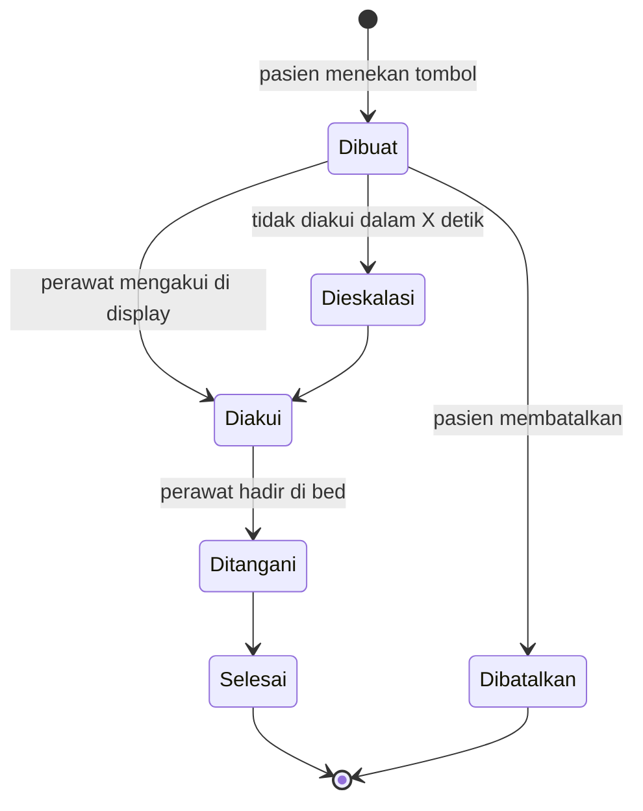

# Nurse View — Analisa Awal

| Field | Nilai |
|---|---|
| Blueprint ID | `nurse-view` |
| Revision | `0` — analisa awal, sebelum `grill-me` |
| Status | `draft` |
| Tanggal | 2026-10-28 |
| Owner Nurse View | **Rizki Gunawan** |
| Owner Rawat Inap (modul tetangga) | **Muhammad Hamzah** |
| Owner proses Gizi (modul tetangga) | Kepala Instalasi Gizi / Kepala Unit Gizi (`GIZ-DEC-014`) |
| Backend SHA | `a6f977a3` (branch `rizkiG`) |
| Frontend SHA | `76b0c6e4b` (branch `RizkiV2`) |

> **Sebagian besar isi dokumen ini sudah dilampaui.** Pada 2026-10-28 scope disederhanakan
> menjadi display pemantauan perawat per lantai tanpa interaksi pasien (`NV-DEC-004`). Tablet
> pasien, panggilan pasien, pemesanan makan, dan jadwal visite kini kandidat slice berikutnya.
> Keputusan yang berlaku ada di [`00-interview-decisions.md`](./00-interview-decisions.md).
> Dokumen ini disimpan sebagai jejak analisa awal.
>
> **Koreksi bagian 3 (2026-10-28).** Baris "Perawat jaga per shift" keliru menyebut pola IGD
> `AmbilDokterJagaAktifAsync` membaca roster HR; yang dibacanya `MstDoctorSchedule`. Peta yang
> berlaku: [`01-existing-capability-map.md`](./01-existing-capability-map.md).

Dokumen ini read-only terhadap source. Isinya pemetaan kebutuhan Nurse View terhadap kemampuan
yang sudah ada dan terhadap aturan blueprint Rawat Inap. **Belum ada satu pun keputusan** di
dalamnya; semua usulan menunggu `grill-me`.

## 0. Kenapa folder sendiri, bukan sub-modul Rawat Inap

Nurse View punya penanggung jawab yang berbeda dari Rawat Inap. Atas saran Muhammad Hamzah,
blueprint ini berdiri di folder sendiri dan **tidak** didaftarkan di registry sub-modul
[`rawat-inap/02-module-map.md`](../rawat-inap/02-module-map.md). Hubungannya dengan Rawat Inap
adalah konsumen data: Nurse View membaca episode, penempatan bed, dan penanggung jawab, tetapi
tidak menulis ke tabel milik Rawat Inap.

Uji pemecahan tetap dicatat karena menunjukkan Nurse View memang layak berdiri sendiri:

| Uji | Hasil |
|---|---|
| Bounded context sendiri | Ya — interaksi pasien ↔ perawat jaga di bangsal |
| Mesin status sendiri | Ya — siklus panggilan pasien |
| Master data sendiri | Ya — perangkat tablet per bed, perangkat display per unit |
| Peran pelaku sendiri | Ya — pasien/akun perangkat sebagai aktor baru, perawat jaga |
| Permission sendiri | Ya |

## 1. Kebutuhan dari owner

Dikutip dari permintaan Rizki Gunawan, 2026-10-28:

1. Interaksi pasien dengan perawat. Penghubungnya adalah **perawat jaga dengan bed**, untuk
   mengetahui siapa yang membutuhkan atau sedang memanggil perawat.
2. Pasien bisa **memesan makan**.
3. Perawat bisa **mengontrol vital sign** pasien.
4. Dua tampilan:
   - **Perawat** — berbentuk display.
   - **Pasien** — tampilan di tablet: pemesanan makanan, jadwal dokter yang akan visite, dan
     lainnya.

## 2. Temuan paling menentukan

1. **Tidak ada jejak Nurse View** di blueprint mana pun: tidak ada panggilan pasien, tablet di
   samping bed, maupun portal pasien.
2. **Nama `NurseCall` sudah terpakai dengan arti terbalik.** Antrean rawat jalan memakai
   `NurseCallExpiresAt` dan `NurseCallAttemptCount` di
   `Areas/HealthServices/RegistrationManagement/Controllers/NurseStationQueueController.cs` untuk
   perawat yang memanggil pasien. Entity baru perlu nama lain, misalnya `PatientCall` /
   "Panggilan Pasien".
3. **Menu dan siklus menu dikeluarkan dari scope Gizi** oleh `GIZ-DEC-013`. Pemesanan makan oleh
   pasien terhalang sampai Kepala Instalasi Gizi memutuskan ulang.
4. **Jadwal visite dokter belum ada sebagai rencana.** `CliPhysicianVisit` hanya mencatat visite
   yang sudah terjadi.
5. Sisanya — bed, penempatan, perawat penanggung jawab, TTV dengan EWS, diet, distribusi makanan,
   akun perangkat, SignalR — **sudah ada dan bisa dipakai ulang**.

## 3. Peta kemampuan existing

| Kebutuhan | Bukti di source | Status |
|---|---|---|
| Siapa yang menempati bed | `InpBedPlacement` sumber kebenaran; `MstBed.BedStatus` hanya salinan (lihat `InpatientMonitoringController` endpoint `bed-drift`) | Ready to reuse |
| Bed, kamar, unit, lantai | `MstBed` (`RoomId`), `MstRoom` (`ServiceUnitId`, `FloorCode`, `FloorPlanRoomKey`) | Ready to reuse |
| Denah bed | `GET bed-management/floor-plan`; FE `src/lib/constants/health-services/inpatient-management/floor-plan/schematic/lantai-*.schematic.js` | Ready to reuse — tata letak display perawat |
| Perawat penanggung jawab episode | `InpNurseAssignment` (`EpisodeId`, `EmployeeId`, berperiode) | Ready to reuse |
| Perawat jaga per shift | Roster HR: `TrxShiftAssignment`, `TrxRosterAssignment`. Pola pembacaan dokter jaga: `EmergencyDoctorAssignmentService.AmbilDokterJagaAktifAsync` | Adapter — tiru pola IGD untuk perawat |
| Jam shift perawat | `NursingShiftController` (`nursing-shifts`). `AC-KEP-093`: shift tidak menentukan siapa boleh menulis | Ready to reuse — hanya tampilan |
| TTV dan EWS | `PatientVitalSignController`: `EarlyWarningScore`, `EwsRiskLevel`, `GET critical-alerts`, `PATCH notify-doctor` | Ready to reuse — display membaca |
| Diet aktif pasien | `InpDietController` → `GziPatientDiet`; alur instruksi dan verifikasi `RWI-DEC-178`/`188` | Ready to reuse — pembatas pilihan makan |
| Jadwal makan, produksi, distribusi | `GziMealSchedule`, `GziProductionBatch`, `GziMealDelivery` | Extend |
| Menu, siklus menu, porsi | Tidak ada; di luar scope menurut `GIZ-DEC-013` | **Conflict** |
| DPJP episode | `InpDoctorAssignment` | Ready to reuse |
| Riwayat visite | `CliPhysicianVisit` (`VisitDateTime`, status `Recorded`/`Cancelled`) | Ready to reuse |
| Rencana jadwal visite | Tidak ada. `MstDoctorSchedule` adalah jadwal praktik rawat jalan | **Missing** |
| Realtime | `QueueHub` (`/hubs/queues`) sudah punya grup per unit rawat inap (`JoinInpatientBedSelection`, `InpBedRealtimeService`) | Extend — tambah grup di hub yang sama, `Program.cs` tidak disentuh |
| Akun perangkat | `MstKioskDevice` + policy `KioskRead`; `MstQueueDisplayDevice` (`TabletDisplay`, `PairingCode`, `DeviceToken`, `ShowPatientName`) | Adapter — display antrean terikat cluster poli, bukan unit atau bed |
| Layar tanpa sidebar di FE | Route `src/app/queue-display`, `src/app/kiosk`; klien `src/lib/signalr/signalrHubClient.jsx` | Ready to reuse — pola untuk `/nurse-display` dan `/bedside` |
| Panggilan pasien | Tidak ada | **Missing** — inti modul |

## 4. Aturan Rawat Inap yang wajib dihormati

| Aturan | Akibatnya bagi Nurse View |
|---|---|
| `InpBedPlacement` adalah sumber kebenaran penghuni bed | Tablet menentukan pasien dari penempatan aktif, bukan dari konfigurasi perangkat. Saat pindah kamar atau pulang, tablet berganti pasien atau terkunci, agar pasien baru tidak melihat data pasien lama |
| `RWI-DEC-081` — dokumentasi klinis milik `ClinicalManagement` | Tidak ada tabel TTV baru. Nurse View membaca dan menautkan ke form pengawasan harian yang sudah ada. Pasien tidak menginput TTV |
| `RWI-DEC-032` — episode tanpa perawat penanggung jawab tetap berjalan | Panggilan pasien wajib punya rute cadangan ke seluruh perawat jaga unit |
| `RWI-DEC-178`/`188` — diet atas instruksi dokter | Pilihan makan pasien dibatasi diet aktif. Perlu diputuskan perlakuan diet yang belum diverifikasi |
| `RWI-DEC-156` — tarif milik Billing | Makanan tambahan berbayar, bila ada, bertarif dari Billing |
| Pola `ShowPatientName` pada display | Nama pasien di display nurse station adalah keputusan privasi tersendiri |

## 5. Sketsa tampilan — usulan, belum keputusan

**Display perawat** — per unit/bangsal, layar besar, realtime:

- Kartu bed di atas denah: status bed, panggilan aktif dengan timer dan warna eskalasi, jenis
  panggilan, EWS terakhir dan TTV jatuh tempo, badge risiko jatuh dan alergi, pesanan makan
  menunggu.
- Panel samping: perawat jaga shift berjalan, visite dokter hari ini.

**Tablet pasien** — per bed:

- Tombol panggil perawat, dengan kategori bila disetujui, dan status
  terkirim → diterima → perawat menuju.
- Pemesanan makan sesuai diet per jadwal makan, dengan batas waktu pesan.
- Jadwal visite dokter.
- Nama perawat jaga.
- Jadwal makan.

**Usulan mesin status panggilan pasien:**

Waktu tanggap dicatat untuk laporan mutu.

## 6. Pertanyaan terbuka untuk `grill-me`

| ID | Pertanyaan | Penjawab |
|---|---|---|
| `NV-OQ-001` | Tablet menggantikan atau melengkapi bel kabel yang terpasang? Bila Wi-Fi atau tablet mati, pasien tidak bisa memanggil. Syarat sarana/akreditasi tentang bel pasien perlu diverifikasi, tidak dikarang | Rizki Gunawan |
| `NV-OQ-002` | Rute panggilan: perawat penanggung jawab, perawat jaga roster, atau semua perawat unit? Batas detik sebelum eskalasi, dan eskalasi ke siapa? | Rizki Gunawan |
| `NV-OQ-003` | Display perawat per unit atau per nurse station? Perlu notifikasi ke HP perawat? | Rizki Gunawan |
| `NV-OQ-004` | Tablet milik RS terpasang per bed (akun perangkat, pola Kiosk) atau perangkat pasien lewat QR gelang? QR gelang saat ini hanya memuat No. RM | Rizki Gunawan |
| `NV-OQ-005` | Pemesanan makan: memilih menu dalam batas diet, atau hanya preferensi (porsi, pantangan)? Siapa penyusun master menu? Ada makanan berbayar? Membuka ulang `GIZ-DEC-013` | Kepala Instalasi Gizi |
| `NV-OQ-006` | Jadwal visite: dokter wajib mengisi rencana jam visite, atau tablet cukup menampilkan DPJP dan visite terakhir? | Rizki Gunawan, dengan Muhammad Hamzah bila menyentuh `dokter-rawat-inap` |
| `NV-OQ-007` | Data klinis apa yang boleh dilihat pasien di tablet (TTV, hasil penunjang)? Menyangkut perlindungan data pribadi | Rizki Gunawan |
| `NV-OQ-008` | "Mengontrol vital sign": cukup memantau EWS di display, atau integrasi otomatis dengan monitor pasien? Yang kedua jauh lebih besar dan sebaiknya bukan MVP | Rizki Gunawan |
| `NV-OQ-009` | Nama pasien tampil di display nurse station? | Rizki Gunawan |

## 7. Ketergantungan ke modul tetangga

| Modul | Yang dipakai Nurse View | Arah |
|---|---|---|
| Rawat Inap (Muhammad Hamzah) | Episode aktif, `InpBedPlacement`, `InpNurseAssignment`, `InpDoctorAssignment`, denah | Baca saja |
| Clinical Management | TTV, EWS, critical alerts, riwayat visite | Baca saja |
| Gizi | Diet aktif, jadwal makan, distribusi; menu menunggu `NV-OQ-005` | Baca; tulis pesanan bila disetujui |
| HR Scheduling | Roster perawat jaga | Baca saja |
| Administrator Master Data | Pola akun perangkat Kiosk dan display antrean | Pola, bukan data |
| Billing | Tarif makanan tambahan, bila ada | Menunggu `NV-OQ-005` |

## 8. Langkah berikutnya

Mengikuti chain di `NewQuilvianSystemBackend/CLAUDE.md`:

1. `grill-me` — menutup `NV-OQ-001` s.d. `009`.
2. `trace-existing-capabilities` — audit formal, menggantikan bagian 3 dokumen ini.
3. `requirement-completeness-gate`.
4. `hospital-domain-architect` — relevan: melintasi Gizi, HR, Clinical, dan Billing, serta
   berdampak pada keselamatan klinis.
5. `design-business-module`.
6. `plan-module-delivery`.
