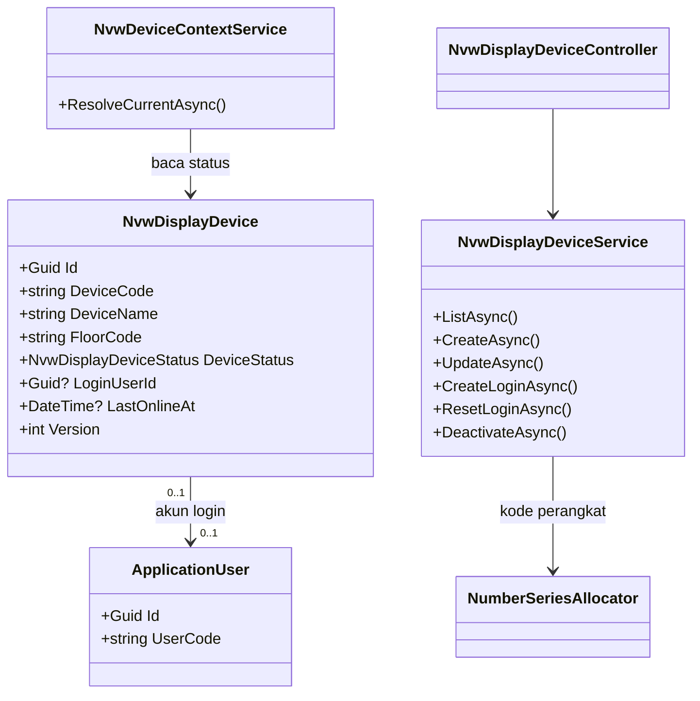
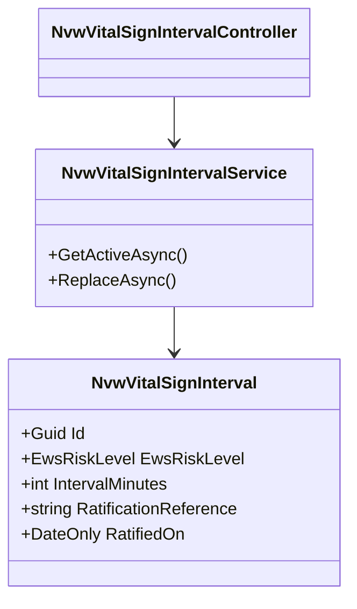
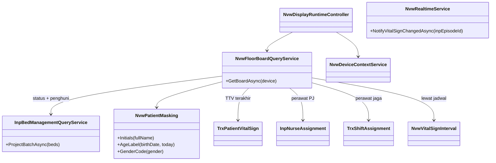
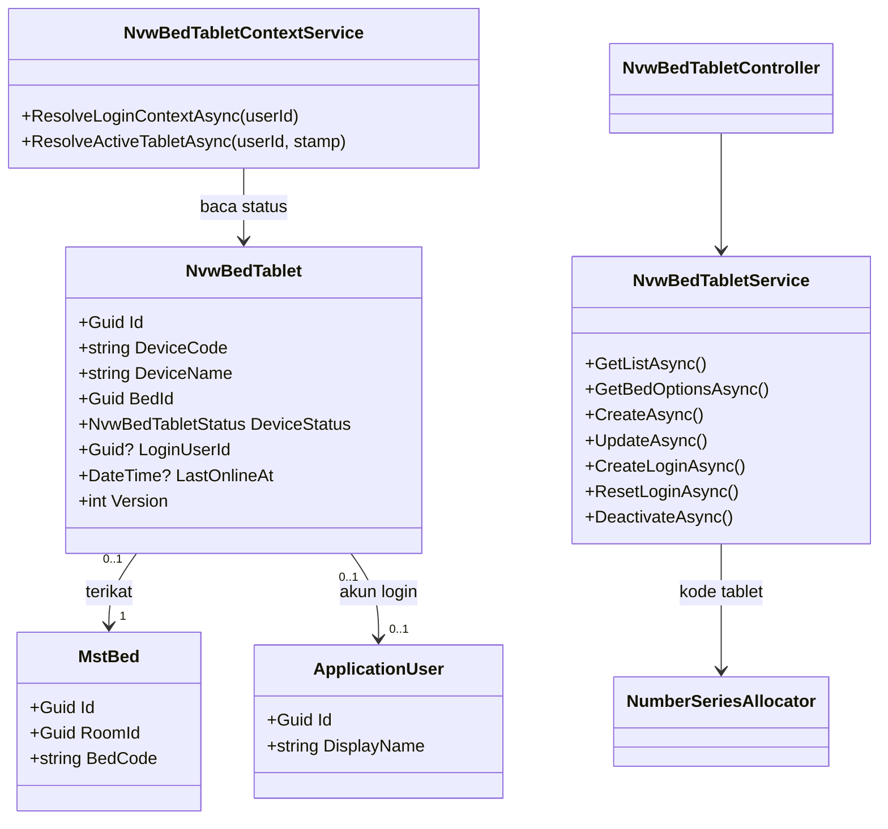
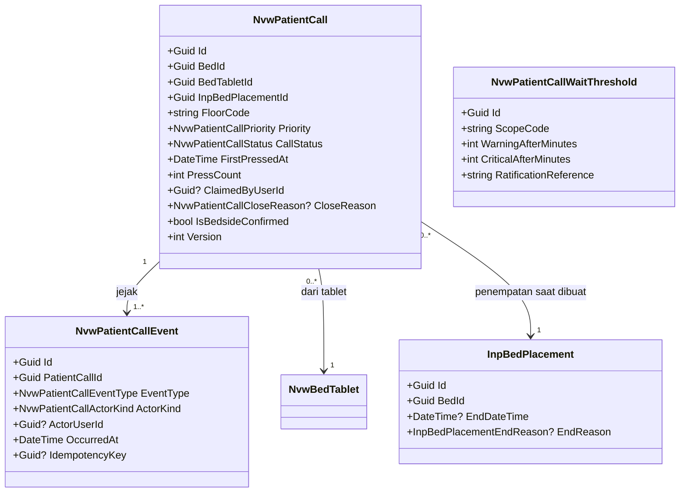
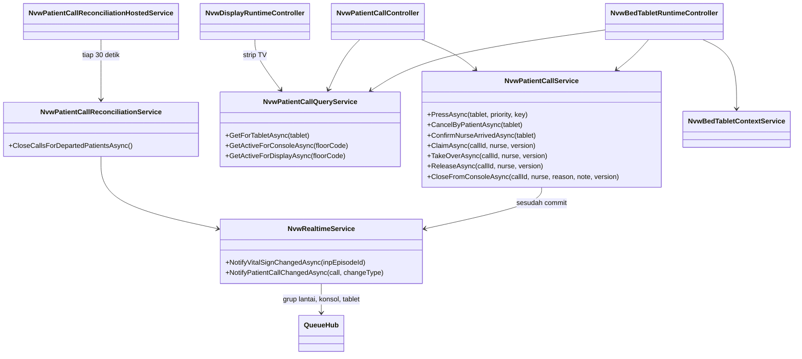

# Arsitektur Backend — Nurse View

| Field | Nilai |
|---|---|
| Blueprint ID | `nurse-view` |
| Revision | `1` |
| Status | `approved` — Rizki Gunawan, 2026-10-28 (`NV-DEC-028`) |
| Owner | Rizki Gunawan |
| Contract version | `0.1.0` (lihat `blueprint-manifest.md`) |
| `domain_architecture_readiness` | `DOMAIN_ARCHITECTURE_NOT_RUN` — modul hanya membaca data, tanpa master bersama dan tanpa billing (`02-requirement-completeness-assessment.md` bagian 7) |
| Masukan | `00-interview-decisions.md` rev `2`, `01-existing-capability-map.md` rev `1`, `02-requirement-completeness-assessment.md` rev `1` |
| Backend SHA | `a6f977a3` |
| Prasyarat implementasi | Baris registry `HealthServices / NurseViewManagement / Nvw` ditulis lebih dulu di MVP-0 (`NV-DEC-029`, `QBE-MOD-002`); berkas bersama direstui lead dengan syarat (`NV-DEC-030`) |

> Seluruh nama `Nvw*` di dokumen ini adalah **usulan** sampai baris registry disetujui. Sebelum
> itu, satu file model pun tidak boleh dibuat.

> **Revision 2 (`approved` `NV-DEC-055`, kontrak `0.2.0`) — 2026-11-05.** Tablet bed dan panggilan pasien
> (Amendment revision 5) dirancang di bagian
> [Revision 2](#revision-2--tablet-bed-dan-panggilan-pasien) di akhir dokumen. Bagian 1–11
> di bawah tetap revision 1 yang sudah `approved` dan tidak disunting.

## 1. Bounded context dan ownership

Nurse View adalah **konteks baca**. Ia menyusun papan per lantai dari data milik modul lain dan
hanya memiliki dua kelompok data kecil: perangkat display dan interval ukur ulang TTV.

| Konteks | Aggregate root | Invariant | Batas transaksi |
|---|---|---|---|
| Perangkat display | `NvwDisplayDevice` | (1) Kode perangkat unik dan diterbitkan number series. (2) Satu perangkat paling banyak satu akun login. (3) Perangkat `Inactive` tidak pernah lolos runtime. (4) Satu perangkat terikat tepat satu lantai | Satu perangkat per transaksi. Pembuatan login: simpan perangkat + akun dalam satu alur; bila pembuatan akun gagal, status perangkat tidak berubah |
| Interval ukur ulang TTV | Himpunan `NvwVitalSignInterval` aktif (ganti-seluruh, pola `NursingShift`) | (1) Satu baris aktif per tingkat EWS. (2) Hanya `Low`, `Medium`, `High`, `Critical`. (3) Setiap himpunan wajib punya rujukan pengesahan. (4) Tidak ada angka bawaan (`G-01`) | Satu transaksi: baris aktif lama ditandai hapus, baris baru disisipkan. Gagal → tidak ada yang berubah |
| Papan lantai (read model) | — tidak dipersistensi | (1) Penghuni dari penempatan aktif, bukan salinan. (2) Identitas disamarkan **di backend**. (3) Perangkat hanya membaca lantainya | Baca saja, `AsNoTracking`, tanpa transaksi |

**Contoh invariant perangkat.** Admin menonaktifkan `NVW-000003` pukul 10.00. TV yang masih
memegang token login meminta papan pukul 10.00.30. Runtime memeriksa status perangkat pada
**setiap** permintaan, menemukan `Inactive`, dan menolak dengan kode 403. TV kembali ke layar
login.

## 2. Tabel kepemilikan data

| Kelompok data | Modul pemilik | Dipakai modul ini | Dibuat ulang di modul ini |
|---|---|:---:|---|
| Pasien (nama, jenis kelamin, tanggal lahir) | Patient Management | Ya | **Tidak** — dibaca lalu disamarkan, tidak disimpan |
| Episode rawat inap, kebutuhan isolasi | Rawat Inap `episode-rawat-inap` | Ya | Tidak |
| Penempatan, reservasi, kesiapan bed, status bed | Rawat Inap `episode-rawat-inap` | Ya | Tidak — lewat `ProjectBatchAsync` |
| Perawat penanggung jawab | Rawat Inap `episode-rawat-inap` | Ya | Tidak |
| Bed, kamar, lantai, bangsal | Master Data HealthServices | Ya | Tidak |
| TTV dan EWS | Clinical Management / `rawat-inap/keperawatan` | Ya | Tidak |
| Hasil instrumen risiko jatuh | Clinical Management / `rawat-inap/keperawatan` | Ya | Tidak |
| Alergi pasien | Clinical Management | Ya | Tidak |
| Roster shift, profesi | HR Scheduling, HR Master Data | Ya | Tidak |
| Akun login | Platform Identity (`ApplicationUser`) | Ya | Tidak — satu akun dibuat per perangkat, tabelnya tetap milik Identity |
| Nomor bisnis | Platform Number Series | Ya | Tidak — `NumberSeriesAllocator` |
| **Perangkat display Nurse View** | **Nurse View** | Ya | **Ya** — tidak ada pemilik lain; `MstQueueDisplayDevice` terikat cluster poli (`NV-DEC-016`) |
| **Interval ukur ulang TTV per tingkat EWS** | **Nurse View** | Ya | **Ya** — tidak ada di mana pun; `EwsMonitoringRecommendation` hanya teks (`NV-CAP-08`) |

## 3. Class diagram

### 3.1 Konteks perangkat display



### 3.2 Konteks interval ukur ulang TTV



### 3.3 Konteks papan lantai (baca saja)



## 4. Penjelasan setiap class

### 4.1 `NvwDisplayDevice`

| Aspek | Penjelasan |
|---|---|
| **Status** | `Baru` |
| **Lokasi file** | `Areas/HealthServices/NurseViewManagement/Models/NvwDisplayDevice.cs` |
| Kategori | Transaksi/konfigurasi milik modul (bukan master bersama) |
| Tanggung jawab utama | Mewakili satu TV di nurse station. Menyimpan lantai yang ditampilkannya, status pakainya, dan akun login yang ia gunakan. Tidak menyimpan kata sandi |
| Field penting | `DeviceCode`, `DeviceName`, `FloorCode`, `LocationName`, `DeviceStatus`, `LoginUserId`, `LastOnlineAt`, `LoginIssuedAt`, `DeactivatedAt`, `DeactivationReason`, `Version` |
| Navigation property dan relasi | `LoginUser` → `ApplicationUser` (0..1, `Restrict`) |
| Pemakaian dalam alur bisnis | Admin IT mendaftarkan TV, membuat login, menonaktifkan bila TV rusak/hilang. Runtime membacanya pada setiap permintaan TV |
| Catatan desain | `DeviceCode` **wajib** dari `NumberSeriesAllocator` (`QBE-CODE-002/003/006`), bukan pola `Max+1` milik `QueueDisplayDeviceController.GenerateCodeAsync` (utang teknis, jangan ditiru). Kata sandi hanya ada di response pembuatan/atur ulang login |
| Ekuivalen model lama | — (pola dirujuk: `MstQueueDisplayDevice`) |

### 4.2 `NvwVitalSignInterval`

| Aspek | Penjelasan |
|---|---|
| **Status** | `Baru` |
| **Lokasi file** | `Areas/HealthServices/NurseViewManagement/Models/NvwVitalSignInterval.cs` |
| Kategori | Konfigurasi klinis milik modul |
| Tanggung jawab utama | Menyimpan berapa menit paling lama TTV boleh tidak diukur ulang untuk satu tingkat risiko EWS, beserta bukti pengesahannya oleh Komite Keperawatan |
| Field penting | `EwsRiskLevel`, `IntervalMinutes`, `RatificationReference`, `RatifiedOn` |
| Navigation property dan relasi | Tidak ada FK; `EwsRiskLevel` memakai enum milik Clinical |
| Pemakaian dalam alur bisnis | Admin memasukkan angka **sesudah** Komite mengesahkan. Papan memakainya untuk tanda "lewat jadwal" |
| Catatan desain | Arketipe ganti-seluruh seperti `NursingShiftController`. Baris lama tidak ditimpa, melainkan ditandai `IsDelete`, sehingga riwayat pengesahan dapat ditelusuri. **Tidak ada seed angka** |
| Ekuivalen model lama | — |

### 4.3 `NvwDisplayDeviceService`

| Aspek | Penjelasan |
|---|---|
| **Status** | `Baru` |
| **Lokasi file** | `Areas/HealthServices/NurseViewManagement/Services/NvwDisplayDeviceService.cs` |
| Kategori | Service |
| Tanggung jawab utama | Daftar, detail, buat, ubah, buat login, atur ulang login, nonaktifkan perangkat |
| Dipanggil oleh | `NvwDisplayDeviceController` |
| Membuka transaksi database | Ya, untuk buat login dan atur ulang login (perangkat + akun). Buat/ubah/nonaktifkan: satu `SaveChangesAsync` |
| Catatan desain | Memakai `UserManager<ApplicationUser>` seperti `QueueDisplayDeviceController`. Nonaktifkan → kunci akun (`SetLockoutEndDateAsync` jauh ke depan) + perbarui security stamp. Atur ulang login → kata sandi baru + security stamp baru + buka kunci |

### 4.4 `NvwVitalSignIntervalService`

| Aspek | Penjelasan |
|---|---|
| **Status** | `Baru` |
| **Lokasi file** | `Areas/HealthServices/NurseViewManagement/Services/NvwVitalSignIntervalService.cs` |
| Tanggung jawab utama | Membaca himpunan aktif; mengganti seluruh himpunan |
| Dipanggil oleh | `NvwVitalSignIntervalController`, `NvwFloorBoardQueryService` |
| Membuka transaksi database | Ya, pada `ReplaceAsync` |

### 4.5 `NvwDeviceContextService`

| Aspek | Penjelasan |
|---|---|
| **Status** | `Baru` |
| **Lokasi file** | `Areas/HealthServices/NurseViewManagement/Services/NvwDeviceContextService.cs` |
| Tanggung jawab utama | Menemukan perangkat milik akun yang login (`LoginUserId == user id`), menolak bila tidak ada atau `Inactive`, dan memperbarui `LastOnlineAt` paling sering sekali per 60 detik agar muat ulang tidak menulis ke database setiap kali |
| Dipanggil oleh | `NvwDisplayRuntimeController`, `QueueHub.JoinNurseViewFloor` |
| Membuka transaksi database | Tidak; satu `SaveChangesAsync` kecil bila `LastOnlineAt` perlu diperbarui |

### 4.6 `NvwFloorBoardQueryService`

| Aspek | Penjelasan |
|---|---|
| **Status** | `Baru` |
| **Lokasi file** | `Areas/HealthServices/NurseViewManagement/Services/NvwFloorBoardQueryService.cs` |
| Tanggung jawab utama | Menyusun papan satu lantai dengan jumlah query tetap per permintaan |
| Dipanggil oleh | `NvwDisplayRuntimeController` |
| Membuka transaksi database | Tidak |

Urutan penyusunan, satu query per langkah, tanpa query per bed:

1. Kamar aktif dengan `FloorCode` = lantai perangkat (tanpa syarat `FloorPlanRoomKey`, `NV-DEC-025`).
2. Bed aktif di kamar itu.
3. `InpBedManagementQueryService.ProjectBatchAsync(beds)` → status bed + penempatan/reservasi.
   `HoldingContext` **diabaikan** (memuat nama lengkap dan No. RM).
4. Episode + pasien untuk episode yang menempati/memesan bed.
5. `InpNurseAssignment` aktif per episode.
6. TTV sah terakhir per episode: `InpEpisodeId` cocok, `VitalSignStatus` ∈ {`Recorded`, `Verified`, `Corrected`}, `IsActive`, tidak dihapus; terbaru menurut `ObservationDateTime`.
7. Hasil instrumen `FallRiskScale` terakhir per episode dari pengkajian `Completed`.
8. Ada/tidaknya alergi `Active` per pasien.
9. Roster: `TrxShiftAssignment` `Published`, bukan libur, `ScheduledStartAt ≤ sekarang < ScheduledEndAt`, `OrganizationUnitId` = organisasi bangsal, profesi perawat atau bidan. Sejak `0.1.2` (`NV-DEC-033`): unit kosong → `TrxRosterPeriod.OrganizationUnitId`; profesi roster kosong → `MstEmployee.ProfessionId`; profesi disaring `IsClinicalProfession` + `MapCpptProfessionType`.
10. Interval aktif.
11. Penyamaran identitas dan perhitungan "lewat jadwal" di memori.

**Bentuk adapter langkah 3 dikunci:** metode `internal` dipanggil langsung, disetujui Muhammad
Hamzah 2026-10-28 (`TLM-NV-001` episode, `NV-DEC-027`).

### 4.7 `NvwPatientMasking`

| Aspek | Penjelasan |
|---|---|
| **Status** | `Baru` |
| **Lokasi file** | `Areas/HealthServices/NurseViewManagement/Helpers/NvwPatientMasking.cs` |
| Tanggung jawab utama | Mengubah identitas pasien menjadi samaran (`NV-DEC-008`, `G-04`) |
| Membuka transaksi database | Tidak; fungsi murni |

| Aturan | Contoh |
|---|---|
| Inisial: huruf pertama setiap kata nama, paling banyak 3, huruf besar, diakhiri titik | "Budi Santoso" → "B.S."; "Siti Nur Aminah Rahma" → "S.N.A." |
| Jenis kelamin: `L`, `P`, atau "–" bila kosong | — |
| Umur ≥ 1 tahun: tahun penuh | lahir 1962-03-10, hari ini 2026-10-28 → "64 th" |
| Umur 1 bulan s.d. < 1 tahun: bulan penuh | lahir 2026-05-01 → "5 bln" |
| Umur < 1 bulan: hari | lahir 2026-10-23 → "5 hr" |
| Tanggal lahir kosong | "Umur –" |

Tanggal "hari ini" memakai jam operasional Asia/Jakarta (`G-08`), sama seperti `GetOperationalNow` di IGD.

### 4.8 `NvwRealtimeService`

| Aspek | Penjelasan |
|---|---|
| **Status** | `Baru` |
| **Lokasi file** | `Areas/HealthServices/NurseViewManagement/Services/NvwRealtimeService.cs` |
| Tanggung jawab utama | Sesudah TTV rawat inap tersimpan/dibatalkan, mencari bed dan lantai pasien lalu mengirim sinyal `NurseViewBoardChanged` tanpa identitas ke grup `nurse-view-floor:{FloorCode}` |
| Dipanggil oleh | `PatientVitalSignController` — **perubahan lintas modul**, `TLM-NV-001` keperawatan, menunggu `NV-OQ-016` |
| Membuka transaksi database | Tidak. Best-effort: seluruh galat ditangkap dan dicatat log, tidak pernah dilempar ke pemanggil |

### 4.9 Controller

| Controller | Status | Lokasi | Service yang dipakai | Atribut akses | Endpoint |
|---|---|---|---|---|---|
| `NvwDisplayDeviceController` | `Baru` | `Areas/HealthServices/NurseViewManagement/Controllers/NvwDisplayDeviceController.cs` | `NvwDisplayDeviceService` | `[Authorize]`, `[AccessController]` modul `HEALTH_SERVICE_NURSE_VIEW`, `[AccessPermission("NurseViewDisplayDevice", ...)]` | Lihat `contracts/api-contract.md` §1 |
| `NvwVitalSignIntervalController` | `Baru` | `.../Controllers/NvwVitalSignIntervalController.cs` | `NvwVitalSignIntervalService` | `[AccessPermission("NurseViewVitalSignInterval", ...)]` | §2 |
| `NvwDisplayRuntimeController` | `Baru` | `.../Controllers/NvwDisplayRuntimeController.cs` | `NvwDeviceContextService`, `NvwFloorBoardQueryService` | `[Authorize(Policy = NurseViewDisplayRead)]`, **tanpa** `[AccessPermission]` (akun perangkat, pola `QueueDisplayRuntimeController`) | §3 |

### 4.10 Berkas bersama yang disentuh — direstui lead dengan syarat (`NV-DEC-030`)

**Syarat lead yang mengikat seluruh baris di bawah:** (1) login pengguna biasa, Kiosk, display antrean, dan akun lain tidak boleh terganggu — dibuktikan `NV-AC-023`–`027`; (2) pola disamakan dengan display antrean. Konsekuensi desain: resolver Nurse View di `AuthController` dipanggil **sesudah** resolver Kiosk dan display antrean tanpa mengubah keduanya, hanya menambah klaim bila akun cocok dengan perangkat Nurse View, dan untuk akun lain menulis `is_nurse_view_account = false` persis seperti pola `is_queue_display_account`. Isi policy dan redirect lama tidak disunting; yang ada hanya penambahan.

| Berkas | Status | Perubahan minimal |
|---|---|---|
| `Controllers/AuthController.cs` | `Diperbarui` | Resolver baru: bila akun adalah `LoginUserId` perangkat Nurse View berstatus `Active`, tambahkan klaim `is_nurse_view_account = true` dan `nurse_view_device_id`, serta `nurse_view_session_stamp` agar sesi lama gugur sesudah Atur Ulang Login. Akun perangkat `Inactive` ditolak login (`NV-DEC-031`) |
| `Constants/AuthorizationPolicies.cs` | `Diperbarui` | Konstanta `NurseViewDisplayRead`; ditambahkan ke `ApprovedAlternativeAuthorization` |
| `Program.cs` | `Diperbarui` | Satu `AddPolicy(NurseViewDisplayRead)`: wajib klaim `nurse_view_device_id`. **Tanpa** role `SuperAdmin`/`Administrator` sebagai jalan pintas, agar akun manusia tidak pernah menerima papan publik. Registrasi `AddScoped` ke-6 service (ketentuan "jangan menambah kode ke `Program.cs`" dikecualikan hanya bila lead merestui) |
| `Hubs/QueueHub.cs` | `Diperbarui` | Metode `JoinNurseViewFloor()` **tanpa parameter**: lantai diambil dari perangkat milik akun, sehingga TV tidak bisa memilih lantai lain |
| `Areas/HealthServices/ClinicalManagement/Controllers/PatientVitalSignController.cs` | `Diperbarui` | Satu panggilan `NvwRealtimeService` sesudah commit pada POST, PUT, PATCH cancel (`TLM-NV-001` keperawatan, `NV-OQ-016`) |

## 5. Arsitektur folder

```text
NewQuilvianSystemBackend/
├── Areas/HealthServices/NurseViewManagement/            # BARU — registry ditulis di MVP-0 (NV-DEC-029)
│   ├── Controllers/
│   │   ├── NvwDisplayDeviceController.cs                 # Baru
│   │   ├── NvwVitalSignIntervalController.cs             # Baru
│   │   └── NvwDisplayRuntimeController.cs                # Baru
│   ├── DTOs/
│   │   ├── NvwDisplayDeviceDtos.cs                       # Baru
│   │   ├── NvwVitalSignIntervalDtos.cs                   # Baru
│   │   └── NvwFloorBoardDtos.cs                          # Baru
│   ├── Enums/
│   │   └── NvwDisplayDeviceStatus.cs                     # Baru
│   ├── Helpers/
│   │   └── NvwPatientMasking.cs                          # Baru
│   ├── Models/
│   │   ├── NvwDisplayDevice.cs                           # Baru
│   │   └── NvwVitalSignInterval.cs                       # Baru
│   └── Services/
│       ├── NvwDisplayDeviceService.cs                    # Baru
│       ├── NvwVitalSignIntervalService.cs                # Baru
│       ├── NvwDeviceContextService.cs                    # Baru
│       ├── NvwFloorBoardQueryService.cs                  # Baru
│       └── NvwRealtimeService.cs                         # Baru
├── Repositories/
│   ├── ApplicationDbContext.cs                           # Diperbarui — 2 DbSet
│   └── Configurations/HealthServices/NurseViewManagement/
│       ├── NvwDisplayDeviceConfiguration.cs              # Baru
│       └── NvwVitalSignIntervalConfiguration.cs          # Baru
├── Controllers/AuthController.cs                         # Diperbarui — NV-DEC-030
├── Constants/AuthorizationPolicies.cs                    # Diperbarui — NV-DEC-030
├── Program.cs                                            # Diperbarui — NV-DEC-030
├── Hubs/QueueHub.cs                                      # Diperbarui — NV-DEC-030
├── Areas/HealthServices/ClinicalManagement/Controllers/
│   └── PatientVitalSignController.cs                     # Diperbarui — NV-OQ-016
├── Areas/Administrator/MasterData/Controllers/
│   └── QueueDisplayDeviceController.cs                   # Sudah ada — controller akses DbContext langsung + Max+1: utang teknis, jangan ditiru
└── Migrations/<timestamp>_AddNurseViewManagement.cs      # Baru — dibuat Rizki sendiri
```

## 6. Status model

| Entity | Status | Dampak migration |
|---|---|---|
| `NvwDisplayDevice` | `Baru` | Tabel baru `public."NvwDisplayDevice"` |
| `NvwVitalSignInterval` | `Baru` | Tabel baru `public."NvwVitalSignInterval"` |
| `ApplicationUser` | `Sudah ada` | Tidak ada kolom baru; baris akun perangkat dibuat lewat `UserManager` saat runtime |
| Seluruh entity Rawat Inap, Clinical, HR, Patient | `Sudah ada` | Tidak ada |

### Enum baru `NvwDisplayDeviceStatus`

| Nilai | Angka | Arti |
|---|---:|---|
| `PendingLogin` | 1 | Terdaftar, belum punya login. **Bawaan** saat dibuat |
| `Active` | 2 | Punya login dan boleh menampilkan papan |
| `Inactive` | 3 | Dinonaktifkan; login dikunci |

## 7. Rencana migration

| Urutan | Nama | Isi | Tanpa downtime? | Data lama | Cara mundur |
|---:|---|---|:---:|---|---|
| 1 | `AddNurseViewManagement` | Buat `NvwDisplayDevice` dan `NvwVitalSignInterval` beserta index | Ya — hanya tabel baru, tidak menyentuh tabel lain | Tidak ada | `Down()` menghapus kedua tabel. Akun `ApplicationUser` perangkat yang terlanjur dibuat dikunci manual oleh admin |

Migration dibuat dan dijalankan **Rizki sendiri**. Agent berhenti sebelum `dotnet ef migrations add`.

## 8. Rencana data master awal

| Data | Isi minimum | Sumber nilai |
|---|---|---|
| `NvwDisplayDevice` | **Kosong.** Satu baris dibuat admin per TV saat pemasangan | Inventaris TV per lantai dari IT |
| `NvwVitalSignInterval` | **Kosong, dengan sengaja** (`G-01`). Selama kosong, tanda "lewat jadwal" tidak tampil | SK/notulen Komite Keperawatan (`NV-OQ-010`) |
| Deret `NVW_DISPLAY_DEVICE` di number series | Tidak perlu seed. Deret lahir pada alokasi pertama (`NumberSeriesAllocator`), awalan `NVW`, 6 digit, `ResetPolicy = NEVER`. **Contoh:** perangkat pertama `NVW-000001` | Konvensi number series |
| Hak akses peran Admin IT | `NurseViewDisplayDevice : Read/Create/Update`, `NurseViewVitalSignInterval : Read/Update` | Diberikan lewat layar Akses Role. **Ingat:** POST role-access menimpa seluruh policy peran; tambahkan, jangan ganti |

Prasyarat data milik modul lain (`G-06`, daftar periksa go-live): `MstRoom.FloorCode` terisi,
versi instrumen risiko jatuh `Approved`, `MstServiceUnit.OrganizationUnitId` bangsal terisi.

## 9. Keamanan, privasi, observability

| Hal | Desain |
|---|---|
| Autentikasi perangkat | Login biasa memakai akun perangkat; klaim perangkat ditambahkan `AuthController` |
| Otorisasi perangkat | Policy `NurseViewDisplayRead` + pemeriksaan status perangkat di setiap permintaan. Lantai **selalu** dari perangkat, tidak pernah dari query string |
| Data minimal | Response papan tidak memuat `FullName`, `MedicalRecordNumber`, nama alergen, nama DPJP, diagnosis. Diuji `NV-AC-002`, `012` |
| Grup realtime terlarang | Akun perangkat tidak punya izin `InpatientBedOccupancy : Read` / `InpatientEpisode : Read`, sehingga `JoinInpatientBedSelection` menolaknya (`NV-AC-022`) |
| Logging | Create/Update/CreateLogin/ResetLogin/Deactivate/Replace interval dicatat `LoggerService` dengan `EntityId`, `DeviceCode`, aksi. **Kata sandi tidak pernah masuk log.** GET tidak dicatat |
| Audit | `IdentityModel` (pembuat/pengubah/penghapus); `LoginIssuedAt`/`LoginIssuedBy`, `DeactivatedAt`/`DeactivatedBy`/`DeactivationReason` pada perangkat; `RatificationReference` + `RatifiedOn` + `CreateBy` pada interval (`G-03`) |
| Observability | `LastOnlineAt` per perangkat terlihat di daftar admin (`G-07`). Kegagalan sinyal realtime dicatat log error |

## 10. Yang sengaja tidak dibuat

| Yang ditolak | Alasan |
|---|---|
| `MstNurseViewDisplayDevice` di `MasterData` | `NV-DEC-016`, `024`: perangkat milik Nurse View, bukan master bersama |
| Memakai `MstQueueDisplayDevice` | Wajib terikat cluster poli rawat jalan (`NV-CAP-12`) |
| Tabel salinan penghuni bed / snapshot papan | Penghuni wajib dibaca dari penempatan aktif; salinan akan basi (invariant papan 1) |
| Tabel jadwal TTV per pasien | Jatuh tempo dihitung dari TTV terakhir + interval; menyimpannya berarti dua sumber |
| Kolom jenis isolasi | Milik Rawat Inap, `NV-OQ-013` |
| Endpoint pratinjau papan untuk akun manusia | Bukan keputusan owner; papan hanya untuk TV pasif (`NV-DEC-009`). Ditinjau bila UAT membutuhkannya |
| Mengikuti event `InpatientBedSelectionChanged` | Payload memuat nama lengkap (`NV-DEC-026`) |
| Kode perangkat dengan `Max+1` | Dilarang `QBE-CODE-002/003` |
| Panggilan pasien, tablet, pesan makan, jadwal visite | Di luar scope (`NV-DEC-004`) |

## 11. Strategi uji

Mengikuti ketentuan proyek: agent tidak menulis maupun menjalankan unit test. Verifikasi agent
cukup eslint/QBE; pengujian milik Rizki dan tim UAT. Skenario ada di
`testing/acceptance-test-matrix.md`.

## Revision 2 — Tablet bed dan panggilan pasien

| Field | Nilai |
|---|---|
| Revision | `2` · status `approved` — Rizki Gunawan, 2026-11-05 (`NV-DEC-055`) |
| Contract version | `0.2.0` `approved` (lihat `blueprint-manifest.md`). Kontrak `0.1.2` tetap berlaku untuk bagian revision 1 |
| `domain_architecture_readiness` | `DOMAIN_ARCHITECTURE_NOT_RUN` — satu bounded context Nurse View, tanpa master bersama, tanpa billing; batas keselamatan klinis diputuskan owner (`02-requirement-completeness-assessment.md` R2.7) |
| Masukan | `00-interview-decisions.md` rev `5` draft (`NV-DEC-034`–`054`, `NV-AC-028`–`045`); `01-existing-capability-map.md` rev `2` (`NV-CAP-17`–`29`); `02-requirement-completeness-assessment.md` rev `2` (R2.10, seluruh `NV-S8` `READY_FOR_DOMAIN_DESIGN`) |
| Backend SHA | `0c6eab34` (branch `rizkiG`) |
| Prasyarat implementasi | (1) Blueprint revision 2 disetujui owner — **terpenuhi 2026-11-05 (`NV-DEC-055`)**. (2) Restu lead `NV-OQ-028` untuk berkas bersama di R2.5. Registry `Nvw` sudah `ACTIVE`, jadi `QBE-MOD-002` tidak menghalangi |

### R2.1 Bounded context dan ownership

Revision 2 menambah tiga kelompok data milik Nurse View dan tiga tampilan baca. Seluruhnya tetap
di bounded context Nurse View; Rawat Inap hanya dibaca.

| Konteks | Aggregate root | Invariant | Batas transaksi |
|---|---|---|---|
| Perangkat tablet bed | `NvwBedTablet` | (1) Kode tablet unik, dari number series. (2) Satu tablet terikat tepat satu bed. (3) Satu bed paling banyak satu tablet yang belum nonaktif (`AD-01`). (4) Tablet `Inactive` tidak pernah lolos runtime. (5) Akun tablet **tidak pernah** lolos policy TV, dan akun TV tidak pernah lolos policy tablet | Satu tablet per transaksi; pembuatan login sama dengan perangkat display: bila akun gagal dibuat, status tablet tidak berubah |
| Panggilan pasien | `NvwPatientCall`, beserta jejaknya `NvwPatientCallEvent` | (1) Satu bed paling banyak satu panggilan aktif (`Waiting` atau `Claimed`) (`NV-DEC-039`). (2) Jam awal tidak pernah berubah. (3) Prioritas hanya naik (`NV-DEC-039`; turun = usulan `G-13`). (4) Satu panggilan paling banyak satu pengklaim (`NV-DEC-040`). (5) Panggilan selesai tidak dibuka ulang (`G-12`). (6) Setiap perubahan menulis tepat satu baris jejak | Satu perintah = satu `SaveChanges`: ubah panggilan + sisipkan jejak. Sinyal realtime dikirim **sesudah** commit, best-effort |
| Ambang lama menunggu | `NvwPatientCallWaitThreshold` (satu baris aktif, ganti-seluruh) | (1) Tanpa angka bawaan (`G-15`). (2) Kuning < merah. (3) Wajib rujukan pengesahan Komite (`NV-DEC-048`) | Satu transaksi: baris aktif lama ditandai hapus, baris baru disisipkan |
| Strip TV, Konsol, runtime tablet (read model) | — tidak dipersistensi | (1) TV tanpa identitas pasien; konsol hanya inisial, jenis kelamin, umur (`NV-DEC-044`). (2) Urutan: Darurat dulu, lalu paling lama menunggu (`NV-DEC-038`). (3) Lantai TV dan tablet selalu dari perangkat, bukan dari request | Baca saja, `AsNoTracking` |

**Contoh invariant 1 panggilan.** Tablet 305-A mengirim "Panggil perawat" pukul 10.00.00.
Karena jaringan tersendat, tablet mengirim ulang permintaan yang sama 2 detik kemudian dengan
`Idempotency-Key` yang sama: sistem mengembalikan panggilan yang sudah ada tanpa jejak baru.
Pukul 10.00.40 pasien menekan lagi dengan kunci baru: sistem tidak membuat panggilan kedua,
hanya menambah `PressCount` menjadi 2 dan menulis jejak `PressedAgain`. Jam awal tetap 10.00.00.

### R2.2 Tabel kepemilikan data — tambahan revision 2

| Kelompok data | Modul pemilik | Dipakai modul ini | Dibuat ulang di modul ini |
|---|---|:---:|---|
| Penempatan bed aktif, akhir penempatan (`EndDateTime`, `EndReason`) | Rawat Inap `episode-rawat-inap` | Ya | **Tidak** — dibaca langsung (`NV-CAP-18`, `19`) |
| Bed, kamar, lantai | Master Data HealthServices | Ya | Tidak (`NV-CAP-17`) |
| Akun login tablet | Platform Identity (`ApplicationUser`) | Ya | Tidak — satu akun per tablet, pola perangkat display |
| Nama perawat pengklaim | Platform Identity (`ApplicationUser.DisplayName`) | Ya | Tidak — disalin sebagai id, nama dibaca saat tampil (`NV-CAP-25`) |
| Pasien (inisial di konsol) | Patient Management | Ya | Tidak — `NvwPatientMasking` (`NV-CAP-26`) |
| **Perangkat tablet bed** | **Nurse View** | Ya | **Ya** — tidak ada pemilik lain. `NvwDisplayDevice` sengaja tidak dipakai (R2.13) |
| **Panggilan pasien dan jejaknya** | **Nurse View** | Ya | **Ya** — tidak ada di mana pun (`NV-CAP-24`). Nama `NurseCall` dipakai antrean rawat jalan dengan arti lain (`NV-FCT-004`) |
| **Ambang lama menunggu** | **Nurse View** | Ya | **Ya** — kebijakan baru (`NV-DEC-048`) |

### R2.3 Class diagram

#### R2.3.1 Konteks perangkat tablet bed



#### R2.3.2 Konteks panggilan pasien



#### R2.3.3 Layanan, controller, dan realtime



### R2.4 Penjelasan setiap class

#### R2.4.1 `NvwBedTablet`

| Aspek | Penjelasan |
|---|---|
| **Status** | `Baru` |
| **Lokasi file** | `Areas/HealthServices/NurseViewManagement/Models/NvwBedTablet.cs` |
| Kategori | Konfigurasi milik modul (bukan master bersama) |
| Tanggung jawab utama | Mewakili satu tablet milik rumah sakit yang terpasang di satu bed. Menyimpan bed tempatnya, status pakai, dan akun login yang ia gunakan. Tidak menyimpan kata sandi, dan tidak menyimpan pasien: pasien selalu dibaca dari penempatan aktif bed itu |
| Field penting | `DeviceCode`, `DeviceName`, `BedId`, `LocationNote`, `Description`, `DeviceStatus`, `LoginUserId`, `LoginIssuedAt`, `LoginIssuedBy`, `LastOnlineAt`, `DeactivatedAt`, `DeactivatedBy`, `DeactivationReason`, `Version` |
| Navigation property dan relasi | `Bed` → `MstBed` (wajib, `Restrict`); `LoginUser` → `ApplicationUser` (0..1, `Restrict`) |
| Pemakaian dalam alur bisnis | Admin IT mendaftarkan tablet untuk bed 305-A, membuat login, lalu memasang tablet. Runtime tablet membaca baris ini pada setiap permintaan |
| Catatan desain | **Sengaja tidak memakai `NvwDisplayDevice`** (`NV-CAP-20`): bila tablet satu tabel dengan TV, `ResolveActiveDeviceAsync` dan policy `NurseViewDisplayRead` akan menerimanya, sehingga tablet di samping pasien bisa membaca seluruh papan lantai. Kode dari `NumberSeriesAllocator` deret `NVW_BED_TABLET`, awalan `NVT` (`AD-03`) |
| Ekuivalen model lama | — (pola dirujuk: `NvwDisplayDevice`) |

#### R2.4.2 `NvwPatientCall`

| Aspek | Penjelasan |
|---|---|
| **Status** | `Baru` |
| **Lokasi file** | `Areas/HealthServices/NurseViewManagement/Models/NvwPatientCall.cs` |
| Kategori | Transaksi |
| Tanggung jawab utama | Satu panggilan pasien dari satu bed, sejak pertama ditekan sampai selesai. Menyimpan prioritas, status, siapa yang mengklaim, bagaimana panggilan berakhir, dan apakah kehadiran dikonfirmasi di bed |
| Field penting | `BedId`, `BedTabletId`, `InpBedPlacementId`, `InpEpisodeId`, `FloorCode`, `Priority`, `CallStatus`, `FirstPressedAt`, `LastPressedAt`, `PressCount`, `EscalatedAt`, `ClaimedByUserId`, `ClaimedAt`, `ClosedAt`, `ClosedByUserId`, `CloseReason`, `CloseNote`, `IsBedsideConfirmed`, `Version` |
| Navigation property dan relasi | `Bed` → `MstBed`; `BedTablet` → `NvwBedTablet`; `BedPlacement` → `InpBedPlacement`; `Events` → `NvwPatientCallEvent` (1..*). Semua `Restrict` |
| Pemakaian dalam alur bisnis | Lahir saat pasien menekan tombol; berubah saat perawat mengklaim, mengambil alih, melepas, hadir, atau menutup dari konsol; berakhir saat pasien membatalkan atau sistem menutupnya karena pasien pindah atau pulang |
| Catatan desain | `FloorCode` disalin saat dibuat agar strip lantai tetap bisa dibaca walau kamar kelak dipindah lantai. `InpEpisodeId` disalin untuk membaca inisial di konsol tanpa join berantai. `ClaimedByUserId` hanya pengklaim **saat ini**; riwayat klaim ada di jejak. Lama menunggu dan waktu tanggap **dihitung**, tidak disimpan |
| Ekuivalen model lama | — (`src/lib/helpers/nurseCallContext.jsx` di frontend hanya prototipe `localStorage`, dihapus `NV-DEC-051`) |

**Contoh satu baris.** 305-A memanggil biasa 10.00.00, naik Darurat 10.00.50, diklaim Sari
10.01.00, diambil alih Dewi 10.04.10, Dewi menahan "Perawat hadir" 10.05.00. Baris akhirnya:
`Priority = Emergency`, `CallStatus = Handled`, `FirstPressedAt = 10.00.00`,
`EscalatedAt = 10.00.50`, `ClaimedByUserId = Dewi`, `ClosedAt = 10.05.00`,
`CloseReason = NurseArrived`, `IsBedsideConfirmed = true`. Waktu tanggap 5 menit.

#### R2.4.3 `NvwPatientCallEvent`

| Aspek | Penjelasan |
|---|---|
| **Status** | `Baru` |
| **Lokasi file** | `Areas/HealthServices/NurseViewManagement/Models/NvwPatientCallEvent.cs` |
| Kategori | Transaksi (jejak, hanya ditambah) |
| Tanggung jawab utama | Satu kejadian pada satu panggilan: ditekan, ditekan ulang, naik Darurat, diklaim, diambil alih, dilepas, perawat hadir, ditutup dari konsol, dibatalkan pasien, ditutup sistem. Inilah sumber data waktu tanggap (`NV-DEC-049`) |
| Field penting | `PatientCallId`, `EventType`, `ActorKind`, `ActorUserId`, `PreviousClaimerUserId`, `CloseReason`, `Note`, `OccurredAt`, `IdempotencyKey` |
| Navigation property dan relasi | `PatientCall` → `NvwPatientCall` (wajib, `Restrict`) |
| Pemakaian dalam alur bisnis | Ditulis bersama perubahan panggilan dalam satu transaksi; tidak pernah diubah atau dihapus |
| Catatan desain | `IdempotencyKey` unik (filter `IS NOT NULL`) menahan permintaan tablet yang terkirim ulang (`NV-AC-039`). Payload log **tidak** memuat `Note` |
| Ekuivalen model lama | — |

#### R2.4.4 `NvwPatientCallWaitThreshold`

| Aspek | Penjelasan |
|---|---|
| **Status** | `Baru` |
| **Lokasi file** | `Areas/HealthServices/NurseViewManagement/Models/NvwPatientCallWaitThreshold.cs` |
| Kategori | Pengaturan milik modul |
| Tanggung jawab utama | Menyimpan dua angka yang disahkan Komite Keperawatan: setelah berapa menit item panggilan berwarna kuning, dan setelah berapa menit merah |
| Field penting | `ScopeCode` (`GLOBAL`), `WarningAfterMinutes`, `CriticalAfterMinutes`, `RatificationReference`, `RatifiedOn` |
| Navigation property dan relasi | — |
| Pemakaian dalam alur bisnis | Admin memasukkan angka sesudah SK Komite terbit. Selama kosong, strip dan konsol hanya menampilkan lama menunggu tanpa warna (`NV-DEC-048`) |
| Catatan desain | **Dibuat kosong** (`G-15`). `ScopeCode` disiapkan agar kelak bisa per lantai tanpa migration baru; MVP hanya `GLOBAL` |
| Ekuivalen model lama | — (pola: `NvwVitalSignInterval`) |

#### R2.4.5 Service

| Service | Status | Lokasi | Fungsi utama | Dipanggil oleh | Membuka transaksi |
|---|---|---|---|---|---|
| `NvwBedTabletService` | `Baru` | `Areas/HealthServices/NurseViewManagement/Services/NvwBedTabletService.cs` | Daftar, pilihan bed, buat, ubah, buat login, atur ulang login, nonaktifkan tablet. Meniru `NvwDisplayDeviceService`, termasuk `NumberSeriesAllocator`, `UserManager`, dan penguncian akun saat nonaktif | `NvwBedTabletController` | Ya, satu tablet per transaksi |
| `NvwBedTabletContextService` | `Baru` | `.../Services/NvwBedTabletContextService.cs` | Mencari tablet milik akun login, memeriksa status `Active` dan stempel sesi, mencatat `LastOnlineAt` paling sering 1×/60 detik. Konstanta klaim `nurse_view_bed_tablet_id`, `nurse_view_bed_tablet_session_stamp` | `AuthController`, `NvwBedTabletRuntimeController`, `QueueHub.JoinNurseViewBedTablet` | Hanya untuk `LastOnlineAt` |
| `NvwPatientCallService` | `Baru` | `.../Services/NvwPatientCallService.cs` | Seluruh perintah panggilan: tekan, batal oleh pasien, perawat hadir, klaim, ambil alih, lepas, tutup dari konsol. Menegakkan aturan R2.1 dan `contracts/state-transition-matrix.md` §5 | `NvwBedTabletRuntimeController`, `NvwPatientCallController` | Ya, satu perintah satu `SaveChanges` |
| `NvwPatientCallQueryService` | `Baru` | `.../Services/NvwPatientCallQueryService.cs` | Bacaan: panggilan aktif tablet sendiri, daftar konsol per lantai (dengan inisial), strip TV per lantai (tanpa identitas), penanda bed yang sedang memanggil untuk papan | Ketiga runtime controller, `NvwFloorBoardQueryService` | Tidak (`AsNoTracking`) |
| `NvwPatientCallReconciliationService` | `Baru` | `.../Services/NvwPatientCallReconciliationService.cs` | Menutup panggilan aktif yang penempatannya — sesudah mengikuti baris pengganti koreksi (`SupersededByCorrectionId`) — berakhir dengan `Transfer`, `EpisodeClosed`, `PatientDeparted`, atau `AdmissionCancelled`, atau dikoreksi ke bed lain (`NV-DEC-050`, `057`). Koreksi di bed yang sama **tidak** ditutup | `NvwPatientCallReconciliationHostedService` | Ya, satu panggilan satu transaksi agar satu kegagalan tidak menahan yang lain |
| `NvwPatientCallReconciliationHostedService` | `Baru` | `.../Services/NvwPatientCallReconciliationHostedService.cs` | `BackgroundService` yang menjalankan pemeriksaan tiap 30 detik dalam scope baru (pola `AttendanceSchedulerHostedService`), sehingga batas ≤ 60 detik `NV-DEC-052` terpenuhi (`AD-05`) | Host aplikasi | Tidak sendiri |
| `NvwPatientCallWaitThresholdService` | `Baru` | `.../Services/NvwPatientCallWaitThresholdService.cs` | Baca dan ganti-seluruh ambang; menghitung tingkat warna item (`None`/`Warning`/`Critical`) | `NvwPatientCallWaitThresholdController`, `NvwPatientCallQueryService` | Ya untuk ganti-seluruh |
| `NvwRealtimeService` | `Diperbarui` | `.../Services/NvwRealtimeService.cs` | Ditambah `NotifyPatientCallChangedAsync`: kirim event `NurseViewPatientCallChanged` tanpa identitas ke grup TV lantai, grup konsol lantai, dan grup tablet. `NotifyVitalSignChangedAsync` tidak berubah | `NvwPatientCallService`, `NvwPatientCallReconciliationService` | Tidak; best-effort |
| `NvwFloorBoardQueryService` | `Diperbarui` | `.../Services/NvwFloorBoardQueryService.cs` | Kartu bed ditambah penanda panggilan aktif (`ActiveCallPriority`) untuk `NV-DEC-047`; jumlah query tetap (`NFR-001`) | `NvwDisplayRuntimeController` | Tidak |
| `NvwResult` (`NvwErrorCodes`, `NvwMessages`) | `Diperbarui` | `.../Services/NvwResult.cs` | Kode dan pesan `VAL-NV-17`–`41` (`contracts/validation-matrix.md`) | Seluruh service Nurse View | — |

#### R2.4.6 Controller

| Controller | Status | Lokasi | Service yang dipakai | Atribut akses | Endpoint |
|---|---|---|---|---|---|
| `NvwBedTabletController` | `Baru` | `Areas/HealthServices/NurseViewManagement/Controllers/NvwBedTabletController.cs` | `NvwBedTabletService` | `[Authorize]`, `[AccessController]` modul `HEALTH_SERVICE_NURSE_VIEW`; `[AccessAction]` + `[AccessPermission("NurseViewBedTablet", "Read"/"Create"/"Update")]` | `contracts/api-contract.md` R2 §5 |
| `NvwBedTabletRuntimeController` | `Baru` | `.../Controllers/NvwBedTabletRuntimeController.cs` | `NvwBedTabletContextService`, `NvwPatientCallService`, `NvwPatientCallQueryService` | `[Authorize(Policy = NurseViewBedTabletAccess)]`, **tanpa** `[AccessPermission]` (akun perangkat; policy bernama wajib karena `KnownUnenforcedBusinessEndpoints` kosong) | R2 §6 |
| `NvwPatientCallController` | `Baru` | `.../Controllers/NvwPatientCallController.cs` | `NvwPatientCallService`, `NvwPatientCallQueryService`, `NvwBedTabletService` (pilihan lantai) | `[AccessPermission("NurseViewPatientCall", "Read"/"Update")]` | R2 §7 |
| `NvwPatientCallWaitThresholdController` | `Baru` | `.../Controllers/NvwPatientCallWaitThresholdController.cs` | `NvwPatientCallWaitThresholdService` | `[AccessPermission("NurseViewPatientCallWaitThreshold", "Read"/"Update")]` | R2 §8 |
| `NvwDisplayRuntimeController` | `Diperbarui` | `.../Controllers/NvwDisplayRuntimeController.cs` | Ditambah `NvwPatientCallQueryService` | Policy `NurseViewDisplayRead` tetap | R2 §9 — satu endpoint baru `GET active-calls` |

Setiap endpoint manusia memakai `[AccessAction]` sebagai metadata Akses Role; baris izin lahir
otomatis lewat `AccessMenuSeeder` dan diperiksa gerbang integritas saat startup (`NV-CAP-22`).
Resource `NurseViewPatientCall` dipakai juga oleh `QueueHub.JoinNurseViewCallConsole`; karena
resource itu sudah punya endpoint REST, barisnya terbit (temuan no. 4 capability map).

#### R2.4.7 Configuration EF Core

| Configuration | Status | Lokasi | Relasi | Index | `DeleteBehavior` |
|---|---|---|---|---|---|
| `NvwBedTabletConfiguration` | `Baru` | `Repositories/Configurations/HealthServices/NurseViewManagement/NvwBedTabletConfiguration.cs` | `BedId` → `MstBed`; `LoginUserId` → `ApplicationUser` | Unique `DeviceCode`; unique `LoginUserId` filter `IS NOT NULL`; **unique `BedId` filter `"DeviceStatus" <> 3 AND "IsDelete" = false`** (`AD-01`); `(BedId, DeviceStatus)` | `Restrict` keduanya |
| `NvwPatientCallConfiguration` | `Baru` | `.../NvwPatientCallConfiguration.cs` | `BedId` → `MstBed`; `BedTabletId` → `NvwBedTablet`; `InpBedPlacementId` → `InpBedPlacement` | **Unique `BedId` filter `"CallStatus" IN (1, 2) AND "IsDelete" = false`** (`IX_NvwPatientCall_BedId_Active`); `(FloorCode, CallStatus)`; `InpBedPlacementId`; `FirstPressedAt`. `Version` `IsConcurrencyToken` | `Restrict` semua |
| `NvwPatientCallEventConfiguration` | `Baru` | `.../NvwPatientCallEventConfiguration.cs` | `PatientCallId` → `NvwPatientCall` | `(PatientCallId, OccurredAt)`; unique `IdempotencyKey` filter `IS NOT NULL` | `Restrict` |
| `NvwPatientCallWaitThresholdConfiguration` | `Baru` | `.../NvwPatientCallWaitThresholdConfiguration.cs` | — | Unique `ScopeCode` filter `"IsDelete" = false` | — |

### R2.5 Berkas bersama yang disentuh — menunggu restu lead `NV-OQ-028`

Syarat `NV-DEC-030` dianggap tetap berlaku sebagai **usulan**: login akun lain tidak boleh
terganggu dan pola meniru display antrean. Berlaku tidaknya syarat itu untuk revision 2 adalah
wewenang lead.

| Berkas | Status | Perubahan minimal |
|---|---|---|
| `Controllers/AuthController.cs` | `Diperbarui` | Resolver tablet dipanggil **sesudah** resolver Nurse View display, tanpa mengubah resolver lain. Akun tablet aktif: klaim `is_nurse_view_bed_tablet_account = true`, `profile_type = NurseViewBedTablet`, `nurse_view_bed_tablet_id`, `nurse_view_bed_tablet_session_stamp`. Akun lain: `is_nurse_view_bed_tablet_account = false`. Tablet `Inactive` dengan sandi benar dijawab pesan khusus (`AD-02`, meniru `NV-DEC-031`) |
| `Constants/AuthorizationPolicies.cs` | `Diperbarui` | Konstanta `NurseViewBedTabletAccess`; ditambahkan ke `ApprovedAlternativeAuthorization` |
| `Program.cs` | `Diperbarui` | `AddPolicy(NurseViewBedTabletAccess)`: wajib klaim `nurse_view_bed_tablet_id`, tanpa jalan pintas peran. `AddScoped` untuk 6 service baru; `AddHostedService<NvwPatientCallReconciliationHostedService>()` |
| `Hubs/QueueHub.cs` | `Diperbarui` | `JoinNurseViewCallConsole(string floorCode)` dan `Leave…`: tolak akun display antrean, TV Nurse View, dan tablet; wajib `HasAccessAsync(user, "NurseViewPatientCall", "Read")` (pola `JoinAdmissionQueueBoard`). `JoinNurseViewBedTablet()` dan `Leave…` **tanpa parameter**: tablet diambil dari akun. `JoinNurseViewFloor` tidak diubah; akun tablet otomatis ditolak karena bukan `NvwDisplayDevice` |

### R2.6 Arsitektur folder — tambahan revision 2

```text
NewQuilvianSystemBackend/
├── Areas/HealthServices/NurseViewManagement/
│   ├── Constants/NurseViewPermissions.cs                         # Diperbarui — 3 resource baru
│   ├── Controllers/
│   │   ├── NvwBedTabletController.cs                             # Baru
│   │   ├── NvwBedTabletRuntimeController.cs                      # Baru
│   │   ├── NvwPatientCallController.cs                           # Baru
│   │   ├── NvwPatientCallWaitThresholdController.cs              # Baru
│   │   └── NvwDisplayRuntimeController.cs                        # Diperbarui — GET active-calls
│   ├── DTOs/
│   │   ├── NvwBedTabletDtos.cs                                   # Baru
│   │   ├── NvwBedTabletRuntimeDtos.cs                            # Baru
│   │   ├── NvwPatientCallDtos.cs                                 # Baru
│   │   ├── NvwPatientCallWaitThresholdDtos.cs                    # Baru
│   │   └── NvwFloorBoardDtos.cs                                  # Diperbarui — ActiveCallPriority pada kartu
│   ├── Enums/
│   │   ├── NvwBedTabletStatus.cs                                 # Baru
│   │   ├── NvwPatientCallPriority.cs                             # Baru
│   │   ├── NvwPatientCallStatus.cs                               # Baru
│   │   ├── NvwPatientCallCloseReason.cs                          # Baru
│   │   ├── NvwPatientCallEventType.cs                            # Baru
│   │   └── NvwPatientCallActorKind.cs                            # Baru
│   ├── Models/
│   │   ├── NvwBedTablet.cs                                       # Baru
│   │   ├── NvwPatientCall.cs                                     # Baru
│   │   ├── NvwPatientCallEvent.cs                                # Baru
│   │   └── NvwPatientCallWaitThreshold.cs                        # Baru
│   └── Services/
│       ├── NvwBedTabletService.cs                                # Baru
│       ├── NvwBedTabletContextService.cs                         # Baru
│       ├── NvwPatientCallService.cs                              # Baru
│       ├── NvwPatientCallQueryService.cs                         # Baru
│       ├── NvwPatientCallReconciliationService.cs                # Baru
│       ├── NvwPatientCallReconciliationHostedService.cs          # Baru
│       ├── NvwPatientCallWaitThresholdService.cs                 # Baru
│       ├── NvwRealtimeService.cs                                 # Diperbarui
│       ├── NvwFloorBoardQueryService.cs                          # Diperbarui
│       └── NvwResult.cs                                          # Diperbarui — kode VAL-NV-17..41
├── Repositories/
│   ├── ApplicationDbContext.cs                                   # Diperbarui — 4 DbSet
│   └── Configurations/HealthServices/NurseViewManagement/
│       ├── NvwBedTabletConfiguration.cs                          # Baru
│       ├── NvwPatientCallConfiguration.cs                        # Baru
│       ├── NvwPatientCallEventConfiguration.cs                   # Baru
│       └── NvwPatientCallWaitThresholdConfiguration.cs           # Baru
├── Controllers/AuthController.cs                                 # Diperbarui — NV-OQ-028
├── Constants/AuthorizationPolicies.cs                            # Diperbarui — NV-OQ-028
├── Program.cs                                                    # Diperbarui — NV-OQ-028
├── Hubs/QueueHub.cs                                              # Diperbarui — NV-OQ-028
└── Migrations/<timestamp>_AddNurseViewPatientCall.cs             # Baru — dibuat Rizki sendiri
```

Tidak ada berkas Rawat Inap, Clinical, atau Master Data yang disentuh.

### R2.7 Status model

| Entity | Status | Dampak migration |
|---|---|---|
| `NvwBedTablet` | `Baru` | Tabel baru `public."NvwBedTablet"` |
| `NvwPatientCall` | `Baru` | Tabel baru `public."NvwPatientCall"` |
| `NvwPatientCallEvent` | `Baru` | Tabel baru `public."NvwPatientCallEvent"` |
| `NvwPatientCallWaitThreshold` | `Baru` | Tabel baru `public."NvwPatientCallWaitThreshold"` |
| `NvwDisplayDevice`, `NvwVitalSignInterval` | `Sudah ada` | Tidak berubah |
| `InpBedPlacement`, `MstBed`, `MstRoom`, `ApplicationUser` | `Sudah ada` | Tidak berubah; hanya dibaca |

Tidak ada entity berstatus `Diperbarui`; yang berubah hanya DTO dan service.

#### Enum baru

| Enum | Nilai | Bawaan |
|---|---|---|
| `NvwBedTabletStatus` | `PendingLogin = 1`, `Active = 2`, `Inactive = 3` | `PendingLogin` |
| `NvwPatientCallPriority` | `Normal = 1` ("Panggilan"), `Emergency = 2` ("Darurat") | Tanpa bawaan; wajib dari request |
| `NvwPatientCallStatus` | `Waiting = 1` (Menunggu), `Claimed = 2` (Diklaim), `Handled = 3` (Ditangani), `Cancelled = 4` (Dibatalkan), `ClosedBySystem = 5` (Ditutup sistem) | `Waiting` |
| `NvwPatientCallCloseReason` | `NurseArrived = 1`, `TabletUnavailable = 2`, `HandledNotConfirmedAtBed = 3`, `Other = 4`, `CancelledByPatient = 5`, `PatientTransferred = 6`, `PatientDischarged = 7`, `AdmissionCancelled = 8` (`NV-DEC-057`) | Kosong selama aktif |
| `NvwPatientCallEventType` | `Pressed = 1`, `PressedAgain = 2`, `EscalatedToEmergency = 3`, `Claimed = 4`, `TakenOver = 5`, `Released = 6`, `NurseArrived = 7`, `ClosedFromConsole = 8`, `CancelledByPatient = 9`, `ClosedBySystem = 10` | — |
| `NvwPatientCallActorKind` | `BedTablet = 1`, `Nurse = 2`, `System = 3` | — |

### R2.8 Rencana migration

| Urutan | Nama | Isi | Tanpa downtime? | Data lama | Cara mundur |
|---:|---|---|:---:|---|---|
| 1 | `AddNurseViewPatientCall` | Buat keempat tabel beserta index dan unique berfilter | Ya — hanya tabel baru, tidak mengubah tabel yang ada | Tidak ada | `Down()` menghapus keempat tabel dengan urutan `NvwPatientCallEvent` → `NvwPatientCall` → `NvwBedTablet`, `NvwPatientCallWaitThreshold`. Akun `ApplicationUser` tablet yang terlanjur dibuat dikunci manual oleh admin |

Migration dibuat dan dijalankan **Rizki sendiri** di dev; DB dev dipakai bersama, jadi
penerapannya dikoordinasikan. Agent berhenti sebelum `dotnet ef migrations add`.

### R2.9 Rencana data master awal

| Data | Isi minimum | Sumber nilai |
|---|---|---|
| `NvwBedTablet` | **Kosong.** Satu baris per tablet, dibuat admin saat pemasangan | Inventaris tablet per bed dari IT |
| `NvwPatientCall`, `NvwPatientCallEvent` | Kosong; lahir dari pemakaian | — |
| `NvwPatientCallWaitThreshold` | **Kosong, dengan sengaja** (`G-15`). Selama kosong, strip dan konsol tanpa warna | SK/notulen Komite Keperawatan (`NV-OQ-022`) |
| Deret `NVW_BED_TABLET` di number series | Tidak perlu seed; lahir pada alokasi pertama. Awalan `NVT`, 6 digit, `ResetPolicy = NEVER`. **Contoh:** tablet pertama `NVT-000001` (`AD-03`) | Konvensi number series |
| Hak akses Admin IT | `NurseViewBedTablet : Read/Create/Update`, `NurseViewPatientCallWaitThreshold : Read/Update` | Layar Akses Role; tambahkan, jangan ganti seluruh policy |
| Hak akses perawat rawat inap dan kepala ruang | `NurseViewPatientCall : Read/Update` | Layar Akses Role |
| Prasyarat lapangan | Bel kabel berfungsi di setiap bed (`NV-UNK-005`); uji satu tablet contoh (`NV-UNK-007`) | Daftar periksa go-live `G-16` |

### R2.10 Keamanan, privasi, observability, masa simpan

| Hal | Desain |
|---|---|
| Autentikasi tablet | Login biasa memakai akun tablet; klaim tablet ditambahkan `AuthController` |
| Otorisasi tablet | Policy `NurseViewBedTabletAccess` + pemeriksaan status dan stempel sesi tablet di setiap permintaan. Bed **selalu** dari tablet, tidak pernah dari request |
| Pemisahan perangkat | Akun tablet ditolak `NurseViewDisplayRead` dan `JoinNurseViewFloor`; akun TV ditolak `NurseViewBedTabletAccess`; akun manusia ditolak keduanya (`NV-CAP-20`) |
| Data minimal | Response tablet: nomor bed, status panggilan, nama perawat pengklaim; **tanpa** identitas pasien (`G-09`). Strip TV: tanpa identitas. Konsol: inisial, jenis kelamin, umur. Tidak pernah `FullName`, No. RM, tanggal lahir, `PatientId`, `EpisodeId` |
| Sinyal realtime | `NurseViewPatientCallChanged` hanya `callId`, `bedId`, `floorCode`, `changeType`, `occurredAtUtc` |
| Logging | Setiap perintah panggilan dan setiap aksi admin tablet dicatat `LoggerService` dengan `EntityId`, `BedCode`, aksi, status. Jejak audit ditulis di **teks pesan**, karena argumen `data` tidak tersimpan. `CloseNote` dan kata sandi tidak pernah masuk log. GET tidak dicatat |
| Audit | `NvwPatientCallEvent` (siapa, kapan, apa); `IdentityModel`; kolom login dan nonaktif pada tablet (`G-17`) |
| Observability | `LastOnlineAt` tablet di daftar admin; kegagalan sinyal dan kegagalan pemeriksaan berkala dicatat log error tanpa menghentikan host |
| Masa simpan | Tidak ada penghapusan otomatis (`G-10`); masa simpan resmi menunggu kebijakan rumah sakit bila kelak ada |

### R2.11 Transaksi, konkurensi, dan idempotensi

| Kejadian | Penanganan | Contoh |
|---|---|---|
| Tablet mengirim ulang permintaan yang sama | Header `Idempotency-Key` wajib (UUID). Kunci yang sudah ada di `NvwPatientCallEvent` → kembalikan keadaan panggilan saat ini tanpa jejak baru | Wi-Fi tersendat; permintaan 10.00.00 terkirim dua kali → tetap satu panggilan, satu jejak |
| Dua tekanan berbeda nyaris bersamaan dari bed yang sama | Unique `IX_NvwPatientCall_BedId_Active`. Sisipan kedua gagal → service membaca panggilan aktif lalu memperlakukannya sebagai tekan ulang | Pasien menekan dua kali dalam 50 ms → satu panggilan, `PressCount = 2` |
| Dua perawat menekan "Saya tangani" bersamaan | Token `Version`. Yang kedua kalah dengan `409` "Panggilan sudah diambil Sari. Gunakan Ambil alih bila perlu." | Sari dan Dewi mengklik 305-A pada 10.01.00 |
| Perawat hadir bersamaan dengan pasien membatalkan | Token `Version`; yang kalah mendapat `409` dan layar memuat ulang | Pasien menekan Batal tepat saat perawat menahan tombol |
| Pemeriksaan berkala bertemu perintah perawat | Token `Version`; pemeriksaan berikutnya (30 detik) mencoba lagi bila masih aktif | — |
| Sinyal realtime gagal | Dicatat log; TV dan konsol tetap benar lewat muat ulang berkala. Tablet memuat ulang keadaannya tiap 15 detik selama ada panggilan aktif (`DEV_DISCRETION`, `NV-FE-009`) | — |

### R2.12 Usulan desain bertanda — disahkan owner 2026-11-05 (`NV-DEC-055`)

| ID | Usulan | Alasan |
|---|---|---|
| `AD-01` | Satu bed paling banyak satu tablet yang belum nonaktif | Dua tablet di satu bed membuat panggilan ganda dan membingungkan "Perawat hadir" |
| `AD-02` | Tablet nonaktif yang dicoba login dengan sandi benar mendapat pesan "Tablet bed dinonaktifkan. Hubungi IT." | Meniru `NV-DEC-031` untuk TV |
| `AD-03` | Kode tablet `NVT-000001` dari deret `NVW_BED_TABLET` | Membedakan tablet dari TV (`NVW-`) pada daftar dan nama pengguna |
| `AD-04` | Tablet boleh dipindah ke bed lain hanya bila bed lamanya tidak punya panggilan aktif | Panggilan melekat ke bed (`NV-DEC-050`) |
| `AD-05` | Pemeriksaan penutupan otomatis tiap 30 detik | Memenuhi batas ≤ 60 detik `NV-DEC-052` dengan cadangan satu putaran |
| `AD-06` | Izin konsol dipecah `Read` (melihat) dan `Update` (klaim, ambil alih, lepas, tutup); perawat diberi keduanya | Memungkinkan peran pantau-saja; `NV-DEC-043` menyebut satu izin Panggilan Pasien |
| `G-09`–`G-17` | Usulan dari gerbang kelengkapan (`02-requirement-completeness-assessment.md` R2.4) | Sudah tercermin di desain ini |

### R2.13 Yang sengaja tidak dibuat

| Yang ditolak | Alasan |
|---|---|
| Menyimpan tablet di `NvwDisplayDevice` dengan kolom jenis | Resolver dan policy TV tidak membedakan jenis; tablet akan bisa membaca papan lantai (`NV-CAP-20`) |
| Entity bernama `NurseCall*` | Nama dipakai antrean rawat jalan dengan arti terbalik (`NV-FCT-004`) |
| Kedaluwarsa klaim otomatis | Ditolak owner (`NV-DEC-040`); penutupan cadangan lewat konsol (`NV-DEC-053`) |
| Status baru untuk "ditutup dari konsol" | Hasilnya tetap `Handled`; pembedanya `CloseReason` + `IsBedsideConfirmed = false` (`NV-DEC-053`) |
| Titik terbit baru di kode transfer dan pemulangan Rawat Inap | Ditolak owner (`NV-DEC-052`); cukup pemeriksaan berkala milik Nurse View |
| Menyimpan lama menunggu atau waktu tanggap | Turunan dari jam; menyimpannya berarti dua sumber |
| Eskalasi ke kepala ruang, HP, atau tim lain | Di luar scope (`NV-DEC-035`, `G-11`) |
| Membuka ulang panggilan selesai | `G-12`; pasien memanggil lagi |
| Endpoint laporan waktu tanggap | Slice berikutnya (`NV-DEC-049`) |
| Integrasi bel kabel | Di luar scope (`NV-DEC-037`) |

### R2.14 Strategi uji

Ketentuan revision 1 tetap: agent tidak menulis maupun menjalankan unit test; verifikasi agent
berupa QBE/eslint, pengujian oleh Rizki dan tim UAT. Skenario revision 2 ada di
`testing/acceptance-test-matrix.md` R2.
