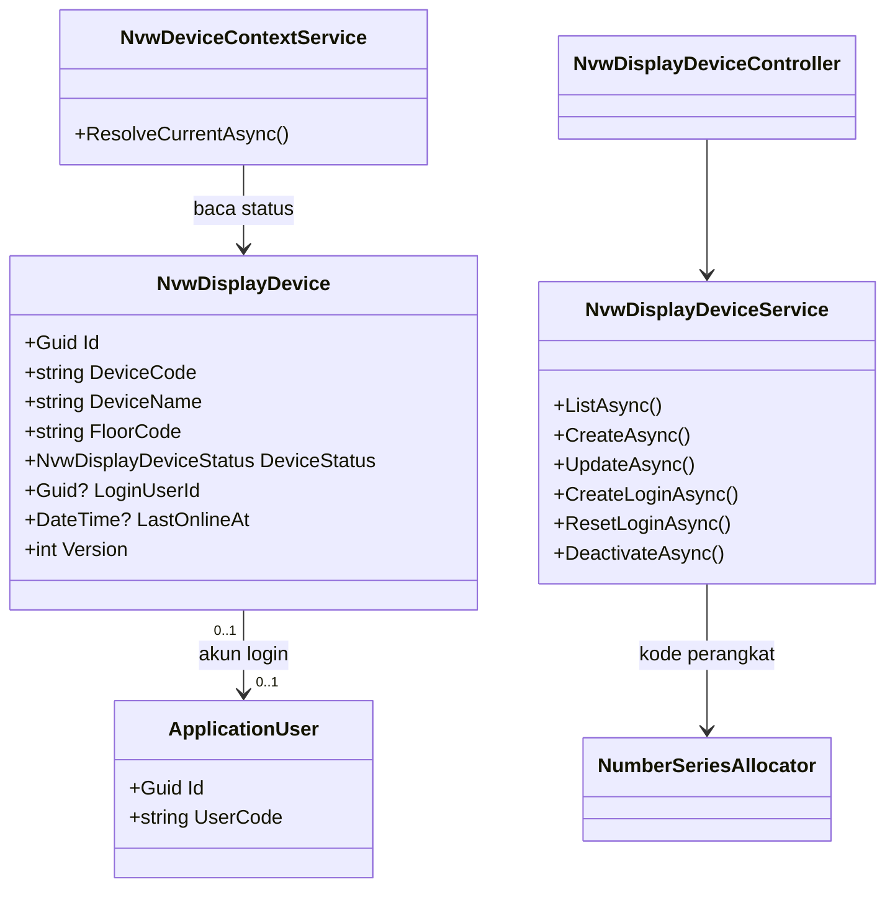
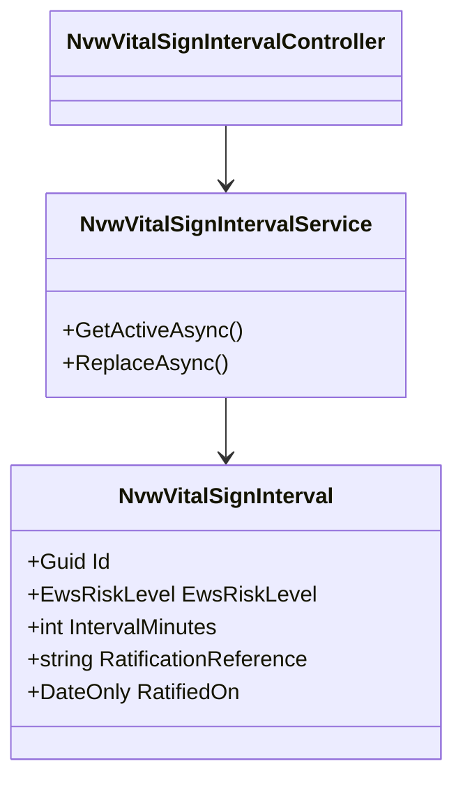
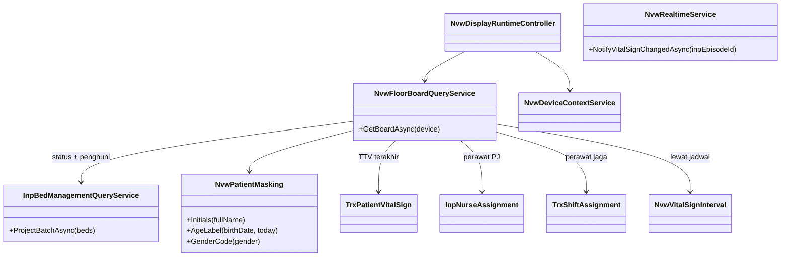

# Arsitektur Backend — Nurse View

| Field | Nilai |
|---|---|
| Blueprint ID | `nurse-view` |
| Revision | `1` |
| Status | `approved` — Rizki Gunawan, 2026-10-28 (`NV-DEC-028`) |
| Owner | Rizki Gunawan |
| Contract version | `0.1.0` (lihat `blueprint-manifest.md`) |
| `domain_architecture_readiness` | `DOMAIN_ARCHITECTURE_NOT_RUN` — modul hanya membaca data, tanpa master bersama dan tanpa billing (`02-requirement-completeness-assessment.md` bagian 7) |
| Masukan | `00-interview-decisions.md` rev `2`, `01-existing-capability-map.md` rev `1`, `02-requirement-completeness-assessment.md` rev `1` |
| Backend SHA | `a6f977a3` |
| Prasyarat implementasi | Baris registry `HealthServices / NurseViewManagement / Nvw` ditulis lebih dulu di MVP-0 (`NV-DEC-029`, `QBE-MOD-002`); berkas bersama direstui lead dengan syarat (`NV-DEC-030`) |

> Seluruh nama `Nvw*` di dokumen ini adalah **usulan** sampai baris registry disetujui. Sebelum
> itu, satu file model pun tidak boleh dibuat.

## 1. Bounded context dan ownership

Nurse View adalah **konteks baca**. Ia menyusun papan per lantai dari data milik modul lain dan
hanya memiliki dua kelompok data kecil: perangkat display dan interval ukur ulang TTV.

| Konteks | Aggregate root | Invariant | Batas transaksi |
|---|---|---|---|
| Perangkat display | `NvwDisplayDevice` | (1) Kode perangkat unik dan diterbitkan number series. (2) Satu perangkat paling banyak satu akun login. (3) Perangkat `Inactive` tidak pernah lolos runtime. (4) Satu perangkat terikat tepat satu lantai | Satu perangkat per transaksi. Pembuatan login: simpan perangkat + akun dalam satu alur; bila pembuatan akun gagal, status perangkat tidak berubah |
| Interval ukur ulang TTV | Himpunan `NvwVitalSignInterval` aktif (ganti-seluruh, pola `NursingShift`) | (1) Satu baris aktif per tingkat EWS. (2) Hanya `Low`, `Medium`, `High`, `Critical`. (3) Setiap himpunan wajib punya rujukan pengesahan. (4) Tidak ada angka bawaan (`G-01`) | Satu transaksi: baris aktif lama ditandai hapus, baris baru disisipkan. Gagal → tidak ada yang berubah |
| Papan lantai (read model) | — tidak dipersistensi | (1) Penghuni dari penempatan aktif, bukan salinan. (2) Identitas disamarkan **di backend**. (3) Perangkat hanya membaca lantainya | Baca saja, `AsNoTracking`, tanpa transaksi |

**Contoh invariant perangkat.** Admin menonaktifkan `NVW-000003` pukul 10.00. TV yang masih
memegang token login meminta papan pukul 10.00.30. Runtime memeriksa status perangkat pada
**setiap** permintaan, menemukan `Inactive`, dan menolak dengan kode 403. TV kembali ke layar
login.

## 2. Tabel kepemilikan data

| Kelompok data | Modul pemilik | Dipakai modul ini | Dibuat ulang di modul ini |
|---|---|:---:|---|
| Pasien (nama, jenis kelamin, tanggal lahir) | Patient Management | Ya | **Tidak** — dibaca lalu disamarkan, tidak disimpan |
| Episode rawat inap, kebutuhan isolasi | Rawat Inap `episode-rawat-inap` | Ya | Tidak |
| Penempatan, reservasi, kesiapan bed, status bed | Rawat Inap `episode-rawat-inap` | Ya | Tidak — lewat `ProjectBatchAsync` |
| Perawat penanggung jawab | Rawat Inap `episode-rawat-inap` | Ya | Tidak |
| Bed, kamar, lantai, bangsal | Master Data HealthServices | Ya | Tidak |
| TTV dan EWS | Clinical Management / `rawat-inap/keperawatan` | Ya | Tidak |
| Hasil instrumen risiko jatuh | Clinical Management / `rawat-inap/keperawatan` | Ya | Tidak |
| Alergi pasien | Clinical Management | Ya | Tidak |
| Roster shift, profesi | HR Scheduling, HR Master Data | Ya | Tidak |
| Akun login | Platform Identity (`ApplicationUser`) | Ya | Tidak — satu akun dibuat per perangkat, tabelnya tetap milik Identity |
| Nomor bisnis | Platform Number Series | Ya | Tidak — `NumberSeriesAllocator` |
| **Perangkat display Nurse View** | **Nurse View** | Ya | **Ya** — tidak ada pemilik lain; `MstQueueDisplayDevice` terikat cluster poli (`NV-DEC-016`) |
| **Interval ukur ulang TTV per tingkat EWS** | **Nurse View** | Ya | **Ya** — tidak ada di mana pun; `EwsMonitoringRecommendation` hanya teks (`NV-CAP-08`) |

## 3. Class diagram

### 3.1 Konteks perangkat display



### 3.2 Konteks interval ukur ulang TTV



### 3.3 Konteks papan lantai (baca saja)



## 4. Penjelasan setiap class

### 4.1 `NvwDisplayDevice`

| Aspek | Penjelasan |
|---|---|
| **Status** | `Baru` |
| **Lokasi file** | `Areas/HealthServices/NurseViewManagement/Models/NvwDisplayDevice.cs` |
| Kategori | Transaksi/konfigurasi milik modul (bukan master bersama) |
| Tanggung jawab utama | Mewakili satu TV di nurse station. Menyimpan lantai yang ditampilkannya, status pakainya, dan akun login yang ia gunakan. Tidak menyimpan kata sandi |
| Field penting | `DeviceCode`, `DeviceName`, `FloorCode`, `LocationName`, `DeviceStatus`, `LoginUserId`, `LastOnlineAt`, `LoginIssuedAt`, `DeactivatedAt`, `DeactivationReason`, `Version` |
| Navigation property dan relasi | `LoginUser` → `ApplicationUser` (0..1, `Restrict`) |
| Pemakaian dalam alur bisnis | Admin IT mendaftarkan TV, membuat login, menonaktifkan bila TV rusak/hilang. Runtime membacanya pada setiap permintaan TV |
| Catatan desain | `DeviceCode` **wajib** dari `NumberSeriesAllocator` (`QBE-CODE-002/003/006`), bukan pola `Max+1` milik `QueueDisplayDeviceController.GenerateCodeAsync` (utang teknis, jangan ditiru). Kata sandi hanya ada di response pembuatan/atur ulang login |
| Ekuivalen model lama | — (pola dirujuk: `MstQueueDisplayDevice`) |

### 4.2 `NvwVitalSignInterval`

| Aspek | Penjelasan |
|---|---|
| **Status** | `Baru` |
| **Lokasi file** | `Areas/HealthServices/NurseViewManagement/Models/NvwVitalSignInterval.cs` |
| Kategori | Konfigurasi klinis milik modul |
| Tanggung jawab utama | Menyimpan berapa menit paling lama TTV boleh tidak diukur ulang untuk satu tingkat risiko EWS, beserta bukti pengesahannya oleh Komite Keperawatan |
| Field penting | `EwsRiskLevel`, `IntervalMinutes`, `RatificationReference`, `RatifiedOn` |
| Navigation property dan relasi | Tidak ada FK; `EwsRiskLevel` memakai enum milik Clinical |
| Pemakaian dalam alur bisnis | Admin memasukkan angka **sesudah** Komite mengesahkan. Papan memakainya untuk tanda "lewat jadwal" |
| Catatan desain | Arketipe ganti-seluruh seperti `NursingShiftController`. Baris lama tidak ditimpa, melainkan ditandai `IsDelete`, sehingga riwayat pengesahan dapat ditelusuri. **Tidak ada seed angka** |
| Ekuivalen model lama | — |

### 4.3 `NvwDisplayDeviceService`

| Aspek | Penjelasan |
|---|---|
| **Status** | `Baru` |
| **Lokasi file** | `Areas/HealthServices/NurseViewManagement/Services/NvwDisplayDeviceService.cs` |
| Kategori | Service |
| Tanggung jawab utama | Daftar, detail, buat, ubah, buat login, atur ulang login, nonaktifkan perangkat |
| Dipanggil oleh | `NvwDisplayDeviceController` |
| Membuka transaksi database | Ya, untuk buat login dan atur ulang login (perangkat + akun). Buat/ubah/nonaktifkan: satu `SaveChangesAsync` |
| Catatan desain | Memakai `UserManager<ApplicationUser>` seperti `QueueDisplayDeviceController`. Nonaktifkan → kunci akun (`SetLockoutEndDateAsync` jauh ke depan) + perbarui security stamp. Atur ulang login → kata sandi baru + security stamp baru + buka kunci |

### 4.4 `NvwVitalSignIntervalService`

| Aspek | Penjelasan |
|---|---|
| **Status** | `Baru` |
| **Lokasi file** | `Areas/HealthServices/NurseViewManagement/Services/NvwVitalSignIntervalService.cs` |
| Tanggung jawab utama | Membaca himpunan aktif; mengganti seluruh himpunan |
| Dipanggil oleh | `NvwVitalSignIntervalController`, `NvwFloorBoardQueryService` |
| Membuka transaksi database | Ya, pada `ReplaceAsync` |

### 4.5 `NvwDeviceContextService`

| Aspek | Penjelasan |
|---|---|
| **Status** | `Baru` |
| **Lokasi file** | `Areas/HealthServices/NurseViewManagement/Services/NvwDeviceContextService.cs` |
| Tanggung jawab utama | Menemukan perangkat milik akun yang login (`LoginUserId == user id`), menolak bila tidak ada atau `Inactive`, dan memperbarui `LastOnlineAt` paling sering sekali per 60 detik agar muat ulang tidak menulis ke database setiap kali |
| Dipanggil oleh | `NvwDisplayRuntimeController`, `QueueHub.JoinNurseViewFloor` |
| Membuka transaksi database | Tidak; satu `SaveChangesAsync` kecil bila `LastOnlineAt` perlu diperbarui |

### 4.6 `NvwFloorBoardQueryService`

| Aspek | Penjelasan |
|---|---|
| **Status** | `Baru` |
| **Lokasi file** | `Areas/HealthServices/NurseViewManagement/Services/NvwFloorBoardQueryService.cs` |
| Tanggung jawab utama | Menyusun papan satu lantai dengan jumlah query tetap per permintaan |
| Dipanggil oleh | `NvwDisplayRuntimeController` |
| Membuka transaksi database | Tidak |

Urutan penyusunan, satu query per langkah, tanpa query per bed:

1. Kamar aktif dengan `FloorCode` = lantai perangkat (tanpa syarat `FloorPlanRoomKey`, `NV-DEC-025`).
2. Bed aktif di kamar itu.
3. `InpBedManagementQueryService.ProjectBatchAsync(beds)` → status bed + penempatan/reservasi.
   `HoldingContext` **diabaikan** (memuat nama lengkap dan No. RM).
4. Episode + pasien untuk episode yang menempati/memesan bed.
5. `InpNurseAssignment` aktif per episode.
6. TTV sah terakhir per episode: `InpEpisodeId` cocok, `VitalSignStatus` ∈ {`Recorded`, `Verified`, `Corrected`}, `IsActive`, tidak dihapus; terbaru menurut `ObservationDateTime`.
7. Hasil instrumen `FallRiskScale` terakhir per episode dari pengkajian `Completed`.
8. Ada/tidaknya alergi `Active` per pasien.
9. Roster: `TrxShiftAssignment` `Published`, bukan libur, `ScheduledStartAt ≤ sekarang < ScheduledEndAt`, `OrganizationUnitId` = organisasi bangsal, profesi perawat atau bidan.
10. Interval aktif.
11. Penyamaran identitas dan perhitungan "lewat jadwal" di memori.

**Bentuk adapter langkah 3 dikunci:** metode `internal` dipanggil langsung, disetujui Muhammad
Hamzah 2026-10-28 (`TLM-NV-001` episode, `NV-DEC-027`).

### 4.7 `NvwPatientMasking`

| Aspek | Penjelasan |
|---|---|
| **Status** | `Baru` |
| **Lokasi file** | `Areas/HealthServices/NurseViewManagement/Helpers/NvwPatientMasking.cs` |
| Tanggung jawab utama | Mengubah identitas pasien menjadi samaran (`NV-DEC-008`, `G-04`) |
| Membuka transaksi database | Tidak; fungsi murni |

| Aturan | Contoh |
|---|---|
| Inisial: huruf pertama setiap kata nama, paling banyak 3, huruf besar, diakhiri titik | "Budi Santoso" → "B.S."; "Siti Nur Aminah Rahma" → "S.N.A." |
| Jenis kelamin: `L`, `P`, atau "–" bila kosong | — |
| Umur ≥ 1 tahun: tahun penuh | lahir 1962-03-10, hari ini 2026-10-28 → "64 th" |
| Umur 1 bulan s.d. < 1 tahun: bulan penuh | lahir 2026-05-01 → "5 bln" |
| Umur < 1 bulan: hari | lahir 2026-10-23 → "5 hr" |
| Tanggal lahir kosong | "Umur –" |

Tanggal "hari ini" memakai jam operasional Asia/Jakarta (`G-08`), sama seperti `GetOperationalNow` di IGD.

### 4.8 `NvwRealtimeService`

| Aspek | Penjelasan |
|---|---|
| **Status** | `Baru` |
| **Lokasi file** | `Areas/HealthServices/NurseViewManagement/Services/NvwRealtimeService.cs` |
| Tanggung jawab utama | Sesudah TTV rawat inap tersimpan/dibatalkan, mencari bed dan lantai pasien lalu mengirim sinyal `NurseViewBoardChanged` tanpa identitas ke grup `nurse-view-floor:{FloorCode}` |
| Dipanggil oleh | `PatientVitalSignController` — **perubahan lintas modul**, `TLM-NV-001` keperawatan, menunggu `NV-OQ-016` |
| Membuka transaksi database | Tidak. Best-effort: seluruh galat ditangkap dan dicatat log, tidak pernah dilempar ke pemanggil |

### 4.9 Controller

| Controller | Status | Lokasi | Service yang dipakai | Atribut akses | Endpoint |
|---|---|---|---|---|---|
| `NvwDisplayDeviceController` | `Baru` | `Areas/HealthServices/NurseViewManagement/Controllers/NvwDisplayDeviceController.cs` | `NvwDisplayDeviceService` | `[Authorize]`, `[AccessController]` modul `HEALTH_SERVICE_NURSE_VIEW`, `[AccessPermission("NurseViewDisplayDevice", ...)]` | Lihat `contracts/api-contract.md` §1 |
| `NvwVitalSignIntervalController` | `Baru` | `.../Controllers/NvwVitalSignIntervalController.cs` | `NvwVitalSignIntervalService` | `[AccessPermission("NurseViewVitalSignInterval", ...)]` | §2 |
| `NvwDisplayRuntimeController` | `Baru` | `.../Controllers/NvwDisplayRuntimeController.cs` | `NvwDeviceContextService`, `NvwFloorBoardQueryService` | `[Authorize(Policy = NurseViewDisplayRead)]`, **tanpa** `[AccessPermission]` (akun perangkat, pola `QueueDisplayRuntimeController`) | §3 |

### 4.10 Berkas bersama yang disentuh — direstui lead dengan syarat (`NV-DEC-030`)

**Syarat lead yang mengikat seluruh baris di bawah:** (1) login pengguna biasa, Kiosk, display antrean, dan akun lain tidak boleh terganggu — dibuktikan `NV-AC-023`–`027`; (2) pola disamakan dengan display antrean. Konsekuensi desain: resolver Nurse View di `AuthController` dipanggil **sesudah** resolver Kiosk dan display antrean tanpa mengubah keduanya, hanya menambah klaim bila akun cocok dengan perangkat Nurse View, dan untuk akun lain menulis `is_nurse_view_account = false` persis seperti pola `is_queue_display_account`. Isi policy dan redirect lama tidak disunting; yang ada hanya penambahan.

| Berkas | Status | Perubahan minimal |
|---|---|---|
| `Controllers/AuthController.cs` | `Diperbarui` | Resolver baru: bila akun adalah `LoginUserId` perangkat Nurse View berstatus `Active`, tambahkan klaim `is_nurse_view_account = true` dan `nurse_view_device_id`. Akun perangkat `Inactive` ditolak login |
| `Constants/AuthorizationPolicies.cs` | `Diperbarui` | Konstanta `NurseViewDisplayRead`; ditambahkan ke `ApprovedAlternativeAuthorization` |
| `Program.cs` | `Diperbarui` | Satu `AddPolicy(NurseViewDisplayRead)`: wajib klaim `nurse_view_device_id`. **Tanpa** role `SuperAdmin`/`Administrator` sebagai jalan pintas, agar akun manusia tidak pernah menerima papan publik. Registrasi `AddScoped` ke-6 service (ketentuan "jangan menambah kode ke `Program.cs`" dikecualikan hanya bila lead merestui) |
| `Hubs/QueueHub.cs` | `Diperbarui` | Metode `JoinNurseViewFloor()` **tanpa parameter**: lantai diambil dari perangkat milik akun, sehingga TV tidak bisa memilih lantai lain |
| `Areas/HealthServices/ClinicalManagement/Controllers/PatientVitalSignController.cs` | `Diperbarui` | Satu panggilan `NvwRealtimeService` sesudah commit pada POST, PUT, PATCH cancel (`TLM-NV-001` keperawatan, `NV-OQ-016`) |

## 5. Arsitektur folder

```text
NewQuilvianSystemBackend/
├── Areas/HealthServices/NurseViewManagement/            # BARU — registry ditulis di MVP-0 (NV-DEC-029)
│   ├── Controllers/
│   │   ├── NvwDisplayDeviceController.cs                 # Baru
│   │   ├── NvwVitalSignIntervalController.cs             # Baru
│   │   └── NvwDisplayRuntimeController.cs                # Baru
│   ├── DTOs/
│   │   ├── NvwDisplayDeviceDtos.cs                       # Baru
│   │   ├── NvwVitalSignIntervalDtos.cs                   # Baru
│   │   └── NvwFloorBoardDtos.cs                          # Baru
│   ├── Enums/
│   │   └── NvwDisplayDeviceStatus.cs                     # Baru
│   ├── Helpers/
│   │   └── NvwPatientMasking.cs                          # Baru
│   ├── Models/
│   │   ├── NvwDisplayDevice.cs                           # Baru
│   │   └── NvwVitalSignInterval.cs                       # Baru
│   └── Services/
│       ├── NvwDisplayDeviceService.cs                    # Baru
│       ├── NvwVitalSignIntervalService.cs                # Baru
│       ├── NvwDeviceContextService.cs                    # Baru
│       ├── NvwFloorBoardQueryService.cs                  # Baru
│       └── NvwRealtimeService.cs                         # Baru
├── Repositories/
│   ├── ApplicationDbContext.cs                           # Diperbarui — 2 DbSet
│   └── Configurations/HealthServices/NurseViewManagement/
│       ├── NvwDisplayDeviceConfiguration.cs              # Baru
│       └── NvwVitalSignIntervalConfiguration.cs          # Baru
├── Controllers/AuthController.cs                         # Diperbarui — NV-DEC-030
├── Constants/AuthorizationPolicies.cs                    # Diperbarui — NV-DEC-030
├── Program.cs                                            # Diperbarui — NV-DEC-030
├── Hubs/QueueHub.cs                                      # Diperbarui — NV-DEC-030
├── Areas/HealthServices/ClinicalManagement/Controllers/
│   └── PatientVitalSignController.cs                     # Diperbarui — NV-OQ-016
├── Areas/Administrator/MasterData/Controllers/
│   └── QueueDisplayDeviceController.cs                   # Sudah ada — controller akses DbContext langsung + Max+1: utang teknis, jangan ditiru
└── Migrations/<timestamp>_AddNurseViewManagement.cs      # Baru — dibuat Rizki sendiri
```

## 6. Status model

| Entity | Status | Dampak migration |
|---|---|---|
| `NvwDisplayDevice` | `Baru` | Tabel baru `public."NvwDisplayDevice"` |
| `NvwVitalSignInterval` | `Baru` | Tabel baru `public."NvwVitalSignInterval"` |
| `ApplicationUser` | `Sudah ada` | Tidak ada kolom baru; baris akun perangkat dibuat lewat `UserManager` saat runtime |
| Seluruh entity Rawat Inap, Clinical, HR, Patient | `Sudah ada` | Tidak ada |

### Enum baru `NvwDisplayDeviceStatus`

| Nilai | Angka | Arti |
|---|---:|---|
| `PendingLogin` | 1 | Terdaftar, belum punya login. **Bawaan** saat dibuat |
| `Active` | 2 | Punya login dan boleh menampilkan papan |
| `Inactive` | 3 | Dinonaktifkan; login dikunci |

## 7. Rencana migration

| Urutan | Nama | Isi | Tanpa downtime? | Data lama | Cara mundur |
|---:|---|---|:---:|---|---|
| 1 | `AddNurseViewManagement` | Buat `NvwDisplayDevice` dan `NvwVitalSignInterval` beserta index | Ya — hanya tabel baru, tidak menyentuh tabel lain | Tidak ada | `Down()` menghapus kedua tabel. Akun `ApplicationUser` perangkat yang terlanjur dibuat dikunci manual oleh admin |

Migration dibuat dan dijalankan **Rizki sendiri**. Agent berhenti sebelum `dotnet ef migrations add`.

## 8. Rencana data master awal

| Data | Isi minimum | Sumber nilai |
|---|---|---|
| `NvwDisplayDevice` | **Kosong.** Satu baris dibuat admin per TV saat pemasangan | Inventaris TV per lantai dari IT |
| `NvwVitalSignInterval` | **Kosong, dengan sengaja** (`G-01`). Selama kosong, tanda "lewat jadwal" tidak tampil | SK/notulen Komite Keperawatan (`NV-OQ-010`) |
| Deret `NVW_DISPLAY_DEVICE` di number series | Tidak perlu seed. Deret lahir pada alokasi pertama (`NumberSeriesAllocator`), awalan `NVW`, 6 digit, `ResetPolicy = NEVER`. **Contoh:** perangkat pertama `NVW-000001` | Konvensi number series |
| Hak akses peran Admin IT | `NurseViewDisplayDevice : Read/Create/Update`, `NurseViewVitalSignInterval : Read/Update` | Diberikan lewat layar Akses Role. **Ingat:** POST role-access menimpa seluruh policy peran; tambahkan, jangan ganti |

Prasyarat data milik modul lain (`G-06`, daftar periksa go-live): `MstRoom.FloorCode` terisi,
versi instrumen risiko jatuh `Approved`, `MstServiceUnit.OrganizationUnitId` bangsal terisi.

## 9. Keamanan, privasi, observability

| Hal | Desain |
|---|---|
| Autentikasi perangkat | Login biasa memakai akun perangkat; klaim perangkat ditambahkan `AuthController` |
| Otorisasi perangkat | Policy `NurseViewDisplayRead` + pemeriksaan status perangkat di setiap permintaan. Lantai **selalu** dari perangkat, tidak pernah dari query string |
| Data minimal | Response papan tidak memuat `FullName`, `MedicalRecordNumber`, nama alergen, nama DPJP, diagnosis. Diuji `NV-AC-002`, `012` |
| Grup realtime terlarang | Akun perangkat tidak punya izin `InpatientBedOccupancy : Read` / `InpatientEpisode : Read`, sehingga `JoinInpatientBedSelection` menolaknya (`NV-AC-022`) |
| Logging | Create/Update/CreateLogin/ResetLogin/Deactivate/Replace interval dicatat `LoggerService` dengan `EntityId`, `DeviceCode`, aksi. **Kata sandi tidak pernah masuk log.** GET tidak dicatat |
| Audit | `IdentityModel` (pembuat/pengubah/penghapus); `LoginIssuedAt`/`LoginIssuedBy`, `DeactivatedAt`/`DeactivatedBy`/`DeactivationReason` pada perangkat; `RatificationReference` + `RatifiedOn` + `CreateBy` pada interval (`G-03`) |
| Observability | `LastOnlineAt` per perangkat terlihat di daftar admin (`G-07`). Kegagalan sinyal realtime dicatat log error |

## 10. Yang sengaja tidak dibuat

| Yang ditolak | Alasan |
|---|---|
| `MstNurseViewDisplayDevice` di `MasterData` | `NV-DEC-016`, `024`: perangkat milik Nurse View, bukan master bersama |
| Memakai `MstQueueDisplayDevice` | Wajib terikat cluster poli rawat jalan (`NV-CAP-12`) |
| Tabel salinan penghuni bed / snapshot papan | Penghuni wajib dibaca dari penempatan aktif; salinan akan basi (invariant papan 1) |
| Tabel jadwal TTV per pasien | Jatuh tempo dihitung dari TTV terakhir + interval; menyimpannya berarti dua sumber |
| Kolom jenis isolasi | Milik Rawat Inap, `NV-OQ-013` |
| Endpoint pratinjau papan untuk akun manusia | Bukan keputusan owner; papan hanya untuk TV pasif (`NV-DEC-009`). Ditinjau bila UAT membutuhkannya |
| Mengikuti event `InpatientBedSelectionChanged` | Payload memuat nama lengkap (`NV-DEC-026`) |
| Kode perangkat dengan `Max+1` | Dilarang `QBE-CODE-002/003` |
| Panggilan pasien, tablet, pesan makan, jadwal visite | Di luar scope (`NV-DEC-004`) |

## 11. Strategi uji

Mengikuti ketentuan proyek: agent tidak menulis maupun menjalankan unit test. Verifikasi agent
cukup eslint/QBE; pengujian milik Rizki dan tim UAT. Skenario ada di
`testing/acceptance-test-matrix.md`.
