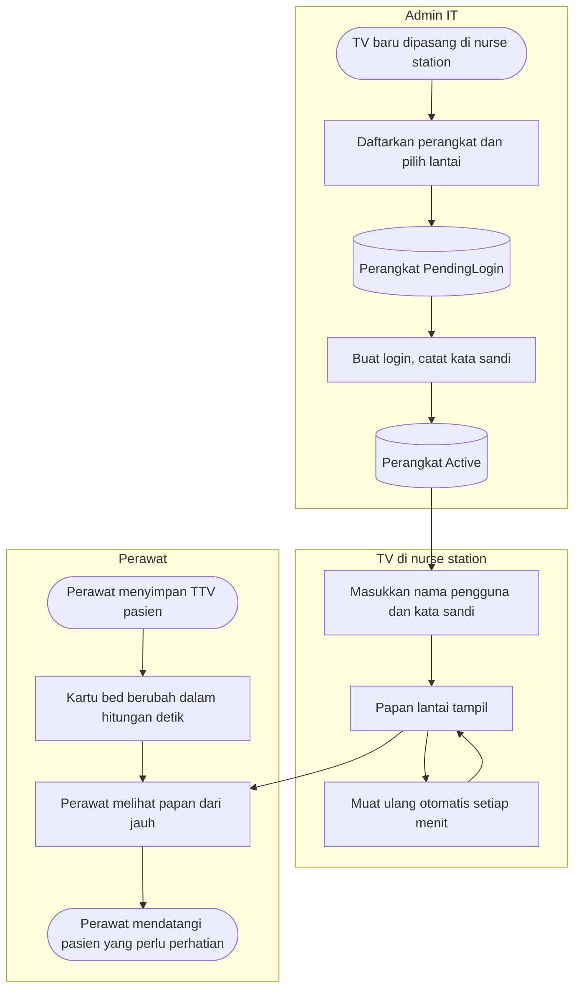
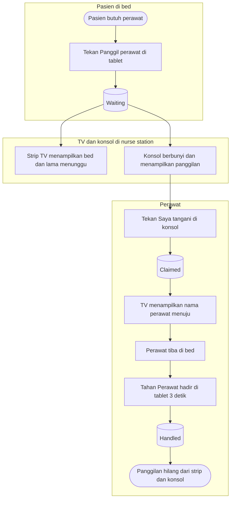

# Flowchart — Alur Utama Nurse View

| Field | Nilai |
|---|---|
| Revision | `1` · `approved` — Rizki Gunawan, 2026-10-28 (`NV-DEC-028`) |
| Keputusan | `NV-DEC-004`, `009`, `014`, `022`, `023` |

Jalur normal saja. Jalur gagal ada di berkas proses.

| Langkah | Pelaku | Masukan | Keluaran | Bila gagal |
|---|---|---|---|---|
| Daftarkan perangkat | Admin IT | Nama, lantai | Perangkat `PendingLogin` | Lihat `01-pengelolaan-perangkat.md` |
| Buat login | Admin IT | Perangkat `PendingLogin` | Nama pengguna + kata sandi sekali tampil; perangkat `Active` | Idem |
| Login di TV | Admin IT di TV | Nama pengguna, kata sandi | Papan tampil | Lihat `02-pembaruan-papan.md` |
| Papan diperbarui | Sistem | Data bed, TTV, perawat | Kartu terbaru | Pita data basi |
| Perawat menindaklanjuti | Perawat | Papan | Pasien didatangi; detail dibaca di rekam medis | Papan hanya alat bantu (`G-02`) |

## Revision 2 — Alur utama panggilan pasien

| Field | Nilai |
|---|---|
| Revision | `2` · `approved` — Rizki Gunawan, 2026-11-05 (`NV-DEC-055`) |
| Keputusan | `NV-DEC-034`, `035`, `037`–`041`, `045`, `047` |

Jalur normal saja. Jalur gagal ada di `04-panggilan-pasien.md`, `05-penutupan-panggilan.md`, dan
`06-pengelolaan-tablet-bed.md`. Bel kabel tetap jalur utama yang bersuara (`NV-DEC-037`).

| Langkah | Pelaku | Masukan | Keluaran | Bila gagal |
|---|---|---|---|---|
| Tekan panggil | Pasien | Bed berpenghuni, tablet aktif | Panggilan `Waiting` | Lihat `04-panggilan-pasien.md`; pasien menekan bel dinding |
| Tampil di TV dan konsol | Sistem | Panggilan baru | Item di strip dan konsol, bunyi di konsol | TV atau konsol terputus → panggilan tetap tersimpan, muncul saat tersambung |
| Saya tangani | Perawat | Konsol terbuka dengan izin | `Claimed`, nama perawat di TV | Sudah diambil perawat lain → ambil alih bila perlu |
| Perawat hadir | Perawat di bed | Panggilan aktif | `Handled`, dikonfirmasi di bed | Tablet tidak dapat dipakai → lihat `05-penutupan-panggilan.md` |
