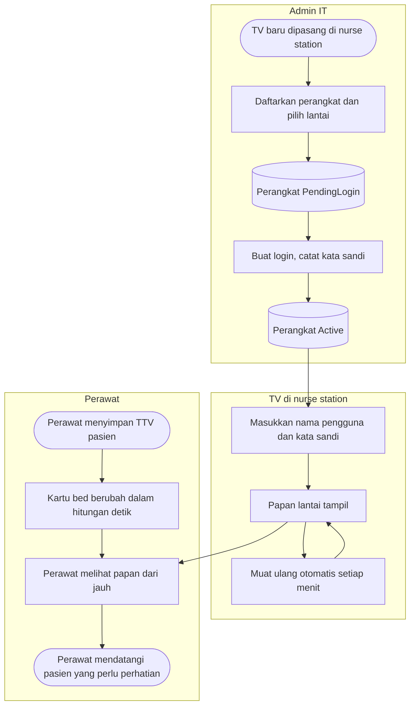

# Flowchart — Alur Utama Nurse View

| Field | Nilai |
|---|---|
| Revision | `1` · `approved` — Rizki Gunawan, 2026-10-28 (`NV-DEC-028`) |
| Keputusan | `NV-DEC-004`, `009`, `014`, `022`, `023` |

Jalur normal saja. Jalur gagal ada di berkas proses.

| Langkah | Pelaku | Masukan | Keluaran | Bila gagal |
|---|---|---|---|---|
| Daftarkan perangkat | Admin IT | Nama, lantai | Perangkat `PendingLogin` | Lihat `01-pengelolaan-perangkat.md` |
| Buat login | Admin IT | Perangkat `PendingLogin` | Nama pengguna + kata sandi sekali tampil; perangkat `Active` | Idem |
| Login di TV | Admin IT di TV | Nama pengguna, kata sandi | Papan tampil | Lihat `02-pembaruan-papan.md` |
| Papan diperbarui | Sistem | Data bed, TTV, perawat | Kartu terbaru | Pita data basi |
| Perawat menindaklanjuti | Perawat | Papan | Pasien didatangi; detail dibaca di rekam medis | Papan hanya alat bantu (`G-02`) |
