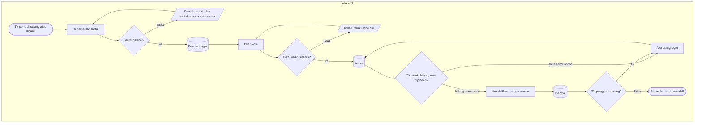

# Flowchart — Pengelolaan Perangkat Display

| Field | Nilai |
|---|---|
| Revision | `1` · `approved` — Rizki Gunawan, 2026-10-28 (`NV-DEC-028`) |
| Keputusan | `NV-DEC-016`, `022` |
| Status | Sama persis dengan `contracts/state-transition-matrix.md` |

| Langkah | Pelaku | Masukan | Keluaran | Bila gagal |
|---|---|---|---|---|
| Isi nama dan lantai | Admin IT | Nama, lantai dari pilihan | Perangkat `PendingLogin` | Lantai tidak dikenal → admin minta admin master data mengisi lantai kamar |
| Buat login | Admin IT | Perangkat `PendingLogin` | Kata sandi tampil sekali; `Active` | Data sudah diubah orang lain → muat ulang lalu ulangi |
| Atur ulang login | Admin IT | Perangkat `Active`/`Inactive` | Kata sandi baru; login lama tidak berlaku; `Active` | Idem |
| Nonaktifkan | Admin IT | Alasan | `Inactive`; TV langsung kembali ke layar login | Alasan kosong → isi alasan |
| Kata sandi hilang sebelum dicatat | Admin IT | — | — | Atur ulang login; kata sandi lama tidak bisa dilihat lagi |
