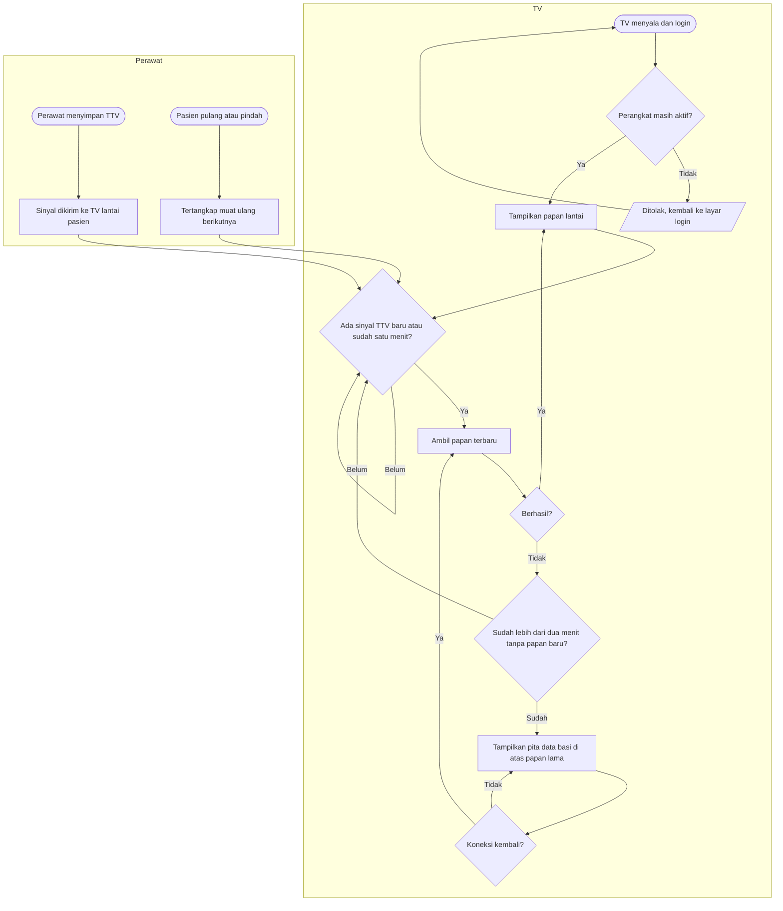

# Flowchart — Pembaruan Papan dan Data Basi

| Field | Nilai |
|---|---|
| Revision | `1` · `approved` — Rizki Gunawan, 2026-10-28 (`NV-DEC-028`) |
| Keputusan | `NV-DEC-014`, `023`, `026`; `NV-AC-006`, `016`, `019`, `020` |

| Langkah | Pelaku | Masukan | Keluaran | Bila gagal |
|---|---|---|---|---|
| Periksa perangkat | Sistem | Akun yang login | Lanjut atau ditolak | Ditolak → IT memeriksa status perangkat |
| Ambil papan | TV | — | Papan lantai | Gagal → coba lagi otomatis; perawat tetap melihat papan lama |
| Sinyal TTV | Sistem | TTV tersimpan | Satu sinyal ke TV lantai | Sinyal gagal → TTV tetap tersimpan, papan berubah paling lambat 60 detik |
| Pita data basi | TV | > 2 menit tanpa papan baru | Pita abu-abu berisi jam data terakhir | Perawat memakai rekam medis sampai pita hilang; lapor IT bila berlanjut |
| Pasien pindah lantai | Sistem | Penempatan baru | Kartu hilang dari lantai lama, muncul di lantai baru | — |
