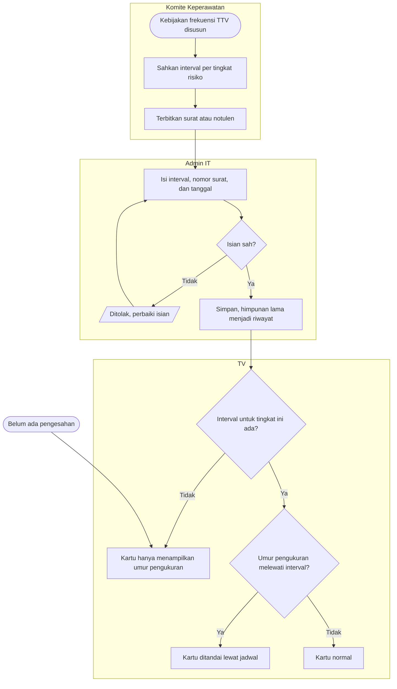

# Flowchart — Pengesahan Interval Ukur Ulang TTV

| Field | Nilai |
|---|---|
| Revision | `1` · `approved` — Rizki Gunawan, 2026-10-28 (`NV-DEC-028`) |
| Keputusan | `NV-DEC-010`; gap `G-01`; open question `NV-OQ-010` |

| Langkah | Pelaku | Masukan | Keluaran | Bila gagal |
|---|---|---|---|---|
| Sahkan interval | Komite Keperawatan | Kebijakan klinis | Surat/notulen | Belum disahkan → TV tetap aman-gagal, tanpa tanda |
| Isi interval | Admin IT | Angka, nomor surat, tanggal | Himpunan aktif baru | Isian ditolak → perbaiki sesuai pesan |
| Tanda di kartu | Sistem | TTV terakhir + interval tingkatnya | Tanda lewat jadwal atau tidak | Tingkat tanpa interval → tanpa tanda |
| Cabut interval | Admin IT | Himpunan kosong + nomor surat pencabutan | Kembali aman-gagal | — |

**Contoh.** SK Komite menetapkan Sedang = 4 jam. Pasien dengan EWS Sedang terakhir diukur
08.00. Pukul 12.00 kartunya mulai ditandai lewat jadwal.
