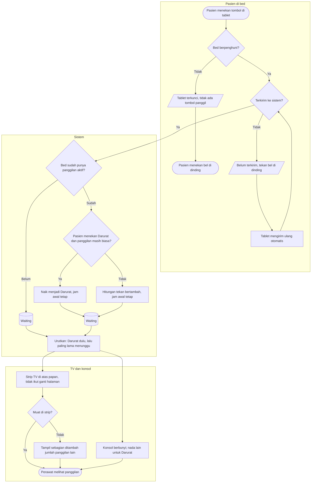

# Flowchart — Panggilan Pasien dari Tablet Bed

| Field | Nilai |
|---|---|
| Revision | `2` · `approved` — Rizki Gunawan, 2026-11-05 (`NV-DEC-055`) |
| Keputusan | `NV-DEC-037`, `038`, `039`, `046`, `047` |
| Status | Sama persis dengan `contracts/state-transition-matrix.md` §5 |

Proses ini mencakup tekan pertama, tekan ulang, naik Darurat, bed kosong, dan gagal kirim.
Banyak pasien yang memanggil bersamaan diurutkan Darurat dulu, lalu yang paling lama menunggu.

| Langkah | Pelaku | Masukan | Keluaran | Bila gagal |
|---|---|---|---|---|
| Tekan tombol | Pasien atau keluarga | Tablet aktif | Permintaan panggilan | Tablet mati atau Wi-Fi putus → tekan bel dinding |
| Periksa penghuni | Sistem | Penempatan aktif bed | Lanjut atau tablet terkunci | Bed kosong → tidak ada tombol; bel dinding tetap tersedia |
| Kirim ulang otomatis | Tablet | Permintaan yang sama | Tepat satu panggilan walau terkirim berkali-kali | Tetap gagal → pesan bel dinding terus tampil |
| Satu bed satu panggilan | Sistem | Panggilan aktif bed itu | Panggilan baru, tekan ulang, atau naik Darurat | — |
| Urutkan | Sistem | Semua panggilan aktif lantai | Darurat dulu, lalu paling lama menunggu | — |
| Tampil di strip | TV | Daftar berurutan | Strip tetap di atas papan | TV terputus → pita data basi; panggilan tetap tersimpan |
| Bunyi di konsol | Konsol | Panggilan baru atau naik Darurat | Bunyi dan pengingat sampai diklaim | Browser menahan bunyi → perawat menekan Aktifkan suara |

**Contoh banyak panggilan.** Pukul 10.00.00 305-A memanggil biasa, 10.00.20 318-B biasa,
10.00.40 331-C Darurat, 10.00.45 305-A menekan lagi. Pukul 10.01.00 urutan strip dan konsol:
331-C (Darurat, 0:20), 305-A (1:00, ditekan 2×), 318-B (0:40). Tidak ada panggilan ganda.
