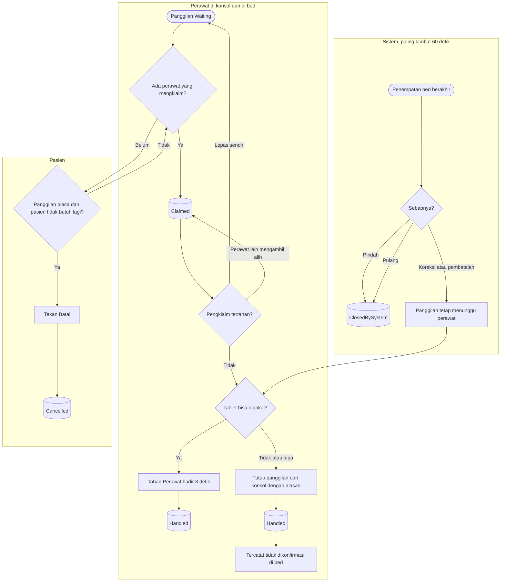

# Flowchart — Klaim dan Penutupan Panggilan

| Field | Nilai |
|---|---|
| Revision | `2` · `approved` — Rizki Gunawan, 2026-11-05 (`NV-DEC-055`) |
| Keputusan | `NV-DEC-040`, `041`, `046`, `050`, `052`, `053`, `054` |
| Status | Sama persis dengan `contracts/state-transition-matrix.md` §5 |

Panggilan selesai lewat salah satu dari lima jalan: perawat hadir di bed, tutup dari konsol,
pasien membatalkan, sistem menutup karena pasien pindah, atau karena pasien pulang. Koreksi dan
pembatalan penempatan **tidak** menutup panggilan.

| Langkah | Pelaku | Masukan | Keluaran | Bila gagal |
|---|---|---|---|---|
| Klaim | Perawat berizin | Panggilan `Waiting` | `Claimed`, nama di TV | Sudah diklaim perawat lain → ambil alih bila perlu |
| Lepas | Pengklaim | Panggilan `Claimed` | Kembali `Waiting`, jam awal tetap | Bukan pengklaim → minta pengklaim melepas atau ambil alih |
| Ambil alih | Perawat berizin lain | Panggilan `Claimed` | Pengklaim berganti; jejak mencatat keduanya | — |
| Perawat hadir | Perawat di bed | Panggilan aktif | `Handled`, dikonfirmasi di bed | Dilepas sebelum 3 detik → ulangi; tablet tidak dapat dipakai → tutup dari konsol |
| Tutup dari konsol | Perawat berizin | Alasan wajib; keterangan untuk Lainnya | `Handled`, tidak dikonfirmasi di bed | Alasan kosong → pilih alasan |
| Batal | Pasien | Panggilan biasa yang masih menunggu | `Cancelled` | Darurat atau sudah diklaim → tidak ada tombol Batal; perawat tetap datang |
| Pindah atau pulang | Sistem | Akhir penempatan dari Rawat Inap | `ClosedBySystem` dengan alasannya | Pemeriksaan gagal → diulang pada putaran berikutnya |
| Koreksi atau pembatalan penempatan | Sistem | Akhir penempatan administratif | Tidak ada perubahan | Perawat menutup lewat tablet atau konsol |

**Contoh tutup cadangan.** Tablet 312-B mati pukul 02.00 sesudah pasien memanggil. Dewi
mengklaim, datang, dan menangani pasien. Karena "Perawat hadir" tidak bisa ditekan, ia menutup
dari konsol dengan alasan "Tablet tidak dapat dipakai". Panggilan selesai dan ditandai tidak
dikonfirmasi di bed.
