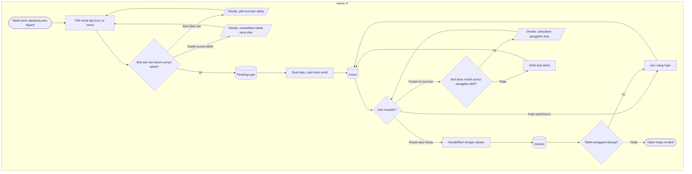

# Flowchart — Pengelolaan Tablet Bed

| Field | Nilai |
|---|---|
| Revision | `2` · `approved` — Rizki Gunawan, 2026-11-05 (`NV-DEC-055`) |
| Keputusan | `NV-DEC-035`, `046`; usulan `AD-01`–`04` |
| Status | Sama persis dengan `contracts/state-transition-matrix.md` §4 |

Polanya sama dengan perangkat display (`01-pengelolaan-perangkat.md`), dengan bed sebagai
pengganti lantai.

| Langkah | Pelaku | Masukan | Keluaran | Bila gagal |
|---|---|---|---|---|
| Pilih bed | Admin IT | Lantai, bed dari daftar | Tablet `PendingLogin` | Bed tanpa lantai → minta admin master data mengisi lantai kamar |
| Buat login | Admin IT | Tablet `PendingLogin` | Kata sandi tampil sekali; `Active` | Data diubah orang lain → muat ulang lalu ulangi |
| Pasang tablet | Admin IT | Nama pengguna, kata sandi | Layar tablet bed tampil | Ditolak → periksa status tablet |
| Nonaktifkan | Admin IT | Alasan | `Inactive`; tablet kembali ke layar login | Alasan kosong → isi alasan |
| Pindah bed | Admin IT | Bed baru | Tablet melayani bed baru | Masih ada panggilan aktif → perawat menutupnya dulu |

**Contoh.** Tablet `NVT-000001` di bed 305-A retak pukul 14.00. Admin menonaktifkannya dengan
alasan "Layar retak". Panggilan aktif 305-A, bila ada, ditutup perawat dari konsol dengan
alasan "Tablet tidak dapat dipakai". Tablet pengganti dipasang; admin mengatur ulang login
`NVT-000001` dan tablet kembali `Active`.
