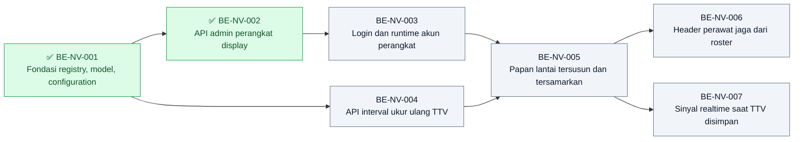

# Roadmap Backend — Nurse View

| Field | Nilai |
|---|---|
| Blueprint ID | `nurse-view` · revision `1` · `approved` (`NV-DEC-028`) |
| Roadmap revision | `1` — 2026-10-28 |
| Contract version | `0.1.0` `approved` |
| Backend SHA | `a6f977a3` (branch `rizkiG`) |
| Masukan | `blueprint-manifest.md` (hash artefak saat approval), `04-prd-to-mvp.md` §10, §20 |
| Owner | Rizki Gunawan |
| Ketentuan owner | (1) Task BE disusul task FE berpasangan. (2) Agent **berhenti sebelum** `dotnet ef migrations add`; migration dibuat dan diterapkan Rizki. (3) Agent tidak menulis/menjalankan unit test; verifikasi agent = QBE preflight. (4) `dotnet build -p:RunAnalyzers=false` dijalankan Rizki |
| QBE | Pada setiap handoff implementasi, QBE preflight dan kesesuaian engineering diselesaikan **saat eksekusi** dari `NewQuilvianSystemBackend/AGENTS.md` dan `docs/engineering/` canonical |

**Legenda tanda status:** ✅ selesai · 🟡 sebagian · ⛔ terblokir · tanpa tanda = belum dikerjakan.

**Pengecualian DoD yang berlaku untuk semua task:** butir unit test dikecualikan atas keputusan
Rizki Gunawan (ketentuan proyek: agent tidak menulis maupun menjalankan unit test). Pengecualian
ini tidak menjangkau syarat "setiap acceptance criteria terpetakan ke source".

## Grafik Urutan Dependency

| Gelombang | Boleh mulai setelah | Task |
| ---: | --- | --- |
| 1 | — | `BE-NV-001` ✅ |
| 2 | `BE-NV-001` (termasuk migration diterapkan Rizki) | `BE-NV-002`, `BE-NV-004` — boleh paralel |
| 3 | `BE-NV-002` | `BE-NV-003` |
| 4 | `BE-NV-003`, `BE-NV-004` | `BE-NV-005` |
| 5 | `BE-NV-005` | `BE-NV-006`, `BE-NV-007` — boleh paralel |

Jumlah panah: **7**, sama dengan jumlah entri kolom `Dependency` di bawah.

## Pemetaan ke gelombang PRD

| Gelombang PRD | Task backend | Pasangan frontend |
|---|---|---|
| `MVP-0` | `BE-NV-001` | — |
| `MVP-1` | `BE-NV-002`, `BE-NV-003` | `FE-NV-001`, `FE-NV-002`, `FE-NV-003` |
| `MVP-2` | `BE-NV-005`, `BE-NV-006` | `FE-NV-005`, `FE-NV-006` |
| `MVP-3` | `BE-NV-004` | `FE-NV-004` |
| `MVP-4` | `BE-NV-007` | `FE-NV-007` |

`BE-NV-004` (`MVP-3`) dikerjakan sebelum `BE-NV-005` (`MVP-2`) karena papan memakai interval
untuk tanda lewat jadwal. Tanpa angka sah papan tetap aman-gagal, tetapi service-nya harus ada.

## Tabel task

| Task ID | Outcome | Requirement/decision | Kontrak | Reuse | Cakupan | Dependency | Acceptance criteria | Verifikasi | Risiko/pemilik | DoD |
|---|---|---|---|---|---|---|---|---|---|---|
| ✅ `BE-NV-001` | Fondasi registry, model, configuration | `NV-DEC-016`, `024`, `029`; `G-01` | `0.1.0` data-dictionary | `IdentityModel`, pola configuration | Registry, 2 model, 1 enum, 2 configuration, 2 DbSet | — | Kartu | QBE preflight; build oleh Rizki; migration diterapkan Rizki | Salah prefix → QBE gagal / Rizki | Kartu |
| ✅ `BE-NV-002` | API admin perangkat display | `FR-NV-001`–`005`; `NV-DEC-016`, `022` | `0.1.0` api §1 | `NumberSeriesAllocator`, `UserManager`, pola `QueueDisplayDeviceController` (alur saja) | Service + controller + DTO | `BE-NV-001` | Kartu | HTTP via Swagger oleh Rizki | Kata sandi bocor ke log / Rizki | Kartu |
| `BE-NV-003` | Login dan runtime akun perangkat | `FR-NV-018`; `NV-DEC-009`, `022`, `030` | `0.1.0` api §3 `/current` | `ResolveQueueDisplayLoginContextAsync`, policy `QueueDisplayRuntimeRead` | `AuthController`, `AuthorizationPolicies`, `Program.cs`, context service, runtime controller | `BE-NV-002` | Kartu, termasuk regresi `NV-AC-023`–`027` | HTTP + login empat jenis akun | **Regresi login seluruh sistem** / Rizki, syarat lead | Kartu |
| `BE-NV-004` | API interval ukur ulang TTV | `FR-NV-020`–`022`; `NV-DEC-010` | `0.1.0` api §2 | Pola ganti-seluruh `NursingShiftController` | Service + controller + DTO | `BE-NV-001` | Kartu | HTTP via Swagger | Angka bawaan diselipkan / Rizki | Kartu |
| `BE-NV-005` | Papan lantai tersusun dan tersamarkan | `FR-NV-010`–`016`, `021`; `NV-DEC-006`–`020`, `025`, `026`, `027` | `0.1.0` api §3 `/board` | `ProjectBatchAsync` (`internal`, disetujui Hamzah), `TrxPatientVitalSign`, instrumen risiko jatuh, `TrxPatientAllergy`, `InpNurseAssignment` | Query service, masking helper, DTO papan, endpoint `/board` | `BE-NV-003`, `BE-NV-004` | Kartu | HTTP dengan akun perangkat + pencarian teks identitas di response | **Kebocoran identitas** / Rizki | Kartu |
| `BE-NV-006` | Header perawat jaga dari roster | `FR-NV-017`; `NV-DEC-012`, `021`, `027` | `0.1.0` api §3 `Wards[].OnDutyNurses` | `TrxShiftAssignment`, `MapCpptProfessionType` | Query roster di service papan; `MapCpptProfessionType` → `internal static` | `BE-NV-005` | Kartu | HTTP dengan roster kosong dan berisi | Lintas modul keperawatan / Rizki + Hamzah | Kartu |
| `BE-NV-007` | Sinyal realtime saat TTV disimpan | `FR-NV-032`; `NV-DEC-023`, `026`, `027` | `0.1.0` api §4 | `QueueHub`, pola `InpBedRealtimeService` (best-effort) | `NvwRealtimeService`, `QueueHub.JoinNurseViewFloor`, satu panggilan di `PatientVitalSignController` | `BE-NV-005` | Kartu | Hub + simpan TTV | Lintas modul keperawatan, simpan TTV tidak boleh gagal / Rizki + Hamzah | Kartu |

## Kartu task

### ✅ BE-NV-001 — Fondasi registry, model, configuration

| Field | Isi |
|---|---|
| Status | ✅ SELESAI — 2026-10-28. AC 4/4 terpetakan ke source; QBE Strict `PASS` (6 berkas, 0 violation, 0 review); build `PASS` dan `database update` `PASS` menurut pernyataan Rizki; migration `20261028082048_AddNurseViewManagement` diperiksa bersih (2 tabel, snapshot +180/−0). Unit test dikecualikan atas keputusan Rizki Gunawan. Laporan: [`BE-NV-001.md`](../task/report/backend/BE-NV-001.md) |
| Outcome | Modul `NurseViewManagement` terdaftar dan dua tabel siap dibuat migration-nya |
| Trace | `NV-DEC-016`, `024`, `029`; `02-backend-architecture.md` §4.1, §4.2, §5–§8; `data/data-dictionary.md` |
| Cakupan | (1) **Langkah pertama:** tambah baris `HealthServices / NurseViewManagement / Nurse View / BUSINESS DOMAIN / MODULE / Nvw / ACTIVE` dan kepanjangan `Nvw = Nurse View` ke `docs/engineering/MODULE_OWNERSHIP_PREFIX_REGISTRY.md`, dengan catatan lifecycle "propagasi persetujuan yang sudah ada (`NV-DEC-029`), bukan persetujuan baru". (2) `Models/NvwDisplayDevice.cs`, `Models/NvwVitalSignInterval.cs`, `Enums/NvwDisplayDeviceStatus.cs`. (3) `Repositories/Configurations/HealthServices/NurseViewManagement/NvwDisplayDeviceConfiguration.cs`, `NvwVitalSignIntervalConfiguration.cs` — index unik, unik terfilter, check constraint, `Restrict`, concurrency `Version`. (4) Dua `DbSet` di `ApplicationDbContext`. (5) **Berhenti** sebelum `dotnet ef migrations add`; serahkan perintahnya ke Rizki |
| Acceptance criteria | AC-1 baris registry ada sebelum file model pertama dibuat. AC-2 kolom, tipe, panjang, bawaan, index sama dengan kamus data. AC-3 tidak ada seed angka interval (`G-01`). AC-4 tidak ada `Trx*` |
| Verifikasi | QBE preflight oleh agent; `dotnet build -p:RunAnalyzers=false` oleh Rizki; migration `AddNurseViewManagement` dibuat dan diterapkan Rizki di DB lokal |
| DoD | AC-1–4 terpetakan ke source; build Rizki lulus; migration diterapkan; laporan `task/report/backend/BE-NV-001.md` |

### ✅ BE-NV-002 — API admin perangkat display

| Field | Isi |
|---|---|
| Status | ✅ SELESAI — 2026-10-29. 8/8 endpoint api §1 dan VAL-NV-01–08 terpetakan ke source; QBE Strict `PASS` (7 berkas, 0 violation, 0 review); pasangan atribut akses 8/8 cocok; build Rizki `PASS` (pernyataan owner, DLL 10:14); uji HTTP 29 Okt **12/12 `PASS`** (putaran 2 sesudah data lantai diisi Rizki). Verifikasi developer, bukan UAT. `authorization-verifier` dijalankan terpisah. Unit test dikecualikan atas keputusan Rizki Gunawan. Laporan: [`BE-NV-002.md`](../task/report/backend/BE-NV-002.md) |
| Outcome | Admin IT dapat mendaftarkan, mengubah, membuat login, mengatur ulang login, dan menonaktifkan perangkat |
| Trace | `FR-NV-001`–`005`; `NV-DEC-016`, `022`; `VAL-NV-01`–`08`; state-transition §1 |
| Cakupan | `NvwDisplayDeviceService`, `NvwDisplayDeviceController` (8 endpoint api §1), `NvwDisplayDeviceDtos.cs`. Kode dari `NumberSeriesAllocator` deret `NVW_DISPLAY_DEVICE`, awalan `NVW`, 6 digit, `NEVER`. Login via `UserManager`; nonaktif → kunci akun + security stamp baru; reset → sandi baru + security stamp + buka kunci. `AccessController` modul `HEALTH_SERVICE_NURSE_VIEW`; `[AccessPermission("NurseViewDisplayDevice", "Read"/"Create"/"Update")]`. Logging tanpa kata sandi. Registrasi service mengikuti pola registrasi yang dipakai modul lain (restu `NV-DEC-030`) |
| Acceptance criteria | `NV-AC-016`, `018`; `VAL-NV-01`–`08`; `UAT-02`, `UAT-03`. Contoh: buat login kedua → `409` |
| Verifikasi | HTTP via Swagger oleh Rizki: urutan buat → buat login → atur ulang → nonaktif → atur ulang (aktif kembali); periksa log tanpa kata sandi |
| DoD | Seluruh AC terpetakan; build Rizki lulus; laporan `BE-NV-002.md` |

### BE-NV-003 — Login dan runtime akun perangkat

| Field | Isi |
|---|---|
| Outcome | TV login memakai akun perangkat dan hanya mendapat akses ke runtime Nurse View; login akun lain tidak berubah |
| Trace | `FR-NV-018`; `NV-DEC-009`, `022`, `030`; `VAL-NV-14`–`16`; `02-backend-architecture.md` §4.5, §4.10 |
| Cakupan | (1) `AuthController`: resolver Nurse View dipanggil **sesudah** resolver Kiosk dan display antrean, tanpa mengubah keduanya; klaim `is_nurse_view_account`, `nurse_view_device_id`; akun lain `is_nurse_view_account = false`; perangkat `Inactive` ditolak. (2) `AuthorizationPolicies.NurseViewDisplayRead` + masuk `ApprovedAlternativeAuthorization`. (3) `Program.cs`: satu `AddPolicy`, tanpa jalan pintas SuperAdmin/Administrator. (4) `NvwDeviceContextService` (status per permintaan, `LastOnlineAt` 1×/60 detik). (5) `NvwDisplayRuntimeController` `GET /current` |
| Acceptance criteria | `NV-AC-016`, **`NV-AC-023`–`027`** (regresi login: pegawai, Kiosk, display antrean, SuperAdmin/Administrator, login gagal); `VAL-NV-14`–`16`; `UAT-11` |
| Verifikasi | Rizki login dengan **empat** jenis akun (perawat, Kiosk, display antrean, perangkat Nurse View) + satu login gagal; bandingkan klaim token sebelum/sesudah; `GET /current` dengan akun manusia → `403` |
| Risiko | Syarat lead: login keseluruhan tidak boleh terganggu. Bila satu regresi gagal, task tetap 🟡 dan tidak boleh digabung |
| DoD | AC terpetakan; regresi lulus dan direkam; laporan `BE-NV-003.md` mencantumkan diff ringkas per berkas bersama |

### BE-NV-004 — API interval ukur ulang TTV

| Field | Isi |
|---|---|
| Outcome | Admin memasukkan interval yang disahkan Komite; tanpa interval sistem aman-gagal |
| Trace | `FR-NV-020`–`022`; `NV-DEC-010`; `G-01`, `G-03`; `VAL-NV-09`–`13` |
| Cakupan | `NvwVitalSignIntervalService` (`GetActiveAsync`, `ReplaceAsync` dalam satu transaksi: baris lama `IsDelete`, baris baru disisipkan), `NvwVitalSignIntervalController` (`[AccessPermission("NurseViewVitalSignInterval", "Read"/"Update")]`), DTO |
| Acceptance criteria | `NV-AC-004`; `VAL-NV-09`–`13`; `UAT-08`; `IsConfigured = false` saat kosong |
| Verifikasi | HTTP: GET kosong → isi 2 tingkat → GET → ganti → baris lama bertanda hapus |
| DoD | AC terpetakan; build lulus; laporan `BE-NV-004.md` |

### BE-NV-005 — Papan lantai tersusun dan tersamarkan

| Field | Isi |
|---|---|
| Outcome | `GET /board` mengembalikan papan lantai perangkat dengan identitas samaran dan seluruh isi kartu |
| Trace | `FR-NV-010`–`016`, `021`; `NV-DEC-006`, `007`, `008`, `011`, `013`, `015`, `018`, `019`, `020`, `025`, `026`, `027`; `02-backend-architecture.md` §4.6–§4.7 |
| Cakupan | `NvwFloorBoardQueryService` (langkah 1–8, 10–11 pada §4.6; langkah 9 roster di `BE-NV-006`), `NvwPatientMasking`, `NvwFloorBoardDtos.cs`, endpoint `GET /board`. `HoldingContext` diabaikan. Kamar cukup `FloorCode` |
| Acceptance criteria | `NV-AC-001`–`005`, `007`, `008`, `010`–`015`, `021`; `UAT-04`–`06`; `NFR-001`, `002`, `005` |
| Verifikasi | Rizki memanggil `/board` dengan akun perangkat lantai uji; simpan JSON; cari nama lengkap, No. RM, nama alergen → nol hasil; ukur waktu respons untuk ±40 bed |
| Risiko | Kebocoran identitas lewat field baru. Uji pencarian teks wajib ada di laporan |
| DoD | AC terpetakan; JSON bukti tersimpan; laporan `BE-NV-005.md` |

### BE-NV-006 — Header perawat jaga dari roster

| Field | Isi |
|---|---|
| Outcome | Setiap bangsal di papan menampilkan perawat/bidan jaga shift berjalan, atau "Roster shift ini belum tersedia" |
| Trace | `FR-NV-017`; `NV-DEC-012`, `021`, `027`; `TLM-NV-001` keperawatan permintaan 2 |
| Cakupan | Langkah 9 §4.6: `TrxShiftAssignment` `Published`, bukan libur, rentang shift memuat sekarang, `OrganizationUnitId` bangsal, profesi Nurse/Midwife. **Lintas modul:** `InpatientClinicalContextService.MapCpptProfessionType` `private static` → `internal static`, tanpa perubahan isi |
| Prasyarat kerja | Konfirmasi singkat ke Hamzah bahwa Rizki yang menulis perubahan baris itu (`TLM-NV-001` pertanyaan 2). **Assumption:** Rizki menulisnya di task ini |
| Acceptance criteria | `NV-AC-009`, `017` |
| Verifikasi | HTTP: roster kosong → `RosterAvailable = false`; roster `Published` 3 perawat + 1 petugas administrasi → hanya 3 perawat tampil |
| DoD | AC terpetakan; laporan `BE-NV-006.md` dirujuk dari `rawat-inap/keperawatan/docs/task-lintas-modul/` |

### BE-NV-007 — Sinyal realtime saat TTV disimpan

| Field | Isi |
|---|---|
| Outcome | TV lantai pasien menerima `NurseViewBoardChanged` beberapa detik sesudah TTV disimpan/dibatalkan |
| Trace | `FR-NV-032`; `NV-DEC-023`, `026`, `027`; `TLM-NV-001` keperawatan permintaan 1 |
| Cakupan | `NvwRealtimeService.NotifyVitalSignChangedAsync` (best-effort, payload tanpa identitas). `QueueHub.JoinNurseViewFloor` / `LeaveNurseViewFloor` tanpa parameter. **Lintas modul:** satu panggilan sesudah commit pada `POST`, `PUT`, `PATCH cancel` di `PatientVitalSignController`, hanya bila `InpEpisodeId` terisi |
| Prasyarat kerja | Sama dengan `BE-NV-006`: konfirmasi Hamzah soal penulis dan pemilik `PatientVitalSignController` (`TLM-NV-001` pertanyaan 2–3) |
| Acceptance criteria | `NV-AC-019`, `022`; `TLM-NV-001-AC-1`–`4` |
| Verifikasi | Hub: akun perangkat join lantai → simpan TTV → event diterima; matikan hub → simpan TTV tetap `200`; akun perangkat `JoinInpatientBedSelection` → ditolak |
| DoD | AC terpetakan; laporan `BE-NV-007.md` dirujuk dari folder TLM keperawatan |

## Traceability

Lihat [`requirement-traceability.md`](./requirement-traceability.md).
