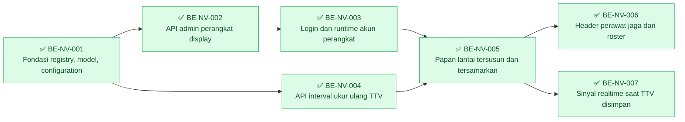
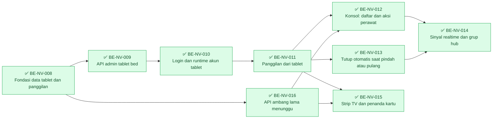

# Roadmap Backend — Nurse View

| Field | Nilai |
|---|---|
| Blueprint ID | `nurse-view` · revision `1` · `approved` (`NV-DEC-028`) |
| Roadmap revision | `1` — 2026-10-28 |
| Contract version | `0.1.0` `approved` |
| Backend SHA | `a6f977a3` (branch `rizkiG`) |
| Masukan | `blueprint-manifest.md` (hash artefak saat approval), `04-prd-to-mvp.md` §10, §20 |
| Owner | Rizki Gunawan |
| Ketentuan owner | (1) Task BE disusul task FE berpasangan. (2) Agent **berhenti sebelum** `dotnet ef migrations add`; migration dibuat dan diterapkan Rizki. (3) Agent tidak menulis/menjalankan unit test; verifikasi agent = QBE preflight. (4) `dotnet build -p:RunAnalyzers=false` dijalankan Rizki |
| QBE | Pada setiap handoff implementasi, QBE preflight dan kesesuaian engineering diselesaikan **saat eksekusi** dari `NewQuilvianSystemBackend/AGENTS.md` dan `docs/engineering/` canonical |

**Legenda tanda status:** ✅ selesai · 🟡 sebagian · ⛔ terblokir · tanpa tanda = belum dikerjakan.

**Pengecualian DoD yang berlaku untuk semua task:** butir unit test dikecualikan atas keputusan
Rizki Gunawan (ketentuan proyek: agent tidak menulis maupun menjalankan unit test). Pengecualian
ini tidak menjangkau syarat "setiap acceptance criteria terpetakan ke source".

> **Revision 2** (tablet bed dan panggilan pasien, `MVP-5` s.d. `MVP-9`, `BE-NV-008`–`BE-NV-016`)
> ada di bagian [Revision 2](#revision-2--tablet-bed-dan-panggilan-pasien) di bawah. Bagian dari
> sini sampai "Kartu task" adalah revision 1 dan tidak disunting.

## Grafik Urutan Dependency

| Gelombang | Boleh mulai setelah | Task |
| ---: | --- | --- |
| 1 | — | `BE-NV-001` ✅ |
| 2 | `BE-NV-001` (termasuk migration diterapkan Rizki) | `BE-NV-002`, `BE-NV-004` — boleh paralel |
| 3 | `BE-NV-002` | `BE-NV-003` |
| 4 | `BE-NV-003`, `BE-NV-004` | `BE-NV-005` |
| 5 | `BE-NV-005` | `BE-NV-006`, `BE-NV-007` — boleh paralel |

Jumlah panah: **7**, sama dengan jumlah entri kolom `Dependency` di bawah.

## Pemetaan ke gelombang PRD

| Gelombang PRD | Task backend | Pasangan frontend |
|---|---|---|
| `MVP-0` | `BE-NV-001` | — |
| `MVP-1` | `BE-NV-002`, `BE-NV-003` | `FE-NV-001`, `FE-NV-002`, `FE-NV-003` |
| `MVP-2` | `BE-NV-005`, `BE-NV-006` | `FE-NV-005`, `FE-NV-006` |
| `MVP-3` | `BE-NV-004` | `FE-NV-004` |
| `MVP-4` | `BE-NV-007` | `FE-NV-007` |

`BE-NV-004` (`MVP-3`) dikerjakan sebelum `BE-NV-005` (`MVP-2`) karena papan memakai interval
untuk tanda lewat jadwal. Tanpa angka sah papan tetap aman-gagal, tetapi service-nya harus ada.

## Tabel task

| Task ID | Outcome | Requirement/decision | Kontrak | Reuse | Cakupan | Dependency | Acceptance criteria | Verifikasi | Risiko/pemilik | DoD |
|---|---|---|---|---|---|---|---|---|---|---|
| ✅ `BE-NV-001` | Fondasi registry, model, configuration | `NV-DEC-016`, `024`, `029`; `G-01` | `0.1.0` data-dictionary | `IdentityModel`, pola configuration | Registry, 2 model, 1 enum, 2 configuration, 2 DbSet | — | Kartu | QBE preflight; build oleh Rizki; migration diterapkan Rizki | Salah prefix → QBE gagal / Rizki | Kartu |
| ✅ `BE-NV-002` | API admin perangkat display | `FR-NV-001`–`005`; `NV-DEC-016`, `022` | `0.1.0` api §1 | `NumberSeriesAllocator`, `UserManager`, pola `QueueDisplayDeviceController` (alur saja) | Service + controller + DTO | `BE-NV-001` | Kartu | HTTP via Swagger oleh Rizki | Kata sandi bocor ke log / Rizki | Kartu |
| ✅ `BE-NV-003` | Login dan runtime akun perangkat | `FR-NV-018`; `NV-DEC-009`, `022`, `030` | `0.1.0` api §3 `/current` | `ResolveQueueDisplayLoginContextAsync`, policy `QueueDisplayRuntimeRead` | `AuthController`, `AuthorizationPolicies`, `Program.cs`, context service, runtime controller | `BE-NV-002` | Kartu, termasuk regresi `NV-AC-023`–`027` | HTTP + login empat jenis akun | **Regresi login seluruh sistem** / Rizki, syarat lead | Kartu |
| ✅ `BE-NV-004` | API interval ukur ulang TTV | `FR-NV-020`–`022`; `NV-DEC-010` | `0.1.0` api §2 | Pola ganti-seluruh `NursingShiftController` | Service + controller + DTO | `BE-NV-001` | Kartu | HTTP via Swagger | Angka bawaan diselipkan / Rizki | Kartu |
| ✅ `BE-NV-005` | Papan lantai tersusun dan tersamarkan | `FR-NV-010`–`016`, `021`; `NV-DEC-006`–`020`, `025`, `026`, `027` | `0.1.0` api §3 `/board` | `ProjectBatchAsync` (`internal`, disetujui Hamzah), `TrxPatientVitalSign`, instrumen risiko jatuh, `TrxPatientAllergy`, `InpNurseAssignment` | Query service, masking helper, DTO papan, endpoint `/board` | `BE-NV-003`, `BE-NV-004` | Kartu | HTTP dengan akun perangkat + pencarian teks identitas di response | **Kebocoran identitas** / Rizki | Kartu |
| ✅ `BE-NV-006` | Header perawat jaga dari roster | `FR-NV-017`; `NV-DEC-012`, `021`, `027` | `0.1.0` api §3 `Wards[].OnDutyNurses` | `TrxShiftAssignment`, `MapCpptProfessionType` | Query roster di service papan; `MapCpptProfessionType` → `internal static` | `BE-NV-005` | Kartu | HTTP dengan roster kosong dan berisi | Lintas modul keperawatan / Rizki + Hamzah | Kartu |
| ✅ `BE-NV-007` | Sinyal realtime saat TTV disimpan | `FR-NV-032`; `NV-DEC-023`, `026`, `027` | `0.1.0` api §4 | `QueueHub`, pola `InpBedRealtimeService` (best-effort) | `NvwRealtimeService`, `QueueHub.JoinNurseViewFloor`, satu panggilan di `PatientVitalSignController` | `BE-NV-005` | Kartu | Hub + simpan TTV | Lintas modul keperawatan, simpan TTV tidak boleh gagal / Rizki + Hamzah | Kartu |

## Kartu task

### ✅ BE-NV-001 — Fondasi registry, model, configuration

| Field | Isi |
|---|---|
| Status | ✅ SELESAI — 2026-10-28. AC 4/4 terpetakan ke source; QBE Strict `PASS` (6 berkas, 0 violation, 0 review); build `PASS` dan `database update` `PASS` menurut pernyataan Rizki; migration `20261028082048_AddNurseViewManagement` diperiksa bersih (2 tabel, snapshot +180/−0). Unit test dikecualikan atas keputusan Rizki Gunawan. Laporan: [`BE-NV-001.md`](../task/report/backend/BE-NV-001.md) |
| Outcome | Modul `NurseViewManagement` terdaftar dan dua tabel siap dibuat migration-nya |
| Trace | `NV-DEC-016`, `024`, `029`; `02-backend-architecture.md` §4.1, §4.2, §5–§8; `data/data-dictionary.md` |
| Cakupan | (1) **Langkah pertama:** tambah baris `HealthServices / NurseViewManagement / Nurse View / BUSINESS DOMAIN / MODULE / Nvw / ACTIVE` dan kepanjangan `Nvw = Nurse View` ke `docs/engineering/MODULE_OWNERSHIP_PREFIX_REGISTRY.md`, dengan catatan lifecycle "propagasi persetujuan yang sudah ada (`NV-DEC-029`), bukan persetujuan baru". (2) `Models/NvwDisplayDevice.cs`, `Models/NvwVitalSignInterval.cs`, `Enums/NvwDisplayDeviceStatus.cs`. (3) `Repositories/Configurations/HealthServices/NurseViewManagement/NvwDisplayDeviceConfiguration.cs`, `NvwVitalSignIntervalConfiguration.cs` — index unik, unik terfilter, check constraint, `Restrict`, concurrency `Version`. (4) Dua `DbSet` di `ApplicationDbContext`. (5) **Berhenti** sebelum `dotnet ef migrations add`; serahkan perintahnya ke Rizki |
| Acceptance criteria | AC-1 baris registry ada sebelum file model pertama dibuat. AC-2 kolom, tipe, panjang, bawaan, index sama dengan kamus data. AC-3 tidak ada seed angka interval (`G-01`). AC-4 tidak ada `Trx*` |
| Verifikasi | QBE preflight oleh agent; `dotnet build -p:RunAnalyzers=false` oleh Rizki; migration `AddNurseViewManagement` dibuat dan diterapkan Rizki di DB lokal |
| DoD | AC-1–4 terpetakan ke source; build Rizki lulus; migration diterapkan; laporan `task/report/backend/BE-NV-001.md` |

### ✅ BE-NV-002 — API admin perangkat display

| Field | Isi |
|---|---|
| Status | ✅ SELESAI — 2026-10-29. 8/8 endpoint api §1 dan VAL-NV-01–08 terpetakan ke source; QBE Strict `PASS` (7 berkas, 0 violation, 0 review); pasangan atribut akses 8/8 cocok; build Rizki `PASS` (pernyataan owner, DLL 10:14); uji HTTP 29 Okt **12/12 `PASS`** (putaran 2 sesudah data lantai diisi Rizki). Verifikasi developer, bukan UAT. `authorization-verifier` dijalankan terpisah. Unit test dikecualikan atas keputusan Rizki Gunawan. Laporan: [`BE-NV-002.md`](../task/report/backend/BE-NV-002.md) |
| Outcome | Admin IT dapat mendaftarkan, mengubah, membuat login, mengatur ulang login, dan menonaktifkan perangkat |
| Trace | `FR-NV-001`–`005`; `NV-DEC-016`, `022`; `VAL-NV-01`–`08`; state-transition §1 |
| Cakupan | `NvwDisplayDeviceService`, `NvwDisplayDeviceController` (8 endpoint api §1), `NvwDisplayDeviceDtos.cs`. Kode dari `NumberSeriesAllocator` deret `NVW_DISPLAY_DEVICE`, awalan `NVW`, 6 digit, `NEVER`. Login via `UserManager`; nonaktif → kunci akun + security stamp baru; reset → sandi baru + security stamp + buka kunci. `AccessController` modul `HEALTH_SERVICE_NURSE_VIEW`; `[AccessPermission("NurseViewDisplayDevice", "Read"/"Create"/"Update")]`. Logging tanpa kata sandi. Registrasi service mengikuti pola registrasi yang dipakai modul lain (restu `NV-DEC-030`) |
| Acceptance criteria | `NV-AC-016`, `018`; `VAL-NV-01`–`08`; `UAT-02`, `UAT-03`. Contoh: buat login kedua → `409` |
| Verifikasi | HTTP via Swagger oleh Rizki: urutan buat → buat login → atur ulang → nonaktif → atur ulang (aktif kembali); periksa log tanpa kata sandi |
| DoD | Seluruh AC terpetakan; build Rizki lulus; laporan `BE-NV-002.md` |

### ✅ BE-NV-003 — Login dan runtime akun perangkat

| Field | Isi |
|---|---|
| Status | ✅ SELESAI — 2 November 2026. Resolver login, klaim, policy `NurseViewDisplayRead`, `NvwDeviceContextService`, dan `GET /current` terpetakan ke source; QBE Strict `PASS` (8 berkas, 0 violation, 0 review); build Rizki `PASS` (DLL 15.08, build penuh; jumlah warning belum dinyatakan); regresi perawat, SuperAdmin, LOKET, Kiosk, display antrean, dan 4 login gagal 9/9 sama dengan baseline (125 cek); satu-satunya beda klaim `is_nurse_view_account=false`; uji TV 9/9 `PASS` (67 cek). Delta kontrak `0.1.1` (`NV-DEC-031`). Persiapan admin lewat endpoint karena halaman detail `404` di dev server (lihat `FE-NV-003`). `authorization-verifier` `NOT RUN`. Verifikasi developer, bukan UAT. Unit test dikecualikan atas keputusan Rizki Gunawan. Laporan: [`BE-NV-003.md`](../task/report/backend/BE-NV-003.md) |
| Outcome | TV login memakai akun perangkat dan hanya mendapat akses ke runtime Nurse View; login akun lain tidak berubah |
| Trace | `FR-NV-018`; `NV-DEC-009`, `022`, `030`; `VAL-NV-14`–`16`; `02-backend-architecture.md` §4.5, §4.10 |
| Cakupan | (1) `AuthController`: resolver Nurse View dipanggil **sesudah** resolver Kiosk dan display antrean, tanpa mengubah keduanya; klaim `is_nurse_view_account`, `nurse_view_device_id`; akun lain `is_nurse_view_account = false`; perangkat `Inactive` ditolak. (2) `AuthorizationPolicies.NurseViewDisplayRead` + masuk `ApprovedAlternativeAuthorization`. (3) `Program.cs`: satu `AddPolicy`, tanpa jalan pintas SuperAdmin/Administrator. (4) `NvwDeviceContextService` (status per permintaan, `LastOnlineAt` 1×/60 detik). (5) `NvwDisplayRuntimeController` `GET /current` |
| Acceptance criteria | `NV-AC-016`, **`NV-AC-023`–`027`** (regresi login: pegawai, Kiosk, display antrean, SuperAdmin/Administrator, login gagal); `VAL-NV-14`–`16`; `UAT-11` |
| Verifikasi | Rizki login dengan **empat** jenis akun (perawat, Kiosk, display antrean, perangkat Nurse View) + satu login gagal; bandingkan klaim token sebelum/sesudah; `GET /current` dengan akun manusia → `403` |
| Risiko | Syarat lead: login keseluruhan tidak boleh terganggu. Bila satu regresi gagal, task tetap 🟡 dan tidak boleh digabung |
| DoD | AC terpetakan; regresi lulus dan direkam; laporan `BE-NV-003.md` mencantumkan diff ringkas per berkas bersama |

### ✅ BE-NV-004 — API interval ukur ulang TTV

| Field | Isi |
|---|---|
| Status | ✅ SELESAI — 2 November 2026. Service, controller, dan DTO terpetakan ke api §2. QBE Strict `PASS` (5 berkas, lalu 3 berkas perbaikan; 0 violation, 0 review); build Rizki `PASS` (412 warning, 0 error; build kedua DLL 11.43). Uji gabungan no. 1–12 `PASS`; `VAL-NV-09`–`13` terbukti lewat HTTP. No. 13 `FAIL` pada putaran pertama (rujukan pencabutan tidak tersimpan), lalu `PASS` 8/8 pada uji ulang sesudah rujukan ditulis ke pesan log aksi (keputusan Rizki 2 Nov; jejak log tidak permanen). `authorization-verifier` `NOT RUN`. Verifikasi developer, bukan UAT. Unit test dikecualikan atas keputusan Rizki Gunawan. Laporan: [`BE-NV-004.md`](../task/report/backend/BE-NV-004.md) |
| Outcome | Admin memasukkan interval yang disahkan Komite; tanpa interval sistem aman-gagal |
| Trace | `FR-NV-020`–`022`; `NV-DEC-010`; `G-01`, `G-03`; `VAL-NV-09`–`13` |
| Cakupan | `NvwVitalSignIntervalService` (`GetActiveAsync`, `ReplaceAsync` dalam satu transaksi: baris lama `IsDelete`, baris baru disisipkan), `NvwVitalSignIntervalController` (`[AccessPermission("NurseViewVitalSignInterval", "Read"/"Update")]`), DTO |
| Acceptance criteria | `NV-AC-004`; `VAL-NV-09`–`13`; `UAT-08`; `IsConfigured = false` saat kosong |
| Verifikasi | HTTP: GET kosong → isi 2 tingkat → GET → ganti → baris lama bertanda hapus |
| DoD | AC terpetakan; build lulus; laporan `BE-NV-004.md` |

### ✅ BE-NV-005 — Papan lantai tersusun dan tersamarkan

| Field | Isi |
|---|---|
| Status | ✅ SELESAI — 4 November 2026. Service, masking helper, DTO, dan `GET /board` terpetakan ke source; QBE Strict `PASS` (5 berkas, 0 violation, 0 review); build Rizki `PASS` (3 Nov 08.50; jumlah warning belum dinyatakan). Uji papan 8/8 `PASS` (51 cek): nol kebocoran nama lengkap, No. RM, tanggal lahir, ID, alergen, dan DPJP; median 121 ms untuk 66 bed. Akun manusia `403` (2/2). 4 Nov: `NV-AC-011`, `NV-AC-013`, dan `NV-AC-021` terbukti dengan data nyata (AC011, AC013, AC021 `PASS`, 17 cek) sesudah Morse disahkan dan isolasi disetel DPJP atas persetujuan Hamzah, serta kamar uji tanpa kunci denah dibuat lalu dinonaktifkan. `authorization-verifier` `NOT RUN`. Verifikasi developer, bukan UAT. Unit test dikecualikan atas keputusan Rizki Gunawan. Laporan: [`BE-NV-005.md`](../task/report/backend/BE-NV-005.md) |
| Outcome | `GET /board` mengembalikan papan lantai perangkat dengan identitas samaran dan seluruh isi kartu |
| Trace | `FR-NV-010`–`016`, `021`; `NV-DEC-006`, `007`, `008`, `011`, `013`, `015`, `018`, `019`, `020`, `025`, `026`, `027`; `02-backend-architecture.md` §4.6–§4.7 |
| Cakupan | `NvwFloorBoardQueryService` (langkah 1–8, 10–11 pada §4.6; langkah 9 roster di `BE-NV-006`), `NvwPatientMasking`, `NvwFloorBoardDtos.cs`, endpoint `GET /board`. `HoldingContext` diabaikan. Kamar cukup `FloorCode` |
| Acceptance criteria | `NV-AC-001`–`005`, `007`, `008`, `010`–`015`, `021`; `UAT-04`–`06`; `NFR-001`, `002`, `005` |
| Verifikasi | Rizki memanggil `/board` dengan akun perangkat lantai uji; simpan JSON; cari nama lengkap, No. RM, nama alergen → nol hasil; ukur waktu respons untuk ±40 bed |
| Risiko | Kebocoran identitas lewat field baru. Uji pencarian teks wajib ada di laporan |
| DoD | AC terpetakan; JSON bukti tersimpan; laporan `BE-NV-005.md` |

### ✅ BE-NV-006 — Header perawat jaga dari roster

| Field | Isi |
|---|---|
| Status | ✅ SELESAI — 4 November 2026. Query roster di `NvwFloorBoardQueryService` dan `MapCpptProfessionType` → `internal static` terpetakan ke source; delta kontrak `0.1.2` (`NV-DEC-033`: unit dan profesi cadangan dari periode roster dan data pegawai). QBE Strict `PASS` (2 berkas, 0 violation, 0 review); build Rizki `PASS` (DLL 10.53; jumlah warning belum dinyatakan). Uji papan 3/3 `PASS` (16 cek): roster terbit tanpa shift dan bangsal tanpa `OrganizationUnitId` → `RosterAvailable = false` tanpa nama (`NV-AC-017`); papan `BE-NV-005` tidak berubah, urutan kini menurut `BedName`. 4 Nov: `NV-AC-009` terbukti dengan data nyata — roster `Published` berisi tiga perawat, satu pegawai tanpa profesi, dan satu non-perawat → `/board` dan kepala bangsal hanya menampilkan ketiga perawat (AC009 `PASS`, 8 cek). Ini sesudah perbaikan lintas modul HR di `RosterPeriodService` (`ToUtc`, restu Rizki; QBE Strict `PASS` 1 berkas; build Rizki 4 Nov 10.39). Dua temuan lintas modul dicatat tanpa diperbaiki: `PUT employees` `500` untuk pegawai yang proyeksi organisasinya menunjuk penempatan lama (platform), dan konvensi waktu `ScheduleChangeService` (HR). `TLM-NV-001` diperbarui. Konfirmasi Hamzah soal penulis baris diterima 3 November 2026 (`TLM-NV-001` §7). `authorization-verifier` `NOT RUN`. Verifikasi developer, bukan UAT. Unit test dikecualikan atas keputusan Rizki Gunawan. Riwayat: 🟡 SEBAGIAN 3 November 2026 karena `NV-AC-009` belum terbukti. Laporan: [`BE-NV-006.md`](../task/report/backend/BE-NV-006.md) |
| Outcome | Setiap bangsal di papan menampilkan perawat/bidan jaga shift berjalan, atau "Roster shift ini belum tersedia" |
| Trace | `FR-NV-017`; `NV-DEC-012`, `021`, `027`; `TLM-NV-001` keperawatan permintaan 2 |
| Cakupan | Langkah 9 §4.6: `TrxShiftAssignment` `Published`, bukan libur, rentang shift memuat sekarang, `OrganizationUnitId` bangsal, profesi Nurse/Midwife. **Lintas modul:** `InpatientClinicalContextService.MapCpptProfessionType` `private static` → `internal static`, tanpa perubahan isi |
| Prasyarat kerja | Konfirmasi singkat ke Hamzah bahwa Rizki yang menulis perubahan baris itu (`TLM-NV-001` pertanyaan 2). **Assumption:** Rizki menulisnya di task ini |
| Acceptance criteria | `NV-AC-009`, `017` |
| Verifikasi | HTTP: roster kosong → `RosterAvailable = false`; roster `Published` 3 perawat + 1 petugas administrasi → hanya 3 perawat tampil |
| DoD | AC terpetakan; laporan `BE-NV-006.md` dirujuk dari `rawat-inap/keperawatan/docs/task-lintas-modul/` |

### ✅ BE-NV-007 — Sinyal realtime saat TTV disimpan

| Field | Isi |
|---|---|
| Status | ✅ SELESAI — 4 November 2026. `NvwRealtimeService`, `QueueHub.JoinNurseViewFloor`/`LeaveNurseViewFloor`, dan satu panggilan sesudah commit pada `POST`, `PUT`, `PATCH cancel` `PatientVitalSignController` terpetakan ke source. QBE Strict `PASS` (6 berkas, 0 violation, 0 review); build Rizki `PASS` (DLL 3 Nov 16.33; jumlah warning belum dinyatakan). Uji hub 11/11 `PASS` (38 cek): sinyal tanpa identitas tiba di TV lantai 3 sebelum jawaban simpan TTV sampai, TV lantai 2 tidak menerima, `verify` dan TTV IGD tanpa sinyal, akun manusia dan token basi ditolak, akun TV ditolak `JoinInpatientBedSelection` (`NV-AC-022`). "Matikan hub" diganti padanan TV terputus mendadak (H10), karena SignalR satu proses dengan API; jalur galat server terbukti lewat review kode. Perubahan kartu di layar (`NV-AC-019`) dibuktikan `FE-NV-007`. `authorization-verifier` `NOT RUN`. Verifikasi developer, bukan UAT. Unit test dikecualikan atas keputusan Rizki Gunawan. Laporan: [`BE-NV-007.md`](../task/report/backend/BE-NV-007.md) |
| Outcome | TV lantai pasien menerima `NurseViewBoardChanged` beberapa detik sesudah TTV disimpan/dibatalkan |
| Trace | `FR-NV-032`; `NV-DEC-023`, `026`, `027`; `TLM-NV-001` keperawatan permintaan 1 |
| Cakupan | `NvwRealtimeService.NotifyVitalSignChangedAsync` (best-effort, payload tanpa identitas). `QueueHub.JoinNurseViewFloor` / `LeaveNurseViewFloor` tanpa parameter. **Lintas modul:** satu panggilan sesudah commit pada `POST`, `PUT`, `PATCH cancel` di `PatientVitalSignController`, hanya bila `InpEpisodeId` terisi |
| Prasyarat kerja | Sama dengan `BE-NV-006`: konfirmasi Hamzah soal penulis dan pemilik `PatientVitalSignController` (`TLM-NV-001` pertanyaan 2–3) |
| Acceptance criteria | `NV-AC-019`, `022`; `TLM-NV-001-AC-1`–`4` |
| Verifikasi | Hub: akun perangkat join lantai → simpan TTV → event diterima; matikan hub → simpan TTV tetap `200`; akun perangkat `JoinInpatientBedSelection` → ditolak |
| DoD | AC terpetakan; laporan `BE-NV-007.md` dirujuk dari folder TLM keperawatan |

## Revision 2 — Tablet bed dan panggilan pasien

| Field | Nilai |
|---|---|
| Blueprint ID | `nurse-view` · revision `2` · `approved` (`NV-DEC-055`) |
| Roadmap revision | `2` — 2026-11-05 · **`approved`** — Rizki Gunawan, 2026-11-05 ("lanjutkan saya setujui", sesi `plan-module-delivery`) |
| Contract version | `0.2.0` `approved` (`NV-DEC-055`). Kontrak `0.1.2` tetap berlaku untuk bagian revision 1 |
| Backend SHA | `0c6eab34` (branch `rizkiG`) — sama dengan baseline revision 2, sehingga impact scan tidak diulang |
| Masukan | `04-prd-to-mvp.md` R2.10, R2.17–R2.20; `02-backend-architecture.md` Revision 2; `contracts/*` `0.2.0` (api §5–§10, state §4–§5, `VAL-NV-17`–`41`); `data/data-dictionary.md` R2; `testing/acceptance-test-matrix.md` R2; flowchart `00`, `04`–`06` |
| Hash masukan | md5, 12 karakter pertama: `00-interview-decisions.md` `9c7cd23add31` · `02-backend-architecture.md` `a3c7827f1292` · `04-prd-to-mvp.md` `a4155103aa87` · `data/data-dictionary.md` `c9d6e132d01c` · `contracts/api-contract.md` `8dc7b3aae027` (label status §5–§8 dibetulkan ke `approved`; sebelumnya `d85638ceed17`) · `contracts/state-transition-matrix.md` `ae9363a99ca1` · `contracts/validation-matrix.md` `8f4fef93d6b7` · `contracts/integration-contract.md` `bb26c9ca2010` · `contracts/permission-audit-matrix.md` `49e9854221be`. Daftar lengkap di `blueprint-manifest.md` blok Revision 2 |
| Gerbang | `NV-OQ-028` **ditutup** 2026-11-05 (`NV-DEC-056`): lead merestui berkas bersama R2.5 dengan syarat `NV-DEC-030`. `NV-OQ-022` (angka ambang, Komite Keperawatan) hanya menahan warna saat runtime, bukan task |
| Owner | Rizki Gunawan |
| Ketentuan owner | Sama dengan revision 1: (1) task BE disusul task FE berpasangan; (2) agent **berhenti sebelum** `dotnet ef migrations add`; migration `AddNurseViewPatientCall` dibuat dan diterapkan Rizki di DB dev bersama; (3) `dotnet build` dijalankan Rizki, bukan agent; (4) agent tidak menulis data ke database; pemeriksaan database hanya `SELECT` read-only |
| QBE | Pada setiap handoff implementasi, QBE preflight dan kesesuaian engineering diselesaikan **saat eksekusi** dari `NewQuilvianSystemBackend/AGENTS.md` dan dokumen engineering canonical di `docs/engineering/`. Prefix `Nvw` sudah `ACTIVE` di registry, sehingga `QBE-MOD-002` tidak menghalangi |
| Automated test | `AUTOMATED TEST: NOT APPLICABLE` — backend tidak memelihara project test otomatis (`rules/backend/TEST_POLICY.md`). Bukti setiap task: QBE, review diff/scope, `dotnet build` oleh Rizki, verifikasi kontrak API, verifikasi proses bisnis, serta uji HTTP/hub oleh Rizki atau Antigravity |

**Legenda tanda status:** ✅ selesai · 🟡 sebagian · ⛔ terblokir · tanpa tanda = belum dikerjakan.
Tanda status setiap task revision 2 ada pada grafik, tabel task, dan judul kartunya.

Revision 1 (`BE-NV-001`–`007`, seluruhnya ✅) adalah titik awal. Task revision 2 memakai hasilnya
sebagai kemampuan yang sudah ada (kolom **Reuse**), bukan sebagai baris `Dependency`. Karena itu
grafik di bawah hanya memuat task revision 2.

### Grafik Urutan Dependency

Grafik ini memakai Mermaid, sama dengan grafik revision 1 di atas, karena satu berkas roadmap
tidak boleh memuat dua bentuk grafik (`rules/rule-output/grafik-dependency-roadmap.md` §13).

| Gelombang | Boleh mulai setelah | Task |
| ---: | --- | --- |
| 1 | — | `BE-NV-008` |
| 2 | `BE-NV-008`, termasuk migration `AddNurseViewPatientCall` sudah diterapkan Rizki | `BE-NV-009`, `BE-NV-016` — boleh paralel |
| 3 | `BE-NV-009` | `BE-NV-010` |
| 4 | `BE-NV-010` | `BE-NV-011` |
| 5 | `BE-NV-011`; ditambah `BE-NV-016` untuk `BE-NV-012` dan `BE-NV-015` | `BE-NV-012`, `BE-NV-013`, `BE-NV-015` — boleh paralel |
| 6 | `BE-NV-012`, `BE-NV-013` | `BE-NV-014` |

Jumlah panah: **11**, sama dengan jumlah entri kolom `Dependency` pada tabel task revision 2.
Tidak ada task ⛔, karena gerbang `NV-OQ-028` sudah ditutup.

**Cara membaca grafik.** Hari ini hanya `BE-NV-008` yang boleh dikerjakan. Sesudah Rizki
menerapkan migration-nya, `BE-NV-009` (admin tablet) dan `BE-NV-016` (ambang) boleh dikerjakan
bersamaan. `BE-NV-014` paling akhir, karena ia menambahkan sinyal realtime ke seluruh perintah
panggilan, termasuk penutupan otomatis milik `BE-NV-013`.

### Pemetaan ke gelombang PRD

| Gelombang PRD | Isi menurut `04-prd-to-mvp.md` R2.20 | Task backend | Pasangan frontend |
|---|---|---|---|
| `MVP-5` | Model, enum, configuration, 4 `DbSet`, migration | `BE-NV-008` | — |
| `MVP-6` | `EPIC NV-05` backend + login tablet di berkas bersama | `BE-NV-009`, `BE-NV-010` | `FE-NV-008`, `FE-NV-009` |
| `MVP-7` | `EPIC NV-06` backend: runtime tablet, endpoint konsol, pemeriksaan berkala, realtime, method hub | `BE-NV-011`, `BE-NV-012`, `BE-NV-013`, `BE-NV-014` | — (layarnya di `MVP-8`) |
| `MVP-8` | `EPIC NV-07` strip TV | `BE-NV-015` | `FE-NV-010`–`FE-NV-014` |
| `MVP-9` | `EPIC NV-09` ambang lama menunggu | `BE-NV-016` | `FE-NV-015` |

**Catatan urutan `BE-NV-016`.** R2.20 menulis bahwa `MVP-9` cukup menunggu `MVP-5` dan tidak
menahan `MVP-8` karena aman-gagal. Itu tetap benar untuk **angka** ambang (`NV-OQ-022`) dan untuk
layar `FE-NV-015`. Namun tingkat warna dihitung di `NvwPatientCallWaitThresholdService`, dan
service itu dipanggil query konsol dan strip (`02-backend-architecture.md` R2.4.5). Karena itu
`BE-NV-016` dikerjakan di gelombang 2, sebelum `BE-NV-012` dan `BE-NV-015`. Ia hanya butuh
`BE-NV-008`, tidak butuh keputusan Komite, dan tabel ambangnya tetap kosong. **Contoh:** konsol
yang dibuka sebelum Komite mengesahkan angka menampilkan `WaitLevel = None` untuk semua panggilan
karena tabel ambang kosong, bukan karena kodenya belum ada.

### Berkas bersama per task

| Berkas | Task | Perubahan |
|---|---|---|
| `Program.cs` | `BE-NV-009`, `010`, `011`, `013`, `016` | `AddScoped` untuk enam service baru, satu `AddPolicy`, satu `AddHostedService` |
| `Controllers/AuthController.cs` | `BE-NV-010` | Resolver tablet dipanggil sesudah resolver TV Nurse View |
| `Constants/AuthorizationPolicies.cs` | `BE-NV-010` | `NurseViewBedTabletAccess` + `ApprovedAlternativeAuthorization` |
| `Hubs/QueueHub.cs` | `BE-NV-014` | `JoinNurseViewCallConsole`/`Leave…`, `JoinNurseViewBedTablet`/`Leave…` |
| `Repositories/ApplicationDbContext.cs` | `BE-NV-008` | Empat `DbSet` (pola biasa setiap modul, bukan berkas `NV-OQ-028`) |

Empat berkas pertama tunduk pada `NV-DEC-056` beserta syarat `NV-DEC-030`. Perubahan di luar
baris tabel ini butuh restu baru. Laporan task yang menyentuh berkas bersama wajib memuat diff
ringkas per berkas.

### Tabel task revision 2

| Task ID | Outcome | Requirement/decision | Kontrak | Reuse | Cakupan | Dependency | Acceptance criteria | Verifikasi | Risiko/pemilik | DoD |
|---|---|---|---|---|---|---|---|---|---|---|
| ✅ `BE-NV-008` | Fondasi data tablet bed dan panggilan pasien | `NV-DEC-035`, `039`, `040`, `048`, `049`, `050`, `053`; `AD-01`, `03`; `G-10`, `15`, `17`; `NFR-009`, `011` | `0.2.0` kamus data R2 | `IdentityModel`, pola configuration `NvwDisplayDevice`, index berfilter `InpBedPlacement` | 4 model, 6 enum, 4 configuration, 4 `DbSet`; berhenti sebelum migration | — | Kartu | QBE; build dan migration oleh Rizki; pemeriksaan index read-only | Filter index salah → dua panggilan aktif per bed / Rizki | Kartu |
| ✅ `BE-NV-009` | API admin tablet bed | `FR-NV-033`–`035`; `NV-DEC-035`; `AD-01`, `03`, `04`; `G-17` | `0.2.0` api §5 | Alur `NvwDisplayDeviceService`, `NumberSeriesAllocator`, `UserManager` | Service + controller (9 endpoint) + DTO + resource `NurseViewBedTablet`; `VAL-NV-17`–`25` | `BE-NV-008` | Kartu | HTTP via Swagger/Antigravity oleh Rizki | Kata sandi bocor ke log / Rizki | Kartu |
| ✅ `BE-NV-010` | Login dan runtime akun tablet bed | `FR-NV-034`, `036`; `NV-DEC-030`, `046`, `056`; `AD-02`; `G-09` | `0.2.0` api §6 `/current` | Resolver TV Nurse View, `NvwDeviceContextService`, policy `NurseViewDisplayRead` | `AuthController`, `AuthorizationPolicies`, `Program.cs`, context service, runtime controller `GET /current` | `BE-NV-009` | Kartu, termasuk regresi `NV-AC-041` | Login enam jenis akun + bandingkan klaim | **Regresi login seluruh sistem** / Rizki, syarat lead | Kartu |
| ✅ `BE-NV-011` | Panggilan dari tablet: tekan, Darurat, batal, perawat hadir | `FR-NV-037`, `038`, `040`, `042`, `044`, `045`; `NV-DEC-039`, `041`, `046`, `050`, `054`; `G-12`, `13` | `0.2.0` api §6 `POST` | Context service (`BE-NV-010`), pola `Idempotency-Key` refund | `NvwPatientCallService` sisi tablet + 3 endpoint `POST`; `VAL-NV-28`–`32`, `37`, `38` | `BE-NV-010` | Kartu | HTTP termasuk kirim ganda dan paralel; jejak lewat `SELECT` | Panggilan ganda / Rizki | Kartu |
| ✅ `BE-NV-012` | Konsol: daftar dan aksi perawat | `FR-NV-039`, `041`, `044`, `049`, `050`; `NV-DEC-038`, `040`, `043`, `044`, `053`; `AD-06` | `0.2.0` api §7 | `NvwPatientMasking`, `ApplicationUser.DisplayName`, service ambang (`BE-NV-016`) | Controller (6 endpoint) + query konsol + klaim/ambil alih/lepas/tutup; `VAL-NV-33`–`36`, `39` | `BE-NV-011`, `BE-NV-016` | Kartu | HTTP dua akun perawat + paralel; pencarian identitas di JSON | Identitas bocor; klaim ganda / Rizki | Kartu |
| ✅ `BE-NV-013` | Tutup otomatis saat pasien pindah atau pulang | `FR-NV-043`, `044`; `NV-DEC-046`, `050`, `052`, `057`; `AD-05` | `0.2.1` state §5 (`NV-DEC-057`), integration R2 §5 | Pola `AttendanceSchedulerHostedService`, enum `InpBedPlacementEndReason` | Reconciliation service + hosted service 30 detik | `BE-NV-011` | Kartu | Pindah/pulang pasien uji lewat layar Rawat Inap; ukur jeda lewat `SELECT` | Arti `EndReason` milik Rawat Inap → `TLM-NV-002` / Rizki | Kartu |
| ✅ `BE-NV-014` | Sinyal realtime panggilan dan grup hub | `FR-NV-048`; `NV-AC-028`; `NV-DEC-044`, `047`; `VAL-NV-41` | `0.2.0` api §10 | `NvwRealtimeService`, `QueueHub#JoinAdmissionQueueBoard`, `#JoinNurseViewFloor` | `NotifyPatientCallChangedAsync` + pemanggilnya; 4 method hub | `BE-NV-012`, `BE-NV-013` | Kartu | Uji hub TV + konsol + tablet | Regresi grup hub lain / Rizki, syarat lead | Kartu |
| ✅ `BE-NV-015` | Strip TV dan penanda kartu | `FR-NV-046`, `047`; `NV-DEC-044`, `047`, `048` | `0.2.0` api §9 | `NvwDisplayRuntimeController`, `NvwFloorBoardQueryService`, service ambang (`BE-NV-016`) | `GET /active-calls`, query strip, `ActiveCallPriority` di papan | `BE-NV-011`, `BE-NV-016` | Kartu | HTTP akun TV dan tablet; perbandingan JSON `/board` | Identitas bocor di strip; regresi papan / Rizki | Kartu |
| ✅ `BE-NV-016` | API ambang lama menunggu | `FR-NV-053`; `NV-DEC-048`; `G-15` | `0.2.0` api §8 | Pola ganti-seluruh `NvwVitalSignIntervalService` | Service (termasuk `ResolveWaitLevel`) + controller + DTO; `VAL-NV-40` | `BE-NV-008` | Kartu | HTTP isi → ganti → cabut | Angka bawaan terselip / Rizki | Kartu |

### Kartu task revision 2

#### ✅ BE-NV-008 — Fondasi data tablet bed dan panggilan pasien

| Field | Isi |
|---|---|
| Status | ✅ **SELESAI 6 November 2026.** AC 4/4 terpetakan ke source dan bukti. 4 model, 6 enum, 4 configuration, 4 `DbSet`; QBE Strict `PASS` (15 berkas dievaluasi, 0 violation, 0 review); nol komentar; berkas source CRLF; diff `ApplicationDbContext.cs` +4/−0. Build `PASS` menurut pernyataan Rizki (DLL 6 Nov 09.39; jumlah warning tidak dinyatakan). Migration `20261106015006_AddNurseViewPatientCall` dibuat dan diterapkan Rizki; diperiksa bersih: 4 `CreateTable`, 12 index, 6 FK `Restrict`, 1 check constraint, snapshot +435/−0 hanya entity `Nvw*`. `SELECT` read-only DB dev: migration tercatat, index dan filter sesuai kamus data, tabel kosong. `AUTOMATED TEST: NOT APPLICABLE`. Riwayat: 🟡 SEBAGIAN 5 November 2026 karena build dan migration belum dijalankan. Laporan: [`BE-NV-008.md`](../task/report/backend/BE-NV-008.md) |
| Gelombang | 1 · `MVP-5` |
| Outcome | Empat tabel milik Nurse View siap dibuat migration-nya: tablet bed, panggilan pasien, jejak panggilan, dan ambang lama menunggu |
| Trace | `NV-DEC-035`, `039`, `040`, `048`, `049`, `050`, `053`; `AD-01`, `AD-03`; `G-10`, `G-15`, `G-17`; `NFR-009`, `011`, `014`; `02-backend-architecture.md` R2.3, R2.4.1–R2.4.4, R2.4.7, R2.7, R2.8; `data/data-dictionary.md` R2.2, R2.4 |
| Kontrak | `0.2.0` — kamus data R2 |
| Reuse | `IdentityModel` (kolom audit); pola `NvwDisplayDeviceConfiguration` (token `Version` baris 26); pola index unik berfilter `IX_InpBedPlacement_BedId_Active`; registry `Nvw` `ACTIVE` (`MODULE_OWNERSHIP_PREFIX_REGISTRY.md` baris 45) |
| Cakupan | (1) `Models/NvwBedTablet.cs`, `NvwPatientCall.cs`, `NvwPatientCallEvent.cs`, `NvwPatientCallWaitThreshold.cs`. (2) Enum `NvwBedTabletStatus`, `NvwPatientCallPriority`, `NvwPatientCallStatus`, `NvwPatientCallCloseReason`, `NvwPatientCallEventType`, `NvwPatientCallActorKind` dengan nilai persis `02-backend-architecture.md` R2.7. (3) Empat configuration di `Repositories/Configurations/HealthServices/NurseViewManagement/`: unik `DeviceCode`; unik berfilter `LoginUserId IS NOT NULL`; unik berfilter `IX_NvwBedTablet_BedId_InUse` (`"DeviceStatus" <> 3 AND "IsDelete" = false`); unik berfilter `IX_NvwPatientCall_BedId_Active` (`"CallStatus" IN (1, 2) AND "IsDelete" = false`); index `(FloorCode, CallStatus)`, `InpBedPlacementId`, `FirstPressedAt`, `(PatientCallId, OccurredAt)`; unik berfilter `IdempotencyKey IS NOT NULL`; unik berfilter `ScopeCode` (`"IsDelete" = false`); check constraint `CK_NvwPatientCallWaitThreshold_Order`; seluruh FK `Restrict`; `Version` sebagai concurrency token pada tablet dan panggilan. (4) Empat `DbSet` di `ApplicationDbContext`. (5) **Berhenti** sebelum `dotnet ef migrations add`; serahkan perintah migration `AddNurseViewPatientCall` ke Rizki |
| Berkas bersama | `ApplicationDbContext.cs` (empat baris `DbSet`) |
| Acceptance criteria | AC-1 kolom, tipe, panjang, wajib/tidak, bawaan, index, dan relasi sama dengan kamus data R2.2 dan R2.4. **Contoh:** `IX_NvwPatientCall_BedId_Active` menolak baris `Waiting` kedua untuk bed 305-A, tetapi menerima baris baru sesudah panggilan pertama menjadi `Handled`. AC-2 tidak ada seed maupun angka bawaan untuk ambang dan tablet (`G-15`). AC-3 tidak ada nama `NurseCall*` (`NV-FCT-004`), dan tidak ada perubahan pada model Rawat Inap, Master Data, Patient, maupun Identity. AC-4 migration buatan Rizki hanya membuat empat tabel baru beserta index-nya, dan `Down()` menghapusnya dengan urutan `NvwPatientCallEvent` → `NvwPatientCall` → `NvwBedTablet`, `NvwPatientCallWaitThreshold` (R2.8) |
| Verifikasi | QBE preflight/conformance saat eksekusi; review diff/scope (hanya berkas di Cakupan); `dotnet build` oleh Rizki; migration dibuat dan diterapkan Rizki di DB dev bersama; agent memeriksa berkas migration dan snapshot (hanya penambahan); index keempat tabel diperiksa lewat `SELECT` read-only ke `pg_indexes` |
| Risiko/pemilik | Filter index salah tulis → dua panggilan aktif per bed lolos, atau tablet nonaktif menghalangi tablet pengganti / Rizki. DB dev dipakai bersama → waktu penerapan migration dikoordinasikan Rizki |
| DoD | AC-1–4 terpetakan ke source; QBE `PASS`; build Rizki lulus; migration diterapkan; laporan `task/report/backend/BE-NV-008.md` |

#### ✅ BE-NV-009 — API admin tablet bed

| Field | Isi |
|---|---|
| Status | ✅ **SELESAI 6 November 2026.** AC 5/5 terpetakan ke source dan bukti: `NvwBedTabletService`, `NvwBedTabletController` (9 endpoint), `NvwBedTabletDtos`, kode `VAL-NV-17`–`25` di `NvwResult`, resource `NurseViewBedTablet`, `Program.cs` +1 `AddScoped`. QBE Strict `PASS` (9 berkas gabungan dengan `BE-NV-016`, 0 violation, 0 review); pasangan atribut akses 9/9. Build `PASS` menurut pernyataan Rizki (DLL 10.56; jumlah warning tidak dinyatakan); startup "Permission registry valid". Uji HTTP 6 Nov 11.07 WIB no. 1–29 `PASS` (28 cek + pemindaian log nol kata sandi, delapan jejak aksi) dengan aktor peran berizin sementara dan aktor tanpa hak; policy jabatan uji dipulihkan identik. AC-4 (`VAL-NV-20`) terbukti lewat source; bukti runtime-nya diambil 9 Nov 2026 lewat uji `BE-NV-011` no. 14 (`409` `VAL-NV-20`, [`BE-NV-011.md`](../task/report/backend/BE-NV-011.md)). `AUTOMATED TEST: NOT APPLICABLE`. Riwayat: 🟡 SEBAGIAN 6 Nov pagi sebelum build dan uji. Laporan: [`BE-NV-009.md`](../task/report/backend/BE-NV-009.md) |
| Gelombang | 2 · `MVP-6` · `EPIC NV-05` |
| Outcome | Admin IT dapat mendaftarkan tablet untuk satu bed, mengubah atau memindahkan bed-nya, membuat login, mengatur ulang login, dan menonaktifkan tablet |
| Trace | `FR-NV-033`, `034`, `035`; `NV-DEC-035`; `AD-01`, `AD-03`, `AD-04`; `G-17`; `VAL-NV-17`–`25`; state §4; flowchart `06`; `02-backend-architecture.md` R2.4.1, R2.4.5, R2.4.6, R2.9 |
| Kontrak | `0.2.0` api §5 (9 endpoint) |
| Reuse | Alur `NvwDisplayDeviceService` (`CreateLoginAsync` baris 235, `ResetLoginAsync` baris 307, `DeactivateAsync` baris 368) ditiru alurnya; `NumberSeriesAllocator`; `UserManager`; `NvwHttp`; `NurseViewPermissions`; pola `GET /floors` perangkat display |
| Cakupan | (1) `NvwBedTabletService`: daftar dengan saringan lantai, status, dan kata kunci; pilihan lantai; pilihan bed satu lantai beserta `HasTabletInUse`; rincian beserta `HasActiveCall` dan `AvailableActions`; buat; ubah, termasuk pindah bed (`AD-04`); buat login; atur ulang login yang juga mengaktifkan kembali tablet `Inactive` (dengan cek `VAL-NV-19`); nonaktifkan (kunci akun + security stamp baru). (2) `NvwBedTabletController` 9 endpoint dengan `[Tags("Health Services / Nurse View Management / Bed Tablet")]`, `[AccessController]` modul `HEALTH_SERVICE_NURSE_VIEW`, `[AccessAction]` + `[AccessPermission("NurseViewBedTablet", "Read"/"Create"/"Update")]`. (3) `DTOs/NvwBedTabletDtos.cs`. (4) Resource `NurseViewBedTablet` di `NurseViewPermissions`. (5) Kode `VAL-NV-17`–`25` di `NvwResult`. (6) Kode tablet dari deret `NVW_BED_TABLET`, awalan `NVT`, 6 digit, `NEVER` (`AD-03`). (7) `Program.cs`: `AddScoped<NvwBedTabletService>`. Log aksi admin menulis `EntityId`, `DeviceCode`, `BedCode`, aksi, dan status di **teks pesan**; kata sandi tidak pernah dicatat |
| Berkas bersama | `Program.cs` (satu `AddScoped`) — restu `NV-DEC-056` |
| Acceptance criteria | AC-1 sembilan endpoint sama dengan api §5: method, path, hak akses, request, dan response. AC-2 `VAL-NV-17`–`25` menolak dengan kode dan pesan matriks validasi. **Contoh:** tablet pertama untuk bed 305-A mendapat kode `NVT-000001`; tablet kedua untuk 305-A ditolak `409` "Bed ini sudah punya tablet. Nonaktifkan tablet lama lebih dulu." (`VAL-NV-19`, `UAT-13`); bed di kamar tanpa lantai ditolak `422` (`VAL-NV-18`). AC-3 buat login → status `Active` dan kata sandi hanya ada di response login; atur ulang → sandi dan sesi lama gugur; nonaktif tanpa alasan → `400` (`VAL-NV-24`). AC-4 memindahkan tablet dari bed yang masih punya panggilan aktif ditolak `409` (`VAL-NV-20`). AC-5 kolom login dan nonaktif terisi beserta pelakunya (`G-17`); kata sandi tidak ada di response rincian maupun di log |
| Verifikasi | QBE saat eksekusi; review diff/scope; `dotnet build` oleh Rizki; pasangan `[AccessAction]`/`[AccessPermission]` 9/9 cocok; uji HTTP oleh Rizki/Antigravity: buat → buat login → atur ulang → nonaktif → atur ulang (aktif kembali) → tablet kedua untuk bed yang sama → bed tanpa lantai; pemeriksaan log tanpa kata sandi. AC-4 ditelusuri di source pada task ini; bukti runtime-nya diambil saat verifikasi `BE-NV-011`, karena panggilan aktif baru bisa dibuat di sana |
| Risiko/pemilik | Kata sandi bocor ke log atau response rincian / Rizki. `IX_NvwBedTablet_BedId_InUse` ikut menolak pengaktifan kembali tablet lama bila bed sudah dipasangi tablet pengganti; itu perilaku yang diharapkan (`VAL-NV-19`) |
| DoD | AC-1–5 terpetakan ke source; QBE `PASS`; build Rizki lulus; uji HTTP tercatat; laporan `task/report/backend/BE-NV-009.md` |

#### ✅ BE-NV-010 — Login dan runtime akun tablet bed

| Field | Isi |
|---|---|
| Status | ✅ **SELESAI 8 November 2026.** AC 5/5 terpetakan ke source dan terbukti runtime. Source: `NvwBedTabletContextService`, `NvwPatientCallQueryService.GetForTabletAsync`, `NvwBedTabletRuntimeController` `GET /current`, `NvwBedTabletRuntimeDtos`, kode `VAL-NV-26`/`27`. Berkas bersama sesuai restu `NV-DEC-056`: `AuthController.cs` (+146/−21, hanya tambahan), `AuthorizationPolicies.cs` (+4/−1), `Program.cs` (+12/−0). Kode masuk commit `589fb513`. QBE Strict `PASS` (8 berkas, 0 violation, 0 review). Build oleh Rizki; jumlah warning tidak dinyatakan. Regresi login (AC-1, `NV-AC-041`, syarat lead) 8 Nov 09.22 WIB **172/172** terhadap baseline 12 skenario yang direkam sebelum kode berjalan; satu-satunya beda klaim adalah `is_nurse_view_bed_tablet_account = "false"`, plus stempel sesi TV karena atur ulang. Uji runtime tablet 8 Nov 09.23 WIB **13/13 `PASS`** (AC-2 s.d. AC-5). Log backend nol kata sandi, token, dan identitas pasien; policy jabatan uji dipulihkan identik. `AUTOMATED TEST: NOT APPLICABLE`. Riwayat: 🟡 SEBAGIAN 6 Nov 2026 sebelum build dan uji. Laporan: [`BE-NV-010.md`](../task/report/backend/BE-NV-010.md) |
| Gelombang | 3 · `MVP-6` · `EPIC NV-05` |
| Outcome | Tablet masuk dengan akun perangkatnya dan hanya bisa membuka runtime tablet untuk bed-nya sendiri. Akun TV dan akun manusia ditolak di runtime tablet, akun tablet ditolak di papan TV, dan login akun lain tidak berubah |
| Trace | `FR-NV-034` (nonaktif langsung ditolak runtime), `FR-NV-036`; `NV-DEC-030`, `046`, `056`; `AD-02`; `G-09`; `VAL-NV-14` × tablet, `VAL-NV-26`, `27`; `NV-AC-041`; `UAT-12`, `14`, `26`; `02-backend-architecture.md` R2.4.5 (`NvwBedTabletContextService`), R2.5, R2.10 |
| Kontrak | `0.2.0` api §6 `GET /current` |
| Reuse | `AuthController#ResolveNurseViewLoginContextAsync` (baris 1882; klaim baris 2062–2070) sebagai pola; `NvwDeviceContextService` (`ResolveLoginContextAsync` baris 33, `ResolveActiveDeviceAsync` baris 56); policy `NurseViewDisplayRead` (`Program.cs` baris 1473–1481); penempatan aktif `InpBedPlacement` (`EndDateTime IS NULL`, unik per bed `INV-INP-02`) |
| Cakupan | (1) `AuthController`: resolver tablet dipanggil **sesudah** resolver TV Nurse View, tanpa mengubah resolver lain. Akun tablet aktif mendapat klaim `is_nurse_view_bed_tablet_account = true`, `profile_type = NurseViewBedTablet`, `nurse_view_bed_tablet_id`, `nurse_view_bed_tablet_session_stamp`; akun lain mendapat `is_nurse_view_bed_tablet_account = false`. Tablet `Inactive` dengan sandi benar dijawab `401` "Tablet bed dinonaktifkan. Hubungi IT." (`AD-02`); sandi salah tetap mendapat pesan standar. (2) `AuthorizationPolicies.NurseViewBedTabletAccess`, ditambahkan ke `ApprovedAlternativeAuthorization`. (3) `Program.cs`: satu `AddPolicy` yang mewajibkan klaim `nurse_view_bed_tablet_id` tanpa jalan pintas peran; `AddScoped` untuk `NvwBedTabletContextService` dan `NvwPatientCallQueryService`. (4) `NvwBedTabletContextService`: tablet milik akun, status `Active`, stempel sesi, `LastOnlineAt` paling sering 1×/60 detik. (5) `NvwBedTabletRuntimeController` `GET /current` dengan `[Tags("Health Services / Nurse View Management / Bed Tablet Runtime")]`: bed selalu dari tablet; `IsBedOccupied` dari penempatan aktif; `ActiveCall` lewat `NvwPatientCallQueryService.GetForTabletAsync` (selalu kosong sampai `BE-NV-011`); `RefreshIntervalSeconds`, `ServerTimeUtc`; tanpa identitas pasien. (6) Kode `VAL-NV-26`, `27` di `NvwResult` |
| Berkas bersama | `AuthController.cs`, `AuthorizationPolicies.cs`, `Program.cs` — restu `NV-DEC-056` |
| Acceptance criteria | AC-1 regresi login (`NV-AC-041`, syarat 1 lead): perawat, SuperAdmin/Administrator, Kiosk, display antrean, TV Nurse View, dan satu login gagal menghasilkan klaim dan jawaban yang sama dengan baseline; satu-satunya beda yang boleh adalah klaim tambahan `is_nurse_view_bed_tablet_account = false`. AC-2 akun tablet ditolak `403` di `GET /display-runtime/current` dan `GET /display-runtime/board` (`VAL-NV-14` × tablet, `UAT-14`). AC-3 akun TV dan akun Administrator ditolak `403` di `GET /bed-tablet-runtime/current` (`VAL-NV-26` × TV). AC-4 tablet dinonaktifkan pukul 14.00 → permintaan pukul 14.00.30 ditolak `403`; login ulang dengan sandi benar dijawab pesan `AD-02` (`VAL-NV-27`). AC-5 `GET /current` tablet bed 305-A yang berpenghuni → `IsBedOccupied = true`, tanpa nama, inisial, No. RM, maupun umur (`G-09`); bed kosong → `IsBedOccupied = false` |
| Verifikasi | QBE saat eksekusi; review diff/scope dengan diff ringkas tiap berkas bersama; `dotnet build` oleh Rizki; login keenam jenis akun di AC-1 dan perbandingan klaim token sebelum/sesudah (pola baseline `BE-NV-003`); `GET /current` dengan akun manusia → `403`; pencarian nama lengkap pasien uji di response tablet → nol hasil |
| Risiko/pemilik | **Regresi login seluruh sistem** / Rizki, syarat lead `NV-DEC-030`/`056`. Bila satu regresi gagal, task tetap 🟡 dan tidak boleh digabung. Tablet yang lolos sebagai TV akan membocorkan papan lantai ke samping bed (`NV-CAP-20`); dicegah AC-2 |
| DoD | AC-1–5 terpetakan ke source; regresi login lulus dan direkam; laporan `task/report/backend/BE-NV-010.md` memuat diff ringkas tiap berkas bersama |

#### ✅ BE-NV-011 — Panggilan dari tablet: tekan, Darurat, batal, perawat hadir

| Field | Isi |
|---|---|
| Status | ✅ **SELESAI 9 November 2026.** AC 8/8 terpetakan ke source. Source: `NvwPatientCallService` (`PressAsync`, `CancelByPatientAsync`, `ConfirmNurseArrivedAsync`), tiga `POST` di `NvwBedTabletRuntimeController`, DTO `NvwTabletCallRequest`/`NvwTabletCallVersionRequest`, kode `VAL-NV-28`–`32`, `37`, `38` di `NvwResult`, `MapTabletCallAsync` di `NvwPatientCallQueryService`, `Program.cs` +1 `AddScoped` (restu `NV-DEC-056`). QBE Strict `PASS` (6 berkas, 0 violation, 0 review). Build `PASS` menurut pernyataan Rizki (DLL 8 Nov 11.10). Uji HTTP 9 Nov 08.19 WIB **21/21 `PASS`**. Balapan index unik terbukti terjadi dan ditangani (log EF `23505`). Nol kata sandi, token, dan identitas pasien di log. Run pertama 18/21 karena dua cacat skrip yang tercatat di laporan. Bukti runtime bagian kedua AC-4 dan AC-6 (`NV-AC-042`) **dikecualikan atas keputusan Rizki 9 November 2026**: bukti source saja, karena pemulihan koreksi penempatan tidak mungkin lewat API Rawat Inap (temuan dicatat untuk tim Hamzah). `AUTOMATED TEST: NOT APPLICABLE`. Riwayat: 🟡 SEBAGIAN 8 Nov 2026. Laporan: [`BE-NV-011.md`](../task/report/backend/BE-NV-011.md) |
| Gelombang | 4 · `MVP-7` · `EPIC NV-06` |
| Outcome | Tablet bed membuat panggilan, menekan ulang, menaikkan ke Darurat, membatalkan panggilan biasa yang masih menunggu, dan menutup panggilan lewat "Perawat hadir", tanpa pernah membuat panggilan ganda |
| Trace | `FR-NV-037`, `038`, `040`, `042`, `044` (kejadian dari tablet), `045` (sisi server); `NV-DEC-037`, `039`, `041`, `046`, `050`, `054`; `G-12`, `G-13`; `VAL-NV-28`–`32`, `37`, `38`; state §5; flowchart `04`, `05`; `02-backend-architecture.md` R2.1, R2.4.2, R2.4.3, R2.11; `NFR-009`, `010`, `011`, `014` |
| Kontrak | `0.2.0` api §6 `POST /calls`, `/calls/current/cancel`, `/calls/current/nurse-arrived` |
| Reuse | `NvwBedTabletContextService` dan `GET /current` (`BE-NV-010`); index `IX_NvwPatientCall_BedId_Active` dan unik `IdempotencyKey` (`BE-NV-008`); pola header `Idempotency-Key` di `FinancePatientRefundsController.cs` baris 106 |
| Cakupan | (1) `NvwPatientCallService.PressAsync` mengikuti tabel aturan `POST /calls` di api §6; `CancelByPatientAsync`; `ConfirmNurseArrivedAsync` yang tetap bisa walau bed kini kosong (`NV-DEC-050`), mengisi `IsBedsideConfirmed = true` dan `ClosedByUserId` = pengklaim saat itu. (2) Satu perintah = satu `SaveChanges`: ubah panggilan + sisipkan tepat satu jejak. (3) `Idempotency-Key` wajib berupa UUID; kunci yang sudah tercatat → kembalikan keadaan saat ini tanpa jejak baru. (4) Sisipan yang kalah oleh index unik → baca panggilan aktif, lalu perlakukan sebagai tekan ulang. (5) Tiga endpoint `POST` pada `NvwBedTabletRuntimeController`. (6) Kode `VAL-NV-28`–`32`, `37`, `38`. (7) `Program.cs`: `AddScoped<NvwPatientCallService>`. Log ditulis di teks pesan (`EntityId`, `BedCode`, aksi, status). Sinyal realtime **belum** dikirim; itu bagian `BE-NV-014` |
| Berkas bersama | `Program.cs` (satu `AddScoped`) — restu `NV-DEC-056` |
| Acceptance criteria | AC-1 `NV-AC-029`: 305-A menekan "Panggil perawat" pukul 10.00.00, menekan lagi, lalu "Darurat" pukul 10.00.50 → tetap satu panggilan dengan `Priority = Emergency`, `FirstPressedAt = 10.00.00`, `EscalatedAt = 10.00.50`, dan jejak `Pressed`, `PressedAgain`, `EscalatedToEmergency`. AC-2 kunci yang sama dikirim dua kali → satu jejak (`NFR-010`); tanpa kunci → `400` (`VAL-NV-29`); prioritas `3` → `400` (`VAL-NV-30`). AC-3 dua tekanan dengan kunci berbeda dalam selang ±50 ms dari bed yang sama → satu panggilan, `PressCount = 2` (`NFR-009`). AC-4 bed tanpa penempatan aktif → `409` (`VAL-NV-28`), termasuk bila bed itu masih punya panggilan aktif (`NV-DEC-050`). AC-5 batal pada panggilan biasa `Waiting` → `Cancelled` dengan jejak `CancelledByPatient`; batal pada Darurat → `409` (`VAL-NV-31`); tanpa panggilan aktif → `404` (`VAL-NV-32`). AC-6 "Perawat hadir" → `Handled`, `IsBedsideConfirmed = true`, jejak `NurseArrived` dengan `ActorKind = BedTablet` (`NV-AC-034` sisi server); tetap berhasil sesudah penempatan bed dikoreksi (`NV-AC-042`). AC-7 tindakan apa pun sesudah `Handled` → `409` (`VAL-NV-37`); panggilan selesai tidak dibuka ulang (`G-12`) dan Darurat tidak bisa turun (`G-13`). AC-8 seluruh jam diambil dari jam server dan disimpan UTC (`NFR-014`) |
| Verifikasi | QBE saat eksekusi; review diff/scope; `dotnet build` oleh Rizki; uji HTTP oleh Rizki/Antigravity dengan akun tablet uji: urutan AC-1, kirim ganda AC-2, dua permintaan paralel AC-3, bed kosong AC-4, batal dan hadir AC-5–AC-7; jumlah jejak dihitung lewat `SELECT` read-only ke `NvwPatientCallEvent`. Bukti runtime `VAL-NV-20` milik `BE-NV-009` diambil di sini. Batal pada panggilan `Claimed` (`VAL-NV-31`) ditelusuri di source; bukti runtime-nya di `BE-NV-012`, karena klaim baru ada di sana. Koreksi penempatan untuk AC-6 dibuat lewat layar Rawat Inap oleh Rizki; bila jalur itu tidak bisa dipakai di dev, bagian koreksi AC-6 dicatat belum terbukti, bukan lulus |
| Risiko/pemilik | Panggilan ganda bila penanganan index unik keliru; pasien mengira panggilan terkirim padahal belum / Rizki |
| DoD | AC-1–8 terpetakan ke source; build Rizki lulus; uji HTTP tercatat; laporan `task/report/backend/BE-NV-011.md` |

#### ✅ BE-NV-012 — Konsol Panggilan: daftar dan aksi perawat

| Field | Isi |
|---|---|
| Status | ✅ **SELESAI 9 November 2026.** AC 10/10 terpetakan ke source dan terbukti runtime. Source: `NvwPatientCallController` (6 endpoint, resource `NurseViewPatientCall` Read/Update), `NvwPatientCallQueryService.GetActiveForConsoleAsync`, `ClaimAsync`/`TakeOverAsync`/`ReleaseAsync`/`CloseFromConsoleAsync` di `NvwPatientCallService`, `DTOs/NvwPatientCallDtos.cs`, kode `VAL-NV-33`–`36`, `39`. QBE Strict `PASS` (6 berkas, 0 violation, 0 review); pasangan atribut akses 6/6. Build `PASS` menurut pernyataan Rizki (DLL 9 Nov 09.51); baris izin terbit lewat seeder. Uji HTTP 9 Nov 09.55 WIB **17/17 `PASS`**: dua akun berizin sementara dan satu akun tanpa izin, termasuk klaim bersamaan (kalah `VAL-NV-38`). Log: 74 permintaan = rekaman; nol kata sandi, token, identitas pasien, dan keterangan tutup. Kedua policy dipulihkan identik. `AUTOMATED TEST: NOT APPLICABLE`. Riwayat: 🟡 SEBAGIAN 9 Nov 2026 pagi. Laporan: [`BE-NV-012.md`](../task/report/backend/BE-NV-012.md) |
| Gelombang | 5 · `MVP-7` · `EPIC NV-06`, `NV-08` |
| Outcome | Perawat berizin melihat panggilan aktif satu lantai secara berurutan, dengan inisial · jenis kelamin · umur, lalu mengklaim, mengambil alih, melepas, atau menutup panggilan dengan alasan |
| Trace | `FR-NV-039`, `041`, `044` (kejadian perawat), `049`, `050`; `NV-DEC-038`, `040`, `043`, `044`, `053`; `AD-06`; `VAL-NV-33`–`39`; state §5; flowchart `05`; permission-audit R2 §6–§9; `NFR-011`, `013`, `014`, `015` |
| Kontrak | `0.2.0` api §7 (6 endpoint) |
| Reuse | `NvwPatientMasking` (`Initials`, `GenderCode`, `AgeLabel`); `ApplicationUser.DisplayName`; `NvwPatientCallService` (`BE-NV-011`); `NvwPatientCallWaitThresholdService.ResolveWaitLevel` (`BE-NV-016`); pola `GET /floors` perangkat display |
| Cakupan | (1) `NvwPatientCallController` 6 endpoint dengan `[Tags("Health Services / Nurse View Management / Patient Call")]` dan `[AccessPermission("NurseViewPatientCall", "Read"/"Update")]`; resource `NurseViewPatientCall` di `NurseViewPermissions`. (2) `NvwPatientCallQueryService.GetActiveForConsoleAsync`: Darurat dulu lalu `FirstPressedAt` paling awal; `WaitingSeconds` dari jam server; `IsClaimedByMe`; `AvailableActions`; `WaitLevel` dan `ThresholdsConfigured`; identitas disamarkan di backend; jumlah query tetap per permintaan. (3) `ClaimAsync`, `TakeOverAsync`, `ReleaseAsync`, `CloseFromConsoleAsync` di `NvwPatientCallService`; jejak `TakenOver` dan `Released` mengisi `PreviousClaimerUserId`; tutup dari konsol mengisi `IsBedsideConfirmed = false`. (4) Kode `VAL-NV-33`–`36`, `39`. (5) `DTOs/NvwPatientCallDtos.cs`. `CloseNote` tidak pernah masuk log |
| Berkas bersama | — |
| Acceptance criteria | AC-1 `NV-AC-030`: 305-A biasa 10.00.00, 318-B biasa 10.00.20, 331-C Darurat 10.00.40 → pukul 10.01.00 `GET /active` berurutan 331-C, 305-A, 318-B. AC-2 `NV-AC-032`: Sari mengklaim 305-A; klaim Dewi → `409` "Panggilan sudah diambil Sari. Gunakan Ambil alih bila perlu." (`VAL-NV-33`); Dewi mengambil alih → berhasil; jejak mencatat Sari dan Dewi; lama menunggu tetap dihitung dari 10.00.00. AC-3 `NV-AC-033`: Sari melepas → `Waiting` dengan jam awal tetap; Dewi melepas klaim Sari → `403` (`VAL-NV-35`). AC-4 klaim bersamaan oleh Sari dan Dewi → tepat satu berhasil, satu `409` (`VAL-NV-38`, `UAT-17`). AC-5 `NV-AC-044`: tutup tanpa alasan → `400`; "Lainnya" tanpa keterangan → `400` (`VAL-NV-36`); alasan `3` → `Handled`, `IsBedsideConfirmed = false`, jejak `ClosedFromConsole`. AC-6 `NV-AC-036`: pengguna tanpa izin → `403`; Sari berizin dengan roster kosong mengklaim panggilan lantai 4 → diterima. AC-7 `NV-AC-037` sisi konsol: item hanya memuat "R.A. · P · 72 th", tanpa nama lengkap maupun No. RM. AC-8 lantai tidak dikenal → `422` (`VAL-NV-39`). AC-9 ambang kosong → `WaitLevel = None` dan `ThresholdsConfigured = false` (`NV-AC-040` sisi server). AC-10 batal oleh pasien pada panggilan yang sudah diklaim → `409` (`VAL-NV-31`, `NV-AC-045`) |
| Verifikasi | QBE saat eksekusi; review diff/scope; `dotnet build` oleh Rizki; pasangan atribut akses 6/6; uji HTTP oleh Rizki/Antigravity dengan dua akun perawat uji dan satu akun tanpa izin, termasuk dua klaim paralel; pencarian nama lengkap dan No. RM pasien uji di JSON → nol hasil; pemeriksaan log bahwa `CloseNote` tidak muncul |
| Risiko/pemilik | Identitas bocor lewat field baru; klaim ganda bila token `Version` tidak dipakai / Rizki. Memberi izin lewat layar Akses Role menimpa seluruh policy peran: salin, tambah, lalu pulihkan; DB dev dipakai bersama |
| DoD | AC-1–10 terpetakan ke source; build Rizki lulus; JSON bukti tersimpan; laporan `task/report/backend/BE-NV-012.md` |

#### ✅ BE-NV-013 — Penutupan otomatis saat pasien pindah atau pulang

| Field | Isi |
|---|---|
| Status | ✅ **SELESAI 9 November 2026.** AC 5/5 terpetakan ke source (AC-3 dalam bunyi `NV-DEC-057`). Source: `NvwPatientCallReconciliationService` (rantai `SupersededByCorrectionId`; `Transfer` dan koreksi ke bed lain → "pasien pindah", `EpisodeClosed`/`PatientDeparted` → "pasien pulang", `AdmissionCancelled` → "admisi dibatalkan" (enum baru `8`); satu panggilan satu `SaveChanges`; jejak `ClosedBySystem` `ActorKind = System`), `NvwPatientCallReconciliationHostedService` (tiap 30 detik, blok `runBackgroundJobs`), `Program.cs` +2/−0. QBE Strict `PASS` (3 berkas, 0 violation, 0 review). Build `PASS` menurut pernyataan Rizki (DLL 9 Nov 11.43). Uji HTTP 9 Nov 11.51 WIB **9/9 `PASS`**: pasien 325-A dipindah ke 420-B lalu dikembalikan; panggilan tertutup **1,47 detik** sesudah penempatan berakhir; tablet `IsBedOccupied = false`; lantai 4 tanpa panggilan; panggilan pembanding 326-C tidak tersentuh dua putaran; log tanpa identitas pasien. Bukti runtime AC-2 dikecualikan atas keputusan Rizki 9 Nov 2026; AC-3 belum terbukti runtime (koreksi dan batal admisi tidak dapat dipulihkan), dicatat sesuai kartu. `AUTOMATED TEST: NOT APPLICABLE`. Riwayat: 🟡 SEBAGIAN 9 Nov 2026 pagi. Laporan: [`BE-NV-013.md`](../task/report/backend/BE-NV-013.md) |
| Gelombang | 5 · `MVP-7` · `EPIC NV-06` |
| Outcome | Panggilan aktif dari bed yang ditinggalkan pasien karena pindah atau pulang tertutup sendiri paling lambat 60 detik. Koreksi dan pembatalan penempatan tidak menutupnya |
| Trace | `FR-NV-043`, `044` (kejadian sistem); `NV-DEC-046`, `050`, `052`, `057`; `AD-05`; `NV-AC-038`, `042`; `UAT-19`; `NFR-012`; integration-contract R2 §5, §8; `data/data-dictionary.md` R2.3 (pemetaan `EndReason`) |
| Kontrak | `0.2.1` (`NV-DEC-057`, 2026-11-09) state §5 baris `ClosedBySystem`; kamus data R2.3; integration-contract R2 §5 |
| Reuse | Pola `AttendanceSchedulerHostedService` (`BackgroundService`, scope baru tiap putaran); enum `InpBedPlacementEndReason`; `NvwPatientCallService` (`BE-NV-011`) |
| Cakupan | (1) `NvwPatientCallReconciliationService.CloseCallsForDepartedPatientsAsync`: baca panggilan `Waiting`/`Claimed` yang penempatannya sudah berakhir. `Transfer` → `ClosedBySystem` dengan alasan `PatientTransferred`; `EpisodeClosed` atau `PatientDeparted` → `PatientDischarged`; `AdmissionCancelled` dan `CorrectedEntry` → tidak diubah. *Diubah `NV-DEC-057` (2026-11-09): rantai `SupersededByCorrectionId` diikuti sampai penempatan terkini; `AdmissionCancelled` → `ClosedBySystem` alasan `AdmissionCancelled`; pengganti di bed lain → `PatientTransferred`; pengganti di bed yang sama → tidak diubah.* (2) Satu panggilan satu transaksi; konflik `Version` dicoba lagi pada putaran berikutnya; jejak `ClosedBySystem` dengan `ActorKind = System`. (3) `NvwPatientCallReconciliationHostedService` tiap 30 detik; galat dicatat log error dan putaran berikutnya tetap berjalan. (4) `Program.cs`: `AddScoped` service dan `AddHostedService`. **Tanpa** perubahan kode Rawat Inap (`NV-DEC-052`) |
| Berkas bersama | `Program.cs` (`AddScoped` + `AddHostedService`) — restu `NV-DEC-056` |
| Acceptance criteria | AC-1 `NV-AC-038`: 331-C memanggil pukul 10.00.00, pasien dipindah ke 402-B pukul 10.05.00 → paling lambat 10.06.00 panggilan `ClosedBySystem` dengan alasan "pasien pindah"; `GET /current` tablet 331-C → `IsBedOccupied = false`; lantai 4 tidak menerima panggilan dari kejadian itu. AC-2 pasien pulang (`EpisodeClosed` atau `PatientDeparted`) → alasan "pasien pulang". AC-3 `NV-AC-042`: penempatan dikoreksi (`CorrectedEntry`) atau dibatalkan (`AdmissionCancelled`) → panggilan tetap aktif. *Diubah `NV-DEC-057` (2026-11-09): koreksi di bed yang sama → tetap aktif lalu mengikuti penempatan pengganti; koreksi ke bed lain → "pasien pindah"; `AdmissionCancelled` → "admisi dibatalkan".* AC-4 satu panggilan yang gagal diproses tidak menahan panggilan lain, dan galat satu putaran tidak menghentikan host (`NFR-012`). AC-5 diff tidak memuat berkas di `Areas/HealthServices/InPatientManagement/` |
| Verifikasi | QBE saat eksekusi; review diff/scope (AC-5); `dotnet build` oleh Rizki; uji runtime oleh Rizki: pindahkan dan pulangkan pasien uji lewat layar Rawat Inap, lalu bandingkan `InpBedPlacement.EndDateTime` dengan `NvwPatientCall.ClosedAt` lewat `SELECT` read-only. AC-3 diuji bila koreksi penempatan bisa dibuat lewat layar Rawat Inap di dev; bila tidak, dicatat belum terbukti. AC-4 dibuktikan lewat penelusuran source: penanganan galat per panggilan dan per putaran |
| Risiko/pemilik | Arti `EndReason` milik Rawat Inap; perubahan di sana mengubah perilaku penutupan → pemberitahuan `TLM-NV-002` ke Muhammad Hamzah (pemberitahuan, bukan permintaan persetujuan; tidak menahan task). Transfer yang dicatat lebih awal dari perpindahan nyata (`NV-UNK-006`) → daftar periksa `G-16`. Beban: satu query panggilan aktif tiap 30 detik / Rizki |
| Prasyarat kerja | `TLM-NV-002` sebaiknya sudah disampaikan Rizki ke Hamzah sebelum task ini dimulai. Bukan blocker |
| DoD | AC-1–5 terpetakan ke source; build Rizki lulus; catatan jeda pindah → tutup tersimpan; laporan `task/report/backend/BE-NV-013.md` dirujuk dari `TLM-NV-002` |

#### ✅ BE-NV-014 — Sinyal realtime panggilan dan grup hub konsol serta tablet

| Field | Isi |
|---|---|
| Status | ✅ **SELESAI 10 November 2026.** AC 6/6 terpetakan ke source dan terbukti runtime. QBE Strict `PASS` (7 berkas); build `PASS` menurut pernyataan Rizki (DLL 9 Nov 15.59). Uji hub 10 Nov 2026 08.44–08.45 WIB, H1–H9 9/9 `PASS` (bagian dari uji gabungan 20/20 bersama `BE-NV-015`): sinyal hanya ke TV, konsol, dan tablet bed di lantai panggilan, tiba sebelum respons HTTP selesai terbaca; tepat lima kunci tanpa identitas; TV, tablet, dan DOKTER ditolak grup konsol (`VAL-NV-41`); tablet ditolak grup papan; tujuh jenis perubahan terkirim; perintah tetap `200` tanpa penerima; regresi TTV, antrean admisi, dan display antrean sama. Log: nol rahasia dan token; 10 galat = 10 penolakan hub yang memang diuji. `AUTOMATED TEST: NOT APPLICABLE`. Riwayat: 🟡 SEBAGIAN 9 Nov 2026 sebelum build dan uji. Laporan: [`BE-NV-014.md`](../task/report/backend/BE-NV-014.md) |
| Gelombang | 6 · `MVP-7` · `EPIC NV-06`, `NV-07`, `NV-08` |
| Outcome | TV lantai, Konsol Panggilan, dan tablet bed menerima sinyal ringan tanpa identitas beberapa detik sesudah panggilan berubah; grup konsol hanya bisa dimasuki pengguna berizin |
| Trace | `FR-NV-048`; `NV-AC-028` (sisi server); `NV-DEC-044`, `047`; `VAL-NV-39` (hub), `41`; `NFR-008`, `015`; api §10; integration-contract R2 §8; `02-backend-architecture.md` R2.4.5 (`NvwRealtimeService`), R2.5 |
| Kontrak | `0.2.0` api §10 |
| Reuse | `NvwRealtimeService` (grup `nurse-view-floor:{lantai}`, pola best-effort `NotifyVitalSignChangedAsync`); `QueueHub#JoinAdmissionQueueBoard` baris 116 (`RejectQueueDisplayDeviceAccount` + `HasAccessAsync`); `QueueHub#JoinNurseViewFloor` baris 388; `NvwBedTabletContextService` (`BE-NV-010`) |
| Cakupan | (1) `NvwRealtimeService.NotifyPatientCallChangedAsync`: event `NurseViewPatientCallChanged` berisi `callId`, `bedId`, `floorCode`, `changeType`, `occurredAtUtc`, dikirim ke `nurse-view-floor:{FloorCode}`, `nurse-view-call-console:{FloorCode}`, dan `nurse-view-bed-tablet:{TabletId}`; sesudah commit, best-effort. (2) Pemanggilan pemberitahuan ditambahkan sesudah commit pada setiap perintah `NvwPatientCallService` dan pada `NvwPatientCallReconciliationService`. (3) `QueueHub.JoinNurseViewCallConsole(string floorCode)` / `LeaveNurseViewCallConsole`: tolak akun display antrean, TV, dan tablet; wajib `HasAccessAsync(user, "NurseViewPatientCall", "Read")`; lantai tidak dikenal ditolak. (4) `JoinNurseViewBedTablet()` / `LeaveNurseViewBedTablet()` tanpa parameter; tablet diambil dari akun. `JoinNurseViewFloor` tidak diubah |
| Berkas bersama | `QueueHub.cs` — restu `NV-DEC-056` |
| Acceptance criteria | AC-1 305-A menekan panggil → TV lantai 3, konsol lantai 3, dan tablet 305-A menerima `changeType = Created`; TV dan konsol lantai 2 tidak menerima apa pun. AC-2 payload tanpa nama, inisial, No. RM, nama perawat, maupun `CloseNote` (`NFR-015`). AC-3 akun TV atau tablet memanggil `JoinNurseViewCallConsole` → `HubException` (`VAL-NV-41`); pengguna tanpa izin → `HubException`. AC-4 akun tablet memanggil `JoinNurseViewFloor` → ditolak (privasi papan, `NV-CAP-20`). AC-5 sinyal gagal tidak menggagalkan perintah: perintah tetap `200` dan galatnya tercatat di log. AC-6 grup lain (TV `JoinNurseViewFloor`, antrean admisi, display antrean) berperilaku sama seperti sebelumnya |
| Verifikasi | QBE saat eksekusi; review diff/scope dengan diff ringkas `QueueHub.cs`; `dotnet build` oleh Rizki; uji hub oleh Rizki/Antigravity mengikuti pola uji hub `BE-NV-007`: satu TV, satu konsol, dan satu tablet tersambung; jam event dicatat dan dibandingkan dengan jam response (`NFR-008` sisi server). AC-5 lewat padanan klien terputus mendadak dan penelusuran source, seperti `BE-NV-007` H10 |
| Risiko/pemilik | Regresi grup hub lain / Rizki, syarat lead `NV-DEC-030`/`056`. Kebocoran identitas lewat payload; dicegah AC-2 |
| DoD | AC-1–6 terpetakan ke source; build Rizki lulus; log uji hub tersimpan; laporan `task/report/backend/BE-NV-014.md` |

#### ✅ BE-NV-015 — Strip Panggilan Aktif dan penanda kartu di papan TV

| Field | Isi |
|---|---|
| Status | ✅ **SELESAI 10 November 2026.** AC 6/6 terbukti (AC-6 lewat penelusuran source sesuai kartu). Uji HTTP S1–S11 11/11 pagi (bersama uji hub `BE-NV-014`). Lalu revisi otorisasi: CI integration gagal di invarian [2] `tools/authorization-verifier` karena `NvwDisplayRuntimeController` memakai `[AccessController]`/`[AccessAction]` tanpa `[AccessPermission]`. Atas persetujuan Rizki keduanya dibuang, policy `NurseViewDisplayRead` tetap (pola `NvwBedTabletRuntimeController`), commit `5a7a0cf2`, masuk `rizkiG` lewat merge `160b1008`. Sesudah build Rizki (DLL 14.37), verifier otorisasi lokal `PASS` (pernyataan Rizki) dan uji ulang gabungan 14.44 WIB 20/20 `PASS`: TV `200` di `/board` dan `/active-calls`, tablet, Sari, dan DOKTER `403`; log nol rahasia dan token. Riwayat: 🟡 SEBAGIAN 10 Nov 2026 pagi. Laporan: [`BE-NV-015.md`](../task/report/backend/BE-NV-015.md) |
| Gelombang | 5 · `MVP-8` · `EPIC NV-07` |
| Outcome | TV mendapat daftar panggilan aktif lantainya tanpa identitas pasien, dan kartu bed yang sedang memanggil membawa penanda prioritas |
| Trace | `FR-NV-046`, `047`; `NV-DEC-044`, `047`, `048`; `NV-AC-030`, `031`, `037` (sisi TV); `VAL-NV-14` × tablet pada `/active-calls`; `UAT-21`, `22`; `NFR-001`, `013`; `02-backend-architecture.md` R2.4.5 (`NvwFloorBoardQueryService`), R2.4.6 |
| Kontrak | `0.2.0` api §9 |
| Reuse | `NvwDisplayRuntimeController` (policy `NurseViewDisplayRead`); `NvwDeviceContextService` (lantai dari perangkat); `NvwFloorBoardQueryService` (`BE-NV-005`); `NvwPatientCallWaitThresholdService.ResolveWaitLevel` (`BE-NV-016`) |
| Cakupan | (1) `GET /display-runtime/active-calls` tanpa parameter lantai; lantai diambil dari akun TV. (2) `NvwPatientCallQueryService.GetActiveForDisplayAsync`: `TotalActive`, `Items` berurutan (Darurat dulu, lalu paling lama menunggu), `WaitingSeconds`, `ClaimedByName`, `WaitLevel`, `ThresholdsConfigured`, `ServerTimeUtc`; tanpa identitas pasien. (3) `NvwFloorBoardQueryService`: `ActiveCallPriority` pada `NvwBedCardResponse` lewat satu query tambahan per lantai, bukan per bed. (4) DTO `NvwDisplayCallStripResponse` dan field baru di `NvwFloorBoardDtos.cs` |
| Berkas bersama | — |
| Acceptance criteria | AC-1 urutan strip sama dengan `NV-AC-030`. AC-2 sesudah Dewi mengambil alih 305-A, itemnya menampilkan `ClaimedByName = "Dewi"`. AC-3 response strip dan field kartu baru tanpa inisial, nama, No. RM, maupun umur (`NV-AC-037`); pencarian nama lengkap pasien uji → nol hasil. AC-4 akun tablet → `403` di `/active-calls` (`VAL-NV-14` × tablet). AC-5 bagian lain `/board` tidak berubah: JSON sebelum dan sesudah hanya berbeda pada `ActiveCallPriority`. AC-6 jumlah query `/board` dan `/active-calls` sama untuk 1 maupun 10 panggilan aktif (`NFR-013`) |
| Verifikasi | QBE saat eksekusi; review diff/scope; `dotnet build` oleh Rizki; uji HTTP dengan akun TV lantai uji dan akun tablet; perbandingan JSON `/board` sebelum/sesudah; AC-6 lewat penelusuran source (tidak ada query di dalam perulangan item) dan, bila Rizki menyalakan log SQL, hitungan query |
| Risiko/pemilik | Kebocoran identitas di strip; regresi papan revision 1 / Rizki |
| DoD | AC-1–6 terpetakan ke source; build Rizki lulus; JSON bukti tersimpan; laporan `task/report/backend/BE-NV-015.md` |

#### ✅ BE-NV-016 — API ambang lama menunggu

| Field | Isi |
|---|---|
| Status | ✅ **SELESAI 6 November 2026.** AC 5/5 terpetakan ke source dan bukti: `NvwPatientCallWaitThresholdService` (`GetActiveAsync`, `ReplaceAsync`, `ResolveWaitLevel`), `NvwPatientCallWaitThresholdController` (`GET /`, `PUT /`), DTO, kode `VAL-NV-40`, resource `NurseViewPatientCallWaitThreshold`, `Program.cs` +1 `AddScoped`; tanpa angka bawaan. QBE Strict `PASS` (9 berkas gabungan dengan `BE-NV-009`, 0 violation, 0 review); pasangan atribut akses 2/2. Build `PASS` menurut pernyataan Rizki (DLL 10.56). Uji HTTP 6 Nov 11.07 WIB no. 1–14 `PASS` (AC-1 → AC-5, termasuk tiga jejak log beserta rujukan); ambang dicabut lagi, nol baris aktif di DB dev. AC-4 lewat penelusuran source (150 detik `None`, 180 `Warning`, 300 `Critical`), sesuai cara verifikasi kartu. `AUTOMATED TEST: NOT APPLICABLE`. Riwayat: 🟡 SEBAGIAN 6 Nov pagi sebelum build dan uji. Laporan: [`BE-NV-016.md`](../task/report/backend/BE-NV-016.md) |
| Gelombang | 2 · `MVP-9` · `EPIC NV-09` — lihat "Catatan urutan `BE-NV-016`" |
| Outcome | Admin memasukkan ambang kuning dan merah yang disahkan Komite Keperawatan. Selama kosong, seluruh panggilan tampil tanpa warna |
| Trace | `FR-NV-053`; `NV-DEC-048`; `G-15`; `NV-OQ-022` (angka, runtime saja); `VAL-NV-40`; `NV-AC-040`; `UAT-25`; permission-audit R2 §9 baris "Ganti ambang" |
| Kontrak | `0.2.0` api §8 |
| Reuse | Pola ganti-seluruh `NvwVitalSignIntervalService`/`NvwVitalSignIntervalController` (`BE-NV-004`), termasuk pelajaran no. 13 di sana: rujukan pengesahan ditulis di teks pesan log |
| Cakupan | (1) `NvwPatientCallWaitThresholdService`: `GetActiveAsync`; `ReplaceAsync` dalam satu transaksi (baris aktif lama `IsDelete` + `DeleteBy`, baris baru disisipkan; kedua angka kosong = cabut); `ResolveWaitLevel(waitingSeconds)` → `None`/`Warning`/`Critical`. (2) `NvwPatientCallWaitThresholdController` `GET /` dan `PUT /` dengan `[Tags("Health Services / Nurse View Management / Patient Call Wait Threshold")]` dan `[AccessPermission("NurseViewPatientCallWaitThreshold", "Read"/"Update")]`. (3) DTO; resource di `NurseViewPermissions`; kode `VAL-NV-40`. (4) `Program.cs`: `AddScoped<NvwPatientCallWaitThresholdService>`. **Tanpa angka bawaan** |
| Berkas bersama | `Program.cs` (satu `AddScoped`) — restu `NV-DEC-056` |
| Acceptance criteria | AC-1 tabel kosong → `GET /` `IsConfigured = false`, dan `ResolveWaitLevel` selalu `None` (`NV-AC-040`). AC-2 kuning 3 dengan merah 2 → `400`; hanya kuning diisi → `400`; tanggal pengesahan besok → `400`; rujukan kosong → `400` (`VAL-NV-40`). AC-3 kuning 3, merah 5, rujukan "SK Komite Keperawatan No. 12/2026" (contoh samaran), tanggal hari ini → `200`; baris lama bertanda hapus beserta pelakunya. AC-4 dengan kuning 3 dan merah 5: menunggu 2 menit 30 detik → `None`, 3 menit → `Warning`, 5 menit → `Critical` (contoh kamus data R2.2). AC-5 kedua angka dikosongkan dengan rujukan pencabutan → `IsConfigured = false` |
| Verifikasi | QBE saat eksekusi; review diff/scope; `dotnet build` oleh Rizki; uji HTTP berurutan AC-1 → AC-5 oleh Rizki/Antigravity; baris lama dilihat lewat `SELECT` read-only; AC-4 lewat penelusuran source dengan tiga contoh angka di atas |
| Risiko/pemilik | Angka bawaan terselip di kode atau seed (`G-15`) / Rizki. Angka sah menunggu Komite Keperawatan (`NV-OQ-022`); uji memakai angka contoh dan ambangnya dicabut lagi sesudah uji karena DB dev dipakai bersama |
| DoD | AC-1–5 terpetakan ke source; build Rizki lulus; uji HTTP tercatat; laporan `task/report/backend/BE-NV-016.md` |

### Pekerjaan pendamping yang dilacak

Butir berikut bukan task kode backend, tetapi dilacak supaya tidak hilang.

| Butir | Kaitan backend | Dilacak di | Status |
|---|---|---|---|
| `TLM-NV-002` — pemberitahuan ketergantungan baca `InpBedPlacement.EndDateTime`/`EndReason` ke Muhammad Hamzah | `BE-NV-010` (penempatan aktif), `BE-NV-011` (penempatan saat panggilan dibuat), `BE-NV-013` (akhir penempatan) | `requirement-traceability.md` R2.7; dokumen `rawat-inap/episode-rawat-inap/docs/task-lintas-modul/TLM-NV-002-akhir-penempatan-bed-dan-menu-konsol-panggilan.md` | Disampaikan dan dijawab 2026-11-09 (`TLM-NV-002` bagian 8) |
| Daftar periksa go-live `G-16` (`NV-UNK-005`–`007`) | Menahan go-live, bukan task | `requirement-traceability.md` R2.8 | Belum diperiksa |

## Traceability

Lihat [`requirement-traceability.md`](./requirement-traceability.md).
