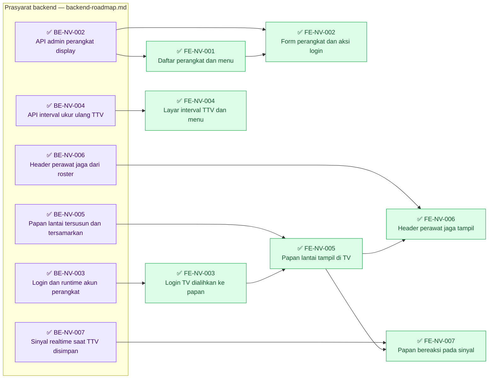
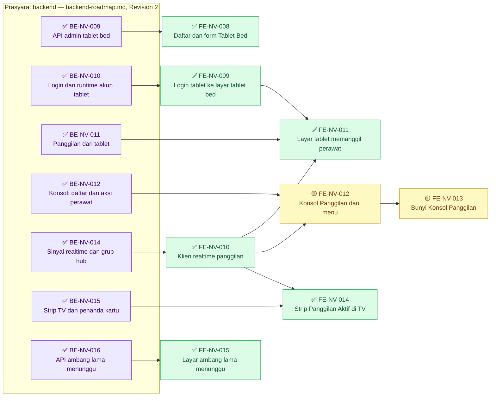

# Roadmap Frontend — Nurse View

| Field | Nilai |
|---|---|
| Blueprint ID | `nurse-view` · revision `1` · `approved` (`NV-DEC-028`) |
| Roadmap revision | `1` — 2026-10-28 |
| Contract version | `0.1.0` `approved` |
| Frontend SHA | `76b0c6e4b` (branch `RizkiV2`) |
| Masukan | `03-frontend-architecture.md`, `contracts/api-contract.md` |
| Owner | Rizki Gunawan |
| Ketentuan owner | Setiap task FE berpasangan dengan task BE, sehingga uji cukup sekali dari layar. Pakai ulang komponen dan gaya yang ada; `globals.css` tidak disentuh. Verifikasi agent: `npm run lint`. Tanpa unit test |

**Legenda tanda status:** ✅ selesai · 🟡 sebagian · ⛔ terblokir · tanpa tanda = belum dikerjakan.

**Pengecualian DoD yang berlaku untuk semua task:** test `.mjs`/unit test dikecualikan atas
keputusan Rizki Gunawan (ketentuan proyek). Uji layar dilakukan Rizki atau tim UAT.

> **Revision 2** (tablet bed dan panggilan pasien, `MVP-6` s.d. `MVP-9`, `FE-NV-008`–`FE-NV-015`)
> ada di bagian [Revision 2](#revision-2--tablet-bed-dan-panggilan-pasien) di bawah. Bagian dari
> sini sampai "Kartu task" adalah revision 1 dan tidak disunting.

## Grafik Urutan Dependency

| Gelombang | Boleh mulai setelah | Task |
| ---: | --- | --- |
| 1 | `BE-NV-002` | `FE-NV-001` |
| 1 | `BE-NV-003` | `FE-NV-003` |
| 1 | `BE-NV-004` | `FE-NV-004` |
| 2 | `FE-NV-001`, `BE-NV-002` | `FE-NV-002` |
| 2 | `FE-NV-003`, `BE-NV-005` | `FE-NV-005` |
| 3 | `FE-NV-005`, `BE-NV-006` | `FE-NV-006` |
| 3 | `FE-NV-005`, `BE-NV-007` | `FE-NV-007` |

Jumlah panah: **11**, sama dengan jumlah entri kolom `Dependency`. Gelombang dihitung dari
prasyarat frontend; prasyarat backend disebut pada kolom kedua dan wajib ✅ lebih dulu.

## Tabel task

| Task ID | Outcome | Requirement/decision | Kontrak | Reuse | Cakupan | Dependency | Acceptance criteria | Verifikasi | Risiko/pemilik | DoD |
|---|---|---|---|---|---|---|---|---|---|---|
| ✅ `FE-NV-001` | Daftar perangkat dan menu | `FR-NV-005`; `NV-DEC-016` | api §1 | Pola daftar `queue-display-devices` | Layar `FE-NVW-01`, butir menu "Display Nurse View" | `BE-NV-002` | Kartu | lint + uji layar | — / Rizki | Kartu |
| ✅ `FE-NV-002` | Form perangkat dan aksi login | `FR-NV-001`–`004`; `NV-DEC-022` | api §1 | Pola form `queue-display-devices/[slug]` | Layar `FE-NVW-02` | `BE-NV-002`, `FE-NV-001` | Kartu | lint + uji layar | Kata sandi tersimpan di state/log / Rizki | Kartu |
| ✅ `FE-NV-003` | Login TV dialihkan ke papan | `FR-NV-018`; `NV-DEC-009`, `030` | api §3 `/current` | Pola `queue-display` di `use-base-login.jsx`, `proxy.js` | Berkas bersama FE + kerangka route `/nurse-view-display` | `BE-NV-003` | Kartu, termasuk regresi | lint + login empat akun | **Regresi redirect** / Rizki, syarat lead | Kartu |
| ✅ `FE-NV-004` | Layar interval TTV dan menu | `FR-NV-020`–`022`; `NV-DEC-010` | api §2 | Komponen form/tabel yang ada | Layar `FE-NVW-03`, butir menu "Interval TTV Nurse View" | `BE-NV-004` | Kartu | lint + uji layar | Angka bawaan di form / Rizki | Kartu |
| ✅ `FE-NV-005` | Papan lantai tampil di TV | `FR-NV-010`–`016`, `021`, `030`, `031`; `NV-DEC-007`, `013`, `014`, `017` | api §3 `/board` | Pola layar `queue-display-screen-view`, hook refresh, pendengar `offline` | Layar `FE-NVW-04` tanpa header roster dan tanpa realtime | `BE-NV-005`, `FE-NV-003` | Kartu | lint + uji di TV/peramban layar penuh | Keterbacaan ±3 m / Rizki | Kartu |
| ✅ `FE-NV-006` | Header perawat jaga tampil | `FR-NV-017`; `NV-DEC-021` | api §3 `Wards[]` | — | Header per bangsal di `FE-NVW-04` | `BE-NV-006`, `FE-NV-005` | Kartu | lint + uji layar | — / Rizki | Kartu |
| ✅ `FE-NV-007` | Papan bereaksi pada sinyal | `FR-NV-032`; `NV-DEC-023` | api §4 | `queue-realtime-client.js` / `signalrHubClient.jsx` | Join grup lantai, muat ulang saat event | `BE-NV-007`, `FE-NV-005` | Kartu | lint + simpan TTV sambil mengamati TV | — / Rizki | Kartu |

## Kartu task

### ✅ FE-NV-001 — Daftar perangkat dan menu

| Field | Isi |
|---|---|
| Status | ✅ SELESAI — 2026-10-29. Skema `FE-NVW-01` dan butir menu terpetakan ke source; `npx eslint` 0 error, 2 warning `EXISTING WARNING` (pola rujukan job-level); grep anti-regresi UI 0 temuan; UI GATE PASS (seluruh REUSE); `npm run build` `PASS` (BUILD_ID 10:26). Uji layar 29 Okt (FE-NV-002 §6): no. 1, 2, 3, 17, 18, 19 seluruhnya `PASS`. Verifikasi developer, bukan UAT. Unit test dikecualikan atas keputusan Rizki Gunawan. Laporan: [`FE-NV-001.md`](../task/report/frontend/FE-NV-001.md) |
| Outcome | Admin IT melihat daftar perangkat Nurse View, menyaring per lantai/status, dan membuka menu dari sidebar |
| Cakupan | Route `/administrator/master-data/nurse-view-devices` (`page.jsx`), view daftar, service API, butir menu di `src/utils/menu-sidebar/menu-items.jsx` (Administrator › Master Data, dekat "Display Antrian"). Keadaan memuat/kosong/gagal sesuai skema §3.1. Tombol Tambah dijaga `NurseViewDisplayDevice : Create` |
| Acceptance criteria | Skema `FE-NVW-01` lengkap; online/offline dari `IsOnline`/`LastOnlineAt` (`FR-NV-005`); butir menu terjangkau |
| DEV_DISCRETION | Nama butir, urutan, ikon, warna |
| DoD | AC terpetakan; `npm run lint` lulus; tangkapan layar; laporan `task/report/frontend/FE-NV-001.md` |

### ✅ FE-NV-002 — Form perangkat dan aksi login

| Field | Isi |
|---|---|
| Status | ✅ SELESAI — 2 November 2026. Form, detail, dan tiga aksi login/nonaktif terpetakan ke source. `npx eslint` dua berkas perbaikan `0 errors`, 1 warning `EXISTING WARNING` (`set-state-in-effect`, baris lama); grep anti-regresi 0; UI GATE PASS. Uji layar 29 Okt: 19/20 `PASS`, no. 5 `FAIL`. No. 5 diperbaiki dengan redirect tertunda 1,5 detik (keputusan Rizki) dan `variant` pada toast; uji ulang 2 Nov `PASS`, 19/19 cek terukur, perangkat `NVW-000003`. Build `PASS` terakhir 29 Okt; `npm run build` sesudah perbaikan `NOT RUN` (dev server aktif; DoD kartu tidak memintanya). Penolakan runtime papan (`NV-AC-016`) dan tampilnya papan (`UAT-01`) lingkup `BE-NV-003`/`FE-NV-003`. Verifikasi developer, bukan UAT. Unit test dikecualikan atas keputusan Rizki Gunawan. Riwayat: 🟡 SEBAGIAN 29 Oktober 2026 karena no. 5 `FAIL`. Laporan: [`FE-NV-002.md`](../task/report/frontend/FE-NV-002.md) |
| Outcome | Admin membuat/mengubah perangkat dan menjalankan Buat Login, Atur Ulang Login, Nonaktifkan |
| Cakupan | Route `create` dan `[slug]`; pilihan lantai dari `GET /floors`; tombol mengikuti `AvailableActions`; konfirmasi + alasan nonaktif; kotak kata sandi sekali tampil dengan Salin. Kata sandi **tidak** masuk Redux/global state, localStorage, maupun `console`. Kirim ganda dikunci; `409` → pesan + muat ulang |
| Acceptance criteria | `NV-AC-016`, `018`; `VAL-NV-01`–`08` tampil di bawah isian; `UAT-01`–`03` |
| DEV_DISCRETION | Modal atau inline untuk konfirmasi; tata letak form |
| DoD | AC terpetakan; lint lulus; rekaman alur buat → login → reset → nonaktif; laporan `FE-NV-002.md` |

### ✅ FE-NV-003 — Login TV dialihkan ke papan

| Field | Isi |
|---|---|
| Status | ✅ SELESAI — 3 November 2026. Cabang login, penguncian route, dan kerangka `/nurse-view-display` terpetakan ke source; `npx eslint` `0 errors`, 1 warning `EXISTING WARNING`; UI GATE PASS; uji TV 9/9 `PASS` (67 cek) dan regresi redirect 5/5 sama dengan baseline (2 Nov); halaman detail admin 3/3 normal dari sidebar (3 Nov). `npm run build` `NOT RUN` (dev server aktif; DoD kartu tidak memintanya). Verifikasi developer, bukan UAT. Unit test dikecualikan atas keputusan Rizki Gunawan. Riwayat: 🟡 SEBAGIAN 2 Nov karena rute admin `404` di dev server, ternyata masalah lingkungan. Laporan: [`FE-NV-003.md`](../task/report/frontend/FE-NV-003.md) |
| Outcome | Akun perangkat Nurse View yang login langsung masuk `/nurse-view-display`; akun lain tidak berubah |
| Cakupan | `src/lib/hooks/auth/use-base-login.jsx`: cabang baru meniru cabang display antrean, menyetel cookie `isNurseViewAccount`. `src/proxy.js`: konstanta `NURSE_VIEW_DISPLAY_PATH`, redirect, dan penguncian route. Kerangka `src/app/nurse-view-display/` (`layout.jsx`, `page.jsx`) yang memanggil `GET /current` dan menangani `401`/`403` → layar login |
| Acceptance criteria | `NV-AC-016`; **`NV-AC-023`–`027`** dan `UAT-11` dari sisi redirect: perawat → dashboard, Kiosk → `/kiosk`, display antrean → `/queue-display`, Nurse View → `/nurse-view-display` |
| Risiko | Syarat lead `NV-DEC-030`. Cabang Kiosk dan display antrean **tidak disunting** isinya |
| DoD | AC terpetakan; lint lulus; rekaman login empat akun; laporan `FE-NV-003.md` mencantumkan diff ringkas kedua berkas bersama |

### ✅ FE-NV-004 — Layar interval TTV dan menu

| Field | Isi |
|---|---|
| Status | ✅ SELESAI — 2 November 2026. Route, butir menu, skema §3.3, dan mode baca saja terpetakan ke source; tanpa angka bawaan. `npx eslint` 8 berkas `0 errors`, 1 warning `EXISTING WARNING`; grep anti-regresi 0; UI GATE PASS (seluruh REUSE). Uji dengan backend sungguhan: no. 1–12 `PASS` (no. 11 dan 12 memakai keadaan simulasi). No. 13 milik `BE-NV-004`: `PASS` pada uji ulang, dan tidak mengubah layar. `UAT-07` butuh `FE-NV-005`. Verifikasi developer, bukan UAT. Unit test dikecualikan atas keputusan Rizki Gunawan. Laporan: [`FE-NV-004.md`](../task/report/frontend/FE-NV-004.md) |
| Outcome | Admin mengisi interval per tingkat EWS beserta nomor dan tanggal pengesahan |
| Cakupan | Route `/administrator/master-data/nurse-view-vital-sign-intervals`; butir menu; skema §3.3; isian tanpa angka bawaan; mode baca saja bila tanpa `NurseViewVitalSignInterval : Update` |
| Acceptance criteria | `NV-AC-004`; `VAL-NV-09`–`13`; `UAT-07`, `UAT-08`; status "Belum dikonfigurasi" saat kosong |
| DoD | AC terpetakan; lint lulus; tangkapan layar kosong dan terisi; laporan `FE-NV-004.md` |

### ✅ FE-NV-005 — Papan lantai tampil di TV

| Field | Isi |
|---|---|
| Status | ✅ SELESAI — 4 November 2026. View papan, kartu, hook muat ulang, dan pita data basi terpetakan ke source; `npx eslint` 7 berkas `0 errors`, 0 warning; grep anti-regresi 0; UI GATE PASS (2 REUSE, sisanya COMPOSE dengan token). Uji layar 8/8 `PASS` (44 cek; L5, L6, L8 memakai jawaban `/board` tiruan); perubahan data tampil di TV dalam 57 detik tanpa muat ulang halaman (L9); uji TV N1–N9 `PASS` dengan papan sungguhan. 4 Nov: ikon J dan I beserta "Bed tidak sesuai isolasi", serta bed dari kamar tanpa kunci denah, terbukti dengan data nyata (AC011, AC013, AC021 `PASS`). Keterbacaan ±3 m dinilai Rizki di TV `NVW-000003` (4 Nov): terbaca, ukuran huruf tidak diubah; perkiraan ukur baris kecil 7–9,5 mm di TV 43–55 inci dicatat sebagai data pendukung. `npm run build` `NOT RUN` (dev server aktif). Verifikasi developer, bukan UAT. Unit test dikecualikan atas keputusan Rizki Gunawan. Riwayat: 🟡 SEBAGIAN 3 November 2026 karena keterbacaan belum dinilai di TV. Laporan: [`FE-NV-005.md`](../task/report/frontend/FE-NV-005.md) |
| Outcome | TV menampilkan papan lantai: grid per bangsal, kartu kritis di atas, ganti halaman otomatis, muat ulang 60 detik, pita data basi |
| Cakupan | View papan di `/nurse-view-display`: kepala (lantai, jam, jam data), kelompok bangsal, kartu terisi dan kosong, ikon J/A/I, tanda "Bed tidak sesuai isolasi", "Belum ada PJ", "Belum ada TTV", lewat jadwal. Tanpa suara. Papan hanya di memori, tidak disimpan ke storage. Header roster menyusul di `FE-NV-006` |
| Acceptance criteria | `NV-AC-001`–`008`, `010`–`014`, `020`, `021`; `UAT-04`, `UAT-09`, `UAT-10`; keterbacaan ±3 m (`NV-FE-002`) |
| DEV_DISCRETION | Warna, ikon, ritme kedip, durasi per halaman (`NV-FE-003`, `004`) |
| DoD | AC terpetakan; lint lulus; rekaman di layar besar termasuk putus jaringan; laporan `FE-NV-005.md` |

### ✅ FE-NV-006 — Header perawat jaga tampil

| Field | Isi |
|---|---|
| Status | ✅ SELESAI — 4 November 2026. Kepala bangsal (nama bangsal + "Perawat jaga: …" atau "Roster shift ini belum tersedia") terpetakan ke source; `npx eslint` `0 errors`, 0 warning; Prettier lulus; grep anti-regresi 0; UI GATE PASS. Uji layar 4/4 `PASS`: roster kosong (lantai 3) dan bangsal tanpa unit (lantai 2) dengan data nyata; tiga perawat dua shift dan 30 perawat di 1366×768 dengan jawaban `/board` tiruan. Regresi `FE-NV-005` L1–L8 8/8 `PASS`. 4 Nov: `NV-AC-009` terbukti dengan data nyata — kepala bangsal Rawat Inap di TV `NVW-000003` menampilkan "Perawat jaga: …" dengan tiga perawat roster, tanpa non-perawat (AC009 `PASS`, `BE-NV-006` §5). `npm run build` `NOT RUN` (dev server aktif). Verifikasi developer, bukan UAT. Unit test dikecualikan atas keputusan Rizki Gunawan. Riwayat: 🟡 SEBAGIAN 3 November 2026 karena `NV-AC-009` hanya terbukti dengan jawaban tiruan. Laporan: [`FE-NV-006.md`](../task/report/frontend/FE-NV-006.md) |
| Outcome | Kelompok bangsal menampilkan nama perawat jaga atau "Roster shift ini belum tersedia" |
| Cakupan | Header per bangsal dari `Wards[].OnDutyNurses`, `RosterAvailable` |
| Acceptance criteria | `NV-AC-009`, `017` |
| DoD | AC terpetakan; lint lulus; tangkapan layar kedua keadaan; laporan `FE-NV-006.md` |

### ✅ FE-NV-007 — Papan bereaksi pada sinyal

| Field | Isi |
|---|---|
| Status | ✅ SELESAI — 4 November 2026. Join `JoinNurseViewFloor` saat tersambung dan saat sambung ulang, muat ulang dari event `NurseViewBoardChanged` dengan batas 1×/5 detik, dan muat ulang 60 detik sebagai cadangan terpetakan ke source (`use-nurse-view-floor-board.jsx`; penambahan di `queue-realtime-client.js`). `npx eslint` 0 error 0 warning; Prettier lulus untuk berkas Nurse View. Uji layar 6/6 `PASS` (31 cek): TTV Kritis → muat ulang 0,01 detik sebelum jawaban simpan tiba, data kritis 0,19 detik, kartu 325-B "Kritis" di kelompok kritis teratas tanpa bunyi (`NV-AC-019`, `NV-AC-003`); dua muat ulang berjarak 5,02 detik untuk tiga sinyal; sambung ulang 0,08 detik dengan join ulang; TV hanya memanggil `JoinNurseViewFloor` (`NV-AC-022` sisi klien). Rekaman video berjam tersimpan. Regresi `FE-NV-005` 7/8: L2-E gagal karena pemesanan bed uji kedaluwarsa (data, bukan diff ini). `npm run build` `NOT RUN`. Verifikasi developer, bukan UAT. Revisi 10 Nov 2026 sore (persetujuan Rizki): bila `JoinNurseViewFloor` gagal sementara koneksi tetap tersambung, muat ulang berkala mencoba join lagi (uji `uji-join-ulang.mjs` 7/7, regresi F0–F5 6/6); commit `554e404d0`, belum masuk build produksi. Laporan: [`FE-NV-007.md`](../task/report/frontend/FE-NV-007.md) |
| Outcome | Kartu berubah beberapa detik sesudah TTV disimpan, tanpa menunggu muat ulang 60 detik |
| Cakupan | Join `JoinNurseViewFloor` sesudah tersambung, termasuk saat sambung ulang; event `NurseViewBoardChanged` → muat ulang (dibatasi 1×/5 detik); muat ulang 60 detik tetap berjalan sebagai cadangan |
| Acceptance criteria | `NV-AC-003`, `019`, `022` dari sisi klien |
| DoD | AC terpetakan; lint lulus; rekaman berjam simpan TTV → kartu berubah; laporan `FE-NV-007.md` |

## Revision 2 — Tablet bed dan panggilan pasien

| Field | Nilai |
|---|---|
| Blueprint ID | `nurse-view` · revision `2` · `approved` (`NV-DEC-055`) |
| Roadmap revision | `2` — 2026-11-05 · **`approved`** — Rizki Gunawan, 2026-11-05 ("lanjutkan saya setujui", sesi `plan-module-delivery`) |
| Contract version | `0.2.0` `approved` (`NV-DEC-055`) |
| Frontend SHA | `91a11b08f` (branch `RizkiV2`) — sama dengan baseline revision 2, sehingga impact scan tidak diulang |
| Masukan | `03-frontend-architecture.md` Revision 2; `contracts/api-contract.md` §5–§10; `contracts/state-transition-matrix.md` §6–§7; `contracts/validation-matrix.md` R2; `testing/acceptance-test-matrix.md` R2; `04-prd-to-mvp.md` R2.18–R2.20 |
| Hash masukan | md5, 12 karakter pertama: `03-frontend-architecture.md` `d7c435ebc16b` · `contracts/api-contract.md` `8dc7b3aae027` (label status §5–§8 dibetulkan; sebelumnya `d85638ceed17`) · `contracts/state-transition-matrix.md` `ae9363a99ca1` · `contracts/validation-matrix.md` `8f4fef93d6b7` · `04-prd-to-mvp.md` `a4155103aa87` · `00-interview-decisions.md` `9c7cd23add31`. Daftar lengkap di `blueprint-manifest.md` blok Revision 2 |
| Gerbang | `NV-OQ-028` **ditutup** 2026-11-05 (`NV-DEC-056`): lead merestui berkas bersama R2.7 dengan syarat `NV-DEC-030` |
| Owner | Rizki Gunawan |
| Ketentuan owner | Sama dengan revision 1: setiap task FE berpasangan dengan task BE; pakai ulang komponen dan gaya yang ada; `globals.css` tidak disentuh; verifikasi agent `npx eslint` pada berkas yang disentuh; uji layar oleh Rizki/Antigravity; `npm run build` boleh dijalankan agent sesudah memeriksa bahwa port 3000 tidak sedang dipakai server uji |
| Test otomatis | Tanpa unit test (ketentuan owner). `rules/frontend/test-policy.md` menjadikan penulisan test opsional, sehingga ketiadaannya tidak menahan task |
| Kewenangan UI | `NV-FE-006` (kapasitas strip), `NV-FE-007` (jeda pengingat), `NV-FE-009` (interval cadangan), `NV-FE-010` (tampilan tablet, nada Darurat) = `DEV_DISCRETION`. `NV-FE-008` (konsol di grup menu Rawat Inap) `approved`. Isi, privasi, urutan, dan aturan bunyi milik owner (`NV-DEC-038`–`047`) |

**Legenda tanda status:** ✅ selesai · 🟡 sebagian · ⛔ terblokir · tanpa tanda = belum dikerjakan.
Seluruh task revision 2 belum dikerjakan.

Revision 1 (`FE-NV-001`–`007`, seluruhnya ✅) adalah titik awal. Task revision 2 memakai hasilnya
sebagai kemampuan yang sudah ada (kolom **Reuse**), bukan sebagai baris `Dependency`.

### Grafik Urutan Dependency

Grafik ini memakai Mermaid, sama dengan grafik revision 1 di atas, karena satu berkas roadmap
tidak boleh memuat dua bentuk grafik (`rules/rule-output/grafik-dependency-roadmap.md` §13).
Node ungu adalah cermin baca-saja task backend dari bagian Revision 2 `backend-roadmap.md`;
tandanya disalin dari sana.

| Gelombang | Boleh mulai setelah | Task |
| ---: | --- | --- |
| 1 | `BE-NV-009` | `FE-NV-008` |
| 1 | `BE-NV-010` | `FE-NV-009` |
| 1 | `BE-NV-014` | `FE-NV-010` |
| 1 | `BE-NV-016` | `FE-NV-015` |
| 2 | `FE-NV-009`, `FE-NV-010`, `BE-NV-011` | `FE-NV-011` |
| 2 | `FE-NV-010`, `BE-NV-012` | `FE-NV-012` |
| 2 | `FE-NV-010`, `BE-NV-015` | `FE-NV-014` |
| 3 | `FE-NV-012` | `FE-NV-013` |

Jumlah panah: **12**, sama dengan jumlah entri kolom `Dependency` pada tabel task revision 2.
Jumlah node 15 (8 task frontend + 7 cermin backend), masih dalam batas satu grafik. Gelombang
dihitung dari prasyarat frontend, sama dengan revision 1; prasyarat backend disebut di kolom
kedua dan wajib ✅ lebih dulu. Tidak ada task ⛔.

**Cara membaca grafik.** `FE-NV-008` dan `FE-NV-009` bisa dikerjakan begitu `BE-NV-009` dan
`BE-NV-010` selesai, jauh sebelum backend panggilan rampung. `FE-NV-015` hanya menunggu
`BE-NV-016`, yang sendiri ada di gelombang 2 backend, sehingga layar ambang bisa jadi paling awal.
Ketiga layar panggilan (`FE-NV-011`, `012`, `014`) menunggu `FE-NV-010`, karena ketiganya memakai
klien realtime yang sama.

### Berkas bersama per task

| Berkas | Task | Perubahan |
|---|---|---|
| `src/proxy.js`, `src/lib/hooks/auth/use-base-login.jsx` | `FE-NV-009` | Cookie `isNurseViewBedTabletAccount`, redirect, dan penguncian route `/nurse-view-bed-tablet` |
| `root-layout-shell.jsx`, `auth-wrapper.jsx`, `session-activity-manager.jsx` | `FE-NV-009` | Masing-masing satu baris `"/nurse-view-bed-tablet"` pada daftar prefix |
| `src/lib/realtime/queue-realtime-client.js` | `FE-NV-010` | Event `NurseViewPatientCallChanged` dan join/leave konsol serta tablet |
| `src/utils/menu-sidebar/menu-items.jsx` | `FE-NV-008`, `FE-NV-012`, `FE-NV-015` | Tiga butir menu `03-frontend-architecture.md` R2.2 |

Seluruhnya tunduk pada `NV-DEC-056` beserta syarat `NV-DEC-030`. Butir "Konsol Panggilan Pasien"
masuk grup tingkat 0 "Rawat Inap" (`menu-items.jsx` baris 2059) milik modul Rawat Inap, sehingga
penambahannya dikabarkan ke Muhammad Hamzah lewat `TLM-NV-002` (`NV-FE-008`). Laporan task yang
menyentuh berkas bersama wajib memuat diff ringkas per berkas.

### Tabel task revision 2

| Task ID | Outcome | Requirement/decision | Kontrak | Reuse | Cakupan | Dependency | Acceptance criteria | Verifikasi | Risiko/pemilik | DoD |
|---|---|---|---|---|---|---|---|---|---|---|
| ✅ `FE-NV-008` | Daftar dan form Tablet Bed beserta butir menu | `FR-NV-033`–`035`; `NV-DEC-035`; `AD-01`–`04` | api §5 | Layar `nurse-view-devices` | Layar `FE-NVW-05`, `FE-NVW-06`, butir menu "Tablet Bed Nurse View" | `BE-NV-009` | Kartu | lint + uji layar | Kata sandi tersimpan di state/log / Rizki | Kartu |
| ✅ `FE-NV-009` | Login tablet dialihkan ke layar tablet bed | `FR-NV-036`; `NV-DEC-030`, `046`, `056`; `G-09` | api §6 `/current` | Cabang `isNurseViewAccount`, kerangka `/nurse-view-display` | Lima berkas bersama + kerangka `/nurse-view-bed-tablet` | `BE-NV-010` | Kartu, termasuk regresi `NV-AC-041` | lint + login lima akun | **Regresi redirect** / Rizki, syarat lead | Kartu |
| ✅ `FE-NV-010` | Klien realtime panggilan pasien (task pendukung) | `FR-NV-048`; `NV-AC-028` | api §10 | `joinNurseViewFloor`, pola join ulang | Event + join/leave konsol dan tablet di `queue-realtime-client.js` | `BE-NV-014` | Kartu | lint + regresi TV papan | Regresi realtime layar lain / Rizki, syarat lead | Kartu |
| ✅ `FE-NV-011` | Layar tablet: panggil, Darurat, batal, perawat hadir | `FR-NV-037`, `038`, `040`, `042`, `045`; `NV-DEC-037`–`039`, `041`, `046`, `050`, `054` | api §6, §10 | Kerangka `FE-NV-009`, klien `FE-NV-010` | Layar `FE-NVW-07` lengkap | `BE-NV-011`, `FE-NV-009`, `FE-NV-010` | Kartu | lint + uji tablet termasuk putus jaringan | Pasien mengira terkirim padahal belum / Rizki | Kartu |
| 🟡 `FE-NV-012` | Konsol Panggilan: lantai, daftar, aksi, menu, hapus prototipe | `FR-NV-039`, `041`, `049`, `050`, `052`; `NV-DEC-040`, `043`, `044`, `051`, `053`; `NV-FE-008` | api §7, §10 | `requiredPermission` menu, pita data basi, klien `FE-NV-010` | Layar `FE-NVW-08` tanpa bunyi; butir menu; hapus `nurseCallContext.jsx` | `BE-NV-012`, `FE-NV-010` | Kartu | lint + uji konsol dua perawat | Konsol untuk lantai salah / Rizki | Kartu |
| 🟡 `FE-NV-013` | Bunyi Konsol Panggilan | `FR-NV-051`; `NV-DEC-045`; `G-14` | api §7, §10 | `playArrivalSound`, deteksi autoplay layar antrean | Bunyi, nada Darurat, pengingat, tunda, "Aktifkan suara" | `FE-NV-012` | Kartu | lint + rekaman bersuara | Kelelahan alarm / Rizki | Kartu |
| ✅ `FE-NV-014` | Strip Panggilan Aktif dan penanda kartu di TV | `FR-NV-046`–`048`; `NV-DEC-013`, `044`, `047`, `048` | api §9, §10 | Papan `FE-NV-005`/`007`, klien `FE-NV-010` | Strip di atas papan + penanda kartu | `BE-NV-015`, `FE-NV-010` | Kartu | lint + uji TV berjam | Regresi papan revision 1 / Rizki | Kartu |
| ✅ `FE-NV-015` | Layar ambang lama menunggu beserta butir menu | `FR-NV-053`; `NV-DEC-048`; `G-15` | api §8 | Layar interval TTV `FE-NV-004` | Layar `FE-NVW-09`, butir menu "Ambang Panggilan Nurse View" | `BE-NV-016` | Kartu | lint + uji layar | Angka bawaan di form / Rizki | Kartu |

### Kartu task revision 2

#### ✅ FE-NV-008 — Daftar dan form Tablet Bed beserta butir menu

| Field | Isi |
|---|---|
| Status | ✅ **SELESAI 6 November 2026.** AC 6/6 terpetakan ke source; `npx eslint` 0 error (1 warning pola warisan hook sebaudara); UI gate seluruh elemen `REUSE`; uji layar 6 Nov 18/18 cek `PASS` (14 cek task ini) dengan aktor peran berizin sementara, aktor baca-saja, dan LOKET — sesudah dua perbaikan temuan uji (isian Bed `remote: false`; `VAL-NV-19` mengosongkan isian Bed). AC-5 (`VAL-NV-20`) bukti runtime menunggu `BE-NV-011`, sesuai kartu. `npm run build` `NOT RUN` (dev server Rizki di port 3000; build tidak diminta kartu). `AUTOMATED TEST: SKIPPED (opsional)`. Laporan: [`FE-NV-008.md`](../task/report/frontend/FE-NV-008.md) |
| Gelombang | 1 · `MVP-6` · `EPIC NV-05` |
| Outcome | Admin IT membuka "Tablet Bed Nurse View" dari sidebar, melihat daftar tablet, mendaftarkan tablet untuk satu bed, mengubah atau memindahkan bed, lalu menjalankan Buat Login, Atur Ulang Login, dan Nonaktifkan |
| Trace | `FR-NV-033`, `034`, `035`; `NV-DEC-035`; `AD-01`–`04`; `03-frontend-architecture.md` R2.1, R2.2, R2.3 (`FE-NVW-05`, `FE-NVW-06`), R2.9; flowchart `06` |
| Kontrak | `0.2.0` api §5 |
| Reuse | Route dan view `src/app/administrator/master-data/nurse-view-devices/` (`page.jsx`, `create/`, `[slug]/`, `[slug]/update/`, `nurse-view-device-client.jsx`) sebagai pola; isian lantai diganti pemilih lantai lalu bed. Pelajaran `FE-NV-002`: toast memakai `variant`, redirect tertunda, kata sandi tidak masuk state global |
| Cakupan | (1) Route `/administrator/master-data/nurse-view-bed-tablets` beserta `create` dan `[slug]`; service API. (2) Daftar: cari kode/nama/bed, saringan lantai dan status, kolom kode, nama, bed, lantai, status, online; keadaan memuat, kosong ("Belum ada tablet bed."), dan gagal ("Data tablet gagal dimuat." + Coba lagi); tombol Tambah hanya bagi `NurseViewBedTablet : Create`. (3) Form: lantai → bed dari `bed-options`; bed yang sudah punya tablet tidak bisa dipilih; lantai tanpa bed → "Lantai ini belum punya bed aktif."; nama, lokasi, keterangan; pesan validasi di bawah isian. (4) Rincian: status, online, jejak login dan nonaktif, "Ada panggilan aktif"; tombol mengikuti `AvailableActions`; konfirmasi + alasan untuk Nonaktifkan; kotak kata sandi sekali tampil dengan Salin. (5) Kirim ganda dikunci; `409` → pesan matriks validasi + muat ulang. (6) Butir menu "Tablet Bed Nurse View" di Administrator › Master Data dengan `requiredPermission` `NurseViewBedTablet : Read` |
| Berkas bersama | `menu-items.jsx` (satu butir) — restu `NV-DEC-056` |
| Acceptance criteria | AC-1 skema `FE-NVW-05` dan `FE-NVW-06` lengkap, termasuk ketiga keadaan daftar. AC-2 `UAT-12` sisi admin: daftarkan tablet untuk bed 305-A → `NVT-000001`; Buat Login → nama pengguna dan kata sandi tampil sekali. AC-3 `UAT-13`: bed 305-A tidak bisa dipilih untuk tablet kedua; bila permintaan tetap terkirim, pesan `VAL-NV-19` tampil. AC-4 kata sandi tidak ada di Redux, `localStorage`, `sessionStorage`, maupun `console`. AC-5 pindah bed saat bed lama masih punya panggilan aktif → pesan `VAL-NV-20` (bukti runtime sesudah `BE-NV-011` ada). AC-6 butir menu terjangkau bagi pemegang izin dan tersembunyi bagi yang tidak |
| DEV_DISCRETION | Nama dan urutan butir menu, ikon; modal atau inline untuk konfirmasi; tata letak form |
| Verifikasi | `npx eslint` pada berkas yang disentuh; UI gate (pakai ulang atau buat baru); uji layar oleh Rizki/Antigravity; `npm run build` bila diminta, sesudah memeriksa port 3000 |
| Risiko/pemilik | Kata sandi tersimpan di state atau log / Rizki |
| DoD | AC-1–6 terpetakan ke source; lint `0 errors`; rekaman alur buat → login → atur ulang → nonaktif; laporan `task/report/frontend/FE-NV-008.md` |

#### ✅ FE-NV-009 — Login tablet dialihkan ke layar tablet bed

| Field | Isi |
|---|---|
| Status | ✅ **SELESAI 10 November 2026.** AC 5/5 terbukti di layar. Regresi login lima akun (SuperAdmin, perawat, LOKET, Kiosk, display antrean) sama dengan baseline `FE-NV-003` 2 Nov: tujuan, profil, sidebar, dan probe identik, kecuali `nurseViewCurrent` 404 → 403 dan dua klaim baru bernilai `false` (diharapkan). Uji layar tablet P1, P2, P8, P9, P10 `PASS` (putaran bersih 11/11). Perbaikan selama uji: P10 semula 63 detik (> 60) karena muat ulang tablet tanpa panggilan tiap 60 detik; batas atas `NURSE_VIEW_BED_TABLET_MAX_REFRESH_SECONDS` diturunkan 60 → 45 (`NV-FE-009` `DEV_DISCRETION`), sesudahnya 45 detik. `npx eslint` 0 error. Perubahan satu baris itu belum di-commit dan belum masuk build produksi. Laporan: [`FE-NV-009.md`](../task/report/frontend/FE-NV-009.md) |
| Gelombang | 1 · `MVP-6` · `EPIC NV-05` |
| Outcome | Akun tablet bed yang login langsung masuk `/nurse-view-bed-tablet` tanpa sidebar dan tertahan di sana. Layar menampilkan kode bed dan nama kamar, atau "Bed belum berpenghuni". Akun lain tetap ke tujuan masing-masing |
| Trace | `FR-NV-036`; `NV-DEC-030`, `032`, `046`, `056`; `NV-CAP-21`; `G-09`; `NV-AC-041`; `UAT-12`, `14`, `26`; state §6 (`Memuat`, `BedKosong`, `Ditolak`); `03-frontend-architecture.md` R2.7 |
| Kontrak | `0.2.0` api §6 `GET /current` |
| Reuse | Cabang `isNurseViewAccount` di `use-base-login.jsx` dan `NURSE_VIEW_DISPLAY_PATH` di `proxy.js` (`FE-NV-003`); satu entri daftar prefix di tiga berkas provider (`NV-DEC-032`); kerangka `src/app/nurse-view-display/` dan `nurse-view-display-service.jsx` |
| Cakupan | (1) `use-base-login.jsx`: kenali `is_nurse_view_bed_tablet_account` dan setel cookie `isNurseViewBedTabletAccount`. (2) `proxy.js`: `NURSE_VIEW_BED_TABLET_PATH = "/nurse-view-bed-tablet"`; alihkan akun bercookie itu ke sana dan cegah route lain. (3) `root-layout-shell.jsx`, `auth-wrapper.jsx`, `session-activity-manager.jsx`: masing-masing satu baris `"/nurse-view-bed-tablet"`. (4) `src/app/nurse-view-bed-tablet/` (`layout.jsx`, `page.jsx`, client) yang memanggil `GET /current`: kepala layar berisi kode bed dan nama kamar, **tanpa** nama atau inisial pasien; keadaan `Memuat`, `BedKosong`, `Ditolak` (`401`/`403` → layar login); muat ulang 60 detik selama tanpa panggilan. Tombol panggil dan keadaan panggilan menyusul di `FE-NV-011` |
| Berkas bersama | `proxy.js`, `use-base-login.jsx`, `root-layout-shell.jsx`, `auth-wrapper.jsx`, `session-activity-manager.jsx` — restu `NV-DEC-056` |
| Acceptance criteria | AC-1 regresi redirect (`NV-AC-041`, `UAT-26`): perawat → dashboard, Kiosk → `/kiosk`, display antrean → `/queue-display`, TV Nurse View → `/nurse-view-display`, tablet bed → `/nurse-view-bed-tablet`; tidak ada akun lain yang ke `/nurse-view-bed-tablet`. AC-2 akun tablet yang mengetik `/dashboard` atau `/nurse-view-display` dikembalikan ke `/nurse-view-bed-tablet`; layar tanpa sidebar. AC-3 jaringan putus sesaat tidak menghapus sesi tablet (peran `auth-wrapper`). AC-4 tablet dinonaktifkan → kembali ke layar login paling lambat 60 detik. AC-5 layar tanpa nama, inisial, maupun No. RM pasien; bed kosong → "Bed belum berpenghuni" |
| DEV_DISCRETION | Tata letak kepala layar (`NV-FE-010`) |
| Verifikasi | `npx eslint` pada berkas yang disentuh; UI gate; uji login lima akun oleh Rizki/Antigravity dibandingkan dengan baseline `FE-NV-003` |
| Risiko/pemilik | **Regresi redirect seluruh aplikasi** / Rizki, syarat lead `NV-DEC-030`/`056`. Isi cabang Kiosk, display antrean, dan TV Nurse View **tidak disunting** |
| DoD | AC-1–5 terpetakan ke source; lint `0 errors`; rekaman login lima akun; laporan `task/report/frontend/FE-NV-009.md` memuat diff ringkas tiap berkas bersama |

#### ✅ FE-NV-010 — Klien realtime panggilan pasien

| Field | Isi |
|---|---|
| Status | ✅ **SELESAI 10 November 2026.** AC-1 dan AC-2 terpetakan ke source; AC-3 terbukti: skrip regresi TV `FE-NV-007` (F0–F5) dijalankan ulang tanpa perubahan, 6/6 `PASS` (join `JoinNurseViewFloor` tanpa argumen, muat ulang dari `NurseViewBoardChanged` ≤ 2 detik, jeda minimum 5 detik, sambung ulang dan join ulang, muat ulang 60 detik, satu-satunya method hub TV tetap `JoinNurseViewFloor`). AC-4 dibuktikan task pemakai (`FE-NV-011`, `012`, `014` lulus). `npx eslint` 0 error. Laporan: [`FE-NV-010.md`](../task/report/frontend/FE-NV-010.md) |
| Gelombang | 1 · `MVP-8` · task pendukung |
| Outcome | Klien realtime bersama mengenali sinyal `NurseViewPatientCallChanged` dan bisa bergabung ke grup konsol per lantai serta grup tablet, termasuk saat tersambung ulang, tanpa mengubah perilaku grup lain |
| Alasan berdiri sendiri | Tablet, konsol, dan TV sama-sama butuh perubahan ini. Dengan satu task, diff `queue-realtime-client.js` cukup ditinjau sekali terhadap syarat lead (`NV-DEC-056`), dan ketiga task layar bisa berjalan paralel tanpa saling menyunting berkas yang sama |
| Trace | `FR-NV-048`; `NV-AC-028` (sisi klien); `03-frontend-architecture.md` R2.5, R2.7; integration-contract R2 §8 |
| Kontrak | `0.2.0` api §10 |
| Reuse | `queue-realtime-client.js#joinNurseViewFloor` (baris 578) dan pola join ulang `shouldJoinNurseViewFloor` (baris 166, 316); konstanta `NURSE_VIEW_BOARD_EVENT_NAME` (baris 16) |
| Cakupan | (1) Konstanta `NURSE_VIEW_PATIENT_CALL_EVENT_NAME = "NurseViewPatientCallChanged"` dan opsi callback `onNurseViewPatientCallChanged`. (2) `joinNurseViewCallConsole(floorCode)` / `leaveNurseViewCallConsole(floorCode)`, dengan lantai terakhir diingat untuk join ulang. (3) `joinNurseViewBedTablet()` / `leaveNurseViewBedTablet()`. (4) Join ulang keduanya saat tersambung kembali; keduanya dibersihkan saat klien berhenti. (5) Fungsi baru diekspor. Grup dan event yang sudah ada tidak diubah |
| Berkas bersama | `queue-realtime-client.js` — restu `NV-DEC-056` |
| Acceptance criteria | AC-1 nama event, method hub, dan argumen sama persis dengan api §10. AC-2 diff hanya menambah; baris untuk grup lain tidak berubah. AC-3 regresi TV papan: join `JoinNurseViewFloor` saat tersambung dan saat sambung ulang, serta muat ulang dari `NurseViewBoardChanged`, tetap seperti `FE-NV-007` (F0–F5). AC-4 penerimaan sinyal panggilan di layar dibuktikan oleh task pemakainya (`FE-NV-011`, `012`, `014`), bukan di task ini |
| Verifikasi | `npx eslint`; review diff; uji regresi TV papan oleh Rizki/Antigravity |
| Risiko/pemilik | Regresi realtime layar lain yang memakai klien yang sama (antrean, admisi, TV) / Rizki, syarat lead |
| DoD | AC-1–3 terpetakan ke source; lint `0 errors`; regresi TV tercatat; laporan `task/report/frontend/FE-NV-010.md` |

#### ✅ FE-NV-011 — Layar tablet: panggil perawat, Darurat, batal, perawat hadir

| Field | Isi |
|---|---|
| Status | ✅ **SELESAI 10 November 2026.** AC 6/6 terpetakan ke source; uji layar tablet 1280×800 11/11 `PASS` (putaran bersih): Siap dua tombol tanpa identitas; Batal hanya untuk biasa Menunggu; Darurat tanpa Batal; "‹nama› menuju" 0,84 detik sesudah klaim; tahan 1,5 detik tetap aktif, 3,6 detik → Ditangani; Wi-Fi diputus → "Panggilan belum terkirim — tekan bel di dinding", tersambung → tepat satu panggilan; bed kosong "Bed belum berpenghuni". Bagian AC-5 "area perawat tetap saat bed kosong dengan panggilan aktif" terpetakan ke source; bukti runtime dikecualikan seperti keputusan Rizki 9 Nov 2026 untuk kasus yang sama (`BE-NV-011`), karena keadaan itu hanya bisa dibuat lewat koreksi penempatan yang tidak dapat dipulihkan. Putaran sebelumnya: P1 gagal sekali karena DB dev timeout (`EXISTING / ENVIRONMENT ISSUE`, backend 500 sesudah 15 detik). Tambahan atas permintaan Rizki 10 Nov 2026: tombol Keluar di kanan atas, ditahan 3 detik (uji K2–K3 `PASS`). Revisi 10 Nov 2026 sore (persetujuan Rizki): P4 sempat gagal karena `JoinNurseViewBedTablet` timeout DB, sementara koneksi tetap tersambung dan galatnya ditelan. Kini muat ulang berkala mencoba join lagi (uji `uji-join-ulang.mjs` 7/7, regresi tablet 11/11); commit `554e404d0`, belum masuk build produksi. Laporan: [`FE-NV-011.md`](../task/report/frontend/FE-NV-011.md) |
| Gelombang | 2 · `MVP-8` · `EPIC NV-06` |
| Outcome | Pasien memanggil biasa atau Darurat, melihat status dan lama menunggu, dan membatalkan panggilan biasa yang belum diklaim. Perawat menahan "Perawat hadir" 3 detik. Bila gagal terkirim, tablet selalu menunjuk bel dinding |
| Trace | `FR-NV-037`, `038`, `040`, `042`, `045`; `NV-DEC-037`, `038`, `039`, `041`, `046`, `050`, `054`; `NV-FE-009`, `010`; `G-09`, `G-13`; state §6; flowchart `04`, `05`; `03-frontend-architecture.md` R2.3 (`FE-NVW-07`), R2.5, R2.9 |
| Kontrak | `0.2.0` api §6, §10 |
| Reuse | Kerangka `/nurse-view-bed-tablet` (`FE-NV-009`); klien realtime (`FE-NV-010`); selisih jam server dari `ServerTimeUtc` |
| Cakupan | (1) Dua tombol besar "Panggil perawat" dan "Darurat" yang berbeda jelas; Darurat tidak bisa tertekan tidak sengaja dari tombol biasa. (2) Keadaan `Siap`, `Menunggu` ("Panggilan terkirim · menunggu 1:10"), `Diklaim` ("Dewi menuju"), Darurat tanpa Batal, `GagalKirim`, dan `Terputus`. (3) Batal hanya bila `CanCancel`; Darurat hanya bila `CanEscalate`. (4) Area perawat terpisah dan tidak menyerupai tombol pasien; tahan 3 detik; dilepas sebelum 3 detik → tidak ada yang dikirim. (5) Setiap tekan membuat satu `Idempotency-Key` baru; kirim ulang otomatis dengan jeda bertambah memakai kunci yang **sama**; pesan bel dinding tetap tampil sampai berhasil. (6) `409` → muat ulang keadaan. (7) `joinNurseViewBedTablet` → muat ulang keadaan saat sinyal tiba; cadangan tiap 15 detik selama ada panggilan dan 60 detik bila tidak (`NV-FE-009`). (8) Lama menunggu dihitung dari `FirstPressedAt` dan selisih jam server |
| Berkas bersama | — |
| Acceptance criteria | AC-1 `UAT-12` sisi layar: bed berpenghuni → `Siap` dengan dua tombol, tanpa nama pasien. AC-2 `NV-AC-039`/`UAT-20`: Wi-Fi diputus → "Panggilan belum terkirim — tekan bel di dinding"; tersambung lagi → tepat satu panggilan (jejak hanya satu `Pressed`). AC-3 `NV-AC-034`: area perawat disentuh kurang dari 3 detik → panggilan tetap aktif; ditahan 3 detik → selesai. AC-4 `NV-AC-045`: Batal tampil untuk panggilan biasa `Menunggu` dan menghasilkan `Cancelled`; Batal tidak tampil untuk panggilan Darurat maupun yang sudah diklaim (`UAT-17`). AC-5 `NV-AC-042`/`NV-AC-038`: bed kini kosong → tombol panggil hilang dan tampil "Bed belum berpenghuni"; area perawat tetap ada selama panggilan masih aktif. AC-6 status berubah dalam hitungan detik sesudah perawat mengklaim di konsol, tanpa menunggu muat ulang cadangan (bukti fungsi `FE-NV-010`) |
| DEV_DISCRETION | Ukuran, warna, dan susunan layar (`NV-FE-010`) dengan syarat Cakupan (1) dan (4); jeda kirim ulang; interval cadangan paling lambat 30 detik saat ada panggilan (`NV-FE-009`) |
| Verifikasi | `npx eslint`; UI gate; uji layar di ukuran tablet oleh Rizki/Antigravity, termasuk memutus jaringan; uji di tablet contoh bila sudah tersedia (`NV-UNK-007`, `G-16`) |
| Risiko/pemilik | Pasien mengira panggilan terkirim padahal belum; ini menyangkut keselamatan, sehingga `GagalKirim` wajib selalu terlihat / Rizki. Perilaku tablet sungguhan (layar mati, mode kiosk) baru terjawab `NV-UNK-007` |
| DoD | AC-1–6 terpetakan ke source; lint `0 errors`; rekaman tablet termasuk putus jaringan; laporan `task/report/frontend/FE-NV-011.md` |

#### 🟡 FE-NV-012 — Konsol Panggilan: pilih lantai, daftar, aksi, butir menu, hapus prototipe

| Field | Isi |
|---|---|
| Status | 🟡 **SEBAGIAN 10 November 2026.** AC-1–9 terbukti di layar: uji dua perawat (Sari, Dewi) + DOKTER + tablet, 10/11 `PASS`: panggilan baru tampil 0,27 detik; urutan 326-C, 325-A, 325-B; inisial · JK · umur tanpa nama/No. RM; ambil alih dan lepas; klaim bersamaan → satu pengklaim, yang kalah melihat pesan; Tutup wajib alasan dan keterangan; DOKTER tanpa butir menu dan "Akses Ditolak"; Sari memilih Lantai 4 dan mengklaim. Belum: AC-10 — `src/lib/helpers/nurseCallContext.jsx` masih ada (rujukan 0), menunggu `git rm` oleh Rizki. Catatan tampilan: `StatusBadge` menampilkan "… Menuju" (huruf kapital awal kata). Laporan: [`FE-NV-012.md`](../task/report/frontend/FE-NV-012.md) |
| Gelombang | 2 · `MVP-8` · `EPIC NV-06`, `NV-08` |
| Outcome | Perawat membuka Konsol Panggilan dari grup Rawat Inap, memilih lantai yang diingat PC, melihat panggilan berurutan, lalu mengklaim, mengambil alih, melepas, atau menutup dengan alasan. Prototipe lama `nurseCallContext.jsx` terhapus |
| Trace | `FR-NV-039`, `041`, `049`, `050`, `052`; `NV-DEC-040`, `043`, `044`, `051`, `053`; `NV-FE-008`; `NV-CAP-28`, `29`; state §7; flowchart `05`; `03-frontend-architecture.md` R2.2, R2.3 (`FE-NVW-08`), R2.5, R2.8, R2.9 |
| Kontrak | `0.2.0` api §7, §10 |
| Reuse | Pola `requiredPermission` di `menu-items.jsx`; join grup berizin dari layar staf `use-admission-queue-realtime.jsx` baris 39; pita data basi `FE-NV-005`; klien realtime (`FE-NV-010`) |
| Cakupan | (1) Route `/health-services/nurse-view-management/patient-call-console`; service API. (2) Pilih lantai dari `GET /patient-calls/floors`, diingat di `localStorage` PC dengan try/catch; nama lantai besar dan jelas. (3) Daftar: bed, inisial · jenis kelamin · umur, jenis, lama menunggu, hitungan tekan ("×2"), pengklaim, warna menurut `WaitLevel` (tanpa warna bila `None`). (4) Tombol mengikuti `AvailableActions` dan dikunci selama permintaan berjalan; `409` → pesan + muat ulang daftar. (5) Dialog Tutup: alasan wajib dari tiga pilihan; keterangan wajib 5–250 karakter untuk "Lainnya". (6) Keadaan `PilihLantai`, `Memuat`, `Kosong`, `Berisi`, `DataBasi` (> 120 detik tanpa daftar baru). (7) `joinNurseViewCallConsole(lantai)`; ganti lantai = keluar grup lama, masuk grup baru; cadangan tiap 15 detik (`NV-FE-009`). (8) Butir menu "Konsol Panggilan Pasien" di grup Rawat Inap dengan `requiredPermission` `NurseViewPatientCall : Read` (`NV-FE-008`). (9) **Hapus** `src/lib/helpers/nurseCallContext.jsx` (`NV-DEC-051`). Bunyi menyusul di `FE-NV-013` |
| Berkas bersama | `menu-items.jsx` (satu butir di grup milik Rawat Inap) — restu `NV-DEC-056`; dikabarkan ke Hamzah lewat `TLM-NV-002` |
| Acceptance criteria | AC-1 urutan `NV-AC-030`: 331-C (Darurat), 305-A, 318-B. AC-2 `NV-AC-032`: di layar Dewi, 305-A yang diklaim Sari menampilkan "Ambil alih", bukan "Saya tangani"; sesudah ambil alih tampil "Dewi menuju". AC-3 `NV-AC-033`: Lepas mengembalikan item ke `Menunggu` dengan lama menunggu tetap dihitung dari tekan pertama. AC-4 `UAT-17`: dua perawat mengklaim bersamaan → satu melihat pesan `VAL-NV-33` atau `VAL-NV-38` dan daftarnya dimuat ulang. AC-5 `NV-AC-044`/`UAT-18`: Tutup tanpa alasan ditolak; "Lainnya" tanpa keterangan ditolak; dengan alasan → item hilang. AC-6 `NV-AC-036`/`UAT-24` sisi izin: pengguna tanpa izin tidak melihat butir menu dan ditolak bila membuka route; Sari berizin dengan roster kosong tetap bisa mengklaim lantai 4. AC-7 `NV-AC-037`: konsol hanya menampilkan inisial · jenis kelamin · umur. AC-8 `NV-AC-040`: ambang kosong → tanpa warna, lama menunggu tetap tampil. AC-9 `NV-AC-028` sisi konsol: panggilan baru tampil dalam hitungan detik tanpa menunggu muat ulang cadangan. AC-10 `NV-AC-043`: berkas `nurseCallContext.jsx` tidak ada, dan pencarian `nurseCallContext` serta `NurseCallProvider` di `src/` menghasilkan nol temuan |
| DEV_DISCRETION | Nama dan urutan butir menu; tata letak dan warna konsol; bentuk dialog Tutup |
| Verifikasi | `npx eslint`; UI gate; uji layar oleh Rizki/Antigravity dengan dua akun perawat uji, satu akun tanpa izin, dan tablet uji; pencarian source untuk AC-10 |
| Risiko/pemilik | Konsol dipakai untuk lantai yang salah → nama lantai wajib besar (`NV-DEC-043`) / Rizki. Memberi izin lewat layar Akses Role menimpa seluruh policy peran: salin, tambah, lalu pulihkan |
| DoD | AC-1–10 terpetakan ke source; lint `0 errors`; rekaman konsol, TV, dan tablet bersamaan; laporan `task/report/frontend/FE-NV-012.md` mencatat hasil pencarian `import` prototipe |

#### 🟡 FE-NV-013 — Bunyi Konsol Panggilan

| Field | Isi |
|---|---|
| Status | 🟡 **SEBAGIAN 9 November 2026.** AC 3/3 terpetakan ke source: dingdong untuk panggilan biasa baru, nada Darurat Web Audio, pengingat 30 detik sesudah bunyi terakhir selama ada `Menunggu`, tunda 5 menit, tombol "Aktifkan suara" saat browser menahan bunyi. `npx eslint` 0 error, 0 warning. Belum, atas permintaan Rizki: rekaman video bersuara. Laporan: [`FE-NV-013.md`](../task/report/frontend/FE-NV-013.md) |
| Gelombang | 3 · `MVP-8` · `EPIC NV-08` |
| Outcome | Konsol berbunyi untuk setiap panggilan baru, memakai nada lain untuk Darurat, mengulang pengingat selama ada panggilan yang belum diklaim, senyap begitu semua diklaim, bisa menunda pengingat, dan menampilkan "Aktifkan suara" bila browser menahan bunyi |
| Trace | `FR-NV-051`; `NV-DEC-045`; `NV-FE-007`, `010`; `G-14`; `NV-CAP-27`; state §7 (`SuaraDitahanBrowser`, `PengingatDitunda`); `03-frontend-architecture.md` R2.6 |
| Kontrak | api §7 (daftar) dan §10 (sinyal); tanpa endpoint baru |
| Reuse | `use-priority-reservation-list.jsx#playArrivalSound` (`/audio/queue-dingdong.mp3`); deteksi autoplay diblokir di `use-queue-display-screen.jsx` baris 530–559 dan 771 |
| Cakupan | (1) Deteksi panggilan baru (id belum ada di daftar sebelumnya) dan kenaikan ke Darurat. (2) Bunyi pendek untuk panggilan biasa baru; nada yang jelas berbeda untuk Darurat. (3) Pengingat berkala selama ada item `Menunggu`; berhenti bila semua sudah diklaim. (4) "Matikan bunyi" hanya menunda pengingat; tampil "Pengingat ditunda sampai HH:MM"; panggilan baru tetap berbunyi. (5) Tombol "Aktifkan suara" saat browser menolak memutar bunyi. TV tetap tanpa suara |
| Berkas bersama | — |
| Acceptance criteria | AC-1 `NV-AC-035`/`UAT-23` mengikuti contoh `NV-DEC-045`: 10.00.00 305-A masuk → bunyi pendek; 10.00.20 331-C Darurat → nada Darurat; 10.00.50 belum ada klaim → pengingat; 10.01.10 331-C diklaim; 10.01.20 pengingat lagi untuk 305-A; 10.01.30 305-A diklaim → senyap. AC-2 pengingat sedang ditunda, lalu panggilan baru masuk → tetap berbunyi. AC-3 `UAT-24` sisi bunyi: browser baru tanpa klik → tombol "Aktifkan suara" tampil; sesudah diklik, bunyi berjalan |
| DEV_DISCRETION | Jeda pengingat 15–60 detik dan lama tunda (`NV-FE-007`); nada Darurat (`NV-FE-010`) |
| Verifikasi | `npx eslint`; UI gate; rekaman video **bersuara** oleh Rizki. Bila perekam Antigravity tidak menangkap audio, bukti bunyi direkam Rizki sendiri |
| Risiko/pemilik | Kelelahan alarm bila pengingat terlalu rapat; kebijakan autoplay browser / Rizki |
| DoD | AC-1–3 terpetakan ke source; lint `0 errors`; rekaman bersuara; laporan `task/report/frontend/FE-NV-013.md` |

#### ✅ FE-NV-014 — Strip Panggilan Aktif dan penanda kartu di TV

| Field | Isi |
|---|---|
| Status | ✅ **SELESAI 10 November 2026.** AC-1–6 terbukti di layar TV 1920×1080 (`NVW-000003`). Strip T1–T11: tanpa panggilan strip tidak dirender; Darurat 326-C tampil 0,17 detik sesudah tekan saat TV di halaman 1; strip tetap di halaman 1–4, kartu 326-C bertanda Darurat di halaman 4; urutan Darurat dulu; "‹nama› menuju" 0,17 detik; tanpa inisial, umur, nama, No. RM; ambang kosong tanpa warna; 8 panggilan tiruan → 5 item + "+3 lainnya" dengan warna `Critical`/`Warning`; putus jaringan 150 detik → pita basi pada detik 119, pulih 0,5 detik sesudah online; strip hilang saat semua selesai; TV tanpa bunyi. Putaran akhir 10/11: T8 gagal karena race pembacaan skrip, dibuktikan oleh tangkapan layar putaran itu dan T8 `PASS` putaran sebelumnya. Regresi: `FE-NV-007` F0–F5 6/6; `FE-NV-005` L1–L8 43/44 cek, satu cek L2 gagal karena data (326-B kini Kosong, bukan Dipesan seperti keadaan uji 3 Nov). `npx eslint` 0 error; build `PASS` (Rizki). Tambahan atas permintaan Rizki 10 Nov 2026: tombol Keluar di kanan atas TV, sekali klik (uji K1 `PASS`). Laporan: [`FE-NV-014.md`](../task/report/frontend/FE-NV-014.md) |
| Gelombang | 2 · `MVP-8` · `EPIC NV-07` |
| Outcome | TV menampilkan strip panggilan aktif di atas papan yang tidak ikut berganti halaman, tanpa identitas pasien, dengan "+k lainnya" bila tidak muat. Kartu bed yang memanggil bertanda, dan TV tetap tanpa suara |
| Trace | `FR-NV-046`, `047`, `048`; `NV-DEC-013`, `044`, `047`, `048`; `NV-FE-006`; `NV-FCT-001`, `002`; `03-frontend-architecture.md` R2.3 (`FE-NVW-04` tambahan), R2.5 |
| Kontrak | `0.2.0` api §9, §10 |
| Reuse | `nurse-view-floor-board-view.jsx`, `nurse-view-bed-card.jsx`, `use-nurse-view-floor-board.jsx` (`scheduleRealtimeLoad`, jarak minimal 5 detik), pita data basi (`FE-NV-005`); klien realtime (`FE-NV-010`) |
| Cakupan | (1) Strip di atas papan dari `GET /active-calls`, dimuat saat awal dan bersama muat ulang papan tiap 60 detik. (2) Sinyal `NurseViewPatientCallChanged` di grup lantai → strip dimuat ulang **segera**, tidak ikut jeda 5 detik papan; papan dijadwalkan lewat jalur yang ada untuk penanda kartu. (3) Strip tidak memakan tempat saat kosong; kapasitas `DEV_DISCRETION` dengan "+k lainnya". (4) Item: nomor bed, jenis, lama menunggu (selisih jam server), pengklaim ("Sari menuju"), warna menurut `WaitLevel`. (5) Penanda kartu dari `ActiveCallPriority`. (6) Tanpa suara |
| Berkas bersama | — |
| Acceptance criteria | AC-1 `NV-AC-031`/`UAT-21`: TV lantai 3 berisi tiga halaman dan sedang di halaman 1; 331-C (halaman 3) memanggil → strip langsung menampilkan 331-C dan tidak ikut berganti halaman; kartu 331-C bertanda saat halaman 3 tampil. AC-2 `NV-AC-028` sisi TV: panggilan pukul 10.00.00 tampil sebelum 10.00.05 di jaringan dev normal (`NFR-008`). AC-3 `UAT-22`: panggilan melebihi kapasitas → "+k lainnya"; jaringan TV diputus 3 menit → pita data basi; tersambung lagi → strip kembali. AC-4 `NV-AC-037` sisi layar: tidak ada inisial maupun nama di strip. AC-5 `NV-AC-040`: ambang kosong → tanpa warna. AC-6 regresi papan `FE-NV-005` L1–L8 dan `FE-NV-007` tetap lulus |
| DEV_DISCRETION | Kapasitas strip (`NV-FE-006`), warna, dan ikon penanda kartu |
| Verifikasi | `npx eslint`; UI gate; uji di TV `NVW-000003` atau peramban layar penuh oleh Rizki/Antigravity, termasuk memutus jaringan; rekaman berjam |
| Risiko/pemilik | Regresi papan revision 1; keterbacaan dari ±3 m / Rizki |
| DoD | AC-1–6 terpetakan ke source; lint `0 errors`; rekaman berjam TV; laporan `task/report/frontend/FE-NV-014.md` |

#### ✅ FE-NV-015 — Layar ambang lama menunggu beserta butir menu

| Field | Isi |
|---|---|
| Status | ✅ **SELESAI 6 November 2026.** AC 5/5 terpetakan ke source dan terbukti di uji layar (kosong, tolak 3/2, 500 tetap 500, simpan 3/5, cabut, mode baca, menu); `npx eslint` 0 error (1 warning pola warisan hook interval TTV); UI gate seluruh elemen `REUSE`; tanpa angka bawaan dan tanpa `min`/`max`. Ambang dicabut lagi sesudah uji. `npm run build` `NOT RUN` (alasan sama dengan `FE-NV-008`). `AUTOMATED TEST: SKIPPED (opsional)`. Laporan: [`FE-NV-015.md`](../task/report/frontend/FE-NV-015.md) |
| Gelombang | 1 · `MVP-9` · `EPIC NV-09` |
| Outcome | Admin mengisi ambang kuning dan merah beserta nomor SK Komite dan tanggal pengesahan. Saat kosong, layar menyatakan "Belum dikonfigurasi — panggilan tampil tanpa warna" |
| Trace | `FR-NV-053`; `NV-DEC-048`; `G-15`; `NV-OQ-022`; `VAL-NV-40`; `NV-AC-040`; `UAT-25`; `03-frontend-architecture.md` R2.2, R2.3 (`FE-NVW-09`) |
| Kontrak | `0.2.0` api §8 |
| Reuse | Layar `src/app/administrator/master-data/nurse-view-vital-sign-intervals/` (`FE-NV-004`): isian tanpa angka bawaan, mode baca saja tanpa izin `Update`, status "Belum dikonfigurasi" |
| Cakupan | (1) Route `/administrator/master-data/nurse-view-call-wait-thresholds`; service API. (2) Dua isian menit (kuning, merah), nomor SK/notulen, dan tanggal pengesahan; cabut dengan mengosongkan kedua angka. (3) Status kosong. (4) Mode baca saja bila tanpa `NurseViewPatientCallWaitThreshold : Update`. (5) Pesan `VAL-NV-40` di bawah isian. (6) Butir menu "Ambang Panggilan Nurse View" di Administrator › Master Data dengan `requiredPermission` `NurseViewPatientCallWaitThreshold : Read`. **Tanpa angka bawaan**; isian angka **tidak** memakai `min`/`max` yang mengubah angka diam-diam, batasnya ditegakkan lewat pesan validasi |
| Berkas bersama | `menu-items.jsx` (satu butir) — restu `NV-DEC-056` |
| Acceptance criteria | AC-1 ambang kosong → status "Belum dikonfigurasi — panggilan tampil tanpa warna" (`NV-AC-040`). AC-2 `UAT-25`: merah 2 dengan kuning 3 → ditolak dengan pesan; kuning 3, merah 5, SK, dan tanggal → tersimpan. AC-3 angka yang diketik tidak berubah sendiri: 500 untuk merah tetap 500 lalu ditolak dengan pesan, bukan diubah menjadi 480. AC-4 kepala ruang yang hanya punya izin `Read` melihat layar dalam mode baca. AC-5 butir menu terjangkau bagi pemegang izin. Tampilnya warna di konsol dan strip adalah AC `FE-NV-012` dan `FE-NV-014` |
| DEV_DISCRETION | Tata letak form; nama dan urutan butir menu |
| Verifikasi | `npx eslint`; UI gate; uji layar oleh Rizki/Antigravity dengan angka contoh yang dicabut lagi sesudah uji (DB dev dipakai bersama) |
| Risiko/pemilik | Angka bawaan terselip di form (`G-15`) / Rizki |
| DoD | AC-1–5 terpetakan ke source; lint `0 errors`; tangkapan layar kosong dan terisi; laporan `task/report/frontend/FE-NV-015.md` |

### Pekerjaan pendamping yang dilacak

| Butir | Kaitan frontend | Dilacak di | Status |
|---|---|---|---|
| Penghapusan `src/lib/helpers/nurseCallContext.jsx` (`NV-DEC-051`, `NV-AC-043`) | Cakupan (9) dan AC-10 `FE-NV-012` | `requirement-traceability.md` R2.1 baris `FR-NV-052` dan R2.6 | 🟡 9 Nov 2026: pencarian `nurseCallContext`/`NurseCallProvider` di `src/` 0 temuan selain berkas itu sendiri; penghapusan ditolak pengaman sesi agent, menunggu Rizki (`git rm src/lib/helpers/nurseCallContext.jsx`) ([`FE-NV-012.md`](../task/report/frontend/FE-NV-012.md)) |
| Kabar butir menu Konsol Panggilan di grup Rawat Inap (`NV-FE-008`) | Cakupan (8) `FE-NV-012` | `TLM-NV-002` bagian 4; `requirement-traceability.md` R2.7 | Disampaikan 2026-11-09; Hamzah tidak keberatan (`TLM-NV-002` bagian 8 no. 5) |
| Uji tablet contoh (`NV-UNK-007`, bagian `G-16`) | Verifikasi `FE-NV-011` | `requirement-traceability.md` R2.8 | Belum diperiksa |

## Traceability

Lihat [`requirement-traceability.md`](./requirement-traceability.md).
