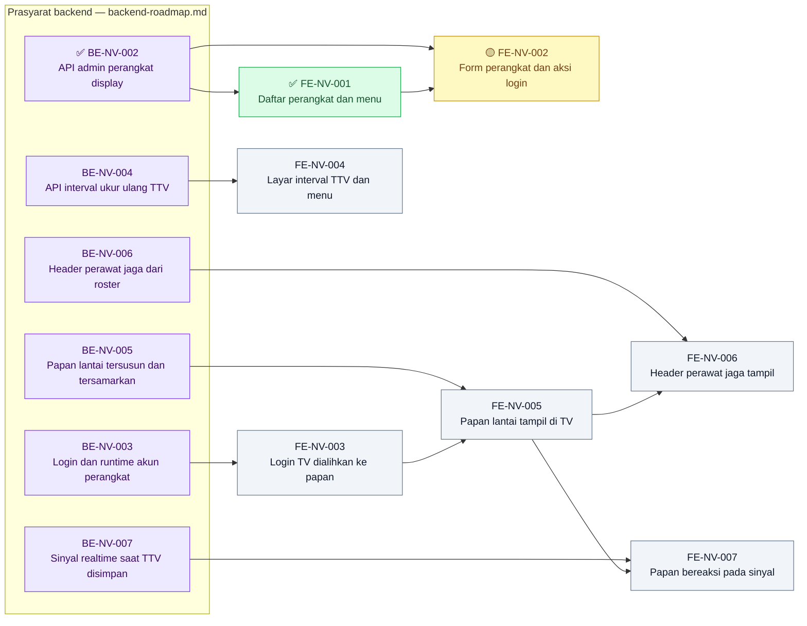

# Roadmap Frontend — Nurse View

| Field | Nilai |
|---|---|
| Blueprint ID | `nurse-view` · revision `1` · `approved` (`NV-DEC-028`) |
| Roadmap revision | `1` — 2026-10-28 |
| Contract version | `0.1.0` `approved` |
| Frontend SHA | `76b0c6e4b` (branch `RizkiV2`) |
| Masukan | `03-frontend-architecture.md`, `contracts/api-contract.md` |
| Owner | Rizki Gunawan |
| Ketentuan owner | Setiap task FE berpasangan dengan task BE, sehingga uji cukup sekali dari layar. Pakai ulang komponen dan gaya yang ada; `globals.css` tidak disentuh. Verifikasi agent: `npm run lint`. Tanpa unit test |

**Legenda tanda status:** ✅ selesai · 🟡 sebagian · ⛔ terblokir · tanpa tanda = belum dikerjakan.

**Pengecualian DoD yang berlaku untuk semua task:** test `.mjs`/unit test dikecualikan atas
keputusan Rizki Gunawan (ketentuan proyek). Uji layar dilakukan Rizki atau tim UAT.

## Grafik Urutan Dependency

| Gelombang | Boleh mulai setelah | Task |
| ---: | --- | --- |
| 1 | `BE-NV-002` | `FE-NV-001` |
| 1 | `BE-NV-003` | `FE-NV-003` |
| 1 | `BE-NV-004` | `FE-NV-004` |
| 2 | `FE-NV-001`, `BE-NV-002` | `FE-NV-002` |
| 2 | `FE-NV-003`, `BE-NV-005` | `FE-NV-005` |
| 3 | `FE-NV-005`, `BE-NV-006` | `FE-NV-006` |
| 3 | `FE-NV-005`, `BE-NV-007` | `FE-NV-007` |

Jumlah panah: **11**, sama dengan jumlah entri kolom `Dependency`. Gelombang dihitung dari
prasyarat frontend; prasyarat backend disebut pada kolom kedua dan wajib ✅ lebih dulu.

## Tabel task

| Task ID | Outcome | Requirement/decision | Kontrak | Reuse | Cakupan | Dependency | Acceptance criteria | Verifikasi | Risiko/pemilik | DoD |
|---|---|---|---|---|---|---|---|---|---|---|
| ✅ `FE-NV-001` | Daftar perangkat dan menu | `FR-NV-005`; `NV-DEC-016` | api §1 | Pola daftar `queue-display-devices` | Layar `FE-NVW-01`, butir menu "Display Nurse View" | `BE-NV-002` | Kartu | lint + uji layar | — / Rizki | Kartu |
| 🟡 `FE-NV-002` | Form perangkat dan aksi login | `FR-NV-001`–`004`; `NV-DEC-022` | api §1 | Pola form `queue-display-devices/[slug]` | Layar `FE-NVW-02` | `BE-NV-002`, `FE-NV-001` | Kartu | lint + uji layar | Kata sandi tersimpan di state/log / Rizki | Kartu |
| `FE-NV-003` | Login TV dialihkan ke papan | `FR-NV-018`; `NV-DEC-009`, `030` | api §3 `/current` | Pola `queue-display` di `use-base-login.jsx`, `proxy.js` | Berkas bersama FE + kerangka route `/nurse-view-display` | `BE-NV-003` | Kartu, termasuk regresi | lint + login empat akun | **Regresi redirect** / Rizki, syarat lead | Kartu |
| `FE-NV-004` | Layar interval TTV dan menu | `FR-NV-020`–`022`; `NV-DEC-010` | api §2 | Komponen form/tabel yang ada | Layar `FE-NVW-03`, butir menu "Interval TTV Nurse View" | `BE-NV-004` | Kartu | lint + uji layar | Angka bawaan di form / Rizki | Kartu |
| `FE-NV-005` | Papan lantai tampil di TV | `FR-NV-010`–`016`, `021`, `030`, `031`; `NV-DEC-007`, `013`, `014`, `017` | api §3 `/board` | Pola layar `queue-display-screen-view`, hook refresh, pendengar `offline` | Layar `FE-NVW-04` tanpa header roster dan tanpa realtime | `BE-NV-005`, `FE-NV-003` | Kartu | lint + uji di TV/peramban layar penuh | Keterbacaan ±3 m / Rizki | Kartu |
| `FE-NV-006` | Header perawat jaga tampil | `FR-NV-017`; `NV-DEC-021` | api §3 `Wards[]` | — | Header per bangsal di `FE-NVW-04` | `BE-NV-006`, `FE-NV-005` | Kartu | lint + uji layar | — / Rizki | Kartu |
| `FE-NV-007` | Papan bereaksi pada sinyal | `FR-NV-032`; `NV-DEC-023` | api §4 | `queue-realtime-client.js` / `signalrHubClient.jsx` | Join grup lantai, muat ulang saat event | `BE-NV-007`, `FE-NV-005` | Kartu | lint + simpan TTV sambil mengamati TV | — / Rizki | Kartu |

## Kartu task

### ✅ FE-NV-001 — Daftar perangkat dan menu

| Field | Isi |
|---|---|
| Status | ✅ SELESAI — 2026-10-29. Skema `FE-NVW-01` dan butir menu terpetakan ke source; `npx eslint` 0 error, 2 warning `EXISTING WARNING` (pola rujukan job-level); grep anti-regresi UI 0 temuan; UI GATE PASS (seluruh REUSE); `npm run build` `PASS` (BUILD_ID 10:26). Uji layar 29 Okt (FE-NV-002 §6): no. 1, 2, 3, 17, 18, 19 seluruhnya `PASS`. Verifikasi developer, bukan UAT. Unit test dikecualikan atas keputusan Rizki Gunawan. Laporan: [`FE-NV-001.md`](../task/report/frontend/FE-NV-001.md) |
| Outcome | Admin IT melihat daftar perangkat Nurse View, menyaring per lantai/status, dan membuka menu dari sidebar |
| Cakupan | Route `/administrator/master-data/nurse-view-devices` (`page.jsx`), view daftar, service API, butir menu di `src/utils/menu-sidebar/menu-items.jsx` (Administrator › Master Data, dekat "Display Antrian"). Keadaan memuat/kosong/gagal sesuai skema §3.1. Tombol Tambah dijaga `NurseViewDisplayDevice : Create` |
| Acceptance criteria | Skema `FE-NVW-01` lengkap; online/offline dari `IsOnline`/`LastOnlineAt` (`FR-NV-005`); butir menu terjangkau |
| DEV_DISCRETION | Nama butir, urutan, ikon, warna |
| DoD | AC terpetakan; `npm run lint` lulus; tangkapan layar; laporan `task/report/frontend/FE-NV-001.md` |

### 🟡 FE-NV-002 — Form perangkat dan aksi login

| Field | Isi |
|---|---|
| Status | 🟡 SEBAGIAN — 2026-10-29. Form, detail, dan tiga aksi login/nonaktif terpetakan ke source; lint dan grep sama dengan `FE-NV-001`; UI GATE PASS; build `PASS`. Uji layar gabungan 29 Okt: 19/20 `PASS`; **gagal: no. 5** — toast hijau "Data Berhasil Disimpan" tidak tampil karena hilang saat `router.push` ke detail (pola sama dengan rujukan job-level; belum diperbaiki). Laporan: [`FE-NV-002.md`](../task/report/frontend/FE-NV-002.md) |
| Outcome | Admin membuat/mengubah perangkat dan menjalankan Buat Login, Atur Ulang Login, Nonaktifkan |
| Cakupan | Route `create` dan `[slug]`; pilihan lantai dari `GET /floors`; tombol mengikuti `AvailableActions`; konfirmasi + alasan nonaktif; kotak kata sandi sekali tampil dengan Salin. Kata sandi **tidak** masuk Redux/global state, localStorage, maupun `console`. Kirim ganda dikunci; `409` → pesan + muat ulang |
| Acceptance criteria | `NV-AC-016`, `018`; `VAL-NV-01`–`08` tampil di bawah isian; `UAT-01`–`03` |
| DEV_DISCRETION | Modal atau inline untuk konfirmasi; tata letak form |
| DoD | AC terpetakan; lint lulus; rekaman alur buat → login → reset → nonaktif; laporan `FE-NV-002.md` |

### FE-NV-003 — Login TV dialihkan ke papan

| Field | Isi |
|---|---|
| Outcome | Akun perangkat Nurse View yang login langsung masuk `/nurse-view-display`; akun lain tidak berubah |
| Cakupan | `src/lib/hooks/auth/use-base-login.jsx`: cabang baru meniru cabang display antrean, menyetel cookie `isNurseViewAccount`. `src/proxy.js`: konstanta `NURSE_VIEW_DISPLAY_PATH`, redirect, dan penguncian route. Kerangka `src/app/nurse-view-display/` (`layout.jsx`, `page.jsx`) yang memanggil `GET /current` dan menangani `401`/`403` → layar login |
| Acceptance criteria | `NV-AC-016`; **`NV-AC-023`–`027`** dan `UAT-11` dari sisi redirect: perawat → dashboard, Kiosk → `/kiosk`, display antrean → `/queue-display`, Nurse View → `/nurse-view-display` |
| Risiko | Syarat lead `NV-DEC-030`. Cabang Kiosk dan display antrean **tidak disunting** isinya |
| DoD | AC terpetakan; lint lulus; rekaman login empat akun; laporan `FE-NV-003.md` mencantumkan diff ringkas kedua berkas bersama |

### FE-NV-004 — Layar interval TTV dan menu

| Field | Isi |
|---|---|
| Outcome | Admin mengisi interval per tingkat EWS beserta nomor dan tanggal pengesahan |
| Cakupan | Route `/administrator/master-data/nurse-view-vital-sign-intervals`; butir menu; skema §3.3; isian tanpa angka bawaan; mode baca saja bila tanpa `NurseViewVitalSignInterval : Update` |
| Acceptance criteria | `NV-AC-004`; `VAL-NV-09`–`13`; `UAT-07`, `UAT-08`; status "Belum dikonfigurasi" saat kosong |
| DoD | AC terpetakan; lint lulus; tangkapan layar kosong dan terisi; laporan `FE-NV-004.md` |

### FE-NV-005 — Papan lantai tampil di TV

| Field | Isi |
|---|---|
| Outcome | TV menampilkan papan lantai: grid per bangsal, kartu kritis di atas, ganti halaman otomatis, muat ulang 60 detik, pita data basi |
| Cakupan | View papan di `/nurse-view-display`: kepala (lantai, jam, jam data), kelompok bangsal, kartu terisi dan kosong, ikon J/A/I, tanda "Bed tidak sesuai isolasi", "Belum ada PJ", "Belum ada TTV", lewat jadwal. Tanpa suara. Papan hanya di memori, tidak disimpan ke storage. Header roster menyusul di `FE-NV-006` |
| Acceptance criteria | `NV-AC-001`–`008`, `010`–`014`, `020`, `021`; `UAT-04`, `UAT-09`, `UAT-10`; keterbacaan ±3 m (`NV-FE-002`) |
| DEV_DISCRETION | Warna, ikon, ritme kedip, durasi per halaman (`NV-FE-003`, `004`) |
| DoD | AC terpetakan; lint lulus; rekaman di layar besar termasuk putus jaringan; laporan `FE-NV-005.md` |

### FE-NV-006 — Header perawat jaga tampil

| Field | Isi |
|---|---|
| Outcome | Kelompok bangsal menampilkan nama perawat jaga atau "Roster shift ini belum tersedia" |
| Cakupan | Header per bangsal dari `Wards[].OnDutyNurses`, `RosterAvailable` |
| Acceptance criteria | `NV-AC-009`, `017` |
| DoD | AC terpetakan; lint lulus; tangkapan layar kedua keadaan; laporan `FE-NV-006.md` |

### FE-NV-007 — Papan bereaksi pada sinyal

| Field | Isi |
|---|---|
| Outcome | Kartu berubah beberapa detik sesudah TTV disimpan, tanpa menunggu muat ulang 60 detik |
| Cakupan | Join `JoinNurseViewFloor` sesudah tersambung, termasuk saat sambung ulang; event `NurseViewBoardChanged` → muat ulang (dibatasi 1×/5 detik); muat ulang 60 detik tetap berjalan sebagai cadangan |
| Acceptance criteria | `NV-AC-003`, `019`, `022` dari sisi klien |
| DoD | AC terpetakan; lint lulus; rekaman berjam simpan TTV → kartu berubah; laporan `FE-NV-007.md` |

## Traceability

Lihat [`requirement-traceability.md`](./requirement-traceability.md).
