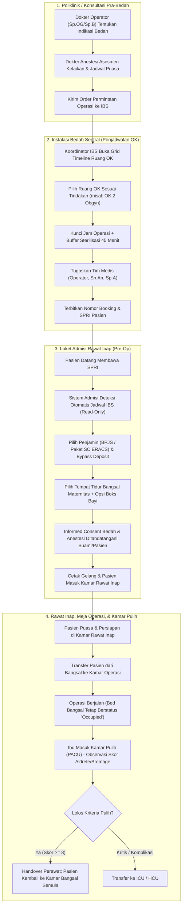
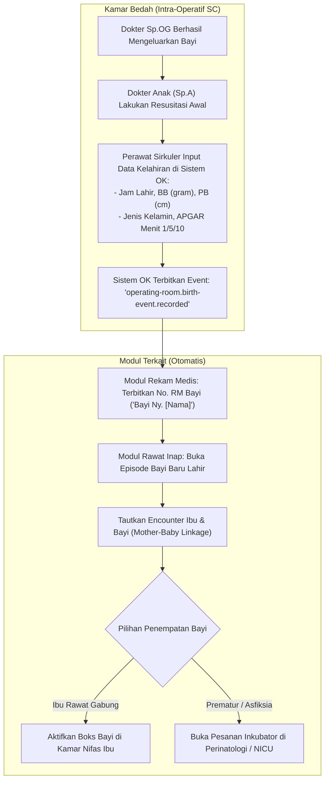
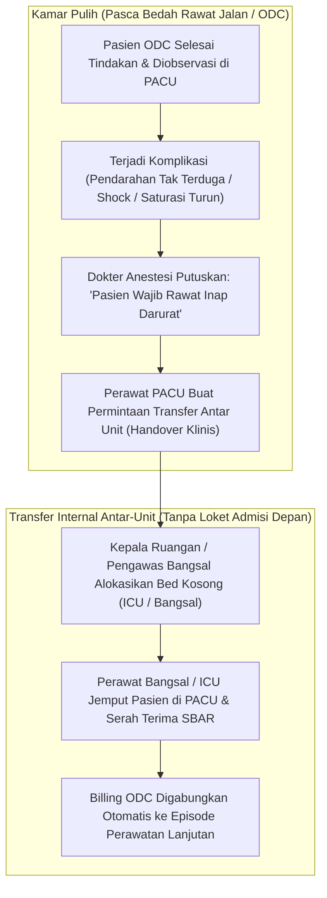

# Desain Arsitektur Target: Integrasi Penjadwalan Kamar Operasi & Admisi Rawat Inap (Termasuk Bedah Obgyn)

| Field Metadata | Nilai |
| :--- | :--- |
| **Dokumen ID** | `DSN-OPR-RWI-20261023` |
| **Modul Terkait** | `HealthServices/OperatingRoomManagement` & `HealthServices/InPatientManagement` |
| **Status Desain** | `PROPOSED DRAFT` (Menunggu Pengesahan Pemilik Kebutuhan) |
| **Tanggal Terbit** | 23 Oktober 2026 |
| **Pengesah Keputusan** | Muhammad Hamzah (Sesi Wawancara `grill-me`, 23 Oktober 2026) |
| **Dasar Keputusan** | `OPS-DEC-038` s.d. `OPS-DEC-042` & `RWI-DEC-355` s.d. `RWI-DEC-358` |
| **Bahasa** | Bahasa Indonesia Baku |

---

## 1. Ringkasan Eksekutif & Latar Belakang Masalah

### 1.1 Masalah pada Desain Lama
Sebelumnya, sistem menempatkan *"Admisi Kamar Pulih"* sebagai salah satu pintu masuk utama rawat inap dengan asumsi pasien dioperasi terlebih dahulu di Instalasi Bedah Sentral (IBS), lalu setelah operasi baru memilih dan memesan tempat tidur rawat inap di loket admisi.

Di rumah sakit Indonesia, alur ini tidak lazim dan berisiko tinggi:
1. **Risiko Tempat Tidur Penuh**: Pasien selesai operasi di kamar bedah tetapi seluruh kamar bangsal rawat inap atau ICU ternyata penuh.
2. **Ketiadaan Kamar Persiapan Pra-Bedah**: Pasien operasi terencana membutuhkan tempat tidur untuk persiapan fisik, infus, dan pemantauan puasa 6–8 jam sebelum diantar ke kamar bedah.
3. **Ketidaksesuaian Wewenang**: Petugas loket pendaftaran di lobi depan tidak memiliki kompetensi klinis untuk memilih kamar bedah (OK 1, OK 2, OK 3) atau menentukan jam pembedahan.

### 1.2 Solusi Desain Baru (Arsitektur Terpadu IBS ↔ Admisi)
1. **Pemisahan Wewenang (*Separation of Concerns*)**:
   * Penjadwalan kamar bedah fisik, alokasi jam operasi, dan perhitungan waktu sterilisasi ruangan (*buffer time*) dikelola penuh oleh **Koordinator Kamar Operasi (IBS)**.
   * Pemilihan kamar rawat inap (bangsal), penjaminan (BPJS/Asuransi/Paket SC), dan perjanjian rawat inap dikelola oleh **Petugas Admisi Rawat Inap**.
2. **Alur Operasi Terencana Pre-Op**: Pasien didaftarkan dan mendapatkan kamar rawat inap terlebih dahulu, kamar bangsal tetap ditahan (*bed hold*) selama operasi, dan pasca-bedah pasien kembali ke kamar rawat inap semula tanpa admisi ulang.
3. **Penghapusan Jalur Kamar Pulih**: Jalur *"Admisi dari Kamar Pulih"* di loket pendaftaran rawat inap **dihilangkan/dihapus total** (`RWI-DEC-359`). Seluruh pasien operasi wajib di-admisi ke bangsal pre-op terlebih dahulu sebagai standar baku RS. Bila pasien ODC mengalami komplikasi pasca-bedah di PACU, penanganannya dilakukan via serah terima transfer internal (IBS/PACU ke Ranap/ICU), bukan lewat loket pendaftaran depan.
4. **Dukungan Penuh Bedah Obgyn (Sectio Caesarea / SC)**:
   * Formasi Tri-Dokter: Operator (Sp.OG), Anestesi (Sp.An), dan Anak (Sp.A).
   * Filter kamar ke Bangsal Maternitas/Nifas dengan fasilitas Rawat Gabung (*Rooming-in*) boks bayi.
   * Auto-trigger pembuatan identitas dan episode Bayi Baru Lahir (*Newborn*) saat persalinan berhasil di meja operasi.

---

## 2. Alur Proses Bisnis Ujung-ke-Ujung (Flowcharts)

### 2.1 Alur Utama: Operasi Terencana (Elektif / SC)



---

### 2.2 Alur Khusus: Auto-Trigger Kelahiran Bayi pada Kasus SC



---

### 2.3 Alur Pengecualian: Eskalasi Komplikasi Pasien ODC di Kamar Pulih (Transfer Internal Tanpa Loket Admisi)



---

## 3. Kamus Data & Spesifikasi Skema Entity Target

### 3.1 Skema Penjadwalan Kamar Operasi (`OprSchedule`) — Diperbarui

Tabel ini menyimpan data alokasi ruangan dan waktu operasi yang dikelola oleh Koordinator IBS:

| Nama Kolom | Tipe Data | Nullable | Keterangan & Validasi |
| :--- | :--- | :---: | :--- |
| `Id` | `Guid` | Tidak | Primary Key unik revisi jadwal |
| `OprCaseId` | `Guid` | Tidak | Foreign Key ke `OprCase` |
| `RoomId` | `Guid` | Tidak | Foreign Key ke `MstRoom` (Kamar Bedah OK 1, OK 2, dll) |
| `ScheduledStartAt` | `DateTime` | Tidak | Waktu rencana mulai tindakan insisi |
| `ScheduledEndAt` | `DateTime` | Tidak | Waktu rencana operasi selesai |
| `BufferBeforeMinutes`| `int` | Tidak | Buffer persiapan ruang (bawaan: 15 menit) |
| `BufferAfterMinutes` | `int` | Tidak | **Buffer sterilisasi/pembersihan** (bawaan: 45 menit, `OPS-DEC-039`) |
| `IsCitoOverride` | `bool` | Tidak | Menandai apakah jadwal ini menyisip darurat Cito (`OPS-DEC-041`) |
| `CitoOverrideReason` | `string(500)`| Ya | Alasan klinis jika operasi elektif digeser oleh kasus darurat |
| `IsCurrent` | `bool` | Tidak | Menandai revisi jadwal yang sedang aktif berlaku |

---

### 3.2 Perluasan Skema Episode Rawat Inap (`InpEpisode`) — Diperbarui

| Nama Kolom | Tipe Data | Nullable | Keterangan & Validasi |
| :--- | :--- | :---: | :--- |
| `SurgicalBookingNumber` | `string(50)` | Ya | Nomor booking IBS yang terhubung (`OPS-DEC-040`) |
| `ClinicalSubCategory` | `string(50)` | Ya | `ObstetricSurgery`, `GynecologicSurgery`, `GeneralSurgery`, `ODC` |
| `IsRoomingInBabyPlanned`| `bool` | Tidak | `true` jika pasien SC meminta fasilitas boks bayi rawat gabung (`RWI-DEC-357`) |
| `MaternityPackageId` | `Guid` | Ya | Foreign Key ke paket melahirkan/SC jika memilih paket (`RWI-DEC-358`) |
| `BedHoldStatus` | `string(30)` | Ya | `None`, `InSurgery`, `InRecovery` untuk mengunci ranjang bangsal (`RWI-DEC-355`) |

---

## 4. Spesifikasi Kontrak API (Swagger Style)

### 4.1 Modul Kamar Operasi (IBS)

#### Tag: `[Tags("Health Services / Operating Room Management / Scheduling")]`

##### Endpoint 1: Visualisasi Timeline Ruang Kamar Bedah
* **Method & Path**: `GET /api/v1/health-services/operating-room-management/rooms/timeline`
* **Deskripsi**: Menampilkan jadwal seluruh ruang OK dalam bentuk slot waktu (terisi, buffer sterilisasi, dan slot kosong) untuk tanggal yang diminta.
* **Hak Akses**: `[AccessPermission("OperatingRoomSchedule", "Read")]`
* **Query Parameters**:
  * `date` (string, format `YYYY-MM-DD`, wajib): Tanggal jadwal yang dilihat.
  * `floorLocation` (string, opsional): Lokasi lantai (misal `Lantai 2`).
* **Format Respons (`200 OK`)**:
```json
{
  "isSuccess": true,
  "data": [
    {
      "roomId": "e3a89123-4451-4d1a-8812-78129a671b02",
      "roomName": "Kamar Operasi 2 (Kebidanan - Obgyn)",
      "floor": "Lantai 2",
      "slots": [
        {
          "slotType": "Occupied",
          "caseId": "91a27b11-9231-419b-a012-3891823a0192",
          "bookingNumber": "BOK-202610-0089",
          "patientName": "Ny. Siti Rahma",
          "procedureName": "Sectio Caesarea (SC)",
          "startAt": "2026-10-28T09:00:00+07:00",
          "endAt": "2026-10-28T10:30:00+07:00",
          "leadSurgeonName": "dr. Budi, Sp.OG",
          "anesthesiologistName": "dr. Rina, Sp.An"
        },
        {
          "slotType": "SterilizationBuffer",
          "startAt": "2026-10-28T10:30:00+07:00",
          "endAt": "2026-10-28T11:15:00+07:00",
          "durationMinutes": 45,
          "note": "Pembersihan & Dekontaminasi Ruangan"
        },
        {
          "slotType": "Available",
          "startAt": "2026-10-28T11:15:00+07:00",
          "endAt": "2026-10-28T21:00:00+07:00"
        }
      ]
    }
  ]
}
```

##### Endpoint 2: Lookup Data Booking Operasi Pasien
* **Method & Path**: `GET /api/v1/health-services/operating-room-management/schedules/lookup-by-patient`
* **Deskripsi**: Menyediakan ringkasan data rencana operasi terkonfirmasi untuk dikonsumsi oleh Modul Admisi Rawat Inap secara read-only.
* **Hak Akses**: `[AccessPermission("OperatingRoomCase", "Read")]`
* **Query Parameters**:
  * `patientId` (`Guid`, opsional) atau `bookingNumber` (`string`, opsional).
* **Format Respons (`200 OK`)**:
```json
{
  "isSuccess": true,
  "data": {
    "bookingNumber": "BOK-202610-0089",
    "caseId": "91a27b11-9231-419b-a012-3891823a0192",
    "patientId": "78a19283-1123-4819-b123-99128374619a",
    "procedureName": "Sectio Caesarea (SC) Transperitonealis",
    "clinicalCategory": "ObstetricSurgery",
    "operatingRoomName": "Kamar Operasi 2 (Obgyn)",
    "scheduledDate": "2026-10-28",
    "scheduledTime": "09:00 - 10:30 WIB",
    "leadSurgeon": { "id": "d123-...", "name": "dr. Budi Santoso, Sp.OG" },
    "anesthesiologist": { "id": "d456-...", "name": "dr. Rina Puspita, Sp.An" },
    "pediatrician": { "id": "d789-...", "name": "dr. Dewi Anggraini, Sp.A" },
    "preOpInstructions": "Puasa padat mulai 03.00 WIB. Pasang infus RL di kamar perawatan."
  }
}
```

---

#### Tag: `[Tags("Health Services / Operating Room Management / Execution")]`

##### Endpoint 3: Pencatatan Kelahiran Bayi pada Kasus Persalinan SC
* **Method & Path**: `POST /api/v1/health-services/operating-room-management/cases/{caseId}/execution/birth-event`
* **Deskripsi**: Tim OK mencatat momen bayi lahir di kamar bedah, memicu integrasi pembuatan identitas dan episode rawat inap neonatus.
* **Hak Akses**: `[AccessPermission("OperatingRoomExecution", "Update")]`
* **Request Body (`RecordOprBirthEventRequest`)**:
```json
{
  "birthDateTime": "2026-10-28T09:42:00+07:00",
  "gender": "Female",
  "weightGrams": 3150,
  "lengthCentimeters": 49.5,
  "headCircumferenceCm": 34.0,
  "apgarScore1Min": 8,
  "apgarScore5Min": 9,
  "apgarScore10Min": 10,
  "isMultipleBirth": false,
  "deliveryComplications": null,
  "resuscitationPerformed": false,
  "pediatricianId": "d789-...",
  "idempotencyKey": "birth-case-91a27b11-baby-1"
}
```
* **Format Respons (`201 Created`)**:
```json
{
  "isSuccess": true,
  "message": "Data kelahiran berhasil dicatat dan integrasi pendaftaran bayi baru lahir berhasil diterbitkan.",
  "data": {
    "birthEventId": "b182-...",
    "temporaryBabyName": "Bayi Ny. Siti Rahma",
    "generatedMedicalRecordNumber": "RM-2026-991204",
    "babyEncounterId": "enc-baby-0012"
  }
}
```

---

### 4.2 Modul Admisi Rawat Inap

#### Tag: `[Tags("Health Services / Inpatient Management / Admissions")]`

##### Endpoint 4: Pendaftaran Pasien Rawat Inap Operasi
* **Method & Path**: `POST /api/v1/health-services/inpatient-management/admissions`
* **Deskripsi**: Menyimpan pendaftaran pasien rawat inap pra-operasi dengan mengaitkan nomor booking operasi dan fasilitas maternitas.
* **Hak Akses**: `[AccessPermission("InpatientEpisode", "Create")]`
* **Request Body Tambahan**:
```json
{
  "patientId": "78a19283-1123-4819-b123-99128374619a",
  "admissionSource": "OutpatientReferral",
  "clinicalSubCategory": "ObstetricSurgery",
  "surgicalBookingNumber": "BOK-202610-0089",
  "serviceUnitId": "unit-maternitas-lt3",
  "bedId": "bed-melati-02-a",
  "isRoomingInBabyPlanned": true,
  "maternityPackageId": "pkg-sc-eracs-vip",
  "primaryDoctorId": "d123-...",
  "coManagingDoctorIds": ["d456-...", "d789-..."]
}
```

---

## 5. Rencana Skema Fitur Layar Frontend (UI Specification)

### 5.1 Layar Penjadwalan Kamar Operasi IBS (Lantai 2 Grid View)
* **Route**: `/health-services/operating-room-management/scheduling`
* **Komponen Utama**:
  * Baris Atas: Pemilih tanggal, filter lantai, dan tombol aksi `+ Buat Jadwal Operasi Baru`.
  * Area Tengah (Gantt Chart Ruang OK):
    * Kolom Kiri: Daftar ruangan (`OK 1 Umum`, `OK 2 Obgyn/SC`, `OK 3 Ortopedi`, `OK 4 Septik`).
    * Kolom Kanan: Sumbu waktu horisontal (07.00 s.d. 21.00).
    * Kartu Blok Hijau/Biru: Jadwal terisi (menampilkan nama pasien, tindakan, dan dokter).
    * Kartu Blok Abu-abu Bergaris: **Buffer Sterilisasi Ruangan (45 menit)** yang terkunci otomatis.
    * Tombol Interaksi: Mengklik area kosong membuka modal pemesanan slot jadwal.
    * Tombol Khusus: **[Tombol Merah] Emergency Cito Override** (khusus Koordinator IBS menyisipkan operasi darurat).

### 5.2 Layar Admisi Rawat Inap Langkah 1 (Tautan Otomatis Jadwal IBS)
* **Route**: `/health-services/inpatient-management/admissions/existing-patient?step=existing-patient`
* **Perilaku Layar**:
  * Ketika petugas memasukkan No. RM atau nomor SPRI, sistem memanggil API `lookup-by-patient`.
  * Jika jadwal ditemukan, muncul banner informasi berwarna toska:
    > 📅 **Pasien Terjadwal Operasi di Kamar Bedah (IBS)**  
    > * Tindakan: **Sectio Caesarea (SC)**  
    > * Lokasi & Jam: **Kamar Operasi 2 (Lantai 2) — 28 Okt 2026 pk 09.00 WIB**  
    > * Dokter Operator: **dr. Budi, Sp.OG** | Anestesi: **dr. Rina, Sp.An** | Anak: **dr. Dewi, Sp.A**  
    > * *Catatan: Jadwal dikelola oleh IBS. Petugas melanjutkan pemilihan kamar perawatan rawat inap.*

### 5.3 Layar Admisi Langkah 6 & 7 (Filter Bangsal Maternitas & Rawat Gabung Boks Bayi)
* **Route**: `/health-services/inpatient-management/admissions/existing-patient?step=bed-selection`
* **Perilaku Layar**:
  * Filter bangsal otomatis mengunci: **Bangsal Maternitas / Ruang Nifas**.
  * Di bawah kartu pemilihan bed ibu, terdapat komponen kartu saklar:
    * **[✓] Fasilitas Rawat Gabung Bayi (*Rooming-in*)**: Mencadangkan boks bayi di samping ranjang ibu.

### 5.4 Antarmuka Layar Muka: Kartu Pendaftaran Admisi Rawat Inap (4 Pintu Masuk Resmi)
* **Route**: `/health-services/inpatient-management/admissions`
* **Penyajian 4 Kartu Masuk**:
  1. **Pasien Baru**: Pasien yang belum pernah memiliki No. Rekam Medis.
  2. **Pasien Lama / Rujukan Poli & Operasi Terencana**: Pasien yang memiliki No. RM dan membawa SPRI/Rencana Tindakan (termasuk SC).
  3. **Admisi Bayi Baru Lahir**: Pendaftaran mandiri bayi baru lahir (jika persalinan di luar RS atau admisi susulan).
  4. **Admisi Transfer IGD & Poliklinik**: Pasien rujukan opname dari Instalasi Gawat Darurat atau Poliklinik rawat jalan.
  *(Jalur/kartu 'Admisi dari Kamar Pulih' ditiadakan secara total dari loket pendaftaran rawat inap)*.

---

## 6. PRD ke MVP: Batasan Rilis & Definisi Selesai (DoD)

### 6.1 Batasan Rilis Pertama (MVP Scope)
* **Termasuk dalam MVP**:
  1. Visualisasi kalender jadwal ruang OK timeline per ruangan dan buffer sterilisasi otomatis 45 menit di modul Operasi.
  2. Panggilan API read-only jadwal operasi pada Langkah 1 pendaftaran Admisi Rawat Inap.
  3. Pemilihan kamar nifas/maternitas dengan opsi rawat gabung boks bayi.
  4. Formasi tri-dokter (Sp.OG, Sp.An, Sp.A) pada Langkah 5 Dokter.
  5. Form pencatatan data kelahiran bayi intraoperatif di modul Operasi dan penerbitan event integrasi bayi baru lahir.
  6. Penghapusan penuh kartu & jalur masuk Admisi Kamar Pulih dari modul admisi rawat inap (`FE-RWI-282`).
* **Di luar MVP (Rilis Berikutnya)**:
  * Pembuatan partograf digital grafis real-time di kamar bersalin.
  * Integrasi otomatis pemotongan stok darah ke mesin pendingin Bank Darah RFID.

### 6.2 Definisi Selesai (Definition of Done - DoD)
* [ ] Seluruh endpoint `rooms/timeline`, `schedules/lookup-by-patient`, dan `birth-event` lulus unit test backend dengan kode status yang sesuai.
* [ ] Penjadwalan dua operasi berturut-turut pada ruang yang sama dengan jeda < 30 menit otomatis ditolak oleh backend (`409 Conflict`).
* [ ] Pasien operasi terencana yang sudah diadmisi di bangsal tidak kehilangan status ranjangnya saat dijemput ke kamar bedah.
* [ ] Pasca pemulihan di PACU, perawat dapat melakukan serah terima kembali ke kamar bangsal semula tanpa memicu alur admisi baru.
* [ ] Penginputan kelahiran bayi di kamar bedah SC berhasil menerbitkan No. RM Bayi dan menautkannya ke No. RM Ibu.
* [ ] Layar Admisi Rawat Inap menampilkan kartu jadwal operasi secara informatif tanpa wewenang mengubah ruangan OK.
