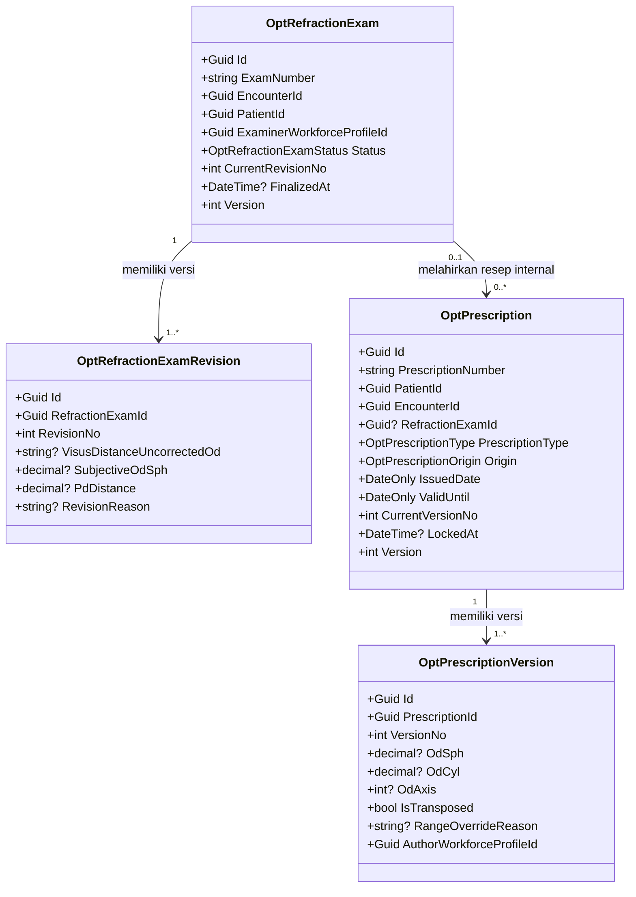
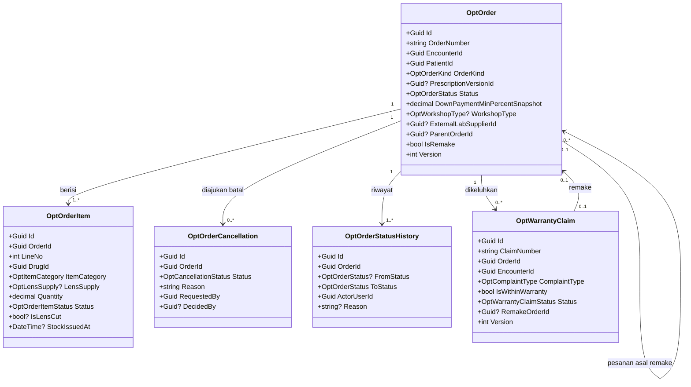
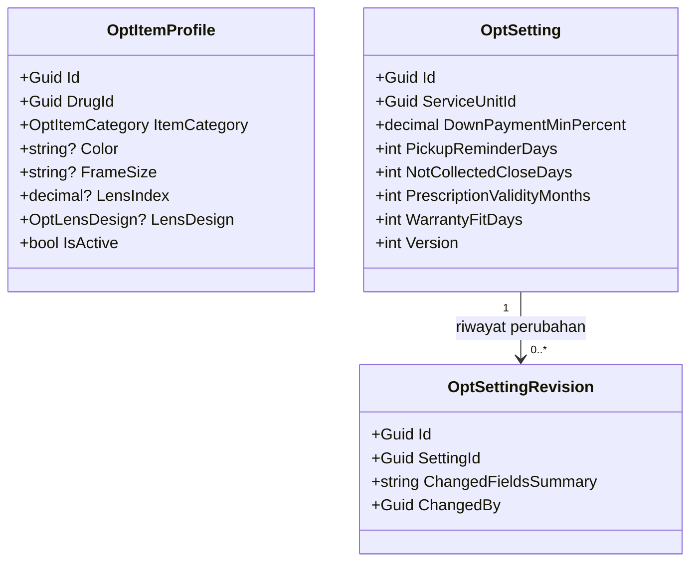
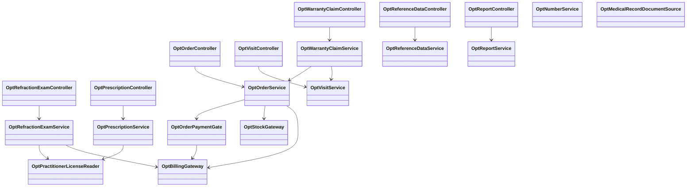

# Optik — Arsitektur Backend

| Field | Nilai |
| --- | --- |
| Blueprint ID | `OPT-BP-001` |
| Dokumen | `OPT-BE-ARCH` revision `1` |
| Status | `approved` — Yoga Aji Pratama, 2026-11-03 |
| Owner | Yoga Aji Pratama (product/domain); API/security: pemilik arsitektur backend (belum ditunjuk untuk Optik) |
| Masukan | `00-interview-decisions.md` r4 (`OPT-DEC-001`..`049`), `01-existing-capability-map.md` r1, `02-requirement-completeness-assessment.md` r2, `03-domain-architecture.md` r1 (`OPT-HDA-001`, `DOMAIN_ARCHITECTURE_READY`) |
| Source SHA | Backend `2a5094ca`, frontend `b6dd6c304` |
| Applicability | `NEW CODE` untuk seluruh `Opt*`; `TOUCHED LEGACY` untuk titik perluasan di Registrasi, Billing, Farmasi, Rekam Medis, Medical Fee, dan Master Data |
| QBE yang berlaku | `QBE-ENT-001..003`, `QBE-NAM-001/002/004`, `QBE-CFG-001`, `QBE-MOD-001..003`, `QBE-SVC-001`, `QBE-API-001`, `QBE-PERM-001`, `QBE-LOG-001`, `QBE-CODE-001..006`, `QBE-VAL-001`, `QBE-TXN-001`, `QBE-DTO-001`, `QBE-PAGE-001`, `QBE-DEL-001`, `QBE-AUD-001` |

> **Prasyarat yang mengikat.** Seluruh model `Opt*` berstatus **BLOCKED** (`QBE-MOD-002`, `QBE-MOD-003`)
> sampai prefix `Opt` dan folder `Areas/HealthServices/OpticalManagement/` terdaftar di
> `docs/engineering/MODULE_OWNERSHIP_PREFIX_REGISTRY.md` (`OPT-DEC-036`). Pendaftaran itu adalah
> task pertama roadmap.

---

## 1. Bounded context dan ownership

Diambil apa adanya dari `03-domain-architecture.md`; tidak dirancang ulang di sini.

| Context | Aggregate root | Invariant utama | Batas transaksi |
| --- | --- | --- | --- |
| `BC-OPT-01` Klinis | `OptRefractionExam` | Pemeriksa RO/Sp.M ber-SIP berlaku (WIB); final sekali; revisi berversi tanpa tagih ulang (`OPT-DEC-042`, `047`) | Satu pemeriksaan + revisinya dalam satu transaksi. Fakta tagihan diterbitkan **sesudah** commit |
| `BC-OPT-01` Klinis | `OptPrescription` | Rentang dan notasi minus `OPT-DEC-045`; revisi hanya bila belum terkunci; berlaku ≤ usia resep | Satu resep + versinya |
| `BC-OPT-02` Pesanan | `OptOrder` | Alur status `OPT-DEC-016`; uang muka dari bagian pasien; potong stok sekali; satu pesanan berpengerjaan belum lunas per kunjungan (aturan sementara `OPT-DEC-035`) | Pesanan + item + riwayat status + pengajuan batal dalam satu transaksi. Panggilan stok berada **di dalam** transaksi yang sama (kunci idempoten); fakta tagihan sesudah commit |
| `BC-OPT-02` Pesanan | `OptWarrantyClaim` | Tertaut ke pesanan `HandedOver` dan kunjungan keluhan baru; maksimal satu remake | Keluhan + pembuatan pesanan remake dalam satu transaksi |
| `BC-OPT-03` Profil & Pengaturan | `OptItemProfile`, `OptSetting` | Satu profil per barang; satu pengaturan per unit Optik; nilai dibekukan ke dokumen saat dibuat | Per baris |

**Rollback.** Kegagalan setelah commit (penerbitan fakta tagihan, Rekam Medis) tidak membatalkan
data klinis. Fakta yang belum pasti tercatat di jalur pengiriman ulang milik
`ClinicalMilestoneFactProducer` (`Pending`). Kegagalan stok di dalam transaksi membatalkan
seluruh perpindahan status.

---

## 2. Tabel kepemilikan data

| Kelompok data | Modul pemilik | Dipakai Optik | Dibuat ulang di Optik | Status di desain |
| --- | --- | :---: | --- | --- |
| Pasien | Patient Management (`MstPatient`) | Ya | **Tidak** — dirujuk `PatientId` | Sudah ada |
| Kunjungan | Registrasi (`RegPatientEncounter`) | Ya | **Tidak** — dibuat lewat `EncounterIntakeService` | Diperbarui (rujukan kunjungan asal) |
| Unit layanan | Master Data (`MstServiceUnit`, enum `ServiceUnitType`) | Ya | **Tidak** | Diperbarui (nilai enum `Optical = 11`) |
| Pegawai dan STR/SIP | Human Resource (`MstWorkforceProfile`, `WfpCredentialLicense`) | Ya, baca | **Tidak** | Sudah ada |
| Barang (frame, lensa, lensa kontak, aksesoris) | Master Data (`MstDrug`, `MstDrugCategory`) | Ya | **Tidak** — hanya profil atribut Optik | Sudah ada (data kategori baru) |
| Atribut barang Optik | **Optik** (`OptItemProfile`) | Ya | Ya, karena atribut frame/lensa tidak ada di master barang (`OPT-CAP-14`, `OPT-DEC-031`) | Baru |
| Tarif | Master Data (`MstTariff`, `MstProcedure`) | Ya | **Tidak** | Sudah ada (data tarif baru) |
| Supplier lab lensa | Administrator Master Data (`MstSupplier`) | Ya | **Tidak** | Sudah ada |
| Depo dan kartu stok | Farmasi (`MstDrugStorageLocation`, `PhmDrugStockBalance`, `PhmDrugStockMutation`) | Ya, lewat `DrugStockService` | **Tidak** | Sudah ada (jenis dokumen sumber baru) |
| Tagihan, pembayaran, diskon, piutang | Billing | Ya | **Tidak** | Diperbarui (sumber `Optical`) |
| Jasa medis | Medical Fee | Ya (ditarik Medical Fee) | **Tidak** | Diperbarui (adapter sumber) |
| Tampilan riwayat klinis | Rekam Medis | Ya | **Tidak** — Optik memasang pembaca | Diperbarui (jenis dokumen baru) |
| Nomor dokumen | Platform (`NumberSeriesAllocator`) | Ya | **Tidak** | Sudah ada (kunci baru) |
| Pemeriksaan refraksi | **Optik** | Ya | Ya, karena belum ada di mana pun (`OPT-CAP-10`) | Baru |
| Resep kacamata/lensa kontak | **Optik** | Ya | Ya, karena `PhmPrescription` khusus obat | Baru |
| Pesanan, keluhan garansi | **Optik** | Ya | Ya | Baru |
| Pengaturan Optik | **Optik** | Ya | Ya | Baru |

---

## 3. Class diagram

### 3.1 Klinis — pemeriksaan dan resep (`BC-OPT-01`)



### 3.2 Pesanan dan layanan purna (`BC-OPT-02`)



### 3.3 Profil barang dan pengaturan (`BC-OPT-03`)



### 3.4 Service dan controller



---

## 4. Penjelasan setiap class

Seluruh path relatif terhadap root `NewQuilvianSystemBackend`. Singkatan `OM` =
`Areas/HealthServices/OpticalManagement`, `CFG` = `Repositories/Configurations/HealthServices/OpticalManagement`.

### 4.1 Model

| Class | Status | Lokasi file | Kategori | Tanggung jawab utama | Field penting | Relasi | Pemakaian dalam alur | Catatan desain | Ekuivalen lama |
| --- | --- | --- | --- | --- | --- | --- | --- | --- | --- |
| `OptRefractionExam` | Baru | `OM/Models/OptRefractionExam.cs` | Transaksi klinis | Satu pemeriksaan refraksi pada satu kunjungan Optik | `ExamNumber`, `EncounterId`, `PatientId`, `ExaminerWorkforceProfileId`, `ExaminerLicenseNumberSnapshot`, `Status`, `CurrentRevisionNo`, `FinalizedAt`, `BillingFactEmittedAt`, `Version` | Punya `OptRefractionExamRevision`; merujuk kunjungan, pasien, pegawai | RO membuka dari daftar kunjungan Optik, mengisi hasil, lalu menyimpan final | Nilai ukur **tidak** disimpan di root; hanya di revisi. `BillingFactEmittedAt` mencegah tagih ulang saat revisi | — |
| `OptRefractionExamRevision` | Baru | `OM/Models/OptRefractionExamRevision.cs` | Transaksi klinis | Satu versi hasil ukur; versi tidak pernah diubah | Visus jauh/dekat dengan dan tanpa koreksi per mata, autorefraktometer per mata (SPH/CYL/AXIS), koreksi subjektif per mata (SPH/CYL/AXIS/ADD), `PdDistance`, `PdNear`, `KeratometryNote`, `ClinicalNote`, `RevisionReason`, `RevisedByWorkforceProfileId` | Milik `OptRefractionExam` | Versi 1 dibuat saat mulai; versi berikut saat revisi sesudah final (`OPT-DEC-047`) | Rincian isian berstatus `PROPOSED` (RCG `n1`). Seluruh nilai ukur bertanda **Sensitif** | — |
| `OptPrescription` | Baru | `OM/Models/OptPrescription.cs` | Transaksi klinis | Resep kacamata atau lensa kontak beserta asalnya | `PrescriptionNumber`, `PatientId`, `EncounterId`, `RefractionExamId?`, `PrescriptionType`, `Origin`, `ExternalAuthorName`, `ExternalFacilityName`, `IssuedDate`, `ValidityMonthsSnapshot`, `ValidUntil`, `CurrentVersionNo`, `LockedAt`, `LockedByOrderId`, `Version` | Punya `OptPrescriptionVersion` | Dibuat RO/Sp.M dari pemeriksaan, atau disalin dari resep luar | `ValidUntil` dihitung saat dibuat dari `IssuedDate` + `ValidityMonthsSnapshot`. Terkunci = `LockedAt` terisi | `PhmPrescription` **bukan** ekuivalen |
| `OptPrescriptionVersion` | Baru | `OM/Models/OptPrescriptionVersion.cs` | Transaksi klinis | Satu isi resep; tidak pernah diubah | Kacamata per mata (`OdSph`, `OdCyl`, `OdAxis`, `OdAdd`, `OsSph`, `OsCyl`, `OsAxis`, `OsAdd`), `PdDistance`, `PdNear`; lensa kontak per mata (`OdCl…`/`OsCl…` power, `BaseCurve`, `Diameter`), `ContactLensBrandOrType`, `ContactLensReplacement`; `IsTransposed`, `OriginalNotationText`, `RangeOverrideReason`, `AuthorWorkforceProfileId`, `AuthorLicenseNumberSnapshot`, `RevisionReason` | Milik `OptPrescription` | Versi 1 saat dibuat; versi baru setiap revisi (`OPT-DEC-007`, `011`) | Silinder selalu ≤ 0 (`OPT-DEC-045`). Unik `(PrescriptionId, VersionNo)` | — |
| `OptOrder` | Baru | `OM/Models/OptOrder.cs` | Transaksi | Pesanan kacamata/lensa kontak/barang | `OrderNumber`, `EncounterId`, `PatientId`, `OrderKind`, `PrescriptionId?`, `PrescriptionVersionId?`, `Status`, `DownPaymentMinPercentSnapshot`, `WorkshopType`, `ExternalLabSupplierId`, `EstimatedReadyDate`, `BilledAt`, `SentToWorkAt`, `ReadyAt`, `HandedOverAt`, `HandoverIdentityVerified`, `HandoverReceiverName`, `HandoverReceiverRelationship`, `FittingNote`, `WarrantyFitDaysSnapshot`, `WarrantyLensDefectMonthsSnapshot`, `WarrantyFrameDefectMonthsSnapshot`, `NotCollectedAt`, `IsRemake`, `ParentOrderId`, `Version` (tautan ke keluhan disimpan di `OptWarrantyClaim.RemakeOrderId`, tidak di sini, agar relasi tidak berputar) | Punya item, riwayat, pengajuan batal | Seluruh alur pesanan (bagian 3 `00-interview-decisions.md`) | Diskon **tidak** disimpan (milik Billing, `OPT-DEC-027`). Harga **tidak** disimpan (milik tarif/Billing, `QBE-ENT-003`) | — |
| `OptOrderItem` | Baru | `OM/Models/OptOrderItem.cs` | Transaksi | Satu baris barang | `OrderId`, `LineNo`, `DrugId`, `ItemCategory`, `LensSupply`, `Quantity`, `Status`, `IsLensCut`, `StockIssuedAt`, `StockReturnedAt`, `BillingFactVersion` | Milik `OptOrder`; merujuk `MstDrug` | Ditambah saat `Draft`; dikunci sesudah ditagihkan | Unik `(OrderId, LineNo)`. `IsLensCut` hanya diisi saat pengajuan batal sesudah pengerjaan | — |
| `OptOrderCancellation` | Baru | `OM/Models/OptOrderCancellation.cs` | Transaksi | Pengajuan dan keputusan batal | `OrderId`, `Status`, `Reason`, `RequestedBy`, `RequestedAt`, `DecidedBy`, `DecidedAt`, `DecisionNote` | Milik `OptOrder` | Petugas mengajukan, Kepala Optik memutuskan (`OPT-DEC-010`, `038`) | Paling banyak satu berstatus `Requested` per pesanan (unique index terfilter) | — |
| `OptOrderStatusHistory` | Baru | `OM/Models/OptOrderStatusHistory.cs` | Transaksi | Jejak setiap perpindahan status | `OrderId`, `FromStatus`, `ToStatus`, `ActorUserId`, `OccurredAt`, `Reason` | Milik `OptOrder` | Ditulis service pada setiap transisi | Pola `McuOrderStatusHistory`. Tidak pernah diubah | — |
| `OptWarrantyClaim` | Baru | `OM/Models/OptWarrantyClaim.cs` | Transaksi | Keluhan garansi | `ClaimNumber`, `OrderId`, `EncounterId`, `ComplaintType`, `ComplaintNote`, `IsWithinWarranty`, `WarrantyDeadlineSnapshot`, `Status`, `ExaminedByWorkforceProfileId`, `ExaminationFinding`, `ReexamRefractionExamId`, `DecidedBy`, `DecidedAt`, `DecisionReason`, `RemakeOrderId`, `Version` | Merujuk pesanan asal, kunjungan keluhan, pemeriksaan ulang | Dicatat pada kunjungan baru (`OPT-DEC-043`) | `ComplaintNote` dan `ExaminationFinding` **Sensitif** | — |
| `OptItemProfile` | Baru | `OM/Models/OptItemProfile.cs` | Master/reference Optik | Atribut Optik untuk barang | `DrugId` (unik), `ItemCategory`, `Color`, `FrameSize`, `FrameMaterial`, `LensIndex`, `LensDesign`, `LensCoating`, `ContactLensBaseCurve`, `ContactLensDiameter`, `ContactLensReplacement`, `IsActive` | Merujuk `MstDrug` | Diisi Admin Optik saat barang Optik didaftarkan | Merk memakai `MstDrug.BrandName`, tidak digandakan. Prefix `Opt`, bukan `Mst`, karena milik Optik (pola `McuPackage`) | — |
| `OptSetting` | Baru | `OM/Models/OptSetting.cs` | Master/reference Optik | Angka bawaan per unit Optik | `ServiceUnitId` (unik), `DownPaymentMinPercent`, `PickupReminderDays`, `NotCollectedCloseDays`, `PrescriptionValidityMonths`, `WarrantyFitDays`, `WarrantyLensDefectMonths`, `WarrantyFrameDefectMonths`, `ContactLensBaseCurveMin/Max`, `ContactLensDiameterMin/Max`, `Version` | Merujuk `MstServiceUnit` | Diubah Admin Optik; dibaca saat dokumen dibuat | Batas diskon **tidak** di sini (milik kebijakan diskon Billing, `OPT-DEC-027`) | — |
| `OptSettingRevision` | Baru | `OM/Models/OptSettingRevision.cs` | Audit Optik | Nilai lama dan baru setiap perubahan pengaturan | `SettingId`, `ChangedFieldsSummary`, `ChangedBy`, `ChangedAt` | Milik `OptSetting` | Ditulis saat pengaturan diubah | Audit di database, terpisah dari logger (`QBE-AUD-001`) | — |
| `RegPatientEncounter` | Diperbarui | `Areas/HealthServices/RegistrationManagement/Models/RegPatientEncounter.cs` | Transaksi Registrasi | Kunjungan | Tambah `ReferralSourceEncounterId` (`Guid?`) | FK ke `RegPatientEncounter` sendiri | Diisi saat kunjungan Optik hasil rujukan Poli Mata | `SourceEncounterId` yang ada bermakna *transfer* dan **tidak** dipakai ulang. Butuh `OPT-APR-008`/`010` | — |
| `ServiceUnitType` (enum) | Diperbarui | `Areas/HealthServices/MasterData/Enums/ServiceUnitType.cs` | Enum | Jenis unit | Tambah `Optical = 11` di ujung | — | Unit layanan Optik | Disimpan sebagai `int`, sehingga tidak perlu migration (`OPT-DEC-032`) | — |
| `ClinicalDocumentKind` (enum) | Diperbarui | `Areas/HealthServices/MedicalRecordManagement/Enums/ClinicalDocumentKind.cs` | Enum | Jenis dokumen Rekam Medis | Tambah `OpticalRefraction = 45`, `OpticalPrescription = 46` (angka final ditetapkan pemilik Rekam Medis) | — | Pembaca Rekam Medis | Ikut aturan `JenisYangDitegakkan` di `ClinicalDocumentIntegrityService` sesuai keputusan Rekam Medis (`OPT-APR-007`) | — |
| `DrugStockSourceDocumentTypes` | Diperbarui | `Areas/HealthServices/PharmacyManagement/Enums/DrugStockEnums.cs` | Konstanta | Jenis dokumen sumber stok | Tambah `OpticalOrder = "OpticalOrder"` | — | Mutasi stok Optik | `OPT-APR-005` | — |
| `BillingSourceContract` | Diperbarui | `Areas/HealthServices/BillingManagement/Operational/Constants/BillingSourceContract.cs` | Konstanta kontrak | Daftar sumber resmi | Tambah `OpticalSourceContext = "Optical"`, `OpticalExamChargeEffectType = "OpticalExamCharge"`, `OpticalItemChargeEffectType = "OpticalItemCharge"` | — | Fakta tagihan Optik | `OPT-APR-001`, `011` | — |

### 4.2 Service

| Class | Status | Lokasi file | Tanggung jawab utama | Dipanggil oleh | Membuka transaksi | Catatan desain |
| --- | --- | --- | --- | --- | --- | --- |
| `OptVisitService` | Baru | `OM/Services/OptVisitService.cs` | Mendaftarkan kunjungan Optik (datang sendiri, rujukan, keluhan) lewat `EncounterIntakeService`; daftar kunjungan Optik terbuka | `OptVisitController`, `OptWarrantyClaimService` | Tidak (transaksi milik Registrasi) | Tidak pernah menulis `RegPatientEncounter` langsung |
| `OptRefractionExamService` | Baru | `OM/Services/OptRefractionExamService.cs` | Mulai, isi, final, revisi, batal pemeriksaan | `OptRefractionExamController` | Ya | Fakta tagihan sesudah commit, sekali per pemeriksaan |
| `OptPrescriptionService` | Baru | `OM/Services/OptPrescriptionService.cs` | Buat, salin resep luar, revisi, transposisi, cek rentang, cek berlaku | `OptPrescriptionController`, `OptOrderService` (kunci) | Ya | Aturan rentang di `OptPrescriptionRules` (kelas statis di file yang sama) |
| `OptPractitionerLicenseReader` | Baru | `OM/Services/OptPractitionerLicenseReader.cs` | Adapter baca STR/SIP berlaku per tanggal WIB untuk akun pengguna | Service klinis | Tidak | Membandingkan `ExpiredDate.Date` dengan `AppDateTimeHelper.OperationalDate()`; **tidak** meniru `ExpiredDate >= UtcNow` |
| `OptOrderService` | Baru | `OM/Services/OptOrderService.cs` | Seluruh transisi pesanan | `OptOrderController`, `OptWarrantyClaimService` | Ya | Satu transisi = satu transaksi + satu baris riwayat |
| `OptOrderPaymentGate` | Baru | `OM/Services/OptOrderPaymentGate.cs` | Menghitung minimum uang muka dari bagian pasien dan membaca jumlah terbayar; menegakkan aturan sementara `OPT-DEC-035` | `OptOrderService` | Tidak | Membaca Billing; *fail-closed* bila Billing tidak menjawab |
| `OptStockGateway` | Baru | `OM/Services/OptStockGateway.cs` | Membungkus `DrugStockService.IssueAsync`/`ReceiveBatchAsync` dengan kunci idempoten tetap | `OptOrderService` | Tidak (ikut transaksi pemanggil) | Kunci: `OPT:{orderId}:{itemId}:issue` / `:return` |
| `OptBillingGateway` | Baru | `OM/Services/OptBillingGateway.cs` | Menyusun `ClinicalMilestoneFactRequest` sumber `Optical` dan memanggil `ClinicalMilestoneFactProducer`; memicu pengecekan finalisasi tagihan | Service klinis dan pesanan | Tidak (dipanggil sesudah commit) | Pola `LabOrderService` |
| `OptWarrantyClaimService` | Baru | `OM/Services/OptWarrantyClaimService.cs` | Catat, periksa ulang, putuskan keluhan; buat pesanan remake | `OptWarrantyClaimController` | Ya | Remake dibuat lewat `OptOrderService` dalam transaksi yang sama |
| `OptNumberService` | Baru | `OM/Services/OptNumberService.cs` | Nomor `OPT-EXM`, `OPT-RX`, `OPT-ORD`, `OPT-CLM` lewat `NumberSeriesAllocator` | Service pembuat dokumen | Tidak | Pola `McuOrderNumberService` (`QBE-CODE-001..006`) |
| `OptReferenceDataService` | Baru | `OM/Services/OptReferenceDataService.cs` | Profil barang, pengaturan, dan opsi daftar | `OptReferenceDataController` | Ya (tulis) | Pengaturan menulis `OptSettingRevision` |
| `OptReportService` | Baru | `OM/Services/OptReportService.cs` | Empat laporan `OPT-DEC-025` | `OptReportController` | Tidak | Baca saja, `AsNoTracking` |
| `OptMedicalRecordDocumentSource` | Baru | `OM/Services/OptMedicalRecordDocumentSource.cs` | Implementasi `IMedicalRecordDocumentSource`: pemeriksaan (revisi terakhir) dan resep (versi terakhir) | Rekam Medis | Tidak | Tanpa data harga/pembayaran (`OPT-DEC-024`) |
| `EncounterIntakeService` | Diperbarui | `Areas/HealthServices/RegistrationManagement/Services/EncounterIntakeService.cs` | Menerima `ReferralSourceEncounterId` opsional pada jalur penunjang | `OptVisitService` | Ya (milik Registrasi) | Validasi: kunjungan asal milik pasien yang sama |
| `BillingChargeSourceAdapter` | Diperbarui | `Areas/HealthServices/BillingManagement/Billing/Services/BillingChargeSourceAdapter.cs` | Kebijakan sumber `OPTICAL` | Billing | — | Status `ORDERED`, `IN_WORK`, `READY` = **belum selesai** (menahan finalisasi); `HANDED_OVER`, `NOT_COLLECTED`, `COMPLETED` = selesai; void normal dari `ORDERED` (`OPT-APR-012`) |
| `BillingSourceTariffResolver` | Diperbarui | `Areas/HealthServices/BillingManagement/Billing/Services/BillingSourceTariffResolver.cs` | `ResolveOpticalAsync`: pemeriksaan lewat tarif tindakan, barang lewat `FindDrugTariffAsync` | Billing | — | `OPT-APR-001`, `011` |
| `MedicalFeeServiceSourceAdapter` | Diperbarui | `Areas/HealthServices/MedicalFeeManagement/FeeCalculation/Services/MedicalFeeServiceSourceAdapter.cs` | Menarik pemeriksaan Optik final sebagai layanan medis | Medical Fee | — | `OPT-APR-009`; kelayakan RO (bukan dokter) diputuskan Medical Fee |

### 4.3 Controller

Semua controller memakai `[AccessController]` dengan `OpticalPermissions.ModuleCode`, serta
`[AccessAction]` dan `[AccessPermission]` per endpoint (`QBE-PERM-001`). Tidak ada controller yang
mengakses `ApplicationDbContext` langsung (`QBE-SVC-001`).

| Class | Status | Lokasi file | Service yang dipakai | Endpoint yang diurus | `[Tags]` |
| --- | --- | --- | --- | --- | --- |
| `OptVisitController` | Baru | `OM/Controllers/OptVisitController.cs` | `OptVisitService` | Daftar kunjungan Optik, daftarkan kunjungan | `Health Services / Optical Management / Opt Visit` |
| `OptRefractionExamController` | Baru | `OM/Controllers/OptRefractionExamController.cs` | `OptRefractionExamService` | Pemeriksaan refraksi | `Health Services / Optical Management / Opt Refraction Exam` |
| `OptPrescriptionController` | Baru | `OM/Controllers/OptPrescriptionController.cs` | `OptPrescriptionService` | Resep | `Health Services / Optical Management / Opt Prescription` |
| `OptOrderController` | Baru | `OM/Controllers/OptOrderController.cs` | `OptOrderService` | Pesanan | `Health Services / Optical Management / Opt Order` |
| `OptWarrantyClaimController` | Baru | `OM/Controllers/OptWarrantyClaimController.cs` | `OptWarrantyClaimService` | Keluhan garansi | `Health Services / Optical Management / Opt Warranty Claim` |
| `OptReferenceDataController` | Baru | `OM/Controllers/OptReferenceDataController.cs` | `OptReferenceDataService` | Profil barang, pengaturan, opsi | `Health Services / Optical Management / Opt Reference Data` |
| `OptReportController` | Baru | `OM/Controllers/OptReportController.cs` | `OptReportService` | Laporan | `Health Services / Optical Management / Opt Report` |

### 4.4 DTO dan enum

| Berkas | Status | Lokasi | Isi |
| --- | --- | --- | --- |
| `OptVisitDtos.cs` | Baru | `OM/DTOs/` | `OptVisitRegisterRequest`, `OptVisitListQuery` (PagedQuery), `OptVisitListItemResponse` |
| `OptRefractionExamDtos.cs` | Baru | `OM/DTOs/` | `OptRefractionExamStartRequest`, `OptRefractionExamMeasurementRequest` (Update), `OptRefractionExamFinalizeRequest` (Status), `OptRefractionExamReviseRequest`, `OptRefractionExamCancelRequest`, `OptRefractionExamResponse`, `OptRefractionExamRevisionResponse` |
| `OptPrescriptionDtos.cs` | Baru | `OM/DTOs/` | `OptPrescriptionCreateRequest`, `OptPrescriptionCopyExternalRequest`, `OptPrescriptionReviseRequest`, `OptLensPowerDto`, `OptPrescriptionResponse`, `OptPrescriptionVersionResponse`, `OptPrescriptionListQuery`, `OptPrescriptionOptionResponse` |
| `OptOrderDtos.cs` | Baru | `OM/DTOs/` | `OptOrderCreateRequest`, `OptOrderItemRequest`, `OptOrderSendToWorkRequest`, `OptOrderHandOverRequest`, `OptOrderCancelRequest`, `OptOrderCancelDecisionRequest`, `OptOrderNotCollectedRequest`, `OptOrderListQuery`, `OptOrderResponse`, `OptOrderListItemResponse`, `OptOrderPaymentStatusResponse` |
| `OptWarrantyClaimDtos.cs` | Baru | `OM/DTOs/` | `OptWarrantyClaimCreateRequest`, `OptWarrantyClaimExamineRequest`, `OptWarrantyClaimDecisionRequest`, `OptWarrantyClaimResponse`, `OptWarrantyClaimListQuery` |
| `OptReferenceDataDtos.cs` | Baru | `OM/DTOs/` | `OptItemProfileUpsertRequest`, `OptItemProfileResponse`, `OptItemCatalogQuery`, `OptSettingUpdateRequest`, `OptSettingResponse`, `OptMetadataResponse` |
| `OptReportDtos.cs` | Baru | `OM/DTOs/` | Query periode + empat response laporan |
| `OpticalEnums.cs` | Baru | `OM/Enums/` | Lihat tabel di bawah |
| `OpticalPermissions.cs` | Baru | `OM/Constants/` | Resource dan action (`contracts/permission-audit-matrix.md`) |

| Enum | Nilai | Bawaan |
| --- | --- | --- |
| `OptRefractionExamStatus` | `Draft = 1`, `Final = 2`, `Cancelled = 3` | `Draft` |
| `OptPrescriptionType` | `Spectacle = 1`, `ContactLens = 2` | — (wajib) |
| `OptPrescriptionOrigin` | `Internal = 1`, `External = 2` | — (wajib) |
| `OptOrderKind` | `Fabrication = 1`, `DirectSale = 2`, `Remake = 3` | — (wajib) |
| `OptOrderStatus` | `Draft = 1`, `AwaitingDownPayment = 2`, `InFabrication = 3`, `ReadyForPickup = 4`, `HandedOver = 5`, `Cancelled = 6`, `NotCollected = 7` | `Draft` |
| `OptOrderItemStatus` | `Active = 1`, `Cancelled = 2` | `Active` |
| `OptItemCategory` | `Frame = 1`, `SpectacleLens = 2`, `ContactLens = 3`, `Accessory = 4`, `ReadyMadeGlasses = 5` | — (wajib) |
| `OptLensSupply` | `Stock = 1`, `Custom = 2` | — (wajib untuk lensa) |
| `OptLensDesign` | `SingleVision = 1`, `Bifocal = 2`, `Progressive = 3` | — |
| `OptWorkshopType` | `InHouse = 1`, `ExternalLab = 2` | — (wajib saat kirim) |
| `OptCancellationStatus` | `Requested = 1`, `Approved = 2`, `Rejected = 3` | `Requested` |
| `OptComplaintType` | `FitDiscomfort = 1`, `LensDefect = 2`, `FrameDefect = 3`, `Damage = 4` | — (wajib) |
| `OptWarrantyClaimStatus` | `Submitted = 1`, `Examined = 2`, `Approved = 3`, `Rejected = 4` | `Submitted` |

Semua enum disimpan sebagai `int` (`HasConversion<int>()`).

### 4.5 Configuration

Satu file per entity di `CFG/` (`QBE-CFG-001`): `OptRefractionExamConfiguration.cs`,
`OptRefractionExamRevisionConfiguration.cs`, `OptPrescriptionConfiguration.cs`,
`OptPrescriptionVersionConfiguration.cs`, `OptOrderConfiguration.cs`, `OptOrderItemConfiguration.cs`,
`OptOrderCancellationConfiguration.cs`, `OptOrderStatusHistoryConfiguration.cs`,
`OptWarrantyClaimConfiguration.cs`, `OptItemProfileConfiguration.cs`, `OptSettingConfiguration.cs`,
`OptSettingRevisionConfiguration.cs`. Isi index, unique, dan `DeleteBehavior` ada di
`erd/data-dictionary.md`. Seluruh relasi memakai `DeleteBehavior.Restrict`. Concurrency memakai
kolom `Version` (`int`, `IsConcurrencyToken`) seperti `McuOrderConfiguration`.

---

## 5. Arsitektur folder

```text
Areas/HealthServices/OpticalManagement/                       # Baru — wajib terdaftar di registry dulu
├── Constants/
│   └── OpticalPermissions.cs                                 # Baru
├── Controllers/                                              # Baru — bentuk jamak (pola standar)
│   ├── OptVisitController.cs                                 # Baru
│   ├── OptRefractionExamController.cs                        # Baru
│   ├── OptPrescriptionController.cs                          # Baru
│   ├── OptOrderController.cs                                 # Baru
│   ├── OptWarrantyClaimController.cs                         # Baru
│   ├── OptReferenceDataController.cs                         # Baru
│   └── OptReportController.cs                                # Baru
├── DTOs/                                                     # Baru — 7 berkas (bagian 4.4)
├── Enums/
│   └── OpticalEnums.cs                                       # Baru
├── Models/                                                   # Baru — 12 berkas (bagian 4.1)
├── Seeders/
│   └── OptReferenceDataSeeder.cs                             # Baru — pengaturan bawaan unit Optik
└── Services/                                                 # Baru — 13 berkas (bagian 4.2)

Repositories/Configurations/HealthServices/OpticalManagement/ # Baru — 12 berkas configuration
Repositories/ApplicationDbContext.cs                          # Diperbarui — 12 DbSet: OptRefractionExams, OptRefractionExamRevisions, OptPrescriptions, OptPrescriptionVersions, OptOrders, OptOrderItems, OptOrderCancellations, OptOrderStatusHistories, OptWarrantyClaims, OptItemProfiles, OptSettings, OptSettingRevisions
Program.cs                                                    # Diperbarui — AddScoped untuk 13 service + registrasi IMedicalRecordDocumentSource

Areas/HealthServices/RegistrationManagement/Models/RegPatientEncounter.cs           # Diperbarui (OPT-APR-008/010)
Areas/HealthServices/RegistrationManagement/DTOS/EncounterIntakeDtos.cs             # Diperbarui — folder DTOS (huruf besar) adalah utang teknis, jangan ditiru
Areas/HealthServices/RegistrationManagement/Services/EncounterIntakeService.cs      # Diperbarui
Areas/HealthServices/MasterData/Enums/ServiceUnitType.cs                            # Diperbarui
Areas/HealthServices/PharmacyManagement/Enums/DrugStockEnums.cs                     # Diperbarui
Areas/HealthServices/BillingManagement/Operational/Constants/BillingSourceContract.cs   # Diperbarui
Areas/HealthServices/BillingManagement/Billing/Services/BillingChargeSourceAdapter.cs   # Diperbarui
Areas/HealthServices/BillingManagement/Billing/Services/BillingSourceTariffResolver.cs  # Diperbarui
Areas/HealthServices/MedicalRecordManagement/Enums/ClinicalDocumentKind.cs              # Diperbarui
Areas/HealthServices/MedicalFeeManagement/FeeCalculation/Services/MedicalFeeServiceSourceAdapter.cs  # Diperbarui
```

Penyimpangan yang ditemukan dan **tidak** ditiru: folder `RegistrationManagement/DTOS/` (huruf
besar). Perapiannya bukan bagian modul Optik.

---

## 6. Status model dan dampak migration

| Model | Status | Kolom yang berubah | Migration |
| --- | --- | --- | --- |
| 12 model `Opt*` | Baru | Seluruh kolom (kamus data) | `AddOpticalManagement` |
| `RegPatientEncounter` | Diperbarui | Tambah `ReferralSourceEncounterId uuid NULL` + index + FK ke dirinya (`Restrict`) | `AddEncounterReferralSource` |
| `ServiceUnitType` | Diperbarui | Nilai enum baru, disimpan `int` | Tidak perlu |
| `ClinicalDocumentKind` | Diperbarui | Nilai enum baru | Tidak perlu |
| `DrugStockSourceDocumentTypes`, `BillingSourceContract` | Diperbarui | Konstanta | Tidak perlu |
| `MstDrug`, `MstDrugCategory`, `MstTariff`, `MstProcedure`, `MstServiceUnit`, `MstDrugStorageLocation`, `MstSupplier` | Sudah ada | — (hanya data) | Tidak perlu |

---

## 7. Rencana migration

| Urutan | Nama | Isi | Tanpa downtime? | Pengisian data lama | Langkah mundur |
| ---: | --- | --- | --- | --- | --- |
| 1 | `AddEncounterReferralSource` | Kolom nullable + index + FK pada `RegPatientEncounter` | Ya — kolom nullable, tanpa nilai bawaan | Tidak perlu; seluruh baris lama `NULL` | `Down` menghapus FK, index, dan kolom |
| 2 | `AddOpticalManagement` | 12 tabel `Opt*`, index, unique, FK `Restrict` | Ya — hanya tabel baru | Tidak ada | `Down` menghapus 12 tabel dalam urutan terbalik FK |

Kedua migration dibuat dan dijalankan hanya lewat task yang berwenang. Pembuatan dan eksekusi
migration tidak dilakukan otomatis (`CLAUDE.md` backend). Bandingkan dengan `migrations list` sebelum
menerapkan, karena ada migration lain yang mungkin tertunda.

---

## 8. Rencana data master awal

| Master | Isi minimum | Sumber nilai | Cara mengisi |
| --- | --- | --- | --- |
| `MstServiceUnit` | Satu unit "Optik" (`ServiceUnitType = Optical`) | `OPT-DEC-032` | Seeder Optik / input Master Data |
| `MstDrugStorageLocation` | Satu depo "Depo Optik" tertaut unit Optik, `IsAllowDispensing`, `IsAllowReceiving`, `IsAllowTransferIn` = true | `OPT-DEC-004` | Input Farmasi (`OPT-APR-005`) |
| `MstDrugCategory` | Empat kategori: Optik – Frame, Optik – Lensa Kacamata, Optik – Lensa Kontak, Optik – Aksesoris & Cairan | `OPT-DEC-031` | Input Master Data |
| `MstDrug` | Barang Optik dengan `IsPrescribable = false` (agar tak muncul di peresepan dokter, `OPT-AC-020`), `IsStockManaged = true`, `IsBatchTracked` sesuai barang | Katalog Optik RS | Input Master Data |
| `OptItemProfile` | Satu profil per barang Optik | Katalog Optik RS | Admin Optik |
| `MstProcedure` + `MstTariff` | Tindakan "Pemeriksaan Refraksi" dan tarifnya | `OPT-DEC-042`; nominal dari RS | Input Master Data/Tarif |
| `MstTariff` | Tarif per barang Optik (`DrugId`, klinik/kelas bila perlu) | `OPT-DEC-021` | Input Tarif |
| `MstSupplier` | Lab lensa luar yang dipakai | `OPT-DEC-013` | Input Administrator |
| `OptSetting` | Unit Optik: uang muka 50%, pengingat 30 hari, tutup 90 hari, usia resep 12 bulan, garansi 30 hari / 6 bulan / 6 bulan, BC 7,50–9,50, DIA 13,00–15,00 (**BC/DIA `PROPOSED`**, dikonfirmasi RO/Sp.M) | `OPT-DEC-009`, `040`, `041`, `045` | `OptReferenceDataSeeder` |
| `MstDiscountPolicy` | Kebijakan "Diskon Optik": persentase, batas 10%, perlu persetujuan, penyetuju Kepala Optik | `OPT-DEC-027`, `040` | Input Billing (`OPT-APR-004`) |
| `SysAccessPolicies` | Izin per departemen-jabatan untuk RO, Sp.M, petugas penjualan, Kepala Optik, Admin Optik | `contracts/permission-audit-matrix.md` | Layar Akses Role. POST menimpa seluruh set, jadi baca dulu lalu kirim ulang utuh |
| `WfpCredentialLicense` | STR/SIP RO dan Sp.M yang bertugas | `OPT-DEC-012` | HR |
| `NumberSeries` | Kunci `OPT-EXM`, `OPT-RX`, `OPT-ORD`, `OPT-CLM` | `QBE-CODE-005` | Dibuat alokator saat pertama dipakai (pola MCU) |

---

## 9. Integrasi teknis yang dipilih

Ringkasan; rincian di `contracts/integration-contract.md`.

| Kebutuhan | Cara | Dasar |
| --- | --- | --- |
| Tagihan pemeriksaan | `ClinicalMilestoneFactProducer`, `SourceContext = "Optical"`, `EffectType = "OpticalExamCharge"`, status sumber `COMPLETED`, satu fakta per pemeriksaan | `OPT-DEC-042` |
| Tagihan barang | Fakta per item, `EffectType = "OpticalItemCharge"`. Status sumber mengikuti pesanan: `ORDERED` → `IN_WORK` → `READY` → `HANDED_OVER` / `NOT_COLLECTED`, atau pembatalan (`EmitClinicalCancellationAsync`) | `OPT-DEC-028`, `029` |
| Kunjungan tidak tertutup selama pesanan berjalan | Billing menganggap item `ORDERED`/`IN_WORK`/`READY` belum selesai, sehingga `OrdersIncomplete` menahan finalisasi otomatis maupun manual | `OPT-DEC-043`; fakta: finalisasi otomatis saat lunas di `BillingSettlementService.cs:906-915`, penutupan kunjungan di `BillingFinalizationService.cs:894` |
| Kunjungan ditutup saat pesanan terakhir selesai | Sesudah pesanan terminal, `OptBillingGateway` meminta Billing mencoba finalisasi tagihan yang sudah lunas (`TryCompleteSettledInvoiceAsync`); bila belum lunas, tagihan menunggu kasir | `OPT-DEC-043`, `049` |
| Uang muka | Pembayaran biasa di kasir pada tagihan `Open`; Optik membaca bagian pasien dan jumlah terbayar | `OPT-DEC-028`, `044`; fakta: tender diterima pada tagihan `Open` |
| Diskon | Endpoint Billing yang ada `POST invoices/{id}/discounts`, diajukan dari layar Optik | `OPT-DEC-027` |
| Stok | `DrugStockService` dengan kunci idempoten tetap | `OPT-DEC-019`, `OPT-CAP-16` |
| Jasa medis | Medical Fee **menarik** pemeriksaan final lewat adapternya (pola sumber lain), bukan kiriman Optik | `OPT-DEC-042`; fakta: `MedicalFeeServiceSourceAdapter` |

---

## 10. Keamanan, privasi, logging

| Hal | Aturan |
| --- | --- |
| Hak akses | `[AccessPermission]` per endpoint; pemetaan peran lewat `SysAccessPolicies`. Syarat tambahan ditegakkan service: pemeriksa RO/Sp.M ber-izin berlaku; lewat rentang hanya Sp.M |
| Penentuan RO vs Sp.M | Dari profesi pegawai pada `MstWorkforceProfile` + jenis izin (`OPT-CAP-07` `Unknown` — dicek saat implementasi) |
| Data sensitif | Nilai ukur, resep, catatan klinis, keluhan, dan temuan bertanda **Sensitif** (kamus data). Tidak masuk logger |
| Logging | Create, Update, dan transisi status dicatat lewat logger dengan teks pesan berisi nomor dokumen, aksi, status asal–tujuan, dan aktor. `LoggerService.AuditAsync` mengabaikan payload; ruas `Id`/`Name`/`Path` di payload menimpa pelaku, jadi jangan dipakai |
| GET | Tidak dicatat |
| Retensi | Tidak ada hapus permanen; `IsDelete` tidak dipakai untuk dokumen klinis/pesanan (batal = status) |

---

## 11. Strategi test

| Lapisan | Isi | Dasar |
| --- | --- | --- |
| Unit | `OptPrescriptionRules` (rentang, kelipatan 0,25, AXIS wajib, transposisi), hitung minimum uang muka, masa garansi, usia resep, perbandingan izin WIB | `OPT-AC-002`, `005`, `012`, `022`, `027`, `028` |
| Integrasi (harness) | Transisi pesanan dengan stok (kunci idempoten), pembatalan dan pengembalian stok, remake | `OPT-AC-007`, `008`, `013`, `021` |
| Kontrak | Fakta tagihan sumber `Optical`, kebijakan `OPTICAL` menahan finalisasi | `OPT-AC-018`, `024`, `025` |
| E2E | Satu kasus penuh: kunjungan → pemeriksaan → resep → pesanan → uang muka → pengerjaan → siap → serah → keluhan → remake | `testing/acceptance-test-matrix.md` |

Folder uji backend berada di bawah `/Tests/*`, yang diabaikan `.gitignore`. Uji baru perlu `git add -f`.

---

## 12. Yang sengaja tidak dibuat

| Yang ditolak | Alasan |
| --- | --- |
| `OptPatient` / salinan data pasien | Milik Patient Management; dirujuk `PatientId` |
| `OptVisit` (entity kunjungan Optik sendiri) | Kunjungan milik Registrasi. Tautan rujukan ditambahkan di `RegPatientEncounter` |
| `OptStock`, `OptStockMutation`, master barang Optik sendiri | Stok milik Farmasi (`OPT-DEC-004`). Optik hanya menambah profil atribut |
| `OptPrice` / harga di pesanan | Harga dari master tarif; menyimpan harga melanggar `QBE-ENT-003` dan menggandakan Billing |
| `OptDiscount` | Diskon milik Billing (`OPT-DEC-027`) |
| `OptDownPayment` / pakai `BilDepositPaymentOrder` | Uang muka = pembayaran sebagian (`OPT-DEC-028`); deposit Billing tidak dipakai |
| `OptPrescriptionStatus` bertingkat (Draft/Active/Cancelled) | Revisi berversi menggantikan pembatalan (`OPT-DEC-007`); terkunci dan berlaku adalah sifat turunan |
| Status pesanan `QC` | Ditolak pemilik (`OPT-DEC-016`) |
| Kolom harga/diskon/bayar di pembaca Rekam Medis | Bukan data klinis (`OPT-DEC-024`) |
| Pemakaian ulang `RegPatientEncounter.SourceEncounterId` untuk rujukan | Kolom itu bermakna kunjungan asal **transfer**; mencampur makna merusak pelaporan transfer |
| Layanan latar penutupan kunjungan milik Optik | Penutupan kunjungan sudah dilakukan finalisasi Billing |
| Integrasi BPJS, pesan WhatsApp, alat autorefraktometer | Di luar scope MVP (`OPT-DEC-030`, `018`) |
| Jurnal persediaan/penjualan Optik | Milik Accounting lewat Billing dan Farmasi |
