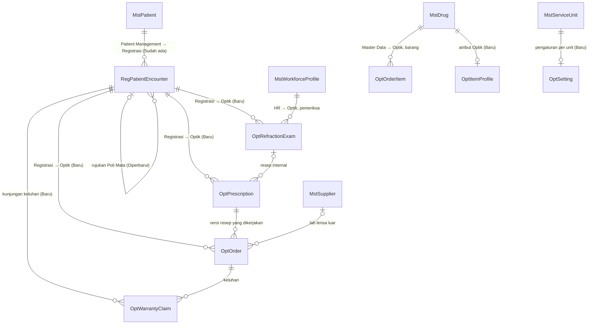

# Optik — Context ERD

| Field | Nilai |
| --- | --- |
| Blueprint ID | `OPT-BP-001` |
| Revision | `1` — `draft` |
| Sumber konteks | `03-domain-architecture.md` (`OPT-HDA-001`) bagian C |

Diagram ini hanya memperlihatkan **arah ketergantungan** antara tabel milik Optik dan tabel milik
modul lain. Kolom lengkap ada di ERD per konteks dan di [data-dictionary.md](data-dictionary.md).

| Arah | Dari (pemilik) | Ke (pemakai) | Bentuk keterhubungan |
| --- | --- | --- | --- |
| Upstream | Patient Management | Optik | `PatientId` |
| Upstream | Registrasi | Optik | `EncounterId` |
| Upstream | Human Resource | Optik | `WorkforceProfileId` + baca izin |
| Upstream | Master Data | Optik | `DrugId`, `ServiceUnitId`, `SupplierId` |
| Downstream | Optik | Farmasi | Perintah stok lewat `DrugStockService` (kunci `SourceDocumentType = OpticalOrder`, `SourceDocumentId = OptOrder.Id`) |
| Downstream | Optik | Billing | Fakta tagihan sumber `Optical` (`SourceAggregateId` = pemeriksaan/pesanan, `SourceItemId` = item) |
| Downstream | Optik | Rekam Medis | Pembaca `OptMedicalRecordDocumentSource` |
| Downstream | Optik | Medical Fee | Ditarik adapter Medical Fee |

Tidak ada tabel modul lain yang memegang foreign key ke tabel Optik, kecuali tautan logis di
Billing dan Farmasi (kolom sumber berbentuk Guid + jenis, bukan FK fisik).
