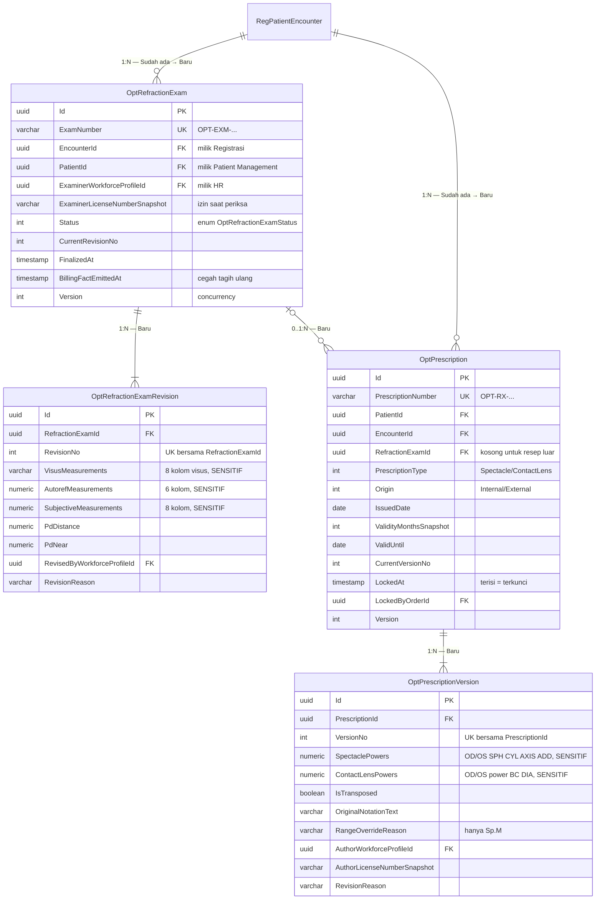

# Optik — ERD Klinis (Pemeriksaan dan Resep)

| Field | Nilai |
| --- | --- |
| Konteks | `BC-OPT-01` Optik — Klinis |
| Revision | `1` — `draft` |
| Keputusan | `OPT-DEC-005`, `007`, `011`, `012`, `017`, `022`, `023`, `039`, `042`, `045`, `046`, `047` |

Kolom ukur diringkas pada diagram. Daftar kolom lengkap ada di
[data-dictionary.md](data-dictionary.md).

| Entity | Status | Owner | Catatan |
| --- | --- | --- | --- |
| `RegPatientEncounter` | Diperbarui | Registrasi | Dirujuk, **tidak** disalin; tambah `ReferralSourceEncounterId` |
| `MstWorkforceProfile` | Sudah ada | Human Resource | Pemeriksa, penulis resep, perevisi |
| `OptRefractionExam` | Baru | Optik | Root pemeriksaan |
| `OptRefractionExamRevision` | Baru | Optik | Versi hasil ukur (`OPT-DEC-047`) |
| `OptPrescription` | Baru | Optik | Root resep |
| `OptPrescriptionVersion` | Baru | Optik | Versi isi resep |
