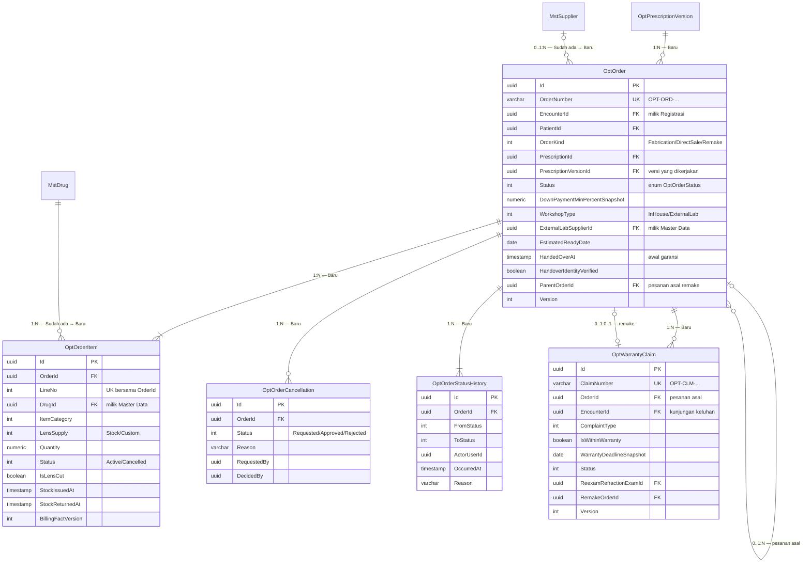

# Optik — ERD Pesanan dan Layanan Purna

| Field | Nilai |
| --- | --- |
| Konteks | `BC-OPT-02` Optik — Pesanan & Layanan Purna |
| Revision | `1` — `draft` |
| Keputusan | `OPT-DEC-010`, `013`, `015`, `016`, `018`, `019`, `020`, `028`, `029`, `034`, `035`, `038`, `041`, `043`, `044`, `048`, `049` |

| Entity | Status | Owner | Catatan |
| --- | --- | --- | --- |
| `OptOrder` | Baru | Optik | Root pesanan; tanpa harga dan diskon |
| `OptOrderItem` | Baru | Optik | Baris barang; satu fakta tagihan per item |
| `OptOrderCancellation` | Baru | Optik | Pengajuan + keputusan batal |
| `OptOrderStatusHistory` | Baru | Optik | Jejak transisi |
| `OptWarrantyClaim` | Baru | Optik | Keluhan garansi |
| `MstDrug` | Sudah ada | Master Data | Barang Optik |
| `MstSupplier` | Sudah ada | Administrator Master Data | Lab lensa luar |
