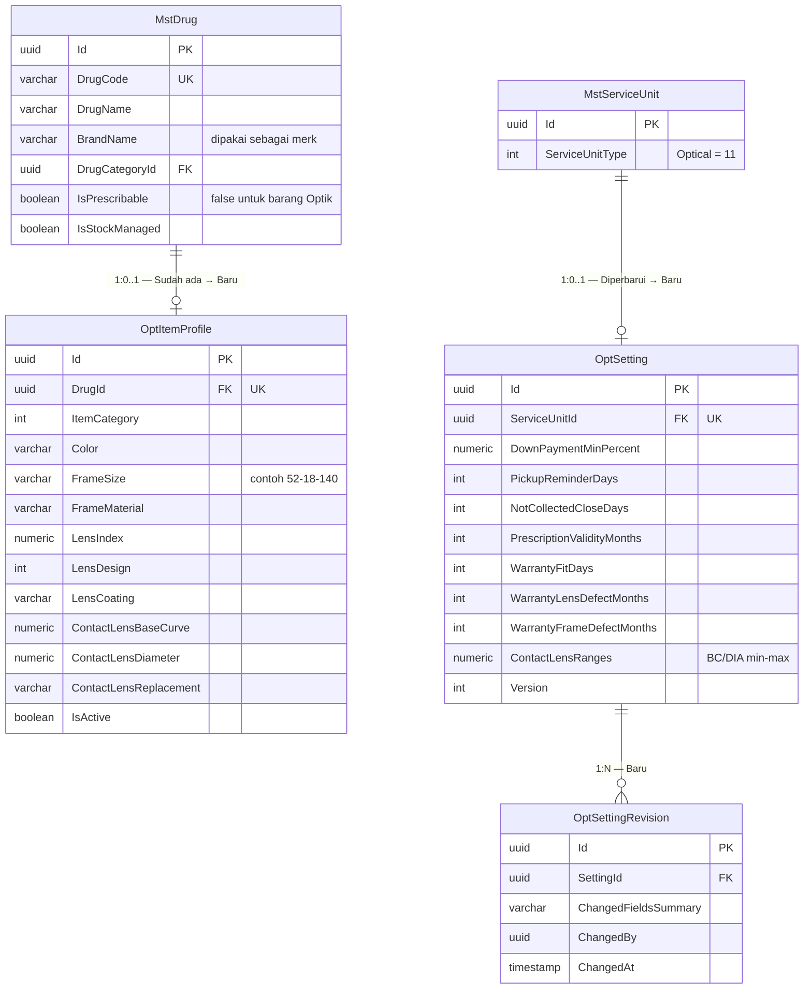

# Optik — ERD Profil Barang dan Pengaturan

| Field | Nilai |
| --- | --- |
| Konteks | `BC-OPT-03` Optik — Profil Barang & Pengaturan |
| Revision | `1` — `draft` |
| Keputusan | `OPT-DEC-009`, `031`, `032`, `040`, `041`, `045` |

| Entity | Status | Owner | Catatan |
| --- | --- | --- | --- |
| `MstDrug` | Sudah ada | Master Data | Tidak diubah; hanya data barang baru |
| `MstServiceUnit` | Diperbarui (enum saja) | Master Data | Nilai `ServiceUnitType.Optical = 11`; tanpa migration |
| `OptItemProfile` | Baru | Optik | Atribut terstruktur (`OPT-DEC-031`); daftar atribut `CONFIGURABLE_DEFAULT` |
| `OptSetting` | Baru | Optik | Angka bawaan |
| `OptSettingRevision` | Baru | Optik | Audit perubahan pengaturan |
