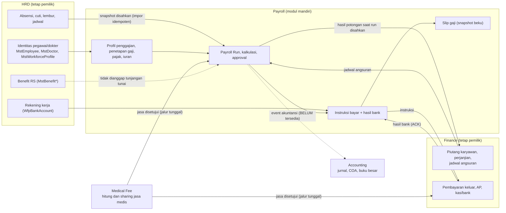

# PAYROLL V2 — 01. Audit dan Pemindahan Payroll dari HRD

| Field | Nilai |
| --- | --- |
| Dokumen | `PAYROLL_V2_01_AUDIT_DAN_PEMINDAHAN_HRD.md` |
| Tanggal | 2026-11-04 (zona `Asia/Jakarta`) |
| Sumber permintaan | `MASTER_PROMPT_MIGRASI_MODUL_PAYROLL_QUILVIAN_V2.md` |
| Backend | `DevBenari/NewQuilvianSystemBackend`, branch `Yasmina` |
| Frontend | `DevBenari/QuilvianSystemFrontendDev`, branch `yasmina` |
| Status pekerjaan | Perubahan lokal belum di-commit, tidak ada `git add`/commit/push, tidak ada `dotnet build`, `dotnet ef`, `npm run build`, `npm run dev`, atau server yang dijalankan |
| Dokumen pendamping | `PAYROLL_V2_02` (proses bisnis), `PAYROLL_V2_03` (integrasi), `PAYROLL_V2_04` (kontrak dan task), `PAYROLL_V2_05` (migration dan verifikasi) |

## 0. Cara membaca label bukti

Setiap pernyataan di seluruh dokumen `PAYROLL_V2_*` diberi salah satu label berikut.

| Label | Arti |
| --- | --- |
| `REPOSITORY FACT` | Fakta yang dibaca dari source pada SHA yang disebut. Bisa dicek ulang di path yang disebut. |
| `TARGET PROPOSAL` | Rancangan atau usulan. Belum ada di source dan belum disetujui pemilik proses. |
| `IMPLEMENTED` | Sudah ada di source hasil pekerjaan ini. Dibuktikan lewat pemeriksaan statis, **belum** dijalankan (lihat bagian 9). |
| `PARTIAL` | Sebagian sudah ada. Bagian yang kurang disebut di baris yang sama. |
| `BLOCKED` | Tidak dapat dikerjakan sekarang karena ada ketergantungan di luar lingkup (aturan governance, modul lain, keputusan pemilik). |
| `NEEDS CONFIRMATION` | Aturan bisnis atau kebijakan yang belum disahkan. Sistem memakai parameter yang bisa diganti dan **tidak** mengaktifkan posting keuangan otomatis untuk hal ini. |

Bukti kode ditulis sebagai `repository + path + simbol + SHA`. Karena pekerjaan ini belum di-commit, bukti untuk file baru berbunyi "perubahan lokal di atas SHA dasar".

## 1. Ringkasan untuk pemilik proses

Sebelum pekerjaan ini, "Payroll" hidup di dalam menu dan folder Sumber Daya Manusia (HRD). Run penggajian, potongan cicilan piutang, dan restitusi sudah ada, tetapi tidak ada alur utuh dari data pegawai sampai slip gaji, dan layar frontend untuk restitusi memanggil alamat API yang tidak ada di backend.

Setelah pekerjaan ini:

1. Payroll punya modul mandiri di backend (`Areas/Corporate/PayrollManagement`) dan di frontend (menu **Payroll**, rute `/payroll/...`).
2. Alur lengkap tersedia di kode: profil penghasilan → persiapan dan impor data HRD → perhitungan gaji → persetujuan → pengiriman instruksi bayar ke Finance → hasil bayar → slip gaji → rekap dan rekonsiliasi.
3. Pemilik data tidak berubah: HRD tetap pemilik identitas pegawai/dokter, absensi, cuti, lembur, dan benefit RS; Finance tetap pemilik piutang dan pembayaran; Medical Fee tetap pemilik perhitungan jasa medis.
4. Pemindahan fisik dilakukan **bertahap** (keputusan pemilik pada sesi ini): kode yang belum tersimpan di database langsung dipindah; entity tersimpan menunggu persetujuan registry (bagian 7).

Yang **belum** bisa dianggap selesai dan harus diputuskan pihak berwenang tercantum di bagian 8.

## 2. Snapshot repository

| Sisi | Branch (wajib) | SHA di prompt | SHA saat dikerjakan | Selisih | Kondisi kerja |
| --- | --- | --- | --- | --- | --- |
| Backend | `Yasmina` | `ba31282612080fb39fd48d9ed0e912f49e333e5b` | `b5fb6c251eafcd680ec35483732e3e72226e19f3` | +7 commit | 24 file diubah, 9 dipindah-keluar (dihapus dari lokasi lama), 40 file baru (38 kode + 2 migration), belum di-commit |
| Frontend | `yasmina` | `fa7eb8d7bbbe78a426d835928a24cea205013194` | `6a980d8c9dee0cae92c616fcd74f903ec0c67d73` | +2 commit | Bersih saat mulai; 45 file diubah, 65 dihapus/dipindah, file baru belum di-commit |

`REPOSITORY FACT`: SHA berubah dari prompt, sehingga seluruh kesimpulan di prompt dibaca ulang terhadap source saat ini. Tidak ada pindah branch, `fetch`, `pull`, `checkout`, atau `stash`.

## 3. Inventaris sebelum perubahan (`REPOSITORY FACT`, SHA dasar di atas)

### 3.1 Backend

| Kelompok | Isi | Lokasi |
| --- | --- | --- |
| Controller operasional | `PayrollRunsController`, `PayrollRestitutionController` | `Areas/Corporate/HumanResource/PayrollManagement/Controllers/` |
| Controller profil | `WfpPayrollController`, `WfpTaxController`, `WfpInsuranceController`, `WfpTransportAllowance*Controller` (3) | sama |
| Service | `PayrollRunService`, `PayrollRestitutionService`, `PayrollInstallmentDeductionService` | `.../PayrollManagement/Services/` |
| DTO | `PayrollRunDtos`, `PayrollRestitutionDtos`, `PayrollInstallmentDeductionDtos` + DTO `Wfp*` | `.../PayrollManagement/DTOs/` |
| Entity operasional | 13 `Trx*`: `TrxPayrollRun`, `TrxPayrollRunEmployee`, `TrxPayrollEmployeeComponent`, `TrxPayrollAttendanceInput`, `TrxPayrollOvertimeInput`, `TrxPayrollVariableInput`, `TrxPayrollAdjustment`, `TrxPayrollApproval`, `TrxPayrollPayment`, `TrxPayrollPayslip`, `TrxPayrollReversal`, `TrxMedicalServiceFeeCalculation`, `TrxMedicalServiceFeePayment` | `.../PayrollManagement/Models/` |
| Entity profil | 6 `Wfp*`: `WfpPayroll`, `WfpTax`, `WfpInsurance`, `WfpTransportAllowance`, `WfpTransportAllowancePolicy`, `WfpTransportAllowanceTransaction` | sama |
| Master data | `MstSalaryGrade`, `MstSalaryStructure`, `MstPayrollPeriod`, `MstPayrollComponentCategory`, `MstPayrollComponent`, `MstAllowanceType`, `MstDeductionType`, `MstShiftAllowancePolicy`, `MstOnCallAllowancePolicy`, `MstHazardAllowancePolicy` (+ `MstBenefit*`) | `Areas/Corporate/HumanResource/MasterData/PayrollAndBenefit/` |
| Penetapan gaji | `WfpSalaryAssignment` + `WfpSalaryAssignmentController` | `Areas/Corporate/HumanResource/WorkforceCore/` |
| Konfigurasi EF | satu `*Configuration` per entity | `Repositories/Configurations/Corporate/HumanResource/PayrollManagement/` dan `.../MasterData/PayrollAndBenefit/` |
| Handoff HRD | `AttendancePayrollHandoffService`, `LeavePayrollIntegrationService`, `OvertimePayrollHandoffService` | modul Attendance, Leave, Overtime |
| Sisi Finance | `FinanceReceivablePayrollSyncService` (dapat membuat/mencari run), `FinPayrollDeductionBatch` | `Areas/Corporate/FinanceManagement/Receivable/` |

### 3.2 Frontend

| Kelompok | Isi | Lokasi |
| --- | --- | --- |
| Menu | grup "Payroll & Penggajian" (10 butir) di Master Data HR, "Penetapan Gaji", "Payroll Run & Potong Gaji" | `src/utils/menu-sidebar/menu-items.jsx` |
| Rute master | 10 entitas × 5 berkas rute | `src/app/hr/master-data/<entitas>/` |
| Rute operasional | `runs`, `runs/[id]`, `restitution-installment`, `salary-assignments` | `src/app/hr/payroll/`, `src/app/hr/workforce-core/` |
| Service | `PayrollIntegrationService` memakai `BASE_URL = "/v1/hr/payroll"` | `src/lib/services/hr/payroll-integration-service.js` |

## 4. Temuan audit

| No | Temuan | Label | Dampak | Tindak lanjut di pekerjaan ini |
| ---: | --- | --- | --- | --- |
| T1 | `PayrollIntegrationService` memanggil `/v1/hr/payroll/restitutions` dan `/installment-deductions`. Tidak ada rute itu di backend, dan tidak ada `rewrites` di `next.config.js` maupun proxy di `nginx.conf`. | `REPOSITORY FACT` | Layar Restitusi & Cicilan tidak pernah memuat data. | `IMPLEMENTED`: service ditulis ulang ke rute nyata `/v1/corporate/payroll-management/...`. |
| T2 | `WorkforceCoreCrossEmployeeService` memakai `/v1/hr/workforce-core/cross-employee`, sedangkan backend `api/v1/corporate/human-resource/workforce-core`. Layar Penetapan Gaji juga membaca field yang tidak dikirim backend (`baseSalary`, `currency`, `effectiveDate`). | `REPOSITORY FACT` | Penetapan Gaji kosong atau tampil "IDR 0". | `IMPLEMENTED` untuk fungsi `salary-assignments` (service Payroll baru, field disesuaikan). Fungsi lain di service itu milik HRD: **dilaporkan, tidak diubah** (`UNRELATED EXISTING ISSUE`). |
| T3 | Prompt menyebut `FinanceReceivablePayrollSyncService` dapat membuat/mencari `TrxPayrollRun`. Pada source saat ini (SHA `b5fb6c2...`) layanan itu **tidak** membuat run atau baris pegawai: bila tidak ada run valid, angsuran diberi alasan `PAYROLL_AWAITING_RUN` dan menunggu. | `REPOSITORY FACT` (prompt sudah usang untuk butir ini) | Tidak ada risiko Finance memiliki run secara teknis. | `IMPLEMENTED` sebelum pekerjaan ini; dikunci oleh uji statis `payroll-installment-deduction-guards.test.mjs` (kini dialamatkan ke path baru). Perubahan di file ini hanya satu `using` namespace baru. |
| T4 | Fallback batas potong 50% gaji bersih tertanam di kode bila master tidak menentukan persentase. | `REPOSITORY FACT` | Aturan kebijakan tersembunyi di kode. | `IMPLEMENTED`: nilai pindah ke `PayrollPolicyOptions.InstallmentDefaultMaxNetSalaryPercentage` (bawaan 50, tetap perilaku lama) dan dicatat `NEEDS CONFIRMATION`. |
| T5 | Layanan potongan hanya memproses **satu** angsuran per pegawai per run (`FirstOrDefault`). | `REPOSITORY FACT` | Angsuran kedua milik pegawai yang sama pada periode yang sama tidak terpotong, tanpa pesan. | `PARTIAL`: tetap berlaku, **belum diperbaiki** karena mengubah kontrak baris potongan; dicatat sebagai risiko R1 di `PAYROLL_V2_04`. |
| T6 | Restitusi menambah komponen sekaligus mengubah total run lewat dua jalur. | `REPOSITORY FACT` | Risiko nilai ganda saat hitung ulang. | `IMPLEMENTED`: komponen non-mesin dihitung sekali oleh mesin kalkulasi; restitusi tidak lagi mengubah total langsung. |
| T7 | Finance belum punya jenis pembayaran `PAYROLL`, dan `MEDICAL_SERVICE` pun masih ditolak di jalur pembayaran. Outbox akuntansi belum punya kode peristiwa payroll. | `REPOSITORY FACT` | Instruksi payroll belum bisa dikonsumsi Finance, dan jurnal belum bisa dibuat. | `BLOCKED`: sisi Finance/Accounting di luar lingkup; Payroll menyiapkan sisi pengirim dan menampilkan "Belum Tersedia" pada rekonsiliasi. |
| T8 | Hasil jasa medis yang disetujui otomatis dibuatkan handoff Finance AP (`MdfFinanceHandoff`) untuk setiap `MdfServiceFee`. | `REPOSITORY FACT` | Menambah jalur Payroll tanpa pencegahan akan membayar jasa dua kali. | `IMPLEMENTED`: jalur Payroll nonaktif secara bawaan; klaim hanya untuk fee tanpa catatan handoff; ada indeks unik (bagian `PAYROLL_V2_05`). |
| T9 | Beberapa file `.Designer.cs` migration terbaru tampak kosong di prompt. | `REPOSITORY FACT` (dibantah) | - | Dicek: dua designer terbaru terisi penuh dan sama dengan snapshot; designer lama diarsipkan di `Migrations/History/`. Pola kosong **tidak** diulang. |
| T10 | Checker QBE memperlakukan file yang dipindah sebagai kode baru (aturan `QBE-NAM-001`, `QBE-MOD-002`, `QBE-CODE-002`) dan registry belum punya baris `Corporate / PayrollManagement`. | `REPOSITORY FACT` | Memindah entity `Trx*` memicu kegagalan CI strict. | Dasar keputusan pemindahan bertahap (bagian 7). |

## 5. Matriks pemindahan: path lama → path baru → pemakai → adaptor → status

### 5.1 Backend (file dipindah dengan `mv`, bukan salinan; tidak ada dua sumber kebenaran)

| Path lama (`Areas/Corporate/HumanResource/PayrollManagement/`) | Path baru (`Areas/Corporate/PayrollManagement/`) | Pemakai yang disesuaikan | Adaptor kompatibilitas | Status |
| --- | --- | --- | --- | --- |
| `Controllers/PayrollRunsController.cs` | `Controllers/PayrollRunsController.cs` | Frontend, Swagger | Rute lama `api/v1/corporate/human-resource/payroll-runs` tetap hidup di controller yang sama (`[Route]` ganda), kunci `AccessController` tidak berubah | `IMPLEMENTED` |
| `Controllers/PayrollRestitutionController.cs` | `Controllers/PayrollRestitutionController.cs` | Finance (pemanggil restitusi) | Rute lama `.../human-resource/payroll-restitutions` tetap hidup | `IMPLEMENTED` |
| `Services/PayrollRunService.cs` | `Services/PayrollRunService.cs` (ditulis ulang) | `Program.cs`, `FinanceBillingIntakeService` | `using` baru; nama kelas sama | `IMPLEMENTED` |
| `Services/PayrollRestitutionService.cs` | `Services/PayrollRestitutionService.cs` | `Program.cs`, controller restitusi | `using` baru | `IMPLEMENTED` |
| `Services/PayrollInstallmentDeductionService.cs` | `Services/PayrollInstallmentDeductionService.cs` | `PayrollRunService`, `FinanceReceivablePayrollSyncService` | `using` baru | `IMPLEMENTED` |
| `DTOs/PayrollRunDtos.cs` | `DTOs/PayrollRunDtos.cs` (diperluas) | controller, service, `FinanceBillingIntakeService` | namespace baru | `IMPLEMENTED` |
| `DTOs/PayrollRestitutionDtos.cs`, `DTOs/PayrollInstallmentDeductionDtos.cs` | `DTOs/...` | sama | namespace baru | `IMPLEMENTED` |
| `Models/PayrollRunStatuses.cs` | `Constants/PayrollRunStatuses.cs` (diperluas) | `FinanceReceivablePayrollSyncService` | `using ...PayrollManagement.Constants` | `IMPLEMENTED` |
| `Models/Trx*.cs` (13), `Models/Wfp*.cs` (6) | **tetap** | seluruh modul | - | `PARTIAL` — fase 2 (bagian 7) |
| `Controllers/Wfp*Controller.cs` (6) | **tetap**, ditambah rute `api/v1/corporate/payroll-management/...` | frontend | rute lama tetap | `IMPLEMENTED` (rute ganda) |
| `.../MasterData/PayrollAndBenefit/Controllers/*` (10 master) | **tetap**, ditambah rute `api/v1/corporate/payroll-management/master-data/...` | frontend master | rute lama tetap | `IMPLEMENTED` (rute ganda) |
| `.../WorkforceCore/Controllers/WfpSalaryAssignmentController.cs` | **tetap**, ditambah rute `payroll-management/workforce-profiles/{id}/salary-assignments` | - | rute lama tetap | `IMPLEMENTED` |
| `Repositories/Configurations/.../PayrollManagement/*` | **tetap** (+3 indeks unik) | EF | - | `IMPLEMENTED` |

Catatan: memindah namespace tidak mengubah nama tabel atau kolom, sehingga **tidak** memerlukan migration. Migration hanya dibuat untuk tiga indeks unik baru (`PAYROLL_V2_05`).

### 5.2 Kode baru di modul Payroll (tidak ada di lokasi lama)

| Komponen | File | Label |
| --- | --- | --- |
| Opsi kebijakan | `Options/PayrollPolicyOptions.cs` | `IMPLEMENTED` |
| Status dan katalog | `Constants/PayrollStatusCatalog.cs` | `IMPLEMENTED` |
| Mesin kalkulasi | `Services/PayrollCalculationService.cs` | `IMPLEMENTED` |
| Impor data HRD | `Services/PayrollHrdImportService.cs` | `IMPLEMENTED` |
| Penghasilan pegawai | `Services/PayrollCompensationService.cs` + `Controllers/PayrollCompensationsController.cs` | `IMPLEMENTED` |
| Potongan cicilan (riwayat dan rekonsiliasi) | `Services/PayrollEmployeeDeductionService.cs` + `Controllers/PayrollEmployeeDeductionsController.cs` | `IMPLEMENTED` |
| Pembayaran | `Services/PayrollPaymentService.cs` + `Controllers/PayrollPaymentsController.cs` | `IMPLEMENTED` (sisi Finance `BLOCKED`) |
| Slip gaji | `Services/PayrollPayslipService.cs`, `PayrollPayslipDocuments.cs` + `Controllers/PayrollPayslipsController.cs`, `PayrollMyPayslipsController.cs` | `IMPLEMENTED` |
| Jasa medis | `Services/PayrollMedicalFeeIntakeService.cs` + `Controllers/PayrollMedicalFeeIntakeController.cs` | `IMPLEMENTED` (jalur Payroll nonaktif bawaan) |
| Laporan | `Services/PayrollReportService.cs` + `Controllers/PayrollReportsController.cs` | `IMPLEMENTED` |
| Pembantu bersama | `PayrollExceptions.cs`, `PayrollVersionToken.cs`, `PayrollTransactionRunner.cs`, `PayrollControllerSupport.cs` | `IMPLEMENTED` |
| Registrasi DI | `Program.cs` (opsi kebijakan + 11 layanan) | `IMPLEMENTED` |

### 5.3 Frontend

| Path lama | Path baru | Pemakai lama | Adaptor | Status |
| --- | --- | --- | --- | --- |
| `/hr/master-data/<10 entitas>/...` | `/payroll/master-data/<10 entitas>/...` | menu HR, tautan di layar | `redirects()` di `next.config.js` (`:path*`, sementara/non-permanen) | `IMPLEMENTED` |
| `/hr/payroll/runs` | `/payroll/payroll-runs` | menu HR | `redirects()` | `IMPLEMENTED` |
| `/hr/payroll/runs/:id` | `/payroll/payroll-runs/:id` | tautan "Buka Payroll Run" | `redirects()` | `IMPLEMENTED` |
| `/hr/payroll/restitution-installment` | `/payroll/employee-receivable-deductions` (+ `/payroll/payroll-restitutions`) | menu HR | `redirects()` | `IMPLEMENTED` |
| `/hr/workforce-core/salary-assignments` | `/payroll/salary-assignments` | menu HR | `redirects()` | `IMPLEMENTED` |
| `src/components/view/hr/payroll/**`, `hooks/hr/payroll/**`, `utils/hr/payroll/**`, `constants/hr/payroll/**`, `style/hr/payroll/**` | `.../payroll/**` (dipindah dengan `mv`, impor diperbarui) | layar run | - | `IMPLEMENTED` |
| `src/lib/services/hr/payroll-integration-service.js` | `src/lib/services/payroll/payroll-integration-service.js` (endpoint nyata) | layar restitusi | - | `IMPLEMENTED` |
| `src/components/view/hr/master-data/<entitas>/**`, hook, slice, konstanta, util master | **tetap** di folder lama (rute dan endpoint diganti) | - | - | `PARTIAL` — fase 2 |

`REPOSITORY FACT`: token rute privat (`detail-...`, `.../update`) disimpan per jenis data, bukan per alamat (komentar di `next.config.js`), sehingga `routeTokenScope` (`hr-master-data-<entitas>`) sengaja tidak diubah.

## 6. Kepemilikan dan batas konteks



| Konsep | Pemilik | Perlakuan di pekerjaan ini | Label |
| --- | --- | --- | --- |
| Identitas pegawai/dokter | HRD | Payroll hanya menyimpan `WorkforceProfileId` dan snapshot nama/nomor. Tidak ada identitas ganda dan tidak ada "karyawan palsu" untuk dokter tanpa `MstEmployee`. | `IMPLEMENTED` |
| Absensi, cuti, lembur | HRD | Payroll mengimpor snapshot yang sudah disahkan lewat tiga layanan HRD yang ada. Payroll tidak mengubah data sumber. | `IMPLEMENTED` |
| Rekening kerja | HRD | Payroll hanya mengonsumsi rekening payroll yang **terverifikasi**; nomor selalu disamarkan di layar. | `IMPLEMENTED` |
| Benefit RS | HRD/Benefit | Tidak disentuh. Plafon benefit medis tidak dianggap tunjangan tunai. | `IMPLEMENTED` |
| Piutang, perjanjian, angsuran | Finance | Payroll mengeksekusi potongan dan mengonfirmasi hasil; saldo piutang tidak pernah ditulis dari frontend. | `IMPLEMENTED` |
| Jasa medis | Medical Fee | Hanya hasil yang sah dikonsumsi, lewat jalur tunggal. Modul Medical Fee tidak diubah. | `IMPLEMENTED` |
| Jurnal dan COA | Accounting | Tidak ada posting dari Payroll atau browser. Pemetaan COA payroll belum disahkan. | `BLOCKED` |

## 7. Pemindahan bertahap dan rencana fase 2

### 7.1 Mengapa bertahap

`REPOSITORY FACT`: `tooling/qbe/Invoke-QbeConformanceCheck.ps1` dijalankan CI (`qbe-conformance.yml`, mode `GitRange` strict) dan menandai berkas yang dipindah sebagai kode baru. Memindah 19 entity `Trx*`/`Wfp*` akan gagal pada `QBE-NAM-001` (awalan `Trx`), `QBE-MOD-002` (modul belum terdaftar), dan `QBE-CODE-002`. Memindah entity juga mengubah nama kelas yang dibaca EF, snapshot migration, dan banyak `using` di modul lain.

Keputusan pemilik pada sesi ini: **bertahap, aman QBE**. Dipindah sekarang: controller, service, DTO, dan konstanta yang belum menjadi entity tersimpan, serta seluruh kode baru. Entity, konfigurasi EF, controller master, dan controller profil `Wfp*` tetap, tetapi mendapat rute alias Payroll.

### 7.2 Syarat fase 2 (`TARGET PROPOSAL`, tidak diterapkan dan tidak mengubah registry)

| No | Syarat | Pemilik keputusan |
| ---: | --- | --- |
| 1 | Menambah baris registry untuk `Corporate / PayrollManagement`. Usulan baris: `| Corporate | PayrollManagement / Payroll | BUSINESS DOMAIN / MODULE | Prl | PLANNED |` (awalan `Prl` hanya usulan). | Pemilik repository (persetujuan manusia) |
| 2 | Menyetujui pengecualian per berkas untuk entity lama yang dipindah **tanpa** ganti nama kelas, mengikuti bentuk `docs/engineering/QBE_EXCEPTIONS.json`: `ExceptionId`, `RuleId` (`QBE-NAM-001`/`QBE-MOD-002`), `Scope` (path), `Reason`, `Status`, `ApprovedBy`, `ApprovalReference`, `NoExpiryRationale`. | Pemilik repository |
| 3 | Memutuskan apakah kelas `Trx*` diganti nama (`Prl*`). Ganti nama kelas **dengan** nama tabel tetap tidak memerlukan migration; ganti nama tabel memerlukan migration non-destruktif (`RenameTable`, `QBE-DB-002`). | Pemilik repository + DBA |
| 4 | Menjalankan skrip pemindahan di bawah pada branch khusus, lalu `dotnet build` oleh pihak yang berwenang. | Pelaksana yang diberi wewenang build |

Draf contoh entri pengecualian (tidak ditulis ke `QBE_EXCEPTIONS.json`):

```json
{
  "ExceptionId": "EXP-QBE-NAM-001-PRL-001",
  "RuleId": "QBE-NAM-001",
  "Scope": "Areas/Corporate/PayrollManagement/Models/TrxPayrollRun.cs",
  "Reason": "Entity operasional lama dipindahkan ke modul Payroll tanpa mengganti nama kelas agar nama tabel dan snapshot migration tidak berubah.",
  "Status": "ACTIVE",
  "ApprovedBy": "<diisi pemilik repository>",
  "ApprovalReference": "PAY-BE-01 fase 2",
  "NoExpiryRationale": "Menunggu keputusan penggantian nama kelas."
}
```

Draf skrip pemindahan fase 2 (jangan dijalankan sebelum syarat 1-3 terpenuhi):

```bash
# Dijalankan dari akar repository backend, pada branch kerja khusus. Memakai mv biasa.
set -euo pipefail
OLD=Areas/Corporate/HumanResource/PayrollManagement
NEW=Areas/Corporate/PayrollManagement
mkdir -p "$NEW/Models"
mv "$OLD/Models/"*.cs "$NEW/Models/"
mv "$OLD/DTOs/Wfp"*.cs "$NEW/DTOs/"
mv "$OLD/Controllers/Wfp"*.cs "$NEW/Controllers/"
# 1) Ganti namespace: QuilvianSystemBackend.Areas.Corporate.HumanResource.PayrollManagement.Models -> ...Corporate.PayrollManagement.Models
grep -rl "HumanResource.PayrollManagement" --include='*.cs' . \
  | xargs sed -i '' 's/Areas\.Corporate\.HumanResource\.PayrollManagement\./Areas.Corporate.PayrollManagement./g'
# 2) Perbarui ApplicationDbContextModelSnapshot.cs dan designer migration terbaru secara manual
#    (nama CLR entity berubah namespace; nama tabel tidak berubah -> tidak perlu migration).
# 3) Jalankan QBE conformance GitRange lokal, lalu build oleh pihak berwenang.
```

Frontend fase 2 serupa: memindahkan `src/components/view/hr/master-data/<entitas>/`, hook, konstanta, util, dan slice 10 entitas master ke `.../payroll/master-data/<entitas>/` dan memperbarui impor. Perubahan ini kosmetik (tidak mengubah perilaku) dan **tidak** dilakukan sekarang karena aturan repository melarang penataan ulang folder besar tanpa permintaan, dan build tidak boleh dijalankan untuk membuktikannya.

## 8. Keputusan bisnis yang belum disahkan (`NEEDS CONFIRMATION`)

| No | Hal | Perilaku sementara di kode | Parameter |
| ---: | --- | --- | --- |
| 1 | Alur approval berjenjang | Satu langkah: diajukan lalu disahkan. Pemisahan pengaju dan pengesah bisa diaktifkan | `RequireDifferentApprover` (bawaan `false`) |
| 2 | Waktu pengakuan pelunasan piutang dari potongan payroll | Saat run **disahkan** (bukan saat draf/hitung/preview); hasil dikonfirmasi ke Finance dalam transaksi serializable | tidak ada parameter; titik pengakuan resmi perlu disahkan Finance/Accounting |
| 3 | Batas dan urutan potongan | Persentase maksimum dari master `MstDeductionType`; bila kosong dipakai bawaan | `InstallmentDefaultMaxNetSalaryPercentage` (50) |
| 4 | Jalur honor dokter kontrak/nonpegawai | Jalur Payroll nonaktif; seluruh jasa medis lewat Finance AP | `MedicalFeePayrollPathEnabled` (`false`) |
| 5 | Bank/penyedia pencairan | Tidak ada integrasi bank dari Payroll; hasil bank datang dari Finance lewat ACK | - |
| 6 | Pemetaan COA per komponen | Tidak ada jurnal; rekonsiliasi menandai event akuntansi "Belum Tersedia" | - |
| 7 | Aturan akses slip gaji | Slip terbit setelah pembayaran berhasil dikonfirmasi bank | `PayslipPublishTrigger` (`PaymentPaid`; alternatif `RunApproved`) |
| 8 | PPh 21 dan BPJS | Memakai nilai tetapan pada profil pajak/iuran pegawai; tidak ada rumus tarif tertanam | - |
| 9 | Prorata dan potongan cuti tanpa gaji | Prorata per hari kalender; cuti tanpa gaji dipotong sesuai hari | `ProrateFixedAllowances` (`true`), `UnpaidLeaveDeductionEnabled` (`true`) |

## 9. Batas pembuktian

| Pemeriksaan | Dijalankan? | Hasil |
| --- | --- | --- |
| `dotnet build`, `dotnet test`, `dotnet ef ...`, update database | **NOT RUN** (dilarang pemilik) | - |
| `npm run build`, `npm run dev`, server/API | **NOT RUN** (dilarang pemilik) | - |
| Pemeriksa statis BE (`verify_be.py`: using hilang/ambigu, arity pemanggilan, kecocokan atribut akses, nama tipe ganda, bentrok rute, namespace kosong) | Dijalankan | 0 kesalahan, 0 peringatan pada 38 file Payroll dan 16 controller |
| Tes unit FE terarah (`node --test`) | Dijalankan | `payroll-module-contract` 12 lulus, `payroll-run-screens` 11 lulus, `payroll-installment-deduction-guards` 6 lulus, `hr-master-data-sidebar-grouping` 6 lulus |
| ESLint pada cakupan yang disentuh | Dijalankan | 0 error; 27 peringatan satu aturan (`react-hooks/set-state-in-effect`), pola yang sama dengan hook payroll yang sudah ada |
| Resolver impor FE (`verify_fe.py`) | Dijalankan | Tidak ada impor baru yang tak terselesaikan dibanding SHA dasar (58 yang lama tidak terkait) |

Kesimpulan: kode **ditulis dan ditinjau statis**. Kesesuaian runtime (kompilasi C#, terjemahan LINQ ke SQL, perilaku layar di peramban) **belum dibuktikan**.
