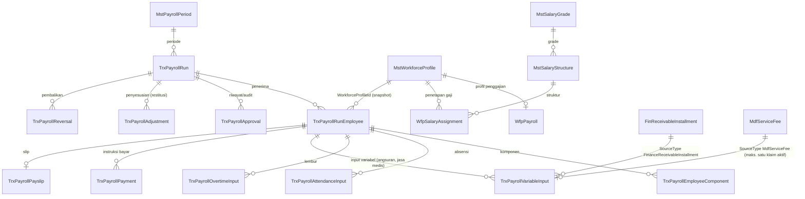

# PAYROLL V2 — 02. Master Data dan Proses Bisnis

| Field | Nilai |
| --- | --- |
| Dokumen | `PAYROLL_V2_02_MASTER_DATA_DAN_PROSES_BISNIS.md` |
| Tanggal | 2026-11-04 |
| Acuan SHA | BE `b5fb6c251eafcd680ec35483732e3e72226e19f3` (+ perubahan lokal), FE `6a980d8c9dee0cae92c616fcd74f903ec0c67d73` (+ perubahan lokal) |
| Label bukti | `REPOSITORY FACT`, `TARGET PROPOSAL`, `IMPLEMENTED`, `PARTIAL`, `BLOCKED`, `NEEDS CONFIRMATION` (arti di `PAYROLL_V2_01` bagian 0) |
| Catatan penamaan (11 November 2026) | Nama entity `Trx*` dan `Wfp*` Payroll di dokumen ini adalah nama saat ditulis. Sejak `PAY-BE-12` dan `PAY-MIG-02` namanya `Prl*` (ganti awalan saja, mis. `TrxPayrollRun` menjadi `PrlPayrollRun`). Lihat `PAYROLL_V2_01` |

Semua rumus dan contoh memakai data samaran. Nominal dalam Rupiah.

## 1. Hierarki Modul → Menu → Submenu → Fitur

Seluruh label di sidebar berbahasa Indonesia. Satu fitur = satu halaman. Setiap butir menu hanya tampil bila pengguna punya izin `Resource : Action` pada kolom terakhir (diatur admin di Pengaturan → Manajemen Role → Akses Role, bukan di kode).

| Modul | Menu | Submenu | Fitur (halaman) | Rute FE | Izin menu | Label |
| --- | --- | --- | --- | --- | --- | --- |
| Payroll | Data Induk | Grade dan Struktur Gaji | Grade Gaji | `/payroll/master-data/salary-grade` | `SalaryGrade : Read` | `IMPLEMENTED` |
| Payroll | Data Induk | Grade dan Struktur Gaji | Struktur Gaji | `/payroll/master-data/salary-structure` | `SalaryStructure : Read` | `IMPLEMENTED` |
| Payroll | Data Induk | Komponen Penggajian | Komponen Penggajian | `/payroll/master-data/payroll-component` | `PayrollComponent : Read` | `IMPLEMENTED` |
| Payroll | Data Induk | Komponen Penggajian | Kategori Komponen | `/payroll/master-data/payroll-component-category` | `PayrollComponentCategory : Read` | `IMPLEMENTED` |
| Payroll | Data Induk | Komponen Penggajian | Jenis Tunjangan | `/payroll/master-data/allowance-type` | `AllowanceType : Read` | `IMPLEMENTED` |
| Payroll | Data Induk | Komponen Penggajian | Jenis Potongan | `/payroll/master-data/deduction-type` | `DeductionType : Read` | `IMPLEMENTED` |
| Payroll | Data Induk | Periode Penggajian | Periode Penggajian | `/payroll/master-data/payroll-period` | `PayrollPeriod : Read` | `IMPLEMENTED` |
| Payroll | Data Induk | Kebijakan Tunjangan | Tunjangan Shift | `/payroll/master-data/shift-allowance-policy` | `ShiftAllowancePolicy : Read` | `IMPLEMENTED` |
| Payroll | Data Induk | Kebijakan Tunjangan | Tunjangan Siaga (On Call) | `/payroll/master-data/on-call-allowance-policy` | `OnCallAllowancePolicy : Read` | `IMPLEMENTED` |
| Payroll | Data Induk | Kebijakan Tunjangan | Tunjangan Risiko | `/payroll/master-data/hazard-allowance-policy` | `HazardAllowancePolicy : Read` | `IMPLEMENTED` |
| Payroll | Data Induk | Kebijakan Tunjangan | Tunjangan Transportasi | (tidak ada layar FE; API `transport-allowance-policies` ada) | - | `PARTIAL` — layar belum ada |
| Payroll | Penghasilan Pegawai | Profil Penggajian | Profil Penggajian | `/payroll/workforce-compensations` (+ `/[id]`) | `PayrollCompensation : Read` | `IMPLEMENTED` |
| Payroll | Penghasilan Pegawai | Penetapan Gaji | Penetapan Gaji | `/payroll/salary-assignments` | `WfpSalaryAssignment : ReadAll` | `IMPLEMENTED` |
| Payroll | Proses Penggajian | Persiapan Penggajian | Persiapan Penggajian | `/payroll/payroll-runs` | `PayrollRun : ReadPeriodOverview` | `IMPLEMENTED` |
| Payroll | Proses Penggajian | Perhitungan Gaji | Perhitungan Gaji | `/payroll/payroll-calculations` (+ detail `/payroll/payroll-runs/[id]`) | `PayrollRun : Read` | `IMPLEMENTED` |
| Payroll | Proses Penggajian | Persetujuan Penggajian | Persetujuan Penggajian | `/payroll/payroll-approvals` | `PayrollRun : Read` | `IMPLEMENTED` |
| Payroll | Potongan dan Penyesuaian | Cicilan Piutang Karyawan | Cicilan Piutang Karyawan | `/payroll/employee-receivable-deductions` | `PayrollEmployeeDeduction : Read` | `IMPLEMENTED` |
| Payroll | Potongan dan Penyesuaian | Restitusi dan Koreksi | Restitusi dan Koreksi | `/payroll/payroll-restitutions` | `PayrollRestitution : Read` | `IMPLEMENTED` |
| Payroll | Remunerasi Dokter | Integrasi Jasa Medis | Integrasi Jasa Medis | `/payroll/medical-fee-intake` | `PayrollMedicalFeeIntake : Read` | `IMPLEMENTED` (jalur Payroll nonaktif bawaan) |
| Payroll | Pembayaran Penggajian | Pengiriman Pembayaran | Pengiriman Pembayaran | `/payroll/payment-dispatch` | `PayrollPayment : FinanceHandoff` | `IMPLEMENTED` (sisi Finance `BLOCKED`) |
| Payroll | Pembayaran Penggajian | Riwayat Pembayaran | Riwayat Pembayaran | `/payroll/payment-history` | `PayrollPayment : Read` | `IMPLEMENTED` |
| Payroll | Slip Gaji | Slip Gaji Pegawai | Slip Gaji Pegawai | `/payroll/payslips` (+ `/[id]`) | `PayrollPayslip : Read` | `IMPLEMENTED` |
| Payroll | Slip Gaji | Slip Gaji Pegawai | Slip Gaji Saya (akses pribadi) | `/payroll/my-payslips` (+ `/[id]`) | `MyPayslip : Read` | `IMPLEMENTED` |
| Payroll | Laporan | Rekap Penggajian | Rekap Penggajian | `/payroll/reports/recap` | `PayrollReport : Read` | `IMPLEMENTED` |
| Payroll | Laporan | Rekonsiliasi Keuangan | Rekonsiliasi Keuangan | `/payroll/reports/reconciliation` | `PayrollReport : ViewAmount` | `IMPLEMENTED` |

Catatan:

- "Slip Gaji Saya" adalah tambahan di bawah menu Slip Gaji agar pegawai dan dokter tetap melihat slip pribadi (kontrak CT-PAY-11). Daftar menu di prompt tidak memuatnya secara eksplisit.
- Semua halaman lama tetap terbuka lewat pengalihan (lihat `PAYROLL_V2_01` bagian 5.3).
- Penerima yang sama bisa membuka halaman detail dengan klik dua kali pada baris tabel; detail master data hanya punya aksi `Kembali`, `Perbarui`, `Hapus` (aturan repository).

## 2. Master data penggajian

Sepuluh entity berikut dimiliki Payroll (`TARGET PROPOSAL` untuk pemindahan folder, lihat `PAYROLL_V2_01` bagian 7). Identitas dan relasi (FK) **tidak berubah**, hanya rute dan label.

| Entity (kelas) | Kegunaan bagi pengguna | Isian utama (nama kolom di kode) | Relasi dan aturan |
| --- | --- | --- | --- |
| Grade Gaji (`MstSalaryGrade`) | Rentang gaji per tingkat jabatan | `SalaryGradeCode`, `SalaryGradeName`, `GradeLevel`, `MinimumSalary`, `MidpointSalary`, `MaximumSalary`, `AnnualIncrementPercentage`, `CurrencyCode`, masa berlaku | Opsional menaut ke grade karyawan HRD (`EmployeeGradeId`) |
| Struktur Gaji (`MstSalaryStructure`) | Paket struktur gaji untuk satu grade, bisa dibatasi per entitas hukum/lokasi/unit/kategori/jenis kepegawaian | `SalaryStructureCode`, `SalaryStructureName`, `SalaryGradeId`, `PaymentFrequency`, `CurrencyCode`, masa berlaku | Wajib menaut ke Grade Gaji |
| Periode Penggajian (`MstPayrollPeriod`) | Kalender penggajian: rentang tanggal, batas data absensi dan input variabel, tanggal bayar, kunci | `PayrollPeriodCode`, `PayrollPeriodName`, `PeriodType`, `FiscalYear`, `PeriodNumber`, `StartDate`, `EndDate`, `AttendanceCutoffDate`, tanggal bayar, status kunci | Periode terkunci tidak bisa dibuka run baru |
| Komponen Penggajian (`MstPayrollComponent`) | Daftar komponen penghasilan dan potongan | `PayrollComponentCode`, `PayrollComponentName`, `ComponentType` (`Earning`/`Deduction`/...), `CalculationMethod`, `FormulaExpression`, `DefaultAmount`, `DefaultPercentage` | Wajib menaut ke Kategori Komponen; dapat menaut ke komponen dasar |
| Kategori Komponen (`MstPayrollComponentCategory`) | Pengelompokan komponen dan dampaknya | `ComponentCategoryCode`, `ComponentCategoryName`, `ComponentGroup`, `AffectsGrossPay`, `AffectsTaxableIncome`, `AffectsTakeHomePay`, `IsEmployerCost` | - |
| Jenis Tunjangan (`MstAllowanceType`) | Jenis tunjangan beserta cara hitungnya | `AllowanceTypeCode`, `AllowanceTypeName`, `AllowanceCategory`, `CalculationMethod`, `DefaultAmount`, `DefaultPercentage`, `MaximumAmount` | Dapat menaut ke Komponen Penggajian |
| Jenis Potongan (`MstDeductionType`) | Jenis potongan beserta cara hitung dan **batas persentase dari gaji bersih** | `DeductionTypeCode`, `DeductionTypeName`, `DeductionCategory`, `CalculationMethod`, `MaximumAmount`, `MaxNetSalaryPercentage` | Dibaca layanan potongan cicilan |
| Tunjangan Shift (`MstShiftAllowancePolicy`) | Aturan tunjangan per shift/grup shift | `ShiftAllowancePolicyCode`, `...Name`, `CalculationMethod` | Wajib menaut ke Jenis Tunjangan |
| Tunjangan Siaga (`MstOnCallAllowancePolicy`) | Aturan tunjangan on-call | `OnCallAllowancePolicyCode`, `...Name`, `CalculationMethod` (`FixedPerAssignment`, ...) | Wajib menaut ke Jenis Tunjangan |
| Tunjangan Risiko (`MstHazardAllowancePolicy`) | Aturan tunjangan risiko kerja | `HazardAllowancePolicyCode`, `...Name`, tingkat risiko | Wajib menaut ke Jenis Tunjangan |

Aturan umum: kode master unik di antara data yang belum dihapus; penghapusan hanya menandai data sebagai tidak aktif (`IsDelete`) sehingga histori tetap bisa ditelusuri.

**Contoh validasi:** Grade "GR-05" dengan `MinimumSalary` Rp 6.000.000, `MidpointSalary` Rp 7.500.000, `MaximumSalary` Rp 9.000.000. Penetapan gaji pokok Rp 9.500.000 pada struktur yang menaut ke grade ini melewati batas atas; layar penetapan gaji milik HRD yang menegakkannya, sedangkan Payroll hanya memakai penetapan yang sudah **disetujui**.

## 3. Tokoh dan wewenang

| Pelaku | Tugas | Izin yang relevan (diatur admin) |
| --- | --- | --- |
| Staf HRD | Memelihara identitas, absensi, cuti, lembur, kontrak, rekening kerja; menyetujui penetapan gaji | izin modul HRD (tidak berubah) |
| Staf Payroll | Membuka run, mengimpor data HRD, menghitung, mengajukan | `PayrollRun : Create/ImportHrd/Calculate/Submit` |
| Pemeriksa/Penyetuju Payroll | Meninjau dan mengesahkan atau mengembalikan run | `PayrollRun : Approve/Return` (opsi pemisahan tugas `RequireDifferentApprover`) |
| Staf Keuangan | Mengirim instruksi bayar ke Finance, mengelola piutang, menerima hasil bank | `PayrollPayment : FinanceHandoff/Retry`; sisi Finance di modul Finance |
| Pegawai/Dokter tetap | Melihat dan mengunduh slip sendiri | `MyPayslip : Read/ReadDetail/Download` |
| Auditor/Manajemen | Melihat rekap dan rekonsiliasi | `PayrollReport : Read/ViewAmount` |

`REPOSITORY FACT`: tidak ada penentuan kewenangan lewat nama peran, nama departemen, atau tipe pengguna di kode baru; semua lewat `[AccessController]`, `[AccessAction]`, dan `[AccessPermission]`. Kepemilikan slip (pemilik hanya melihat slipnya) dan status run diperiksa di backend karena melekat pada data.

## 4. Proses 1 — Penyiapan penerima dan data HRD

| Unsur | Isi |
| --- | --- |
| Tujuan | Memastikan setiap penerima aktif punya data lengkap dan snapshot absensi/cuti/lembur yang sudah disahkan sebelum gaji dihitung |
| Pelaku | Staf Payroll (menjalankan), Staf HRD (memperbaiki data sumber) |
| Pemicu | Periode penggajian akan diproses (mis. periode Nov 2026) |
| Prasyarat | Periode aktif dan belum terkunci; penerima punya profil penggajian aktif dan eligible; penetapan gaji utama sudah disetujui |

**Langkah:**

1. Staf Payroll membuka **Persiapan Penggajian**, memilih periode, lalu menekan **Buka Payroll Run**. Sistem membuat run `Draft`, mengisi penerima dari profil penggajian aktif, dan menarik jadwal angsuran periode itu.
2. Panel **Kesiapan Data HRD** memperlihatkan populasi penerima, jumlah yang punya absensi/lembur/input variabel, serta penerima yang bermasalah (tanpa gaji disetujui, tanpa rekening terverifikasi).
3. Bila ada masalah, HRD memperbaiki data **di HRD**; Payroll tidak mengubah data sumber.
4. Staf Payroll menekan **Impor Data HRD** dan memilih sumber (Absensi, Cuti, Lembur). Sistem memanggil tiga layanan handoff HRD yang sudah ada satu per satu, melaporkan hasil per sumber, dan memajukan run ke `CollectingInput` bila minimal satu sumber berhasil.
5. Impor boleh diulang setelah HRD memperbaiki data; hasil yang sama tidak menggandakan data (idempoten, kunci: catatan sumber + versi + penerima run).

**Aturan bisnis:**

- Impor memeriksa run belum terkunci dan masih menerima input; dibatasi cutoff periode.
- Impor tidak dibungkus satu transaksi besar: setiap sumber punya transaksi sendiri, sehingga kegagalan satu sumber tidak membatalkan yang lain, dan hasilnya jujur per sumber (`Completed`, `CompletedWithIssues`, `Failed`, `Skipped`).
- Perubahan data sumber **setelah** cutoff tidak mengubah run yang sudah disahkan; koreksi lewat penyesuaian pada run terbuka atau run koreksi periode berikutnya.

**Jalur tidak normal:** (a) Cuti pending tidak ikut dan dilaporkan sebagai peringatan; (b) satu sumber gagal, dua lainnya berhasil → run maju ke `CollectingInput` dan kegagalan tampil di hasil impor; (c) run terkunci → impor ditolak (400).

**Hasil akhir:** run berstatus `CollectingInput`, setiap penerima punya agregat absensi/lembur, siap dihitung.

## 5. Proses 2 — Perhitungan gaji

| Unsur | Isi |
| --- | --- |
| Tujuan | Mendapat gross-to-net per penerima yang deterministik dan dapat ditelusuri |
| Pelaku | Staf Payroll |
| Pemicu | Tombol **Hitung Payroll** / **Hitung Ulang** (hanya selama run belum diajukan dan belum terkunci) |
| Prasyarat | Run `Draft`/`CollectingInput`/`Calculated`, tidak terkunci |

**Langkah (urutan di `PayrollRunService.CalculateAsync`):**

1. Pastikan run boleh dihitung dan token versi (`expectedRowVersion`) cocok; bila tidak → 409.
2. Mesin menghitung per penerima: gaji pokok dari penetapan gaji yang disetujui, primer, dan efektif pada periode (dipecah per segmen bila berubah di tengah periode), tunjangan tetap, lembur, tunjangan kehadiran, penghasilan variabel, potongan absensi, potongan cuti tanpa gaji, pajak, dan iuran pegawai.
3. Jadwal angsuran Finance disinkronkan ke run, lalu mesin potongan cicilan menghitung nominal potong berdasarkan gaji bersih yang tersedia.
4. Total run (bruto, potongan, bersih) diperbarui dan kebijakan yang dipakai disimpan (`PolicySnapshotJson`, termasuk `EngineVersion` dan `PolicyVersion`).
5. Penerima yang gagal validasi diberi status `Error` beserta alasannya; jumlah dan pesan masuk ke daftar **Penahan** (blocker).

**Rumus dan contoh berangka**

- *Prorata:* `gaji pokok × hari dibayar ÷ hari dalam periode`. Contoh: periode 1–30 November (30 hari), pegawai bergabung 11 November → hari dibayar 20. Gaji pokok Rp 6.000.000 × 20 ÷ 30 = **Rp 4.000.000**.
- *Segmen:* penetapan lama Rp 6.000.000 berlaku sampai 15 November (15 hari), penetapan baru Rp 7.500.000 mulai 16 November (15 hari): Rp 6.000.000 × 15 ÷ 30 + Rp 7.500.000 × 15 ÷ 30 = Rp 3.000.000 + Rp 3.750.000 = **Rp 6.750.000**.
- *Gross-to-net:* gaji pokok Rp 6.000.000 + tunjangan tetap Rp 1.000.000 + lembur Rp 400.000 = bruto Rp 7.400.000. Pajak Rp 150.000 + iuran pegawai Rp 100.000 + potongan lain Rp 50.000 = Rp 300.000. Gaji bersih sebelum cicilan = Rp 7.100.000. Cicilan piutang Rp 300.000 (dalam batas) → **gaji bersih dibayar Rp 6.800.000**.

**Aturan bisnis:**

- Komponen yang dihasilkan mesin berkode awalan `PAY_` (`PAY_BASE_SALARY`, `PAY_FIXED_ALLOWANCE`, `PAY_OVERTIME`, `PAY_TAX`, ...). Hitung ulang memperbarui per kode dan menandai tidak aktif komponen yang tidak lagi dihasilkan; komponen non-mesin (mis. restitusi) dihitung **sekali** dan tidak disentuh mesin.
- Input variabel berstatus `Draft` **tidak** dihitung; `Submitted` ke atas dihitung.
- Pajak dan iuran memakai nilai tetapan pada profil pajak/iuran penerima (`NEEDS CONFIRMATION`: tidak ada rumus tarif PPh/BPJS yang ditanam). Jenis komponen `Tax`/`Insurance` dipisah dari `Deduction` agar tidak terhitung dua kali pada layanan cicilan.
- Dokter tetap yang punya `WorkforceProfileId` tetapi tanpa `MstEmployee` tetap bisa dihitung bila profil eligible; sistem tidak membuat karyawan palsu.

**Validasi per penerima (menjadi penahan bila gagal):**

| No | Aturan | Pesan bagi pengguna (ringkas) |
| ---: | --- | --- |
| 1 | Profil penggajian ada, eligible, dan berstatus `Active` | "Profil payroll tidak ditemukan, tidak eligible, atau tidak berstatus Active." |
| 2 | Pegawai aktif pada periode (atau berhenti setelah awal periode) | "Pegawai tidak aktif pada periode ini." |
| 3 | Ada hari dibayar pada periode | "Tidak ada hari dibayarkan pada periode ini (belum efektif atau sudah berhenti sebelum periode)." |
| 4 | Ada penetapan gaji utama yang disetujui dan berlaku pada periode | "Penetapan gaji belum disetujui. Setujui penetapan gaji sebelum payroll dihitung." atau "Belum ada penetapan gaji yang disetujui dan berlaku pada periode ini." |
| 5 | Tidak ada dua penetapan utama yang tumpang tindih | "Terdapat lebih dari satu penetapan gaji utama yang berlaku bersamaan. Perbaiki di Penetapan Gaji." |
| 6 | Gaji bruto lebih dari nol | "Gaji bruto nol atau belum dikonfigurasi pada profil payroll." |
| 7 | Gaji bersih tidak negatif | "Gaji bersih negatif (Rp ...): potongan melebihi penghasilan. Periksa potongan dan input variabel." |

Rekening yang belum terverifikasi **tidak** menahan perhitungan; ia menjadi peringatan. Saat pengiriman instruksi bayar, bawaan sistem menahan **seluruh** pengiriman (kode 422) dan menyebut penerima yang rekeningnya belum terverifikasi, supaya tidak ada gaji yang terkirim sebagian tanpa disadari. Bila kebijakan `AllowPartialFinanceHandoff` diaktifkan, penerima tersebut dilewati dan sisanya tetap dikirim.

**Contoh:** run berisi 120 penerima, 3 di antaranya belum punya rekening terverifikasi. Bawaan: pengiriman ditolak dengan pesan "3 penerima belum memiliki rekening payroll terverifikasi sehingga instruksi pembayaran ditahan: ...". Dengan `AllowPartialFinanceHandoff = true`: 117 instruksi dibuat, 3 tercatat sebagai "dilewati" di hasil pengiriman.

## 6. Proses 3 — Pengajuan, persetujuan, dan penguncian

| Unsur | Isi |
| --- | --- |
| Tujuan | Memastikan hasil hitung ditinjau orang lain lalu dibekukan sebelum uang bergerak |
| Pelaku | Staf Payroll (mengajukan); Penyetuju (mengesahkan atau mengembalikan) |
| Pemicu | Run `Calculated` tanpa penahan |
| Prasyarat | Tidak ada pegawai `Error`, ada minimal satu penerima, tidak ada penahan |

**Langkah:** (1) Staf Payroll menekan **Ajukan**. (2) Penyetuju membuka **Persetujuan Penggajian → Tinjau**, membaca ringkasan, penahan, peringatan, dan **Riwayat Status dan Alasan**. (3) Penyetuju menekan **Sahkan** atau **Kembalikan** (alasan wajib). (4) Saat disahkan sistem, dalam satu transaksi serializable dengan kunci per run, mengonfirmasi hasil potongan cicilan ke Finance, mengunci run (`IsLocked = true`), dan membekukan snapshot penerima.

**Tabel perubahan status run**

| Dari status | Tindakan | Ke status | Siapa yang boleh | Syarat |
| --- | --- | --- | --- | --- |
| (belum ada) | Buka Payroll Run | `Draft` | `PayrollRun : Create` | Periode aktif dan tidak terkunci; belum ada run `Regular` aktif untuk periode itu |
| `Draft` | Impor data HRD | `CollectingInput` | `PayrollRun : ImportHrd` | Minimal satu sumber berhasil |
| `Draft`/`CollectingInput`/`Calculated` | Hitung | `Calculated` | `PayrollRun : Calculate` | Tidak terkunci; versi cocok |
| `Calculated` | Ajukan | `Submitted` | `PayrollRun : Submit` | Tanpa penahan dan tanpa pegawai `Error` |
| `Submitted` | Kembalikan | `Calculated` | `PayrollRun : Return` | Alasan wajib |
| `Submitted` | Sahkan | `Approved` (terkunci) | `PayrollRun : Approve` | Sesuai opsi pemisahan tugas; hasil potongan terkonfirmasi ke Finance |
| `Draft`...`Submitted` | Batalkan | `Cancelled` | `PayrollRun : Cancel` | Alasan wajib; tidak untuk run yang sudah disahkan |
| `Approved` | Kirim ke Finance | `SentToFinance` | `PayrollPayment : FinanceHandoff` | Run terkunci; semua penerima terbekukan; rekening terverifikasi (atau pengiriman sebagian diizinkan); idempoten |
| `SentToFinance`/`PartiallyPaid` | Hasil bank masuk | `PartiallyPaid` atau `Paid` | Finance (ACK), atau petugas berwenang lewat konfirmasi manual (`PAY-FE-12`) | Nominal sama dengan instruksi |
| `Paid` | Tutup | `Closed` | `PayrollRun : Close` | Semua instruksi berhasil |

`Posted` ada di daftar status tetapi tidak dipakai (menunggu jalur jurnal). Pemetaan ke kosakata usulan prompt: `INPUT_READY` = `CollectingInput`, `REVIEWED` = `Submitted`, `APPROVED`+`LOCKED` = `Approved` dengan `IsLocked`.

**Contoh pesan error dan artinya**

| Kode | Pesan | Arti bagi pengguna |
| --- | --- | --- |
| 400 | "Hanya payroll run berstatus Submitted yang dapat disahkan (saat ini Calculated)." | Aksi tidak sesuai tahap run. Ajukan dulu. |
| 403 | Aksi ditolak karena kewenangan | Pengaju dan pengesah harus orang berbeda bila opsi pemisahan tugas aktif, atau akun tidak punya izin. |
| 409 | Data sudah diubah pengguna lain | Dua petugas bertindak hampir bersamaan; muat ulang lalu ulangi. |
| 422 | Data tidak valid | Mis. alasan pembatalan kosong. |

**Jalur tidak normal:** run dibatalkan setelah sebagian hasil sementara → jadwal angsuran tetap di Finance dan ditarik ke run baru; run yang sudah disahkan tidak dibatalkan, koreksi lewat pembalikan (`PAYROLL_V2_03`). Mengesahkan dua kali tidak mengirim hasil ke Finance dua kali (idempoten).

## 7. Proses 4 — Pembayaran dan slip gaji

1. Penyetuju keuangan membuka **Pengiriman Pembayaran**, memilih run `Approved`, dan menekan **Kirim ke Finance**. Sistem membuat satu instruksi per penerima (nominal = gaji bersih setelah cicilan), berstatus `Scheduled`, dengan nomor `PAYI-<NomorRun>-<urut>`. Pengiriman ulang mengembalikan hasil pertama (tidak ada instruksi kedua).
2. Finance mengirim hasil bank lewat endpoint ACK (selama belum ada koneksi bank, petugas berwenang dapat memakai endpoint yang sama lewat layar Konfirmasi Pembayaran Manual, `PAY-FE-12`): `Paid` hanya bila referensi bank ada dan nominal sama dengan instruksi; `Failed` wajib beralasan. Hasil yang sama dikirim ulang → "Idempoten".
3. Staf melihat **Riwayat Pembayaran**; instruksi gagal bisa **Coba Ulang** (instruksi baru, yang berhasil tidak ikut).
4. Staf Payroll menekan **Buat Slip** lalu **Terbitkan Slip** pada **Slip Gaji Pegawai**. Slip dibuat dari snapshot beku dengan checksum; slip yang sudah terbit tidak dibuat ulang. Bawaan: slip terbit setelah pembayaran `Paid` (`NEEDS CONFIRMATION`).
5. Pegawai membuka **Slip Gaji Saya**; setiap unduhan dicatat (jumlah dan waktu).

| Dari | Tindakan | Ke | Siapa |
| --- | --- | --- | --- |
| (baru) | Kirim ke Finance | Instruksi `Scheduled` | Staf Keuangan |
| `Scheduled`/`Processing` | ACK berhasil | `Paid` | Finance, atau petugas berwenang (manual) |
| `Scheduled`/`Processing` | ACK gagal | `Failed` | Finance, atau petugas berwenang (manual) |
| `Failed` | Coba ulang | instruksi baru `Scheduled` (yang lama tetap `Failed`) | Staf Keuangan |
| `Paid` | Pembalikan | `PartiallyReversed`/`Reversed` | Proses koreksi |

| Slip | Tindakan | Slip baru | Syarat |
| --- | --- | --- | --- |
| (belum ada) | Buat | `Generated` v1 | Run `Approved` atau lebih jauh (bukan `Reversed`) |
| `Generated` | Buat ulang dengan data berbeda | `Generated` v2 | Hanya bila belum terbit |
| `Generated` | Terbitkan | `Published` | Sesuai pemicu penerbitan |
| `Published` | Diunduh pemilik | `Downloaded` | Pemilik slip |

## 8. Aturan khusus karyawan dan dokter

| Hal | Karyawan | Dokter tetap | Dokter kontrak/nonpegawai |
| --- | --- | --- | --- |
| Identitas | `MstEmployee` + `WorkforceProfileId` | `MstDoctor` + `WorkforceProfileId` | Tidak masuk Payroll |
| Gaji tetap | Ya | Ya | Tidak |
| Jasa medis | Tidak | Lewat jalur tunggal Payroll **atau** Finance AP | Hanya Finance AP |
| Slip gaji | Ya | Ya | Tidak (honor lewat Finance AP) |

**Contoh jalur tunggal:** hasil jasa `MFI-000123` Rp 12.000.000 untuk dokter tetap. Selama jalur Payroll nonaktif, hasil itu sudah punya catatan handoff Finance AP → posisi `AP_PATH_ACTIVE`, tombol klaim tidak muncul, sehingga tidak mungkin terbayar di slip dan di AP sekaligus.

## 9. Parameter kebijakan terversi (`PayrollPolicyOptions`, bagian konfigurasi `Payroll:Policy`)

| Parameter | Bawaan | Arti | Label |
| --- | --- | --- | --- |
| `PolicyVersion` | `PAYROLL-POLICY-2026.11-DRAFT` | Tercatat pada setiap hasil hitung | `NEEDS CONFIRMATION` |
| `AllowProfileSalaryFallback` | `false` | Tidak memakai gaji dari profil bila penetapan gaji tidak ada | - |
| `ProrateFixedAllowances` | `true` | Tunjangan tetap ikut prorata | `DECIDED` (pemilik, 11 November 2026) |
| `UnpaidLeaveDeductionEnabled` | `true` | Cuti tanpa gaji memotong gaji | `DECIDED` (pemilik, 11 November 2026) |
| `RequireDifferentApprover` | `false` | Pengaju ≠ pengesah | `DECIDED` (pemilik, 11 November 2026) |
| `InstallmentDefaultMaxNetSalaryPercentage` | `50` | Batas potong bila master tidak menentukan | `DECIDED` (pemilik, 11 November 2026) |
| `AllowPartialFinanceHandoff` | `false` | Kirim hanya ke penerima yang rekeningnya terverifikasi | `NEEDS CONFIRMATION` |
| `MedicalFeePayrollPathEnabled` | `false` | Jalur Payroll untuk jasa medis | `DECIDED` (pemilik, 11 November 2026) |
| `MedicalFeeComponentCode` | `MEDICAL_SERVICE_FEE` | Komponen penampung jasa medis di slip | - |
| `PayslipPublishTrigger` | `PaymentPaid` | Kapan slip boleh terbit (`PaymentPaid` atau `RunApproved`) | `DECIDED` (pemilik, 11 November 2026) |

## 10. Relasi data

`REPOSITORY FACT`: tidak ada tabel baru; konsep slip, instruksi bayar, dan pembalikan memakai tabel yang sudah ada.
