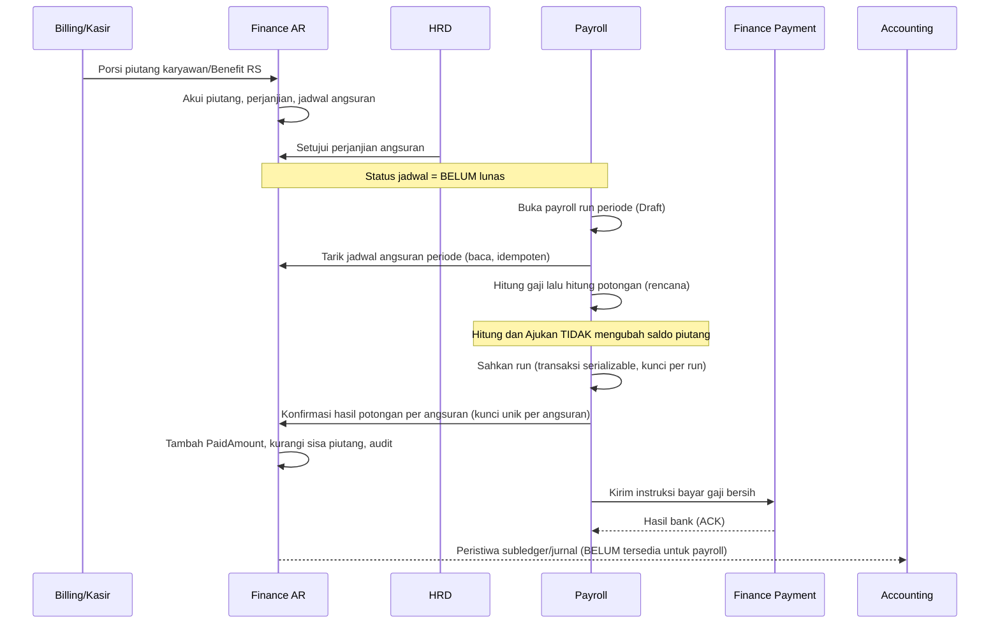
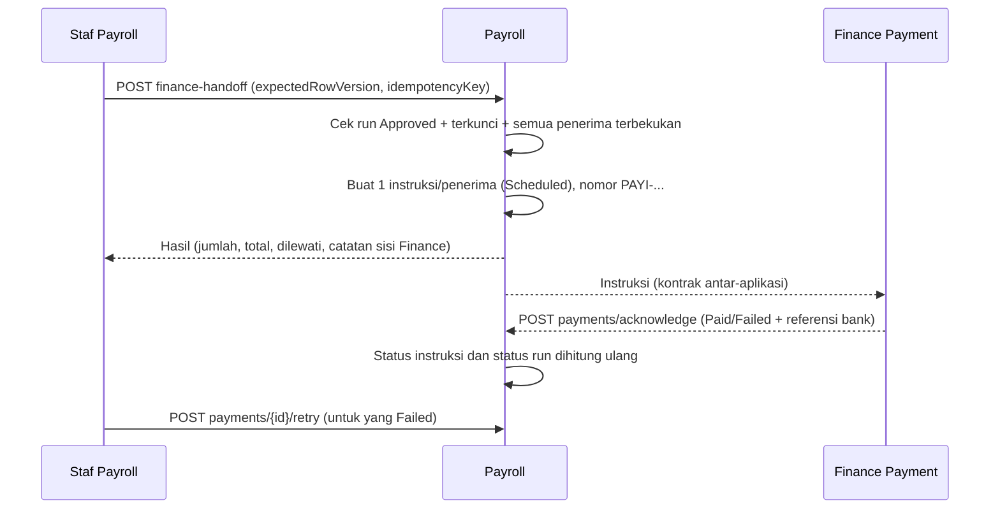

# PAYROLL V2 — 03. Integrasi Finance AR dan Modul Lain

| Field | Nilai |
| --- | --- |
| Dokumen | `PAYROLL_V2_03_INTEGRASI_FINANCE_AR_DAN_MODUL_LAIN.md` |
| Tanggal | 2026-11-04 |
| Acuan SHA | BE `b5fb6c251eafcd680ec35483732e3e72226e19f3` (+ perubahan lokal), FE `6a980d8c9dee0cae92c616fcd74f903ec0c67d73` (+ perubahan lokal) |
| Label bukti | `REPOSITORY FACT`, `TARGET PROPOSAL`, `IMPLEMENTED`, `PARTIAL`, `BLOCKED`, `NEEDS CONFIRMATION` |

## 1. Prinsip yang dijaga

1. **Satu pemilik data.** Payroll tidak menyalin piutang, absensi, atau hasil jasa medis; ia menyimpan referensi (`SourceType`, `SourceId`) dan snapshot hasil.
2. **Hitung ≠ potong ≠ lunas ≠ dibayar.** Empat peristiwa itu berbeda dan dicatat terpisah: *dihitung* (rencana), *disahkan* (hasil dikonfirmasi ke Finance), *dibayar* (hasil bank dari Finance), *dijurnal* (Accounting).
3. **Idempoten.** Mengulang permintaan yang sama tidak menambah potongan, instruksi, atau mutasi piutang.
4. **Tidak ada penulisan lintas modul dari browser.** Frontend tidak pernah menulis saldo piutang, jurnal, atau database Finance/Accounting.

## 2. Finance AR → Payroll → Finance AR (potongan cicilan piutang karyawan/dokter)

### 2.1 Proses bisnis

| Unsur | Isi |
| --- | --- |
| Tujuan | Memotong angsuran piutang karyawan/dokter dari gaji tanpa memotong dua kali dan tanpa melunasi piutang sebelum waktunya |
| Pelaku | Finance (menetapkan piutang, perjanjian, jadwal), HRD (menyetujui perjanjian angsuran), Staf Payroll (menghitung), Penyetuju Payroll (mengesahkan) |
| Pemicu | Periode penggajian dibuka dan angsuran jatuh tempo pada periode itu |
| Prasyarat | Perjanjian angsuran disetujui; periode berada pada atau setelah periode peralihan potong gaji otomatis (`MstPayrollDeductionCutover`); run dibuka |

`IMPLEMENTED` untuk panah Payroll ↔ Finance AR. Panah ke Accounting `BLOCKED` (lihat bagian 5).

### 2.2 Langkah dan aturan

1. **Tarik jadwal.** Saat run dibuka atau dihitung, sistem menarik angsuran periode itu lewat `FinanceReceivablePayrollSyncService` (baca saja). Finance tidak membuat run atau baris pegawai; bila belum ada run, angsuran berstatus **Menunggu Payroll Run**.
2. **Hitung potongan setelah gaji tersedia.** `PayrollInstallmentDeductionService.CalculateRunAsync` baru berjalan setelah gaji bruto terhitung. Bila bruto belum ada, potongan tidak dicatat sebagai `GAGAL` palsu (data belum siap, bukan tunggakan).
3. **Terapkan batas potong:** `batas = gaji bersih tersedia × persentase maksimum ÷ 100`, dibatasi `MaximumAmount` jenis potongan dan tidak melebihi gaji bersih tersedia. Persentase dari `MstDeductionType.MaxNetSalaryPercentage`; bila kosong dipakai `InstallmentDefaultMaxNetSalaryPercentage` (bawaan 50, `NEEDS CONFIRMATION`).
4. **Tentukan hasil rencana:** `BERHASIL` (jumlah jatuh tempo ≤ batas), `SEBAGIAN` (batas > 0 tetapi lebih kecil), `GAGAL` (batas 0).
5. **Sahkan run** → konfirmasi hasil ke Finance (satu-satunya jalur ke Finance), dengan kunci `FIN_INSTALLMENT_PAYROLL_RESULT_{installmentId}` sehingga hasil yang sama tidak menggerakkan piutang dua kali.
6. **Kekurangan** (mis. `SEBAGIAN`) dibawa sebagai tunggakan terbawa ke periode berikutnya oleh Finance; nominalnya tampil di kolom "Termasuk tunggakan".

**Contoh berangka (skenario UAT dari prompt):**

| Skenario | Data | Hasil di Payroll | Posisi piutang di Finance |
| --- | --- | --- | --- |
| A. Angsuran cukup | Angsuran Rp 300.000; gaji bersih tersedia Rp 2.000.000; batas 50% = Rp 1.000.000 | Rencana Rp 300.000 `BERHASIL` | Saat run **disahkan** terpotong Rp 300.000; sebelum itu piutang **belum** berkurang. Sisa turun Rp 300.000 setelah konfirmasi. |
| B. Gaji bersih kecil | Angsuran Rp 300.000; gaji bersih tersedia Rp 100.000; batas 50% = Rp 50.000 | Rencana Rp 50.000 `SEBAGIAN`, alasan tampil di layar | Terpotong Rp 50.000; kekurangan Rp 250.000 menjadi tunggakan periode berikut |
| C. Gaji belum dihitung | Run `Draft`, bruto belum terhitung | Potongan ditahan (tidak ada `GAGAL`, tidak ada Rp 0 palsu) | Tidak berubah |
| D. Diulang | Konfirmasi hasil yang sama dikirim dua kali | Idempoten: tidak ada potongan tambahan | Tidak ada mutasi kedua |
| E. Run dibatalkan sebelum disahkan | Run `Calculated` dibatalkan | Rencana hilang bersama run | Tidak pernah berubah (belum dikonfirmasi) |
| F. Dokter tetap tanpa `MstEmployee` | Punya `WorkforceProfileId` dan profil eligible | Masuk run dan dipotong seperti karyawan | Sama |

`REPOSITORY FACT`: uji statis `payroll-installment-deduction-guards.test.mjs` (6 uji) memastikan: hitung tidak memanggil Finance; konfirmasi hanya dari pengesahan run; run yang diajukan/disahkan/dibatalkan tidak menerima hitung ulang; tidak ada eksekusi manual per pegawai; potongan melebihi sisa piutang ditolak bersih.

### 2.3 Titik pengakuan pelunasan — `NEEDS CONFIRMATION`

Prompt meminta pengakuan pelunasan mengikuti peristiwa settlement resmi (mis. konfirmasi jurnal atau pembayaran). Perilaku sekarang: hasil potongan dikonfirmasi ke Finance **saat run disahkan** (`Approved`), bukan saat dibayar. Alasan: potongan piutang adalah offset terhadap gaji yang sudah terhitung dan terkunci; pembayaran bank hanya memengaruhi gaji bersih. Risiko: bila run disahkan lalu pembayaran gagal total, potongan sudah tercatat. Mitigasi tersedia: pembalikan (bagian 3) memulihkan saldo dengan persetujuan.

Pilihan bagi Finance/Accounting (`TARGET PROPOSAL`): (A) tetap saat disahkan; (B) saat bayar pertama berhasil; (C) saat jurnal gaji diposting. Memilih B atau C memerlukan perubahan titik panggil `ConfirmRunAsync`; layar dan kontrak tidak berubah.

### 2.4 Batasan yang diketahui

| No | Batasan | Dampak | Label |
| ---: | --- | --- | --- |
| R1 | Layanan potongan memproses satu angsuran per pegawai per run (`FirstOrDefault`). | Bila pegawai punya dua angsuran jatuh tempo pada periode yang sama, yang kedua tidak terpotong dan tidak ada pesan. | `PARTIAL` — dicatat, belum diperbaiki karena mengubah bentuk baris potongan pada run |
| R2 | Jalur manual/cutover Finance dipertahankan. Sebelum periode peralihan potongan dicatat Finance lewat Potong Gaji Manual. | Satu angsuran hanya bisa lewat satu jalur per periode. | `IMPLEMENTED` (dijaga uji statis koreksi `fromPayrollRun`) |

## 3. Pembalikan potongan dan restitusi

### 3.1 Pembalikan potongan (koreksi salah potong pada run yang sudah disahkan)

| Dari | Tindakan | Ke | Siapa | Syarat |
| --- | --- | --- | --- | --- |
| (baru) | Ajukan pembalikan | `Requested` | `PayrollRun : RequestReversal` | Run `Approved` atau tahap pembayaran; potongan sudah terkonfirmasi ke Finance; alasan wajib; nominal ≤ yang terpotong; hanya satu pembalikan menunggu per pegawai |
| `Requested` | Setujui | `Approved` | `PayrollRun : ApproveReversal` | Saldo piutang dipulihkan di Finance lewat mutasi `PembalikanPotonganGaji`, atomik dan idempoten |
| `Requested` | Tolak | `Rejected` | `PayrollRun : RejectReversal` | Alasan wajib; saldo tidak berubah |

**Contoh:** potongan Rp 300.000 ternyata salah (pegawai sudah berhenti). Staf mengajukan pembalikan penuh Rp 300.000; penyetuju menyetujui; sisa piutang di Finance naik kembali Rp 300.000. Slip yang sudah disahkan **tidak** diubah, dan pengembalian uang ke pegawai tidak dilakukan oleh langkah ini.

`REPOSITORY FACT`: `ApplyCorrectionCoreAsync` hanya punya satu pemanggil di `PayrollRunService`, dan hanya dengan mode `fromPayrollRun: true` sejak periode peralihan; koreksi manual Finance tidak memakai mode ini (uji `payroll-run-screens.test.mjs`).

### 3.2 Restitusi salah potong (ke slip periode berikutnya)

1. Finance mengoreksi potongan yang salah dan memanggil `POST payroll-restitutions` dengan `SourceId` koreksi Finance (kontrak antar-aplikasi; layar Payroll tidak mengirimnya).
2. Payroll menyematkan **satu** komponen penghasilan "restitusi" pada run tujuan (periode berikutnya yang masih terbuka). Panggilan ulang dengan `SourceId` yang sama dijawab `IDEMPOTENT`.
3. Mesin kalkulasi menghitung komponen non-mesin **sekali**; hitung ulang tidak menggandakannya dan restitusi tidak lagi mengubah total run secara langsung.
4. Bila belum ada run tujuan, jawabannya `TIDAK_ADA_PAYROLL` (tidak ada run palsu, tidak ada kewajiban yang hilang diam-diam).
5. Layar **Restitusi dan Koreksi** menampilkan posisinya: `MENUNGGU_HITUNG`, `SUDAH_DIHITUNG`, `TERKUNCI`.

## 4. Pembayaran gaji dan honor (Payroll → Finance Payment → Payroll)

| Aturan | Penjelasan | Contoh |
| --- | --- | --- |
| Hanya run disahkan | `Approved`, terkunci, semua penerima terbekukan | Run `Calculated` ditolak (400) |
| Hanya rekening terverifikasi | Nomor rekening disalin ke instruksi sebagai snapshot; layar menampilkan versi tersamar | 3 penerima tanpa rekening terverifikasi → pengiriman ditahan (422) kecuali `AllowPartialFinanceHandoff` |
| Idempoten | Pengiriman ulang mengembalikan hasil pertama; hanya satu instruksi "hidup" per penerima (`Scheduled`, `Processing`, `Paid`, `PartiallyReversed`) | Klik dua kali **Kirim ke Finance** → satu set instruksi |
| Dibayar hanya dari ACK | `Paid` wajib punya referensi bank dan nominal sama; `Failed` wajib alasan; ACK sama dikirim ulang → "Idempoten" | ACK Rp 6.800.000 untuk instruksi Rp 6.800.000 → `Paid`; Rp 6.000.000 → ditolak |
| Retry | Instruksi `Failed` diganti instruksi baru; yang `Paid` tidak ikut | Dari 120 instruksi, 2 gagal → hanya 2 yang dibuat ulang |
| Status run mengikuti instruksi | `SentToFinance` → `PartiallyPaid` → `Paid`; instruksi tambahan mengembalikan `Paid` ke `PartiallyPaid` | - |

`BLOCKED`: Finance belum memiliki jenis pembayaran `PAYROLL` (`FinPayment` hanya `SUPPLIER`/`MEDICAL_SERVICE`, dan yang kedua pun masih ditolak di jalur pembayaran). Payroll menyiapkan sisi pengirim dan endpoint ACK; sisi penerima di Finance harus dibangun dan disahkan oleh pemilik Finance. Hasil pengiriman memuat `FinanceConsumptionNote` yang menyatakan hal ini apa adanya di layar. Bank/penyedia pencairan: `NEEDS CONFIRMATION`.

## 5. Accounting

| Hal | Keadaan | Label |
| --- | --- | --- |
| Jurnal gaji, utang gaji, pajak/iuran, offset piutang | Tidak dibuat. Outbox akuntansi (`FinAccountingEventOutbox`) belum punya kode peristiwa payroll; pemetaan COA per komponen belum disahkan. | `BLOCKED` |
| Rekonsiliasi | Laporan membandingkan total run, rincian penerima, komponen, instruksi, hasil bank, dan potongan piutang; baris **Event Accounting** ditandai `BELUM_TERSEDIA`. | `IMPLEMENTED` |
| Posting dari browser | Tidak ada, dan tidak akan ada. | `IMPLEMENTED` |

Selisih pada rekonsiliasi selalu menunjuk baris sumber di kolom penjelasan (mis. penerima yang nominal instruksinya berbeda dari gaji bersihnya).

## 6. Jasa medis dokter — satu jalur bayar per hak

| Unsur | Isi |
| --- | --- |
| Tujuan | Setiap hak jasa medis (`MdfServiceFee`) dibayar lewat tepat satu jalur: `PAYROLL` atau `FINANCE_AP` |
| Pelaku | Medical Fee (menghitung dan menyetujui), Staf Payroll (mengklaim), Finance (AP) |
| Pemicu | Periode Medical Fee disetujui |

**Fakta kode:** persetujuan periode Medical Fee otomatis membuat `MdfFinanceHandoff` (AP) untuk setiap `MdfServiceFee` (status langsung `HandedOff`). Karena itu menambah jalur Payroll tanpa pagar akan membayar dua kali.

**Pagar berlapis (`IMPLEMENTED`):**

1. Jalur Payroll nonaktif secara bawaan (`MedicalFeePayrollPathEnabled = false`): klaim ditolak 409.
2. Bila diaktifkan, hanya fee berstatus `Approved` **tanpa** catatan handoff AP yang boleh diklaim (`NO_PATH_YET` dan penerima adalah penerima payroll).
3. Klaim menjadi `TrxPayrollVariableInput` dengan `InputNumber = MFI-<NomorFee>`, `SourceType = MdfServiceFee`, `SourceId = fee.Id`; indeks unik `UX_TrxPayrollVariableInput_MedicalFeeClaim` menolak klaim aktif kedua atas `SourceId` yang sama (`PAYROLL_V2_05`).
4. Dokter nonpegawai tidak pernah menjadi penerima payroll (`NO_PATH_NOT_PAYROLL_PAYEE`).

**Posisi tiap hak jasa:**

| Posisi | Arti | Tombol klaim |
| --- | --- | --- |
| `PAYROLL_PATH_CLAIMED` | Sudah masuk slip melalui Payroll | Tidak |
| `AP_PATH_ACTIVE` | Sudah diserahkan ke Finance AP | Tidak |
| `AP_PATH_FAILED` | Penyerahan ke AP gagal; pemindahan jalur butuh keputusan pemilik Medical Fee/Finance | Tidak |
| `NO_PATH_YET` | Belum punya jalur; penerima payroll | Ya, bila kebijakan aktif |
| `NO_PATH_NOT_PAYROLL_PAYEE` | Bukan penerima payroll | Tidak |

Perlakuan pajak jasa medis (PPh 21 dan sejenisnya) `NEEDS CONFIRMATION`: nilai yang diklaim adalah jasa kotor dari Medical Fee, dan layar menampilkan catatan pajak apa adanya. **Modul Medical Fee tidak diubah.**

## 7. HRD → Payroll (absensi, cuti, lembur)

| Sumber | Layanan HRD yang dipanggil (tidak diubah) | Syarat | Kunci idempotensi |
| --- | --- | --- | --- |
| Absensi | `AttendancePayrollHandoffService.ExecuteAsync` | Absensi sudah disahkan; sampai `AttendanceCutoffDate` | catatan sumber + versi + penerima run |
| Cuti | `LeavePayrollIntegrationService.ExecuteAsync` | Cuti disetujui (dibayar/tanpa gaji); cuti pending tidak ikut | sama |
| Lembur | `OvertimePayrollHandoffQueryService` + `OvertimePayrollHandoffService.PostAsync` | Lembur disetujui; batas 2000 butir per impor | sama |

Ketiganya membuka transaksi serializable sendiri, karena itu orkestrator `PayrollHrdImportService` **sengaja tidak** membungkusnya dalam satu transaksi. Semuanya memeriksa `run.IsLocked`. Hasil dilaporkan per sumber beserta jumlah dibuat/diperbarui/sama/gagal.

## 8. Pengaman double posting, idempotensi, dan konkurensi

| Risiko | Pengaman | Lokasi |
| --- | --- | --- |
| Dua run `Regular` aktif untuk satu periode | Pemeriksaan dalam transaksi + kunci per periode, dan indeks unik `UX_TrxPayrollRun_RegularPeriod` | `PayrollRunService.CreateAsync`, migration |
| Dua pengguna mengubah run yang sama | Transaksi serializable + kunci penasihat `HR_PAYROLL_RUN_{id}`; token versi `expectedRowVersion` → 409 | `PayrollTransactionRunner`, `PayrollVersionToken` |
| Potongan piutang dua kali | Kunci `FIN_INSTALLMENT_PAYROLL_RESULT_{installmentId}`; konfirmasi hanya dari pengesahan; pengesahan ulang idempoten | `PayrollInstallmentDeductionService`, `PayrollRunService.ApproveAsync` |
| Gaji dibayar dua kali | Satu instruksi hidup per penerima (`UX_TrxPayrollPayment_LiveInstruction`), nomor instruksi unik, handoff idempoten, `Paid` hanya dari ACK | `PayrollPaymentService`, migration |
| Jasa medis dibayar dua kali | Pagar berlapis bagian 6 + `UX_TrxPayrollVariableInput_MedicalFeeClaim` | `PayrollMedicalFeeIntakeService`, migration |
| Restitusi ganda | `SourceId` koreksi sebagai kunci idempotensi; komponen dihitung sekali | `PayrollRestitutionService` |
| Slip berubah setelah terbit | Snapshot beku + checksum SHA-256; versi naik hanya bila isi berubah dan belum terbit | `PayrollPayslipService` |
| Hitung ulang setelah kunci | Ditolak pada run `IsLocked` atau status bukan penerima input | `PayrollRunStatuses.AcceptsInputs` |
| Hapus bukti | Tidak ada hard-delete bukti pembayaran/mutasi piutang; pembatalan lewat pembalikan atau penyesuaian beraudit | seluruh layanan |

## 9. Ringkasan status integrasi

| Integrasi | Arah | Status |
| --- | --- | --- |
| HRD Workforce → Payroll | profil, penetapan gaji, rekening terverifikasi | `IMPLEMENTED` |
| HRD Absensi/Cuti/Lembur → Payroll | impor snapshot idempoten | `IMPLEMENTED` |
| Finance AR ↔ Payroll | jadwal, hasil potongan, pembalikan, restitusi | `IMPLEMENTED` (R1 `PARTIAL`; titik pengakuan `NEEDS CONFIRMATION`) |
| Medical Fee → Payroll/AP | jalur tunggal | `IMPLEMENTED` (jalur Payroll nonaktif bawaan; pajak `NEEDS CONFIRMATION`) |
| Payroll → Finance Payment → Payroll | instruksi dan ACK | `IMPLEMENTED` di sisi Payroll; sisi Finance `BLOCKED` |
| Payroll/Finance → Accounting | jurnal | `BLOCKED` |
| Payroll → Pegawai (slip) | slip terbit, unduh beraudit | `IMPLEMENTED` (aturan akses `NEEDS CONFIRMATION`) |
