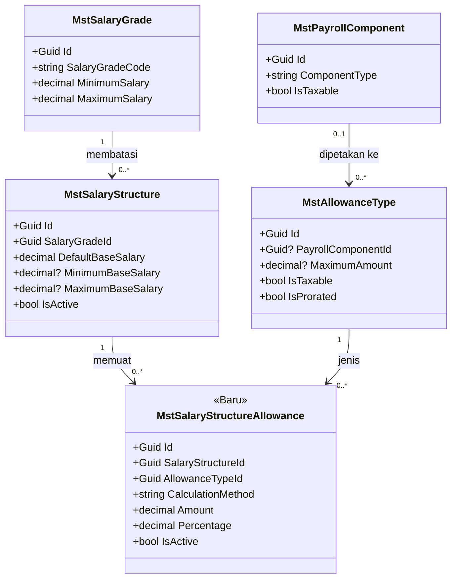
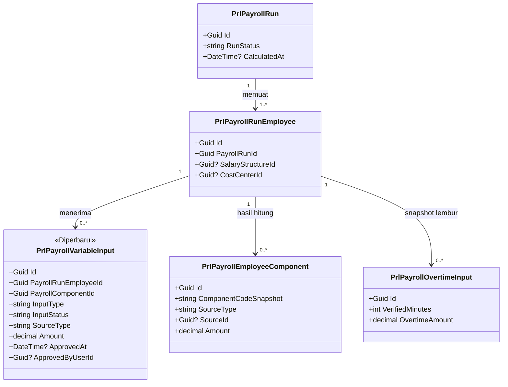
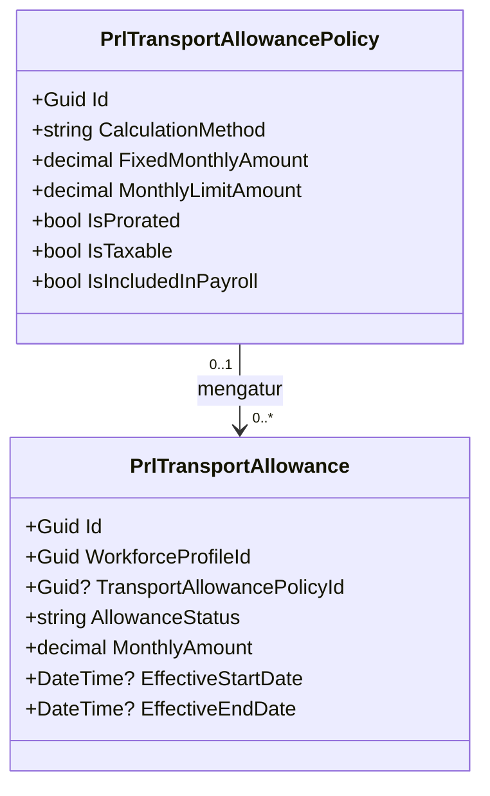
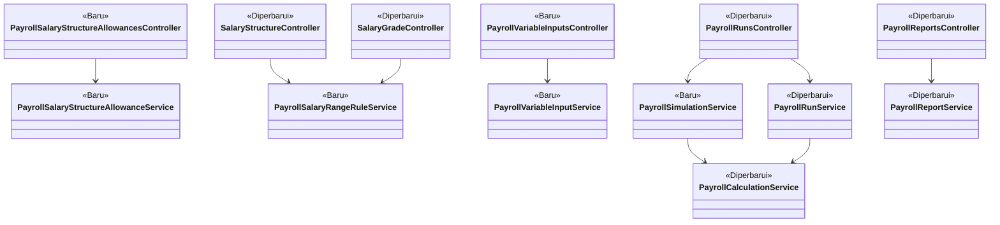

# Arsitektur Backend — Sub-modul Payroll Gaji

| Field | Nilai |
|---|---|
| Blueprint ID | `PRL-BP-001` / sub-modul `payroll-gaji` |
| Revision | `1` |
| Status | `approved` |
| `last_changed_in` | `PGJ-C1` |
| Owner | Yasmin (produk/domain); `approved_by`: Yasmin; `approved_at`: 2026-11-12 |
| `input_revision` | `00-interview-decisions.md` r1, `01-existing-capability-map.md` r1, `02-module-map.md` r1 |
| Backend / Frontend SHA | `89b9fd69` / `bfa3bae69` |
| `domain_architecture_readiness` | `DOMAIN_ARCHITECTURE_NOT_RUN` — slice yang didesain tidak melintasi bounded context baru; hanya memperluas master gaji dan run Payroll yang sudah ada |
| Dampak kompatibilitas | Menambah tabel dan kolom; tidak menghapus atau mengganti nama endpoint, field, atau status yang sudah ada |

## 1. Cakupan desain

Hanya slice yang lolos `requirement-completeness-gate` (`00-interview-decisions.md` bagian 6):

| Epic | Isi | Keputusan |
|---|---|---|
| `EPIC PGJ-01` | Tunjangan tetap dari Struktur Gaji, termasuk masa peralihan | PRL-DEC-02, 04, 13 |
| `EPIC PGJ-02` | Batas gaji Struktur di dalam batas Grade | PRL-DEC-12 |
| `EPIC PGJ-03` | Tunjangan Transportasi bulanan tetap | PRL-DEC-46 |
| `EPIC PGJ-04` | Penghasilan variabel manual: insentif, bonus, honor tugas tambahan | PRL-DEC-07, 31, 38, 43 |
| `EPIC PGJ-05` | Simulasi penggajian | PRL-DEC-32 |
| `EPIC PGJ-06` | Laporan beban gaji per Cost Center, laporan PPh dan BPJS tetapan profil | PRL-DEC-27, 33, 41 |
| `EPIC PGJ-07` | Rekap lembur dan tarif lembur baca-saja | PRL-DEC-42 |

Yang **tidak** dirancang di sini karena keputusannya belum turun: penyimpangan tunjangan per
pegawai, pengecualian penetapan gaji, kebijakan Struktural/Fungsional, Shift/Siaga/Risiko,
pensiun mesin Modern, THR dan bonus tahunan, Sumber Dana, Dashboard, Aturan Komponen, dan
pengaturan menu PPh/BPJS. Semuanya tercatat sebagai epic `OPEN DECISION` di `04-prd-to-mvp.md`.

## 2. Bounded context dan ownership

**Konteks:** Payroll Gaji — menghitung, menyetujui, dan menyerahkan gaji bulanan pegawai.

| Aggregate root | Isi | Invariant utama | Batas transaksi |
|---|---|---|---|
| Struktur Gaji (`MstSalaryStructure`) | Baris tunjangan (`MstSalaryStructureAllowance`) | Satu jenis tunjangan paling banyak satu baris aktif per struktur; satu metode utama per baris; batas gaji struktur berada di dalam batas grade | Simpan struktur atau satu baris tunjangan = satu transaksi |
| Payroll Run (`PrlPayrollRun`) | Pegawai dalam run, komponen hasil hitung, input variabel | Input hanya berubah selama run menerima input (`Draft`, `CollectingInput`, `Calculated`); input manual dihitung hanya bila disetujui; run tidak boleh diajukan bila input berubah setelah perhitungan terakhir | Satu aksi run atau satu aksi input = satu transaksi; impor input = satu transaksi untuk seluruh baris |
| Tunjangan Transportasi pegawai (`PrlTransportAllowance`) | Kebijakan yang dirujuk | Paling banyak satu tunjangan transport bulanan aktif per pegawai pada satu tanggal | Aturan dijaga saat run dihitung |

Kepemilikan data seluruh modul ada di `../02-module-map.md` bagian 2. Kelompok data milik
sub-modul ini: master gaji (`Mst*` payroll), `MstSalaryStructureAllowance` (baru),
`PrlTransportAllowance*`, dan seluruh `PrlPayroll*`.

## 3. Class diagram

### 3.1 Master gaji dan tunjangan



### 3.2 Run dan penghasilan variabel



### 3.3 Tunjangan Transportasi



### 3.4 Service dan controller



## 4. Penjelasan setiap class

### 4.1 Model

**`MstSalaryStructureAllowance`**

| Aspek | Penjelasan |
|---|---|
| **Status** | `Baru` |
| **Lokasi file** | `Areas/Corporate/HumanResource/MasterData/PayrollAndBenefit/Models/MstSalaryStructureAllowance.cs` |
| Kategori | Master |
| Tanggung jawab utama | Menyimpan satu jenis tunjangan tetap yang melekat pada satu Struktur Gaji, beserta cara menghitungnya: nominal tetap atau persentase dari gaji pokok. Inilah sumber tunjangan tetap pengganti angka tunggal di profil pegawai |
| Field penting | `SalaryStructureId` (Guid), `AllowanceTypeId` (Guid), `CalculationMethod` (string: `FixedAmount` atau `PercentageOfBaseSalary`), `Amount` (decimal), `Percentage` (decimal), `Notes` (string?), `IsActive` (bool) |
| Navigation property dan relasi | Milik `MstSalaryStructure`; menunjuk `MstAllowanceType` |
| Pemakaian dalam alur bisnis | Diisi petugas Payroll pada detail Struktur Gaji; dibaca mesin hitung saat run dihitung |
| Catatan desain | Prefix `Mst` dari registry (baris `Mst` ACTIVE). Tanpa `SortOrder` tersimpan; urutan tampil mengikuti nama jenis tunjangan. Metode berbasis aktivitas **tidak** boleh dipasang di sini |
| Ekuivalen model lama | `PrlPayroll.TotalAllowance` (angka tunggal di profil) dan `MstSalaryStructure.ComponentConfigurationJson` yang tidak pernah dibaca |

**`PrlPayrollVariableInput`**

| Aspek | Penjelasan |
|---|---|
| **Status** | `Diperbarui` — tambah `ApprovedAt`, `ApprovedByUserId`, `RejectedAt`, `RejectedByUserId`, `DecisionReason` |
| **Lokasi file** | `Areas/Corporate/PayrollManagement/Models/PrlPayrollVariableInput.cs` |
| Kategori | Transaksi |
| Tanggung jawab utama | Satu penghasilan atau potongan variabel untuk satu pegawai di satu run. Sub-modul ini menambah sumber baru `PayrollManualInput` untuk insentif, bonus, dan honor tugas tambahan yang diinput petugas |
| Field penting | `PayrollRunEmployeeId`, `PayrollComponentId`, `InputNumber`, `InputType`, `InputStatus`, `SourceType`, `Amount`, `Notes`, `SubmittedAt`, `SubmittedByUserId`, `ApprovedAt`, `ApprovedByUserId`, `RejectedAt`, `RejectedByUserId`, `DecisionReason` |
| Navigation property dan relasi | Milik `PrlPayrollRunEmployee`; menunjuk `MstPayrollComponent` |
| Pemakaian dalam alur bisnis | Dibuat petugas Payroll di layar Penghasilan Variabel; disetujui; dihitung saat run dihitung; menjadi `Applied` saat run disahkan |
| Catatan desain | Aturan "harus disetujui dulu" hanya berlaku untuk `SourceType = PayrollManualInput`. Sumber otomatis (jasa medis, cicilan, cuti, AR Finance) tetap mengikuti perilaku sekarang (F-12) |
| Ekuivalen model lama | — |

Model lain yang dipakai **tanpa perubahan**:

| Model | Status | Lokasi file | Dipakai untuk |
|---|---|---|---|
| `MstSalaryStructure` | Sudah ada | `Areas/Corporate/HumanResource/MasterData/PayrollAndBenefit/Models/MstSalaryStructure.cs` | Induk baris tunjangan; batas gaji struktur |
| `MstSalaryGrade` | Sudah ada | `.../PayrollAndBenefit/Models/MstSalaryGrade.cs` | Batas gaji grade |
| `MstAllowanceType` | Sudah ada | `.../PayrollAndBenefit/Models/MstAllowanceType.cs` | Nama, pajak, prorata, batas maksimum tunjangan |
| `MstPayrollComponent` | Sudah ada | `.../PayrollAndBenefit/Models/MstPayrollComponent.cs` | Jenis penghasilan input variabel |
| `PrlPayrollRun`, `PrlPayrollRunEmployee` | Sudah ada | `Areas/Corporate/PayrollManagement/Models/` | Run, waktu perhitungan terakhir (`CalculatedAt`) |
| `PrlPayrollEmployeeComponent` | Sudah ada | `Areas/Corporate/PayrollManagement/Models/PrlPayrollEmployeeComponent.cs` | Baris hasil hitung (tunjangan, transport) |
| `PrlTransportAllowancePolicy`, `PrlTransportAllowance` | Sudah ada | `Areas/Corporate/PayrollManagement/Models/` | Tunjangan transport |
| `PrlPayrollOvertimeInput` | Sudah ada | `Areas/Corporate/PayrollManagement/Models/PrlPayrollOvertimeInput.cs` | Rekap lembur per run |
| `PrlPayroll` | Sudah ada | `Areas/Corporate/PayrollManagement/Models/PrlPayroll.cs` | `TotalAllowance` sebagai cadangan masa peralihan |

### 4.2 Service

| Service | Status | Lokasi file | Fungsi utama | Dipanggil oleh | Membuka transaksi |
|---|---|---|---|---|---|
| `PayrollSalaryStructureAllowanceService` | Baru | `Areas/Corporate/PayrollManagement/Services/PayrollSalaryStructureAllowanceService.cs` | Daftar, tambah, ubah, hapus baris tunjangan struktur beserta validasinya | `PayrollSalaryStructureAllowancesController` | Ya, per aksi tulis |
| `PayrollSalaryRangeRuleService` | Baru | `.../Services/PayrollSalaryRangeRuleService.cs` | Memeriksa batas struktur terhadap grade, dan perubahan grade terhadap struktur aktif | `SalaryStructureController`, `SalaryGradeController` | Tidak (hanya membaca) |
| `PayrollVariableInputService` | Baru | `.../Services/PayrollVariableInputService.cs` | Buat, impor, ubah, ajukan, setujui, tolak, batalkan input manual; alokasi nomor lewat `NumberSeriesAllocator` | `PayrollVariableInputsController` | Ya; impor = satu transaksi untuk seluruh baris |
| `PayrollSimulationService` | Baru | `.../Services/PayrollSimulationService.cs` | Menjalankan impor dan perhitungan di dalam transaksi yang **selalu dibatalkan**, lalu mengembalikan hasil | `PayrollRunsController` | Ya, selalu di-rollback |
| `PayrollCalculationService` | Diperbarui | `.../Services/PayrollCalculationService.cs` | Menghitung tunjangan dari struktur, transport bulanan, aturan input manual, cadangan profil | `PayrollRunService`, `PayrollSimulationService` | Tidak (memakai transaksi pemanggil) |
| `PayrollRunService` | Diperbarui | `.../Services/PayrollRunService.cs` | Penjaga pengajuan run; menandai input manual `Applied` saat disahkan dan `Cancelled` saat run dibatalkan; rekap lembur per run | `PayrollRunsController` | Ya, per aksi |
| `PayrollReportService` | Diperbarui | `.../Services/PayrollReportService.cs` | Laporan beban gaji per Cost Center dan laporan PPh/BPJS | `PayrollReportsController` | Tidak |
| `PayrollHrdImportService` | Sudah ada | `.../Services/PayrollHrdImportService.cs` | Impor snapshot HR ke run (dipakai simulasi) | `PayrollRunService`, `PayrollSimulationService` | Memakai transaksi pemanggil |
| `NumberSeriesAllocator` | Sudah ada | `Areas/Platform/NumberSeriesManagement/Services/NumberSeriesAllocator.cs` | Nomor input variabel (`QBE-CODE-002`) | `PayrollVariableInputService` | Memakai `DbContext` terpisah — nomor tidak kembali bila transaksi utama batal; celah nomor diterima |

### 4.3 Controller

| Controller | Status | Lokasi file | Service yang dipakai | Endpoint yang diurus | Atribut akses |
|---|---|---|---|---|---|
| `PayrollSalaryStructureAllowancesController` | Baru | `Areas/Corporate/PayrollManagement/Controllers/PayrollSalaryStructureAllowancesController.cs` | `PayrollSalaryStructureAllowanceService` | 4 endpoint baris tunjangan | `ControllerName = "SalaryStructureAllowance"` |
| `PayrollVariableInputsController` | Baru | `.../Controllers/PayrollVariableInputsController.cs` | `PayrollVariableInputService` | 11 endpoint input variabel | `ControllerName = "PayrollVariableInput"` |
| `PayrollRunsController` | Diperbarui | `.../Controllers/PayrollRunsController.cs` | `PayrollRunService`, `PayrollSimulationService` | Tambah `POST /simulations`, `GET /{id}/overtime-inputs` | `ControllerName = "PayrollRun"` (tidak berubah) |
| `PayrollReportsController` | Diperbarui | `.../Controllers/PayrollReportsController.cs` | `PayrollReportService` | Tambah `GET /expense-summary`, `GET /tax-contribution` | `ControllerName = "PayrollReport"` (tidak berubah) |
| `SalaryStructureController` | Diperbarui (legacy disentuh) | `Areas/Corporate/HumanResource/MasterData/PayrollAndBenefit/Controllers/SalaryStructureController.cs` | Tambah `PayrollSalaryRangeRuleService` | Validasi pada simpan dan ubah | Tidak berubah |
| `SalaryGradeController` | Diperbarui (legacy disentuh) | `.../PayrollAndBenefit/Controllers/SalaryGradeController.cs` | Tambah `PayrollSalaryRangeRuleService` | Validasi pada ubah | Tidak berubah |
| `WfpTransportAllowancePolicyController`, `WfpTransportAllowanceController` | Sudah ada | `Areas/Corporate/PayrollManagement/Controllers/` | `ApplicationDbContext` langsung (legacy, utang teknis — jangan ditiru) | Dipakai apa adanya oleh layar baru | Tidak berubah |

`SalaryStructureController` dan `SalaryGradeController` masih memakai `ApplicationDbContext`
langsung. Desain ini tidak merapikannya; validasi baru ditaruh di service agar baris baru tidak
menambah akses context di controller (`QBE-SVC-001`).

### 4.4 Configuration, konstanta, dan opsi

| Berkas | Status | Lokasi | Isi perubahan |
|---|---|---|---|
| `MstSalaryStructureAllowanceConfiguration` | Baru | `Repositories/Configurations/Corporate/HumanResource/MasterData/PayrollAndBenefit/` | Tabel, panjang kolom, presisi desimal, index unik, relasi `Restrict` |
| `PrlPayrollVariableInputConfiguration` | Diperbarui | `Repositories/Configurations/Corporate/PayrollManagement/` | Lima kolom baru, relasi user `SetNull` |
| `ApplicationDbContext` | Diperbarui | `Repositories/ApplicationDbContext.cs` | `DbSet<MstSalaryStructureAllowance> MstSalaryStructureAllowances` |
| `PayrollStatusCatalog.cs` | Diperbarui | `Areas/Corporate/PayrollManagement/Constants/` | Kode mesin `PAY_STRUCTURE_ALLOWANCE`, `PAY_TRANSPORT_ALLOWANCE`; sumber `PayrollManualInput` |
| `PayrollManualInputTypes.cs` | Baru | `Areas/Corporate/PayrollManagement/Constants/` | `Incentive`, `Bonus`, `AdditionalDutyHonorarium` |
| `PayrollPolicyOptions.cs` | Diperbarui | `Areas/Corporate/PayrollManagement/Options/` | `AllowProfileAllowanceFallback` (bawaan `true`), `SimulationMaxEmployees` (bawaan `50`) |
| DTO | Baru | `Areas/Corporate/PayrollManagement/DTOs/PayrollSalaryStructureAllowanceDtos.cs`, `PayrollVariableInputDtos.cs`, `PayrollSimulationDtos.cs`; tambahan di `PayrollReportDtos.cs` dan `PayrollRunDtos.cs` | Lihat `contracts/api-contract.md` |

## 5. Aturan perhitungan

### 5.1 Tunjangan dari Struktur Gaji (`EPIC PGJ-01`)

1. Untuk setiap segmen penetapan gaji yang disetujui dan berlaku di periode, ambil baris
   tunjangan aktif milik struktur pada penetapan itu.
2. Nilai sebulan penuh: `FixedAmount` = `Amount`; `PercentageOfBaseSalary` = gaji pokok penetapan
   × `Percentage` / 100.
3. Bila jenis tunjangan punya `MaximumAmount`, nilai sebulan penuh dipotong ke batas itu.
4. Bila jenis tunjangan `IsProrated` dan kebijakan `ProrateFixedAllowances` menyala, nilai dikali
   jumlah hari segmen / jumlah hari periode, sama seperti gaji pokok. Bila tidak diprorata, nilai
   diambil penuh dari struktur penetapan yang menutup akhir periode.
5. Satu baris hasil per jenis tunjangan, kode `PAY_STRUCTURE_ALLOWANCE`, sumber
   `SalaryStructureAllowance`, nama sesuai jenis tunjangan. Status pajak mengikuti `IsTaxable`
   jenis tunjangan.

**Contoh:** gaji pokok Rp 6.000.000, struktur "GR-05 Perawat Pelaksana" memuat Tunjangan Jabatan
Rp 750.000 (diprorata), Tunjangan Makan Rp 500.000 (tidak diprorata), dan Tunjangan Keahlian 5%
gaji pokok dengan batas maksimum Rp 400.000 (diprorata).

| Kasus | Jabatan | Makan | Keahlian | Total |
|---|---:|---:|---:|---:|
| Bekerja sebulan penuh (30 dari 30 hari) | Rp 750.000 | Rp 500.000 | 5% × 6.000.000 = Rp 300.000 | Rp 1.550.000 |
| Masuk tanggal 16 (15 dari 30 hari) | Rp 375.000 | Rp 500.000 | Rp 150.000 | Rp 1.025.000 |
| Gaji pokok Rp 9.000.000, sebulan penuh | Rp 750.000 | Rp 500.000 | 5% × 9.000.000 = Rp 450.000, dipotong ke Rp 400.000 | Rp 1.650.000 |

### 5.2 Masa peralihan (PRL-DEC-04)

| Keadaan | Hasil |
|---|---|
| Struktur berisi baris tunjangan | Baris dari struktur dipakai. Bila profil juga berisi `TotalAllowance`, angka profil **diabaikan** dan muncul peringatan "Angka tunjangan di profil diabaikan karena Struktur Gaji sudah memuat tunjangan" |
| Struktur kosong, profil berisi, saklar `AllowProfileAllowanceFallback` menyala | Satu baris "Tunjangan Tetap" dari profil (kode lama `PAY_FIXED_ALLOWANCE`) dan peringatan "Tunjangan tetap memakai angka profil karena Struktur Gaji belum memuat tunjangan" |
| Struktur kosong, saklar mati | Tidak ada tunjangan tetap. Perilaku ini menunggu DEC-PRL-015 sebelum saklar boleh dimatikan di produksi |

**Contoh:** struktur pegawai kosong, profilnya `TotalAllowance` Rp 1.200.000. Run menampilkan
"Tunjangan Tetap Rp 1.200.000" beserta peringatan. Setelah petugas mengisi struktur dengan total
Rp 1.550.000 dan run dihitung ulang, baris dari struktur yang dipakai dan angka profil diabaikan.
Tidak ada penjumlahan ganda.

### 5.3 Tunjangan Transportasi bulanan tetap (`EPIC PGJ-03`)

1. Ambil tunjangan transport pegawai yang `AllowanceStatus = Active`, masa berlakunya beririsan
   dengan periode, dan kebijakannya `IsIncludedInPayroll` dengan metode `FixedMonthly`.
2. Nilai sebulan: `MonthlyAmount` pada tunjangan pegawai; bila nol, `FixedMonthlyAmount` pada
   kebijakan. Bila `MonthlyLimitAmount` lebih dari nol, nilai dipotong ke batas itu.
3. Bila kebijakan `IsProrated`, nilai dikali hari berlaku di periode / hari periode.
4. Satu baris kode `PAY_TRANSPORT_ALLOWANCE`, sumber `TransportAllowance`. Pajak mengikuti
   `IsTaxable` kebijakan.
5. Dua tunjangan transport bulanan aktif yang beririsan untuk pegawai yang sama membuat pegawai
   itu **gagal dihitung** dengan pesan, agar tidak terbayar dua kali.
6. Metode `PerAttendance`, `PerDay`, dan `Reimbursement` tidak dihitung otomatis dan
   menghasilkan peringatan. Penggantinya selama MVP adalah Penghasilan Variabel (`EPIC PGJ-04`).

**Contoh:** kebijakan "Transport Bulanan" Rp 400.000, diprorata. Pegawai mulai berlaku tanggal 11
pada bulan 30 hari (20 hari). Hasil: Rp 400.000 × 20 / 30 = Rp 266.667, dibulatkan mengikuti aturan
pembulatan mesin hitung yang sudah ada.

### 5.4 Penghasilan variabel manual (`EPIC PGJ-04`)

| Aturan | Contoh |
|---|---|
| Input manual dihitung hanya bila berstatus `Approved` atau `Applied` | Insentif Rp 1.000.000 berstatus `Submitted` tidak masuk gaji |
| Komponen harus aktif dan bertipe `Earning` | Komponen "Potongan Koperasi" (Deduction) ditolak |
| Nilai lebih dari nol | Rp 0 ditolak |
| Honor tugas tambahan wajib menyebut alasan penugasan | "Panitia akreditasi Mei–Juli 2026" |
| Pengaju boleh menyetujui inputnya sendiri (PRL-DEC-10, 43) | Petugas A mengajukan dan menyetujui sendiri: sah |
| Run tidak boleh diajukan bila masih ada input manual `Submitted` | 3 input belum diputuskan: pengajuan run ditolak |
| Run tidak boleh diajukan bila ada input manual yang berubah setelah perhitungan terakhir | Input disetujui pukul 14.00, run terakhir dihitung pukul 13.00: hitung ulang dulu |

### 5.5 Simulasi (`EPIC PGJ-05`)

Simulasi membuka transaksi database, membuat run sementara berjenis `Simulation` tanpa nomor
seri, mengimpor snapshot HR untuk pegawai terpilih, menjalankan perhitungan yang sama persis
dengan run resmi, membaca hasilnya, lalu **membatalkan transaksi**. Tidak ada data yang tersisa.
Run sementara tidak berbenturan dengan index unik run `Regular` karena jenisnya berbeda dan tidak
pernah tersimpan.

Batas jumlah pegawai per permintaan diatur `SimulationMaxEmployees` (bawaan 50). Implementer
**MUST** memastikan tidak ada service di jalur impor atau hitung yang menulis lewat `DbContext`
terpisah. Penyedia nomor seri dan sinkronisasi Finance tidak boleh dipanggil saat simulasi.

## 6. Arsitektur folder

```text
Areas/Corporate/
├── HumanResource/MasterData/PayrollAndBenefit/
│   ├── Models/
│   │   ├── MstSalaryStructure.cs                     Sudah ada
│   │   ├── MstSalaryStructureAllowance.cs            Baru
│   │   ├── MstSalaryGrade.cs                         Sudah ada
│   │   └── MstAllowanceType.cs                       Sudah ada
│   └── Controllers/
│       ├── SalaryStructureController.cs              Diperbarui (DbContext langsung — utang teknis, jangan ditiru)
│       └── SalaryGradeController.cs                  Diperbarui (DbContext langsung — utang teknis, jangan ditiru)
└── PayrollManagement/
    ├── Constants/
    │   ├── PayrollStatusCatalog.cs                   Diperbarui
    │   └── PayrollManualInputTypes.cs                Baru
    ├── Options/PayrollPolicyOptions.cs               Diperbarui
    ├── Models/
    │   ├── PrlPayrollVariableInput.cs                Diperbarui
    │   └── PrlTransportAllowance*.cs                 Sudah ada
    ├── DTOs/
    │   ├── PayrollSalaryStructureAllowanceDtos.cs    Baru
    │   ├── PayrollVariableInputDtos.cs               Baru
    │   ├── PayrollSimulationDtos.cs                  Baru
    │   ├── PayrollReportDtos.cs                      Diperbarui
    │   └── PayrollRunDtos.cs                         Diperbarui
    ├── Services/
    │   ├── PayrollSalaryStructureAllowanceService.cs Baru
    │   ├── PayrollSalaryRangeRuleService.cs          Baru
    │   ├── PayrollVariableInputService.cs            Baru
    │   ├── PayrollSimulationService.cs               Baru
    │   ├── PayrollCalculationService.cs              Diperbarui
    │   ├── PayrollRunService.cs                      Diperbarui
    │   └── PayrollReportService.cs                   Diperbarui
    └── Controllers/
        ├── PayrollSalaryStructureAllowancesController.cs  Baru
        ├── PayrollVariableInputsController.cs             Baru
        ├── PayrollRunsController.cs                       Diperbarui
        ├── PayrollReportsController.cs                    Diperbarui
        └── WfpTransportAllowance*Controller.cs            Sudah ada (DbContext langsung, pengecualian QBE-CODE-002 bertenggat — utang teknis)
Repositories/
├── ApplicationDbContext.cs                                Diperbarui
└── Configurations/Corporate/
    ├── HumanResource/MasterData/PayrollAndBenefit/MstSalaryStructureAllowanceConfiguration.cs  Baru
    └── PayrollManagement/PrlPayrollVariableInputConfiguration.cs                               Diperbarui
Program.cs                                                 Diperbarui (AddScoped untuk empat service baru)
```

Service baru didaftarkan `AddScoped<TService>()` tanpa interface, mengikuti pola V2.

## 7. Status model dan dampak migration

| Model | Status | Kolom yang berubah | Dampak migration |
|---|---|---|---|
| `MstSalaryStructureAllowance` | Baru | Seluruh kolom (lihat `data/data-dictionary.md`) | Tabel baru |
| `PrlPayrollVariableInput` | Diperbarui | Tambah `ApprovedAt` (`timestamp`, boleh kosong), `ApprovedByUserId` (`uuid`, boleh kosong, FK user `SetNull`), `RejectedAt` (`timestamp`, boleh kosong), `RejectedByUserId` (`uuid`, boleh kosong, FK user `SetNull`), `DecisionReason` (`varchar(500)`, boleh kosong) | Kolom baru boleh kosong; baris lama tidak perlu diisi |
| Model lain | Sudah ada | — | Tidak ada |

## 8. Rencana migration

| Urutan | Nama | Isi | Tanpa downtime | Data lama | Langkah mundur |
|---:|---|---|---|---|---|
| 1 | `AddSalaryStructureAllowance` | Tabel `MstSalaryStructureAllowance`, index unik parsial, FK `Restrict` | Ya | Tidak ada | `Down` menghapus tabel; aman selama belum ada baris yang dipakai run |
| 2 | `AddPayrollVariableInputDecisionColumns` | Lima kolom baru di `PrlPayrollVariableInput` | Ya | Dibiarkan kosong | `Down` menghapus lima kolom |

Prasyarat: dua migration Payroll yang belum dijalankan (`../02-module-map.md` bagian 3.2 urutan 0)
sudah diterapkan. Rilis satu paket: database dulu, baru aplikasi.

**Pra-cek data sebelum `EPIC PGJ-02` diaktifkan** (baca-saja, dijalankan pemilik):

```sql
-- Struktur aktif yang batasnya keluar dari rentang grade. Bukan skrip perubahan.
SELECT s."SalaryStructureCode", g."SalaryGradeCode",
       s."MinimumBaseSalary", g."MinimumSalary", s."MaximumBaseSalary", g."MaximumSalary"
FROM public."MstSalaryStructure" s
JOIN public."MstSalaryGrade" g ON g."Id" = s."SalaryGradeId"
WHERE s."IsDelete" = false AND s."IsActive" = true
  AND ((s."MinimumBaseSalary" IS NOT NULL AND s."MinimumBaseSalary" < g."MinimumSalary")
    OR (s."MaximumBaseSalary" IS NOT NULL AND s."MaximumBaseSalary" > g."MaximumSalary")
    OR s."DefaultBaseSalary" < g."MinimumSalary" OR s."DefaultBaseSalary" > g."MaximumSalary");
```

Baris yang muncul dibereskan petugas sebelum aturan berlaku; aturan baru hanya menolak saat
struktur disimpan atau grade diubah, tidak mengubah data lama.

## 9. Rencana data master awal

| Master | Isi minimum | Sumber nilai |
|---|---|---|
| `MstAllowanceType` | Jenis tunjangan tetap yang dipakai rumah sakit (misalnya Tunjangan Jabatan, Makan, Keahlian), masing-masing dipetakan ke Komponen Penggajian bertipe `Earning` | Kebijakan tunjangan rumah sakit; nominal hardcode mesin Modern **bukan** sumber sah sebelum DEC-PRL-004 dijawab |
| `MstSalaryStructureAllowance` | Baris tunjangan untuk setiap struktur aktif | Dipindah dari angka `TotalAllowance` profil per kelompok struktur, direkonsiliasi pemilik (DEC-PRL-015) |
| `MstPayrollComponent` | Komponen `Earning` untuk Insentif, Bonus, Honor Tugas Tambahan, Tunjangan Transportasi | Ditetapkan petugas Payroll |
| `PrlTransportAllowancePolicy` | Minimal satu kebijakan `FixedMonthly` bila rumah sakit memberi transport bulanan | Kebijakan rumah sakit |
| Seri nomor input variabel | Satu seri dengan prefix `PVI`, reset bulanan | Konfigurasi NumberSeriesManagement |

Nilai master **MUST NOT** ditulis di kode.

## 10. Keamanan, privasi, audit, dan operasi

| Hal | Desain |
|---|---|
| Hak akses | `[AccessController]`, `[AccessAction]`, dan `[AccessPermission]` pada setiap endpoint baru; daftar lengkap di `contracts/api-contract.md` |
| Privasi | Nominal gaji, tunjangan, insentif, dan honor adalah data sensitif: tidak masuk payload log; laporan nominal hanya untuk `PayrollReport : ViewAmount` |
| Logging | Setiap aksi tulis dicatat (`Create`, `Update`, `Submit`, `Approve`, `Reject`, `Cancel`, `Import`, `Simulate`) dengan `EntityId`, controller, aksi, status — tanpa nominal |
| Konkurensi | Aksi tulis memakai token versi `PayrollVersionToken` (berbasis waktu buat dan ubah) yang sudah dipakai V2; benturan menghasilkan kode 409 |
| Idempotensi | Aksi status pada input yang sudah berada di status tujuan dikembalikan apa adanya |
| Uji otomatis | `AUTOMATED TEST: NOT APPLICABLE — backend tidak memelihara project test otomatis`; bukti = `dotnet build`, QBE conformance, uji API manual, dan skenario UAT |
| Rilis dan mundur | Migration dulu, aplikasi kemudian. Mundur: aplikasi versi lama tetap jalan di atas skema baru karena hanya ada penambahan |

## 11. Yang sengaja tidak dibuat

| Yang ditolak | Alasan |
|---|---|
| Memakai `MstSalaryStructure.ComponentConfigurationJson` untuk tunjangan | Isinya tidak dijaga relasi ke jenis tunjangan; jenis yang dihapus tidak terdeteksi |
| Kolom `SortOrder` di baris tunjangan | Persisted `SortOrder` generik tidak boleh untuk `NEW CODE`; urutan tampil mengikuti nama |
| Status `Verified` untuk input manual | Persetujuan satu langkah (PRL-DEC-10, 43); verifikasi terpisah tidak diminta |
| Tabel baru untuk insentif atau honor | `PrlPayrollVariableInput` sudah memodelkan penghasilan variabel per pegawai per run |
| Perhitungan transport per kehadiran | Snapshot kehadiran di run tidak memuat jumlah hari hadir; menunggu kontrak HR (DEC-PRL-005) |
| Menulis transaksi `PrlTransportAllowanceTransaction` saat run disahkan | Belum ada keputusan tentang buku besar transport; baris komponen di run sudah menjadi jejak pembayaran |
| Layar penetapan gaji yang bisa diubah di Payroll | HRD pemilik penetapan (PRL-DEC-36) |
| Nominal tunjangan jabatan atau risiko di kode | Dilarang PRL-DEC-15 |
