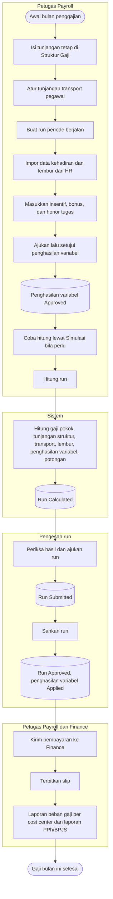

# Alur Utama — Penggajian Bulanan (Payroll Gaji)

| Field | Nilai |
|---|---|
| Blueprint | `PRL-BP-001` / `payroll-gaji`, revision `1`, status `approved` (Yasmin, 2026-11-12) |
| `last_changed_in` | `PGJ-C1` |
| Cakupan | Jalur normal saja. Jalur pengecualian ada di berkas proses masing-masing |

Alur ini menggabungkan langkah yang sudah berjalan dengan langkah baru dari MVP (ditandai
"baru" di tabel).

| Langkah | Pelaku | Masukan yang dibutuhkan | Keluaran | Bila gagal | Baru? |
|---|---|---|---|---|---|
| Isi tunjangan tetap di Struktur Gaji | Petugas Payroll | Struktur aktif, jenis tunjangan aktif | Baris tunjangan per struktur | Baris ditolak; petugas memperbaiki isian | Baru |
| Atur tunjangan transport pegawai | Petugas Payroll | Kebijakan transport aktif | Tunjangan transport pegawai aktif | Ditolak; petugas memperbaiki isian | Baru (layar) |
| Buat run | Petugas Payroll | Periode terbuka | Run `Draft` | Run ganda untuk periode yang sama ditolak; petugas membuka run yang sudah ada | Sudah ada |
| Impor dari HR | Petugas Payroll | Data HR periode itu | Snapshot kehadiran dan lembur | Impor diulang setelah data HR diperbaiki | Sudah ada |
| Masukkan penghasilan variabel | Petugas Payroll | Run menerima input | Input `Draft` | Baris salah ditolak; impor dibatalkan seluruhnya bila ada baris salah | Baru |
| Ajukan dan setujui penghasilan variabel | Petugas Payroll | Input `Draft` | Input `Approved` | Input ditolak dengan alasan; petugas membuat input baru | Baru |
| Simulasi | Petugas Payroll | Periode | Hasil percobaan per pegawai, tidak tersimpan | Petugas memperbaiki data lalu mengulang | Baru |
| Hitung run | Petugas Payroll | Run menerima input | Run `Calculated` | Pegawai bergalat tidak dihitung; petugas memperbaiki data sumbernya | Diperluas |
| Ajukan run | Pengesah run | Run `Calculated`, tidak ada input menunggu keputusan | Run `Submitted` | Ditolak bila ada input menunggu atau input berubah setelah dihitung; hitung ulang | Diperluas |
| Sahkan run | Pengesah run | Run `Submitted` | Run `Approved`; input `Applied` | Dikembalikan untuk perbaikan | Diperluas |
| Kirim ke Finance, terbitkan slip | Petugas Payroll | Run `Approved` | Instruksi pembayaran, slip | Sesuai alur yang sudah ada | Sudah ada |
| Laporan | Kepala Payroll, Finance | Run yang sudah disahkan | Beban gaji per cost center, PPh/BPJS | Hasil kosong bila belum ada run disahkan | Baru |
