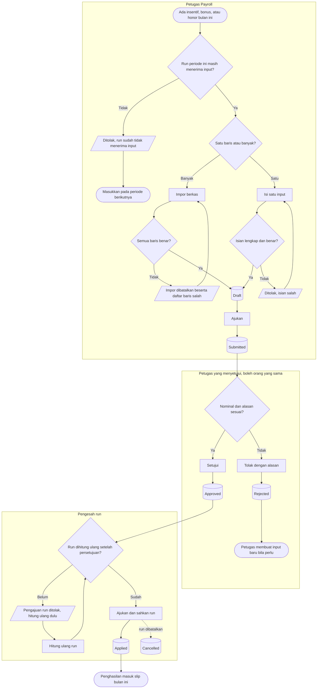

# Proses — Penghasilan Variabel Manual (Insentif, Bonus, Honor Tugas Tambahan)

| Field | Nilai |
|---|---|
| Blueprint | `PRL-BP-001` / `payroll-gaji`, revision `1`, status `approved` (Yasmin, 2026-11-12) |
| `last_changed_in` | `PGJ-C1` |
| Traceability | `EPIC PGJ-04`; PRL-DEC-07, 31, 38, 43 |

Status pada diagram sama persis dengan `contracts/state-transition-matrix.md` bagian 1.

| Langkah | Pelaku | Masukan yang dibutuhkan | Keluaran | Bila gagal |
|---|---|---|---|---|
| Periksa run | Petugas Payroll | Run periode berjalan | Lanjut atau berhenti | Run sudah diajukan: input dimasukkan pada periode berikutnya |
| Isi satu input | Petugas Payroll | Pegawai di run, komponen penghasilan, jenis, nominal, alasan untuk honor | Input `Draft` | Petugas memperbaiki isian yang ditolak |
| Impor berkas | Petugas Payroll | Baris berisi nomor pegawai, kode komponen, jenis, nominal, catatan | Banyak input `Draft` | Seluruh impor dibatalkan; petugas memperbaiki baris yang disebut lalu mengimpor ulang |
| Ajukan | Petugas Payroll | Input `Draft` | Input `Submitted` | — |
| Setujui atau tolak | Petugas berhak menyetujui | Input `Submitted` | `Approved` atau `Rejected` | Ditolak wajib beralasan; input `Rejected` tidak bisa dihidupkan lagi |
| Batalkan | Petugas berhak membatalkan | Input `Draft`, `Submitted`, atau `Approved` | Input `Cancelled` | Alasan wajib |
| Hitung ulang run | Petugas Payroll | Ada input yang berubah setelah perhitungan terakhir | Run `Calculated` terbaru | — |
| Sahkan run | Pengesah run | Run `Submitted` | Input `Applied` | Run dikembalikan; input tetap `Approved` |

**Contoh jalur gagal yang paling sering:** petugas menyetujui insentif pukul 14.00, padahal run
terakhir dihitung pukul 13.00. Pengesah mencoba mengajukan run dan ditolak. Petugas menghitung
ulang run, lalu pengajuan diterima.
