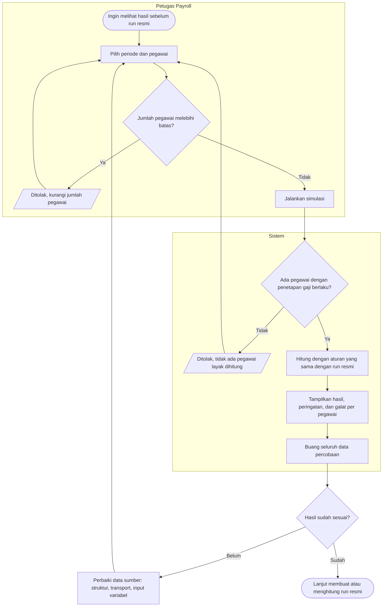

# Proses — Simulasi Penggajian

| Field | Nilai |
|---|---|
| Blueprint | `PRL-BP-001` / `payroll-gaji`, revision `1`, status `approved` (Yasmin, 2026-11-12) |
| `last_changed_in` | `PGJ-C1` |
| Traceability | `EPIC PGJ-05`; PRL-DEC-32 |

Simulasi tidak punya status tersimpan, sehingga diagram tidak memuat node keadaan.

| Langkah | Pelaku | Masukan | Keluaran | Bila gagal |
|---|---|---|---|---|
| Pilih periode dan pegawai | Petugas Payroll | Periode; daftar pegawai opsional | Permintaan simulasi | Petugas mengurangi jumlah pegawai |
| Jalankan simulasi | Sistem | Data aktual periode | Hasil per pegawai; tidak ada data tersimpan | Tidak ada pegawai layak: petugas memeriksa penetapan gaji |
| Tinjau hasil | Petugas Payroll | Hasil simulasi | Keputusan memperbaiki data atau lanjut | — |
