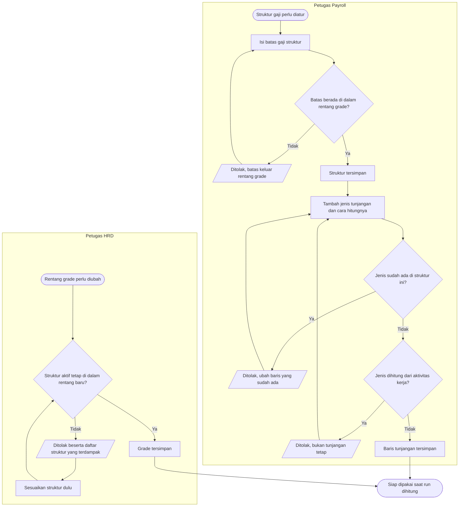
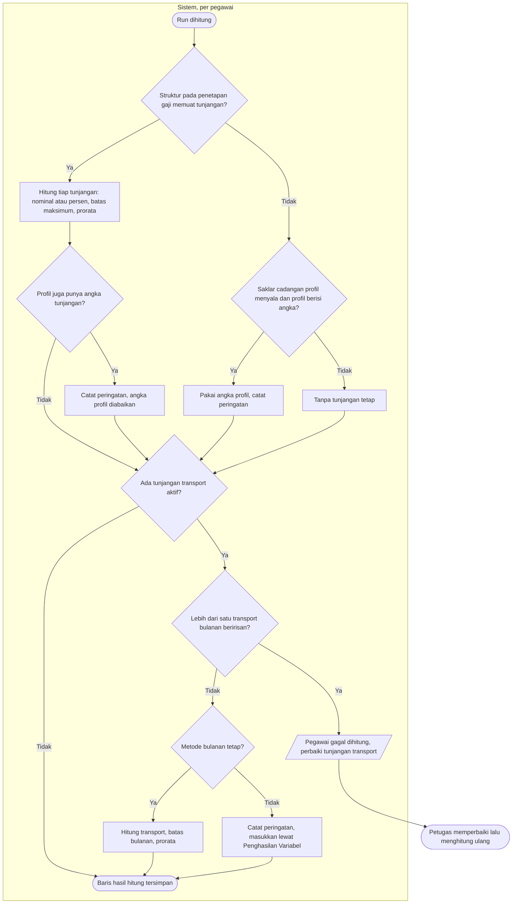

# Proses — Tunjangan Tetap dari Struktur Gaji dan Tunjangan Transportasi

| Field | Nilai |
|---|---|
| Blueprint | `PRL-BP-001` / `payroll-gaji`, revision `1`, status `approved` (Yasmin, 2026-11-12) |
| `last_changed_in` | `PGJ-C1` |
| Traceability | `EPIC PGJ-01`, `PGJ-02`, `PGJ-03`; PRL-DEC-02, 04, 12, 13, 46 |

## 1. Mengatur Struktur Gaji dan tunjangannya

| Langkah | Pelaku | Masukan | Keluaran | Bila gagal |
|---|---|---|---|---|
| Isi batas gaji struktur | Petugas Payroll | Grade struktur | Struktur tersimpan | Petugas menyesuaikan batas ke dalam rentang grade |
| Tambah jenis tunjangan | Petugas Payroll | Jenis tunjangan aktif, nominal atau persen | Baris tunjangan | Petugas mengubah baris yang sudah ada, atau memakai Penghasilan Variabel untuk tunjangan berbasis aktivitas |
| Ubah rentang grade | Petugas HRD | Rentang baru | Grade tersimpan | Petugas menyesuaikan struktur yang disebut, lalu mengulang |

## 2. Saat run dihitung

| Langkah | Pelaku | Masukan | Keluaran | Bila gagal |
|---|---|---|---|---|
| Hitung tunjangan struktur | Sistem | Penetapan gaji disetujui, baris tunjangan aktif | Satu baris per jenis tunjangan | — |
| Cadangan profil | Sistem | Struktur kosong, saklar menyala | Satu baris "Tunjangan Tetap" dan peringatan | Petugas mengisi struktur lalu menghitung ulang |
| Hitung transport | Sistem | Tunjangan transport aktif metode bulanan tetap | Satu baris transport | Dua tunjangan beririsan: pegawai gagal dihitung; petugas menonaktifkan salah satunya |
| Metode transport lain | Sistem | Metode per kehadiran, per hari, penggantian | Peringatan | Petugas memasukkan nominal lewat Penghasilan Variabel |
