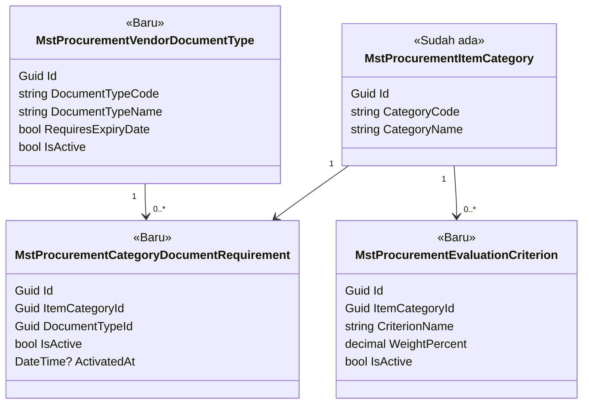
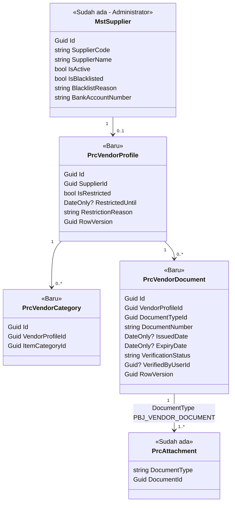
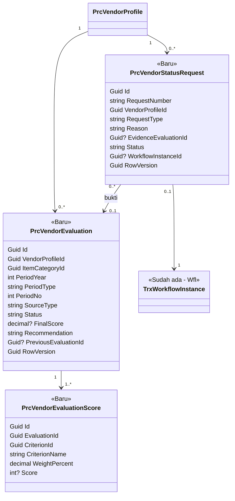
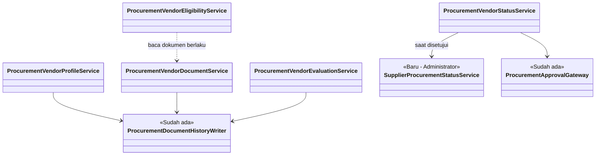

# Manajemen Vendor — Arsitektur Backend

| Field | Nilai |
| --- | --- |
| Blueprint | `PBJ-BP-001` revisi 2, sub-modul `manajemen-vendor` (`PBJ-VD`) |
| Status | `approved` — pengguna sesi, 17 November 2026 (`PBJ-DEC-062`) |
| Masukan | `PBJ-DEC-010`, `015`, `021`, `026`, `043`..`054`, `059`..`061`; `PBJ-ASM-001`..`004`; `PBJ-FE-004`; penilaian kelengkapan revisi 4 (`READY_FOR_DOMAIN_DESIGN` untuk `S-V1`..`S-V6`) |
| Arsitektur domain | `DOMAIN_ARCHITECTURE_NOT_RUN`: modul administratif tanpa data klinis maupun tagihan pasien; lintas konteks (Master Data Supplier, Finance, `Wfl`) sudah diputuskan eksplisit |
| SHA | BE `c6b86a6e`, FE `059b6c612` (branch `sukmagp` / `sukmagpV2`) |
| Prasyarat implementasi | Registry submodule `ProcurementManagement / Vendor` (`Prc`) — **terpenuhi** 17 November 2026 (`PBJ-DEC-063`). Folder `MasterData` memakai baris `Mst` yang sudah `ACTIVE` |

> Nama `PrcVendor*`, `MstProcurement*` baru, dan folder `Areas/Corporate/ProcurementManagement/Vendor/` adalah
> **usulan** sampai registry memuat submodule `Vendor`. Butir **[NILAI AWAL]** adalah nilai bawaan yang dapat
> dikonfigurasi. Butir **[USULAN `G-V..`]** adalah gap `PROPOSED` dari penilaian kelengkapan yang belum dikonfirmasi
> pemilik dan wajib tetap terlihat sebagai usulan.

---

## 1. Batas konteks, aggregate, dan invariant

| Konteks | Aggregate root | Isi | Invariant utama |
| --- | --- | --- | --- |
| Konfigurasi vendor | `MstProcurementVendorDocumentType`, `MstProcurementCategoryDocumentRequirement`, `MstProcurementEvaluationCriterion` | Jenis dokumen legalitas, dokumen wajib per kategori, kriteria penilaian per kategori | Dokumen wajib dimulai kosong dan diaktifkan per kategori (`PBJ-DEC-061`). Total bobot kriteria aktif per kategori = 100% (`PBJ-DEC-050`) |
| Profil vendor | `PrcVendorProfile` (satu per `MstSupplier`) | Kategori vendor, status Dibatasi | Identitas vendor tetap `MstSupplier` dan tidak diubah dari sini (`PBJ-DEC-010`, `053`). Satu profil per supplier |
| Dokumen legalitas | `PrcVendorDocument` | Metadata dokumen, masa berlaku, hasil verifikasi; berkasnya `PrcAttachment` | Pengunggah tidak memverifikasi dokumen sendiri (`PBJ-DEC-046`). Dokumen pengganti = baris baru; dokumen lama tetap tersimpan |
| Usulan status | `PrcVendorStatusRequest` | Usulan blokir/buka blokir lewat approval `Wfl` | Maksimal satu usulan terbuka per vendor **[USULAN `G-V07`]**. Hanya usulan yang disetujui yang menulis `MstSupplier.IsBlacklisted` (`PBJ-DEC-021`, `060`) |
| Penilaian berkala | `PrcVendorEvaluation` + `PrcVendorEvaluationScore` | Nilai per kriteria, nilai akhir, rekomendasi | Satu penilaian berlaku per vendor × kategori × periode (`PBJ-DEC-059`). Penilai tidak memfinalkan sendiri; final terkunci; koreksi lewat revisi (`PBJ-DEC-049`). Kriteria dan bobot disalin saat dibuat (`PBJ-DEC-050`). Rekomendasi tidak mengubah status (`PBJ-DEC-048`) |

**Status vendor tidak disimpan sebagai satu kolom.** Ia dihitung saat dibaca:

| Urutan | Kondisi | Status tampil |
| ---: | --- | --- |
| 1 | `MstSupplier.IsActive = false` | Nonaktif di Master Data |
| 2 | `MstSupplier.IsBlacklisted = true` | Diblokir |
| 3 | `PrcVendorProfile.IsRestricted = true` dan (`RestrictedUntil` kosong atau ≥ hari ini) | Dibatasi |
| 4 | Selain itu | Aktif |

**Contoh:** PT Alkes Maju dibatasi sampai 30-06-2027. Pada 01-07-2027 status tampilnya kembali Aktif tanpa job
terjadwal, karena tanggalnya sudah lewat (`PBJ-DEC-047`).

**Kelayakan dipilih** untuk kategori K dihitung oleh `ProcurementVendorEligibilityService`:

1. Supplier aktif di Master Data dan tidak diblokir.
2. Vendor punya kategori K di profilnya (`PBJ-DEC-052`).
3. Untuk setiap dokumen wajib **aktif** kategori K, ada dokumen `VERIFIED` jenis itu yang masa berlakunya belum
   lewat (`PBJ-DEC-045`, `061`).
4. Vendor Dibatasi tetap layak, tetapi pemilih wajib menulis alasan (`PBJ-DEC-047`).

Status ini hanya mencegah pilihan **baru**; RFQ dan kontrak berjalan tidak dibatalkan (`PBJ-DEC-054`).

**Batas transaksi.** Aksi yang mengubah data (verifikasi dokumen, Batasi/cabut, ajukan usulan, sinkron hasil
approval, finalisasi penilaian) berjalan dalam satu transaksi bersama baris riwayatnya. Saat usulan blokir
disetujui, perubahan status usulan, penulisan `MstSupplier.IsBlacklisted`/`BlacklistReason`, dan riwayat vendor
masuk satu transaksi.

**Kesamaan waktu.** `PrcVendorProfile`, `PrcVendorDocument`, `PrcVendorStatusRequest`, dan `PrcVendorEvaluation`
memakai `RowVersion` (`Guid`) seperti dokumen Pengadaan lain; nilai lama ditolak 409 `PBJ-VAL-090`.

## 2. Kepemilikan data sub-modul ini

Tabel kepemilikan seluruh modul ada di [`../02-module-map.md`](../02-module-map.md) bagian 2. Milik sub-modul ini:
konfigurasi dokumen dan kriteria vendor, profil vendor Pengadaan, dokumen legalitas, usulan status, dan penilaian.

Dipakai **tanpa dibuat ulang**:

| Data | Pemilik | Cara pakai |
| --- | --- | --- |
| Identitas, kontak, rekening vendor (`MstSupplier`) | Administrator Master Data | Dibaca. Rekening disamarkan di DTO Pengadaan (`PBJ-DEC-015`) |
| Status blokir (`MstSupplier.IsBlacklisted`, `BlacklistReason`) | Administrator Master Data | **Ditulis hanya** lewat `SupplierProcurementStatusService` saat usulan Pengadaan disetujui (`PBJ-DEC-021`, `060`) |
| Kategori barang/jasa (`MstProcurementItemCategory`) | `perencanaan-permintaan` | Dibaca sebagai kategori vendor (`PBJ-DEC-052`) |
| Lampiran (`PrcAttachment`) dan riwayat (`PrcDocumentHistory`) | `perencanaan-permintaan` (dokumen bersama) | Dipakai dengan jenis dokumen baru `PBJ_VENDOR`, `PBJ_VENDOR_DOCUMENT`, `PBJ_VENDOR_STATUS`, `PBJ_VENDOR_EVALUATION` |
| Mesin approval `Wfl`, `ProcurementApprovalGateway` | `Wfl` / `perencanaan-permintaan` | Definisi baru `PBJ-VND-BLOKIR`, `PBJ-VND-BUKA` |
| `NumberSeriesAllocator` | Platform | Deret baru `PBJ_VENDOR_STATUS` |

## 3. Class diagram

### 3.1 Konfigurasi vendor



### 3.2 Profil dan dokumen legalitas



### 3.3 Usulan status dan penilaian



### 3.4 Service dan controller



## 4. Penjelasan class

### 4.1 Model

| Class | Status | Lokasi file | Tanggung jawab | Catatan desain |
| --- | --- | --- | --- | --- |
| `MstProcurementVendorDocumentType` | Baru | `Areas/Corporate/ProcurementManagement/MasterData/Models/MstProcurementVendorDocumentType.cs` | Jenis dokumen legalitas (`PBJ-ASM-001`) | `RequiresExpiryDate` menentukan wajib tidaknya tanggal berlaku |
| `MstProcurementCategoryDocumentRequirement` | Baru | `.../MasterData/Models/MstProcurementCategoryDocumentRequirement.cs` | Dokumen wajib per kategori | Dimulai kosong; `IsActive` diaktifkan admin per kategori (`PBJ-DEC-061`). `ActivatedAt` dicatat untuk riwayat |
| `MstProcurementEvaluationCriterion` | Baru | `.../MasterData/Models/MstProcurementEvaluationCriterion.cs` | Kriteria penilaian per kategori dengan bobot | Urutan tampil = nama; tidak memakai `SortOrder` tersimpan (kontrak engineering) |
| `PrcVendorProfile` | Baru | `Areas/Corporate/ProcurementManagement/Vendor/Models/PrcVendorProfile.cs` | Data pendamping satu supplier (`PBJ-DEC-010`) | Dibuat saat Pengadaan pertama kali menyentuh vendor; riwayat pertama mencatat status blokir awal dari Master Data (`PBJ-DEC-060`) |
| `PrcVendorCategory` | Baru | `.../Vendor/Models/PrcVendorCategory.cs` | Kategori yang dilayani vendor (`PBJ-DEC-052`) | Dilepas = hapus lunak, tercatat di riwayat **[USULAN `G-V02`]** |
| `PrcVendorDocument` | Baru | `.../Vendor/Models/PrcVendorDocument.cs` | Satu dokumen legalitas dan hasil verifikasinya (`PBJ-DEC-045`, `046`) | Berkas di `PrcAttachment`. `CreateBy` = pengunggah, dipakai penjaga verifikasi |
| `PrcVendorStatusRequest` | Baru | `.../Vendor/Models/PrcVendorStatusRequest.cs` | Usulan blokir/buka blokir (`PBJ-DEC-021`, `PBJ-ASM-003`) | Nomor `UBV-…` saat diajukan; `EvidenceEvaluationId` menautkan penilaian sebagai bukti (`PBJ-DEC-048`) |
| `PrcVendorEvaluation` | Baru | `.../Vendor/Models/PrcVendorEvaluation.cs` | Penilaian berkala per vendor × kategori × periode (`PBJ-DEC-044`, `049`, `059`) | `SourceType = MANUAL` sekarang; `CONTRACT` disiapkan untuk `S-V7` agar laporan dapat membedakan sumber |
| `PrcVendorEvaluationScore` | Baru | `.../Vendor/Models/PrcVendorEvaluationScore.cs` | Nilai satu kriteria | `CriterionName` dan `WeightPercent` disalin saat penilaian dibuat (`PBJ-DEC-050`) |
| `MstSupplier` | Sudah ada | `Areas/Administrator/MasterData/Models/MstSupplier.cs` | Identitas vendor | Skema tidak diubah |
| `MstProcurementItemCategory`, `PrcAttachment`, `PrcDocumentHistory` | Sudah ada | `Areas/Corporate/ProcurementManagement/{MasterData,Common}/Models/` | Dirujuk | Tidak disalin |

### 4.2 Service

Semua service didaftarkan `AddScoped<T>()` di `ProcurementManagementServiceCollectionExtensions.cs` (sudah ada,
diperbarui). Service Administrator didaftarkan di registrasi Master Data yang sudah ada.

| Service | Status | Lokasi | Fungsi utama | Dipanggil oleh | Transaksi |
| --- | --- | --- | --- | --- | --- |
| `ProcurementVendorDocumentTypeService`, `ProcurementCategoryDocumentRequirementService`, `ProcurementEvaluationCriterionService` | Baru | `.../MasterData/Services/` | Sembilan endpoint master data masing-masing | Controller master | Ya, saat tulis |
| `ProcurementVendorProfileService` | Baru | `.../Vendor/Services/` | Daftar/detail vendor, atur kategori, Batasi/cabut, riwayat, rekening tersamarkan | `VendorsController` | Ya |
| `ProcurementVendorDocumentService` | Baru | `.../Vendor/Services/` | Catat dokumen, verifikasi, tolak, batal; penyedia akses lampiran `PBJ_VENDOR_DOCUMENT` | `VendorDocumentsController`, `ProcurementAttachmentService` | Ya |
| `ProcurementVendorStatusService` | Baru | `.../Vendor/Services/` | Usulan blokir/buka blokir, ajukan ke `Wfl`, terapkan keputusan (`IProcurementWorkflowStatusApplier` untuk `PBJ_VENDOR_STATUS`) | `VendorStatusRequestsController`, `ProcurementWorkflowLifecycleHandler` | Ya; keputusan + `MstSupplier` + riwayat dalam satu transaksi |
| `ProcurementVendorEvaluationService` | Baru | `.../Vendor/Services/` | Draf, ubah nilai, finalisasi, revisi, batal; hitung nilai akhir berbobot | `VendorEvaluationsController` | Ya |
| `ProcurementVendorEligibilityService` | Baru | `.../Vendor/Services/` | Hitung kelayakan dan peringatan per kategori | `VendorsController` (`GET /eligibility`), `pemilihan-penyedia` kelak | Tidak (baca) |
| `SupplierProcurementStatusService` | Baru (modul Administrator) | `Areas/Administrator/MasterData/Services/SupplierProcurementStatusService.cs` | Satu-satunya penulis `IsBlacklisted`/`BlacklistReason` sesudah `PBJ-DEC-060` | `ProcurementVendorStatusService` | Ikut transaksi pemanggil |
| `ProcurementApprovalGateway`, `ProcurementWorkflowLifecycleHandler`, `ProcurementDocumentHistoryWriter`, `ProcurementAttachmentService`, `NumberSeriesAllocator` | Sudah ada | `.../Common/Services/`, Platform | Dipakai apa adanya; jenis dokumen baru didaftarkan | — | — |

### 4.3 Controller

| Controller | Status | Lokasi | Resource `[AccessController]` | Service |
| --- | --- | --- | --- | --- |
| `ProcurementVendorDocumentTypesController` | Baru | `.../MasterData/Controllers/` | `ProcurementVendorDocumentType` | `ProcurementVendorDocumentTypeService` |
| `ProcurementCategoryDocumentRequirementsController` | Baru | `.../MasterData/Controllers/` | `ProcurementCategoryDocumentRequirement` | `ProcurementCategoryDocumentRequirementService` |
| `ProcurementEvaluationCriteriaController` | Baru | `.../MasterData/Controllers/` | `ProcurementEvaluationCriterion` | `ProcurementEvaluationCriterionService` |
| `VendorsController` | Baru | `.../Vendor/Controllers/` | `ProcurementVendor` | `ProcurementVendorProfileService`, `ProcurementVendorEligibilityService` |
| `VendorDocumentsController` | Baru | `.../Vendor/Controllers/` | `ProcurementVendorDocument` | `ProcurementVendorDocumentService` |
| `VendorStatusRequestsController` | Baru | `.../Vendor/Controllers/` | `ProcurementVendorStatusRequest` | `ProcurementVendorStatusService`, `ProcurementApprovalTimelineService` |
| `VendorEvaluationsController` | Baru | `.../Vendor/Controllers/` | `ProcurementVendorEvaluation` | `ProcurementVendorEvaluationService` |
| `SupplierController` | **Diperbarui** (modul Administrator) | `Areas/Administrator/MasterData/Controllers/SupplierController.cs` | `Supplier` (tetap) | Create/update **berhenti** menulis `IsBlacklisted`/`BlacklistReason` (baris 469–470, 575–576 saat ini); field request diabaikan dan respons tetap membawa nilainya (`PBJ-DEC-060`) |

### 4.4 DTO dan enum

| Nama | Jenis | Field kunci |
| --- | --- | --- |
| `VendorQuery` | PagedQuery | `search`, `itemCategoryId`, `vendorStatus`, `documentState`, `startDate`, `endDate`, `customPeriod`, paging |
| `VendorListItem`, `VendorDetailResponse` | Response | Identitas dari `MstSupplier`, status hitung, kategori, ringkasan dokumen, nilai terakhir, `maskedBankAccount` |
| `UpdateVendorCategoriesRequest` | Update | `itemCategoryIds`, `expectedRowVersion` |
| `RestrictVendorRequest`, `LiftRestrictionRequest` | Status | `reason`, `restrictedUntil?`, `expectedRowVersion` |
| `VendorEligibilityResponse` | Response | `supplierId`, `itemCategoryId`, `isEligible`, `isRestricted`, `reasons[]` |
| `CreateVendorDocumentRequest` | Create | `supplierId`, `documentTypeId`, `documentNumber`, `issuedDate?`, `expiryDate?` |
| `VerifyVendorDocumentRequest`, `RejectVendorDocumentRequest` | Status | `expectedRowVersion`, `reason` (tolak) |
| `CreateVendorStatusRequestRequest` | Create | `supplierId`, `requestType`, `reason`, `evidenceEvaluationId?` |
| `CreateVendorEvaluationRequest`, `UpdateVendorEvaluationRequest` | Create/Update | `supplierId`, `itemCategoryId`, `periodYear`, `periodType`, `periodNo`; `scores[{criterionId, score, note}]`, `recommendation`, `notes`, `expectedRowVersion` |
| `VendorDocumentVerificationStatus` | Enum (string) | `PENDING`, `VERIFIED`, `REJECTED`, `CANCELLED` (bawaan `PENDING`) |
| `VendorStatusRequestType` | Enum (string) | `BLOCK`, `UNBLOCK` |
| `VendorStatusRequestStatus` | Enum (string) | `DRAFT`, `PENDING_APPROVAL`, `RETURNED`, `APPROVED`, `REJECTED`, `CANCELLED` |
| `VendorEvaluationStatus` | Enum (string) | `DRAFT`, `FINAL`, `SUPERSEDED`, `CANCELLED` |
| `VendorEvaluationPeriodType` | Enum (string) | `SEMESTER` (bawaan **[NILAI AWAL `G-V05`]**), `QUARTER`, `YEAR` |
| `VendorRecommendation` | Enum (string) | `CONTINUE` (Lanjutkan), `RESTRICT` (Batasi), `BLOCK` (Blokir) |

## 5. Arsitektur folder

```text
Areas/Corporate/ProcurementManagement/
├── MasterData/
│   ├── Controllers/
│   │   ├── ProcurementVendorDocumentTypesController.cs          Baru
│   │   ├── ProcurementCategoryDocumentRequirementsController.cs Baru
│   │   └── ProcurementEvaluationCriteriaController.cs           Baru
│   ├── DTOs/ProcurementVendorMasterDtos.cs                      Baru
│   ├── Models/
│   │   ├── MstProcurementVendorDocumentType.cs                  Baru
│   │   ├── MstProcurementCategoryDocumentRequirement.cs         Baru
│   │   └── MstProcurementEvaluationCriterion.cs                 Baru
│   ├── Seeders/ProcurementVendorMasterSeeder.cs                 Baru
│   └── Services/ (3 service master)                             Baru
├── Vendor/                                                       Baru — butuh registry PBJ-OQ-037
│   ├── Controllers/ (4 controller)                              Baru
│   ├── DTOs/ (VendorDtos, VendorDocumentDtos, VendorStatusDtos, VendorEvaluationDtos) Baru
│   ├── Models/ (6 model)                                        Baru
│   └── Services/ (5 service)                                    Baru
├── Common/
│   ├── Constants/ProcurementDocumentTypes.cs                    Diperbarui — 4 jenis dokumen vendor
│   ├── Constants/ProcurementNumberSeries.cs                     Diperbarui — deret PBJ_VENDOR_STATUS, awalan UBV
│   ├── Constants/ProcurementPermissions.cs                      Diperbarui — resource dan action vendor
│   ├── Constants/ProcurementWorkflowCodes.cs                    Diperbarui — PBJ-VND-BLOKIR, PBJ-VND-BUKA
│   └── Seeders/ProcurementWorkflowDefinitionSeeder.cs           Diperbarui — dua definisi vendor
├── ProcurementManagementServiceCollectionExtensions.cs          Diperbarui
Areas/Administrator/MasterData/
├── Controllers/SupplierController.cs                            Diperbarui (PBJ-DEC-060)
└── Services/SupplierProcurementStatusService.cs                 Baru
Repositories/Configurations/Corporate/ProcurementManagement/      Baru — konfigurasi EF per entity
Migrations/<timestamp>_AddProcurementVendorManagement.cs          Baru
```

## 6. Status model dan dampak migration

| Model | Status | Kolom berubah | Dampak migration |
| --- | --- | --- | --- |
| 3 master `MstProcurement*` vendor | Baru | Seluruh kolom (kamus data bagian 2) | Tabel baru |
| 6 tabel `PrcVendor*` | Baru | Seluruh kolom (kamus data bagian 3–5) | Tabel baru |
| `MstSupplier` | Sudah ada | **Tidak ada** | Tanpa migration; perubahan perilaku tulis saja |
| `MstWorkflowDefinition`, `MstWorkflowStep`, `NumNumberSeries` | Sudah ada | Tidak ada; baris data awal baru | Lewat seeder idempoten |

## 7. Rencana migration (di dalam sub-modul)

| Urutan | Migration | Isi | Tanpa downtime | Data lama | Mundur |
| ---: | --- | --- | :---: | --- | --- |
| 1 | `AddProcurementVendorManagement` | 3 master + 6 tabel vendor, index unik parsial, FK ke `MstSupplier`, `MstProcurementItemCategory` | Ya (tabel baru saja) | Tidak ada; profil vendor lahir saat dipakai | `Down` menghapus tabel baru; tidak menyentuh `MstSupplier` |

Urutan lintas sub-modul ada di `../02-module-map.md` bagian 3.2 (urutan 7, sesudah migration `perencanaan-permintaan`).
Perubahan `SupplierController` (`PBJ-DEC-060`) dirilis **bersamaan** dengan layar usulan blokir, supaya tidak ada
jeda tanpa jalur blokir sama sekali.

## 8. Approval lewat `Wfl` (`PBJ-DEC-021`, `PBJ-ASM-003`)

| Dokumen | `ReferenceType` | Kode definisi | Nominal | Kode kondisi |
| --- | --- | --- | --- | --- |
| Usulan blokir | `PBJ_VENDOR_STATUS` | `PBJ-VND-BLOKIR` | — | — |
| Usulan buka blokir | `PBJ_VENDOR_STATUS` | `PBJ-VND-BUKA` | — | — |

Kedua definisi di-seed tidak aktif dan tanpa matriks, seperti definisi `PBJ-*` lain (`PBJ-DEC-038`). Penyetuju diisi dari
SOP (`PBJ-OQ-019`). Pengusul tidak boleh menyetujui usulannya sendiri (`AllowSelfApproval = false`).

**Penerapan keputusan** lewat `IProcurementWorkflowStatusApplier` untuk `PBJ_VENDOR_STATUS`:

| Hasil `Wfl` | Status usulan | Efek |
| --- | --- | --- |
| Disetujui (`Completed`/`Approved`) | `APPROVED` | `SupplierProcurementStatusService` menulis `IsBlacklisted = true` dan alasannya (blokir), atau `false` dan alasan dikosongkan (buka blokir); riwayat vendor bertambah |
| Ditolak | `REJECTED` | Tidak ada perubahan status vendor |
| Dikembalikan | `RETURNED` | Pengusul boleh mengubah alasan lalu mengajukan ulang |
| Ditarik pengusul | `CANCELLED` | Instance `Withdrawn` |

**Contoh:** Manajer Pengadaan mengajukan UBV-000003 "blokir PT Alkes Maju — 3 NCR kritis dalam 6 bulan" dengan bukti
penilaian Semester I 2027. Direktur menyetujui; `MstSupplier.IsBlacklisted` PT Alkes Maju menjadi `true`, Finance
melihatnya terblokir, dan RFQ baru tidak lagi menawarkannya.

## 9. Penomoran

| Dokumen | `SequenceKey` | Awalan | Contoh |
| --- | --- | --- | --- |
| Usulan status vendor | `PBJ_VENDOR_STATUS` | `UBV` | `UBV-000003` |

Mengikuti `PBJ-DEC-031`: tidak pernah direset, 6 digit, dialokasikan saat diajukan. Dokumen legalitas dan penilaian tidak
bernomor; dokumen legalitas memakai nomor terbitan instansi (`DocumentNumber`).

## 10. Data master awal

| Master | Isi minimum | Sumber nilai |
| --- | --- | --- |
| `MstProcurementVendorDocumentType` | `NIB` Nomor Induk Berusaha (tanpa tanggal berlaku), `NPWP` (tanpa), `IZIN_PBF` Izin Pedagang Besar Farmasi (berlaku), `IZIN_DISTRIBUSI_ALKES` Izin Distribusi Alat Kesehatan (berlaku), `LAIN` Dokumen lain (tanpa) | **[NILAI AWAL]** dari `PBJ-ASM-001`; daftar final dari SOP (`PBJ-OQ-019`) |
| `MstProcurementCategoryDocumentRequirement` | **Kosong** | `PBJ-DEC-061` — diaktifkan admin per kategori |
| `MstProcurementEvaluationCriterion` | Untuk kategori `UMUM`: Ketepatan waktu 40%, Kualitas 40%, Layanan purnajual 20% | **[NILAI AWAL]** contoh `PBJ-DEC-050`; nilai final dari SOP (`PBJ-OQ-034`) |
| `MstWorkflowDefinition` + `MstWorkflowStep` | `PBJ-VND-BLOKIR`, `PBJ-VND-BUKA`, satu langkah "Penyetuju status vendor", `IsActive = false`, tanpa matriks | `PBJ-DEC-038` pola fail-closed |
| `NumNumberSeries` | `PBJ_VENDOR_STATUS` awalan `UBV` | `PBJ-DEC-031` |

Konfigurasi `appsettings`: `Procurement:Vendor:ExpiryWarningDays = 30` **[NILAI AWAL `PBJ-ASM-002`]**.

## 11. Keamanan, privasi, dan pencatatan

- **Tanpa cakupan unit.** Data vendor milik rumah sakit, bukan milik unit; akses dijaga izin resource saja (`PBJ-DEC-051`).
- **Rekening** selalu disamarkan di server: `****` + 4 digit terakhir; nomor utuh tidak pernah dikirim endpoint Pengadaan
  (`PBJ-DEC-015`, `PBJ-AC-009`). Status verifikasi rekening tidak tersedia di `MstSupplier` dan ditampilkan "Tidak
  tersedia di Master Data".
- **Lampiran dokumen legalitas** memakai penjaga berkas `PrcAttachment` (`PBJ-DEC-023`); penyedia akses
  `PBJ_VENDOR_DOCUMENT` memberi hak ubah hanya saat dokumen `PENDING` dan hak baca bagi pemegang `ProcurementVendor : Read`.
- **Pencatatan:** `GET` tidak dicatat; aksi lain mencatat `EntityId`, controller, action, dan status. Alasan blokir,
  alasan tolak, dan catatan penilaian tidak masuk logger.

## 12. Yang sengaja tidak dibuat

| Yang ditolak | Alasan |
| --- | --- |
| Tabel vendor baru (`PrcVendor` sebagai identitas) | Identitas tetap `MstSupplier` (`PBJ-DEC-010`, `053`) |
| Kolom `Status` vendor tersimpan | Status dihitung dari blokir, Dibatasi, dan tanggal; kolom tersimpan akan basi tanpa job (`PBJ-DEC-047`) |
| Tabel rekening Pengadaan | Rekening milik Finance/Master Data (`PBJ-DEC-015`) |
| Master kategori vendor terpisah | Memakai kategori barang Pengadaan (`PBJ-DEC-052`) |
| Approval untuk verifikasi dokumen atau status Dibatasi | Diputuskan tanpa approval berjenjang (`PBJ-DEC-046`, `047`) |
| Alur usulan vendor baru ke Master Data | Vendor dibuat di layar Master Data yang ada (`PBJ-DEC-053`) |
| Evaluasi per kontrak, rekap keterlambatan dan NCR | `S-V7` ditunda sampai `kontrak-pelaksanaan` (`PBJ-DEC-044`); disiapkan lewat `SourceType` |
| Job terjadwal kedaluwarsa | Kedaluwarsa dan akhir Dibatasi dihitung saat dibaca |
