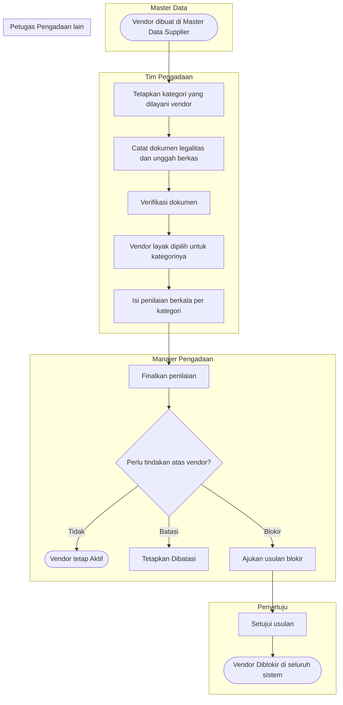

# Manajemen Vendor — Alur Utama

Status dokumen: `approved` (`PBJ-DEC-062`).

**Tujuan:** Pengadaan hanya memilih vendor yang legalitasnya sah dan kinerjanya terpantau, tanpa membuat identitas vendor
kedua.
**Pemicu:** vendor baru terdaftar di Master Data, dokumen vendor berubah, atau periode penilaian tiba.
**Prasyarat:** vendor ada di Master Data Supplier (`PBJ-DEC-053`); kategori barang Pengadaan tersedia.

| Langkah | Pelaku | Masukan | Keluaran | Bila gagal |
| --- | --- | --- | --- | --- |
| Tetapkan kategori | Tim Pengadaan | Vendor, kategori | Profil vendor dan kategorinya | Kategori nonaktif → pilih kategori lain |
| Catat dokumen | Tim Pengadaan | Jenis, nomor, tanggal terbit/berlaku, berkas | Dokumen menunggu verifikasi | Tanggal berlaku kosong untuk jenis yang mewajibkan → lengkapi |
| Verifikasi | Petugas lain | Dokumen dan berkas | Dokumen terverifikasi atau ditolak | Pemeriksa = pengunggah → minta petugas lain |
| Penilaian | Tim Pengadaan, Manajer | Kriteria kategori, nilai 1–5 | Penilaian final dan rekomendasi | Bobot kriteria belum 100% → minta admin melengkapi kriteria |
| Tindakan | Manajer, penyetuju | Rekomendasi sebagai bukti | Dibatasi atau Diblokir | Approval belum dikonfigurasi → hubungi admin |

Proses rinci: [`dokumen-legalitas.md`](dokumen-legalitas.md), [`status-vendor.md`](status-vendor.md),
[`penilaian-vendor.md`](penilaian-vendor.md).
