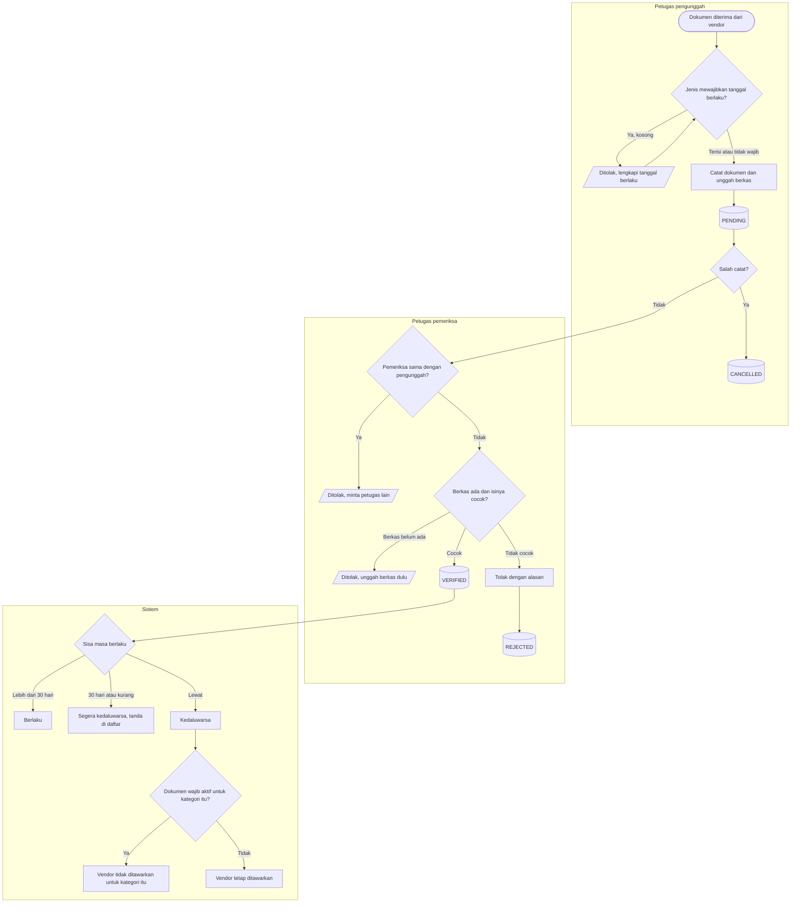

# Proses — Dokumen Legalitas dan Kelayakan Vendor

Status dokumen: `approved` (`PBJ-DEC-062`). Keputusan: `PBJ-DEC-045`, `046`, `061`; `PBJ-ASM-001`, `002`.

**Tujuan:** vendor hanya ditawarkan untuk kategori yang dokumen wajibnya sah dan terverifikasi.
**Pemicu:** dokumen baru diterima dari vendor, atau dokumen lama mendekati kedaluwarsa.
**Prasyarat:** vendor punya kategori; jenis dokumen tersedia.

| Langkah | Pelaku | Masukan | Keluaran | Bila gagal |
| --- | --- | --- | --- | --- |
| Catat dokumen | Petugas pengunggah | Jenis, nomor, tanggal, berkas | `PENDING` | Lengkapi tanggal berlaku |
| Batalkan | Petugas pengunggah | Alasan | `CANCELLED` | — |
| Verifikasi | Petugas pemeriksa | Berkas | `VERIFIED` | Pemeriksa = pengunggah → petugas lain; berkas belum ada → unggah dulu |
| Tolak | Petugas pemeriksa | Alasan | `REJECTED` | Alasan kosong → isi alasan |
| Hitung keadaan berlaku | Sistem | Tanggal berlaku, hari ini | Berlaku / Segera kedaluwarsa / Kedaluwarsa | — |

**Contoh:** izin PBF PT Farma Jaya berlaku sampai 31-03-2027 dan kategori Obat sudah mewajibkan Izin PBF sejak
01-03-2027. Pada 02-03-2027 tanda "Segera kedaluwarsa" tampil. Sejak 01-04-2027 PT Farma Jaya tidak ditawarkan di RFQ
Obat. Andi mengunggah izin baru; Sari memverifikasinya; PT Farma Jaya kembali ditawarkan.

**Masa awal (`PBJ-DEC-061`):** selama kategori belum punya dokumen wajib aktif, keadaan dokumen tidak mengunci vendor.
