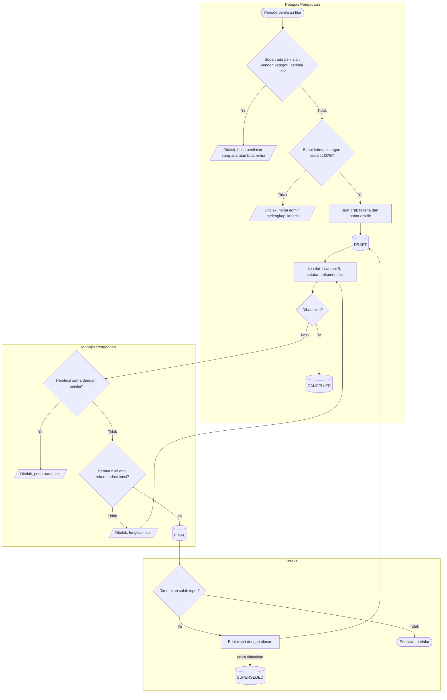

# Proses — Penilaian Vendor Berkala

Status dokumen: `approved` (`PBJ-DEC-062`). Keputusan: `PBJ-DEC-044`, `048`, `049`, `050`, `059`.

**Tujuan:** kinerja vendor tercatat per kategori dan per periode sebagai bukti tindakan.
**Pemicu:** akhir periode penilaian (bawaan semester **[NILAI AWAL `G-V05`]**).
**Prasyarat:** vendor punya kategori; kriteria aktif kategori itu berbobot total 100%.

| Langkah | Pelaku | Masukan | Keluaran | Bila gagal |
| --- | --- | --- | --- | --- |
| Buat draf | Petugas Pengadaan | Vendor, kategori, periode | `DRAFT` dengan salinan kriteria | Sudah ada → buka/revisi; bobot ≠ 100% → admin |
| Isi nilai | Petugas Pengadaan | Nilai per kriteria | Nilai akhir dihitung server | — |
| Finalkan | Manajer Pengadaan | — | `FINAL` | Pemfinal = penilai → orang lain; nilai belum lengkap → lengkapi |
| Revisi | Petugas Pengadaan | Alasan revisi | Draf revisi; versi lama `SUPERSEDED` saat revisi final | Revisi lain masih berjalan → selesaikan dulu |

**Contoh:** PT Sehat Medika (Alat Kesehatan dan Umum) mendapat dua penilaian Semester I 2027. Alat Kesehatan: bobot
40/40/20, nilai 4/5/3 → 4,20, rekomendasi Lanjutkan. Status vendor tidak berubah karena rekomendasi hanya saran.
