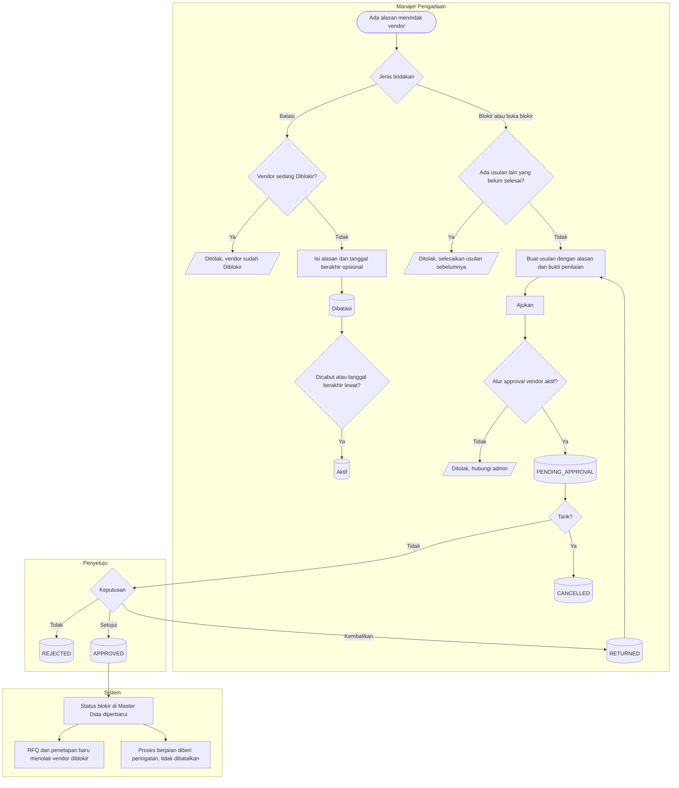

# Proses — Status Vendor: Dibatasi dan Blokir

Status dokumen: `approved` (`PBJ-DEC-062`). Keputusan: `PBJ-DEC-021`, `047`, `048`, `054`, `060`; `PBJ-ASM-003`.

**Tujuan:** vendor bermasalah dapat dibatasi cepat atau diblokir dengan persetujuan, dan statusnya sama di seluruh sistem.
**Pemicu:** penilaian merekomendasikan tindakan, atau kejadian di lapangan (keterlambatan, NCR).
**Prasyarat:** vendor punya profil; untuk blokir, alur approval vendor sudah dikonfigurasi admin.

| Langkah | Pelaku | Masukan | Keluaran | Bila gagal |
| --- | --- | --- | --- | --- |
| Batasi | Manajer Pengadaan | Alasan, tanggal berakhir | Dibatasi | Vendor Diblokir → tidak perlu dibatasi |
| Cabut | Manajer Pengadaan | Alasan | Aktif | — |
| Buat usulan | Manajer Pengadaan | Jenis, alasan, bukti | `DRAFT` | Usulan lain masih berjalan → selesaikan dulu |
| Ajukan | Manajer Pengadaan | — | `PENDING_APPROVAL`, nomor `UBV` | Approval belum dikonfigurasi → admin |
| Putuskan | Penyetuju | — | `APPROVED` / `REJECTED` / `RETURNED` | Penyetuju = pengusul → ditolak mesin approval |
| Terapkan | Sistem | Keputusan | Status blokir Master Data dan riwayat vendor | Penulisan gagal → keputusan tetap sah, usulan menunggu sinkron ulang |

**Contoh:** PT Alkes Maju terlambat tiga kali; Manajer membatasinya sampai 30-06-2027. Setelah tiga NCR kritis, Manajer
mengajukan UBV-000003 dengan bukti penilaian Semester I 2027; Direktur menyetujui; PT Alkes Maju Diblokir. Kontrak
KTR-2027-0008 yang sedang berjalan diberi peringatan, tidak dibatalkan.

**Master Data:** centang Blacklist di layar Supplier tampil nonaktif; perubahan hanya lewat proses ini (`PBJ-DEC-060`).
