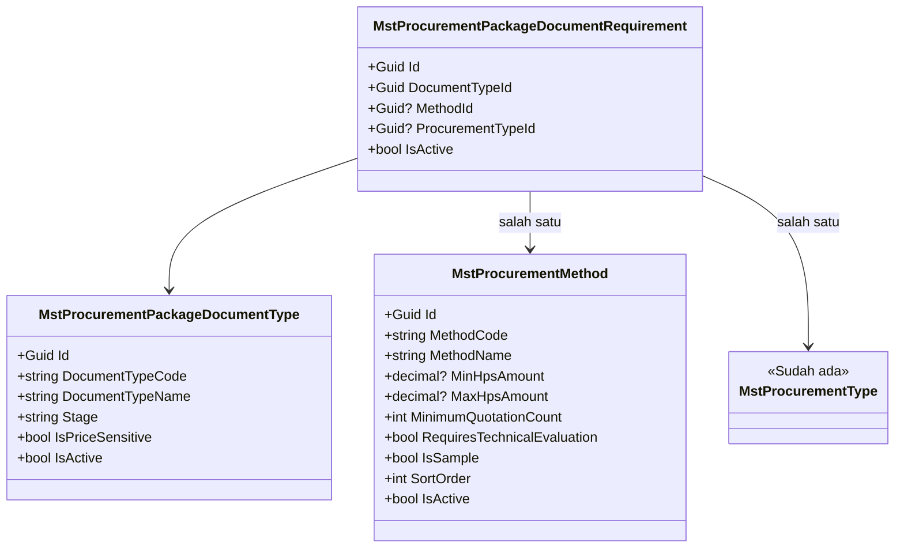
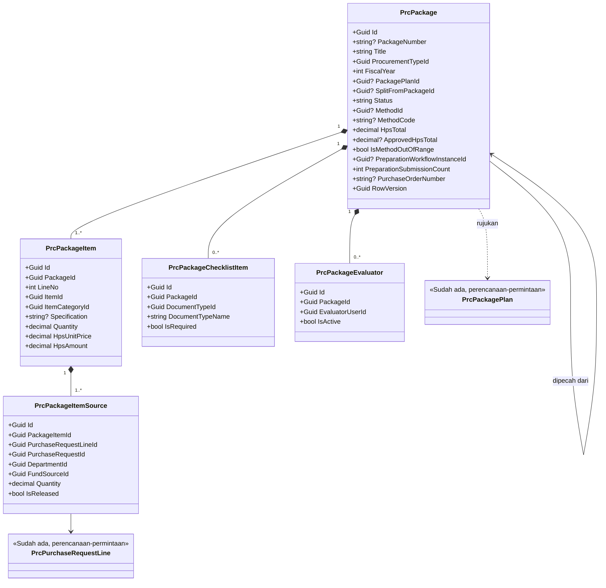
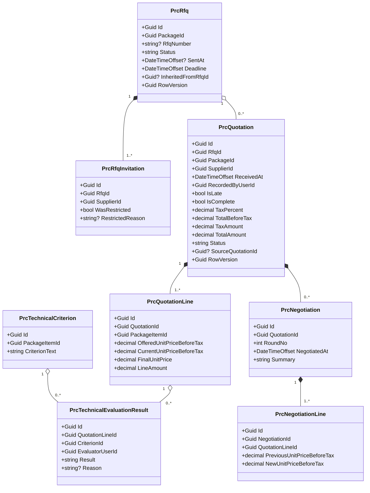
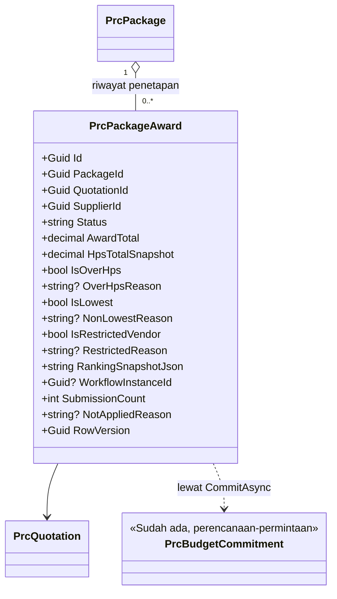

# Pemilihan Penyedia — Arsitektur Backend

| Field | Nilai |
| --- | --- |
| Blueprint | `PBJ-BP-001` revisi 2, sub-modul `pemilihan-penyedia` (`PBJ-PS`) |
| Status | `approved` — `PBJ-DEC-095`, Pengguna sesi, 2026-11-26 |
| Masukan | `PBJ-DEC-066`..`085`; `PBJ-ASM-005`..`009`; `PBJ-AC-022`..`036`; keputusan modul yang berlaku (`PBJ-DEC-006`, `007`, `009`, `011`, `022`..`025`, `028`, `031`, `038`, `045`..`047`, `052`, `054`); `PBJ-FE-004`; penilaian kelengkapan revisi 6 (`READY_FOR_DOMAIN_DESIGN` untuk `S-P1`..`S-P10`); capability map revisi 2 bagian 7 |
| Arsitektur domain | `DOMAIN_ARCHITECTURE_NOT_RUN`: kemampuan administratif tanpa data klinis maupun tagihan pasien; lintas konteks (`perencanaan-permintaan`, `manajemen-vendor`, `Wfl`, Finance/BLM) sudah diputuskan eksplisit (`PBJ-DEC-071`, `076`, `078`, `082`, `011`) |
| SHA | BE `d5fdc8fa`, FE `3e5386679` (branch `sukmagp` / `sukmagpV2`) |
| Prasyarat implementasi | Registry submodule `ProcurementManagement / Sourcing` (`Prc`, `ACTIVE`) didaftarkan 2026-11-26 (`PBJ-DEC-096`, menutup `PBJ-CAP-030`), sehingga model `Prc*` di folder `Areas/Corporate/ProcurementManagement/Sourcing/` lolos `QBE-MOD-002`. Master baru di `MasterData/` memakai baris `Mst` yang sudah `ACTIVE` |

> Nama folder `Sourcing`, entity `PrcPackage*`, `PrcRfq*`, `PrcQuotation*`, `PrcTechnical*`, `PrcNegotiation*`, dan
> `MstProcurementMethod`/`MstProcurementPackageDocument*` adalah **usulan** sampai registry memuat submodule `Sourcing`.
> Butir **[NILAI AWAL]** adalah nilai bawaan yang dapat dikonfigurasi. Usulan `G-P..` dari penilaian kelengkapan sudah
> dikonfirmasi pemilik saat approval (`PBJ-DEC-086`..`095`) dan kini dirujuk dengan nomor keputusannya.

---

## 1. Batas konteks, aggregate, dan invariant

| Konteks | Aggregate root | Isi | Invariant utama |
| --- | --- | --- | --- |
| Konfigurasi pemilihan | `MstProcurementMethod`, `MstProcurementPackageDocumentType`, `MstProcurementPackageDocumentRequirement` | Metode pengadaan beserta aturannya; jenis dokumen paket; dokumen wajib per metode atau per jenis pengadaan | Rentang HPS metode tidak tumpang tindih di antara metode aktif (`PBJ-DEC-095`); nilai contoh ditandai `IsSample` (`PBJ-DEC-069`) |
| Paket | `PrcPackage` + `PrcPackageItem` + `PrcPackageItemSource` + `PrcPackageChecklistItem` + `PrcPackageEvaluator` | Isi paket per barang katalog, asal baris PR, HPS, metode tersalin, checklist, evaluator | Isi selalu baris PR `APPROVED` (`PBJ-DEC-071`, `082`). Satu baris PR hanya di satu paket hidup. Satu jenis pengadaan dan satu tahun anggaran per paket (`PBJ-DEC-090`, `091`). Metode dan aturannya disalin saat dipilih dan tidak berubah oleh pengaturan (`PBJ-DEC-068`) maupun oleh pemecahan (`PBJ-DEC-083`). HPS yang disetujui terkunci (`PBJ-DEC-073`) |
| RFQ dan penawaran | `PrcRfq` + `PrcRfqInvitation`; `PrcQuotation` + `PrcQuotationLine` | Undangan ke vendor layak, batas waktu, penawaran yang dicatat Tim Pengadaan | Undangan hanya ke vendor layak untuk semua kategori paket (`PBJ-ASM-006`). Penawaran setelah batas waktu tidak sah (`PBJ-DEC-081`). Harga akhir = harga sebelum pajak + PPN (`PBJ-DEC-084`) |
| Evaluasi teknis | `PrcTechnicalCriterion`, `PrcTechnicalEvaluationResult` | Kriteria teknis per barang paket; hasil Lulus/Tidak lulus per evaluator | Pencatat penawaran tidak mengevaluasi penawaran itu; hanya penawaran *Lulus* dari semua evaluator yang boleh ditetapkan (`PBJ-DEC-074`) |
| Negosiasi | `PrcNegotiation` + `PrcNegotiationLine` | Putaran negosiasi per penawaran | Harga hasil negosiasi tidak boleh naik; hanya dengan penawaran sah dan *Lulus* (`PBJ-ASM-005`) |
| Penetapan | `PrcPackageAward` | Vendor terpilih, nilai akhir, peringkat tersimpan, alasan | Satu penetapan hidup per paket; satu vendor per paket (`PBJ-DEC-070`). Harga akhir ≤ HPS kecuali alasan + jenjang (`PBJ-DEC-073`). Bukan terendah wajib alasan (`PBJ-DEC-085`). Kelayakan dicek saat diajukan dan saat diterapkan (`PBJ-DEC-076`). Jumlah komitmen = nilai penetapan (`PBJ-DEC-078`) |

**Batas transaksi.**

| Aksi | Isi satu transaksi |
| --- | --- |
| Buat paket / tambah baris | `PrcPackage`, `PrcPackageItem`, `PrcPackageItemSource`, panggilan `ProcurementPurchaseRequestService.MarkLinesPackagedAsync` (milik `perencanaan-permintaan`, ikut transaksi pemanggil), riwayat |
| Ajukan persiapan | Alokasi nomor `PKT` (bila belum), salinan metode dan checklist, lalu `ProcurementApprovalGateway.SubmitAsync` dengan urutan "`Wfl` dulu, baru status dokumen" (`PBJ-DEC-038`) |
| Pecah paket | Paket baru + item yang dipindah + sumber + kriteria + evaluator + salinan RFQ/penawaran/hasil evaluasi baris yang dipindah, riwayat kedua paket (`PBJ-DEC-083`) |
| Terapkan penetapan disetujui | Cek ulang kelayakan, status `PrcPackageAward` dan `PrcPackage`, `ProcurementBudgetCommitmentService.CommitAsync` per garis pagu, riwayat. Bila cek ulang gagal: tidak ada komitmen, status `NOT_APPLIED` (`PBJ-DEC-092`) |
| Batal paket / tarik penetapan | Status, `ReleaseAsync` komitmen (bila ada), `ReleaseLinesAsync` baris PR (batal saja), riwayat (`PBJ-DEC-077`, `093`) |

**Kesamaan waktu.** `PrcPackage`, `PrcRfq`, `PrcQuotation`, dan `PrcPackageAward` memakai `RowVersion` (`Guid`) seperti
dokumen Pengadaan lain; nilai lama ditolak 409 `PBJ-VAL-090`. Dua petugas yang menambahkan baris PR yang sama ke dua paket
berbeda dihentikan oleh index unik `PrcPackageItemSource(PurchaseRequestLineId)` untuk baris yang belum dilepas → 409
`PBJ-VAL-121`.

**Contoh ujung ke ujung.** PR-000031 (IGD, 10 kursi roda) dan PR-000034 (Rawat Inap, 5 kursi roda) disetujui. Andi membuat
paket dari kedua baris → satu `PrcPackageItem` "Kursi Roda Standar" 15 unit dengan dua `PrcPackageItemSource`. HPS
Rp 2.850.000/unit (termasuk PPN) → HPS paket Rp 42.750.000 → metode contoh "Penunjukan Langsung" disarankan dan disalin.
Persiapan disetujui → nomor `PKT-000012`. RFQ-000007 ke PT Sehat Medika. Penawaran dicatat, dinegosiasi ke Rp 2.750.000/unit
termasuk PPN, penetapan Rp 41.250.000 disetujui → komitmen IGD Rp 27.500.000 dan Rawat Inap Rp 13.750.000. Andi mencatat
`PO-2026-0412` → paket "Sudah dipesan".

---

## 2. Kepemilikan data sub-modul ini

Tabel kepemilikan seluruh modul ada di `../02-module-map.md` bagian 2. Yang dimiliki sub-modul ini:

| Kelompok data | Tabel | Dibuat ulang di sini | Catatan |
| --- | --- | --- | --- |
| Konfigurasi pemilihan | `MstProcurementMethod`, `MstProcurementPackageDocumentType`, `MstProcurementPackageDocumentRequirement` | Ya, baru | **Bukan** `MstProcurementCategoryDocumentRequirement` milik `manajemen-vendor` (itu dokumen legalitas vendor, `PBJ-CAP-028`) |
| Paket eksekusi | `PrcPackage`, `PrcPackageItem`, `PrcPackageItemSource`, `PrcPackageChecklistItem`, `PrcPackageEvaluator` | Ya, baru (`PBJ-DEC-028`) | Rencana paket tetap `PrcPackagePlan` milik `perencanaan-permintaan`, hanya dirujuk (`PBJ-DEC-082`) |
| RFQ, penawaran, evaluasi, negosiasi | `PrcRfq`, `PrcRfqInvitation`, `PrcQuotation`, `PrcQuotationLine`, `PrcTechnicalCriterion`, `PrcTechnicalEvaluationResult`, `PrcNegotiation`, `PrcNegotiationLine` | Ya, baru | — |
| Penetapan | `PrcPackageAward` | Ya, baru | Komitmen pagunya tetap di `PrcBudgetCommitment` milik `perencanaan-permintaan`, ditulis lewat service pemilik |

Yang **dipakai, tidak dimiliki**: baris PR (`PrcPurchaseRequestLine`, lewat service `perencanaan-permintaan`), katalog dan
kategori (`MstProcurementItem`, `MstProcurementItemCategory`), jenis pengadaan (`MstProcurementType`), kelayakan vendor
(`ProcurementVendorEligibilityService`), identitas dan penanda pajak vendor (`MstSupplier`), mesin persetujuan (`Wfl`), nomor
(`NumberSeriesAllocator`), lampiran dan riwayat (`PrcAttachment`, `PrcDocumentHistory`).

---

## 3. Class diagram

### 3.1 Konfigurasi pemilihan



### 3.2 Paket dan persiapan



### 3.3 RFQ, penawaran, evaluasi, negosiasi



### 3.4 Penetapan



### 3.5 Service dan controller

```mermaid
classDiagram
    class ProcurementPackagesController
    class ProcurementRfqsController
    class ProcurementQuotationsController
    class TechnicalEvaluationsController
    class ProcurementPackageAwardsController
    class ProcurementPackageService
    class ProcurementPackageSplitService
    class ProcurementRfqService
    class ProcurementQuotationService
    class ProcurementTechnicalEvaluationService
    class ProcurementAwardService
    class ProcurementSourcingStatusApplier
    class ProcurementSourcingAccessProvider
    class ProcurementPurchaseRequestService {
        <<Diperbarui, perencanaan-permintaan>>
    }
    class ProcurementVendorEligibilityService {
        <<Sudah ada, manajemen-vendor>>
    }
    class ProcurementBudgetCommitmentService {
        <<Sudah ada, perencanaan-permintaan>>
    }
    class ProcurementApprovalGateway {
        <<Sudah ada, Common>>
    }
    ProcurementPackagesController --> ProcurementPackageService
    ProcurementPackagesController --> ProcurementPackageSplitService
    ProcurementRfqsController --> ProcurementRfqService
    ProcurementQuotationsController --> ProcurementQuotationService
    TechnicalEvaluationsController --> ProcurementTechnicalEvaluationService
    ProcurementPackageAwardsController --> ProcurementAwardService
    ProcurementPackageService --> ProcurementPurchaseRequestService
    ProcurementPackageService --> ProcurementApprovalGateway
    ProcurementRfqService --> ProcurementVendorEligibilityService
    ProcurementAwardService --> ProcurementVendorEligibilityService
    ProcurementAwardService --> ProcurementApprovalGateway
    ProcurementSourcingStatusApplier --> ProcurementBudgetCommitmentService
    ProcurementSourcingStatusApplier --> ProcurementVendorEligibilityService
```



---

## 4. Penjelasan class

### 4.1 Model

| Class | Status | Lokasi file | Fungsi |
| --- | --- | --- | --- |
| `MstProcurementMethod` | Baru | `Areas/Corporate/ProcurementManagement/MasterData/Models/MstProcurementMethod.cs` | Metode pengadaan dan aturannya (`PBJ-DEC-068`). `MinHpsAmount`/`MaxHpsAmount` kosong = tanpa batas di sisi itu |
| `MstProcurementPackageDocumentType` | Baru | `.../MasterData/Models/MstProcurementPackageDocumentType.cs` | Jenis dokumen paket (KAK/TOR, dasar HPS, surat penawaran harga, berita acara negosiasi, ...). `Stage` = `PREPARATION`/`QUOTATION`/`NEGOTIATION`. `IsPriceSensitive = true` menutup berkasnya dari evaluator (`PBJ-DEC-079`) |
| `MstProcurementPackageDocumentRequirement` | Baru | `.../MasterData/Models/MstProcurementPackageDocumentRequirement.cs` | Dokumen wajib per metode **atau** per jenis pengadaan (tepat satu terisi, `PBJ-ASM-007`) |
| `PrcPackage` | Baru | `Areas/Corporate/ProcurementManagement/Sourcing/Models/PrcPackage.cs` | Kepala paket: status, salinan metode, HPS, persetujuan persiapan, nomor PO |
| `PrcPackageItem` | Baru | `.../Sourcing/Models/PrcPackageItem.cs` | Satu barang katalog di paket (gabungan per kode katalog, `PBJ-DEC-022`), dengan spesifikasi dan HPS satuan (termasuk PPN) |
| `PrcPackageItemSource` | Baru | `.../Sourcing/Models/PrcPackageItemSource.cs` | Asal baris PR beserta salinan kunci garis pagu (tahun, unit, sumber dana, kategori) untuk komitmen (`PBJ-DEC-078`) |
| `PrcPackageChecklistItem` | Baru | `.../Sourcing/Models/PrcPackageChecklistItem.cs` | Salinan checklist dokumen saat metode dipilih; terpenuhi bila ada lampiran `PBJ_PACKAGE` berkategori kode jenis itu |
| `PrcPackageEvaluator` | Baru | `.../Sourcing/Models/PrcPackageEvaluator.cs` | Penugasan evaluator teknis per paket (`PBJ-DEC-074`); dasar cakupan akses evaluator (`PBJ-CAP-026`) |
| `PrcRfq` | Baru | `.../Sourcing/Models/PrcRfq.cs` | Permintaan penawaran: batas waktu, status, nomor `RFQ` saat dikirim. `InheritedFromRfqId` terisi pada paket hasil pecah |
| `PrcRfqInvitation` | Baru | `.../Sourcing/Models/PrcRfqInvitation.cs` | Vendor yang diundang; alasan bila vendor Dibatasi saat diundang |
| `PrcQuotation` | Baru | `.../Sourcing/Models/PrcQuotation.cs` | Penawaran satu vendor: waktu diterima, pencatat, terlambat atau tidak, PPN, total |
| `PrcQuotationLine` | Baru | `.../Sourcing/Models/PrcQuotationLine.cs` | Harga per barang: awal, terkini (setelah negosiasi), dan harga akhir termasuk PPN |
| `PrcTechnicalCriterion` | Baru | `.../Sourcing/Models/PrcTechnicalCriterion.cs` | Butir kriteria teknis per barang paket, mis. "rangka baja, beban 120 kg" |
| `PrcTechnicalEvaluationResult` | Baru | `.../Sourcing/Models/PrcTechnicalEvaluationResult.cs` | Hasil `PASS`/`FAIL` per baris penawaran × kriteria × evaluator |
| `PrcNegotiation`, `PrcNegotiationLine` | Baru | `.../Sourcing/Models/PrcNegotiation.cs`, `PrcNegotiationLine.cs` | Putaran negosiasi dan harga baru per baris |
| `PrcPackageAward` | Baru | `.../Sourcing/Models/PrcPackageAward.cs` | Penetapan penyedia beserta peringkat tersimpan dan alasan; satu yang hidup per paket |
| `PrcPurchaseRequestLine` | **Diperbarui** (`perencanaan-permintaan`) | `Areas/Corporate/ProcurementManagement/Request/Models/PrcPurchaseRequestLine.cs` | Tambah `PackageId` (`Guid?`, index) dan `PackagedAt` (`DateTimeOffset?`). Ditulis hanya lewat service pemilik (`PBJ-DEC-071`) |
| `PrcPurchaseRequest` | Sudah ada | `.../Request/Models/PrcPurchaseRequest.cs` | `ConvertedPackageId` **tidak dipakai lagi** untuk penanda baru (lihat bagian 12); `Status` menjadi `CONVERTED_TO_PACKAGE` saat semua baris beli punya `PackageId` |

### 4.2 Service

| Service | Status | Lokasi | Fungsi utama | Dipanggil oleh | Transaksi |
| --- | --- | --- | --- | --- | --- |
| `ProcurementPackageService` | Baru | `.../Sourcing/Services/ProcurementPackageService.cs` | Buat paket dari baris PR, ubah persiapan, saran metode, salin metode dan checklist, ajukan/tarik persiapan, buka ulang persiapan, batal, catat nomor PO, tetapkan evaluator dan kriteria | `ProcurementPackagesController` | Ya, per aksi |
| `ProcurementPackageSplitService` | Baru | `.../Sourcing/Services/ProcurementPackageSplitService.cs` | Memecah paket dan menyalin item, sumber, kriteria, evaluator, RFQ warisan, penawaran, hasil evaluasi (`PBJ-DEC-083`) | `ProcurementPackagesController` | Ya |
| `ProcurementRfqService` | Baru | `.../Sourcing/Services/ProcurementRfqService.cs` | Daftar vendor layak (irisan kategori), buat/ubah/kirim RFQ, perpanjang batas waktu, tutup, nyatakan gagal | `ProcurementRfqsController` | Ya |
| `ProcurementQuotationService` | Baru | `.../Sourcing/Services/ProcurementQuotationService.cs` | Catat/ubah/batalkan penawaran, hitung PPN dan harga akhir, negosiasi, perbandingan dan peringkat | `ProcurementQuotationsController` | Ya |
| `ProcurementTechnicalEvaluationService` | Baru | `.../Sourcing/Services/ProcurementTechnicalEvaluationService.cs` | Daftar paket ditugaskan, data teknis tanpa harga, isi hasil, nyatakan selesai | `TechnicalEvaluationsController` | Ya |
| `ProcurementAwardService` | Baru | `.../Sourcing/Services/ProcurementAwardService.cs` | Ajukan/tarik/cabut penetapan, cek aturan HPS, terendah, kelayakan | `ProcurementPackageAwardsController` | Ya |
| `ProcurementSourcingStatusApplier` | Baru | `.../Sourcing/Services/ProcurementSourcingStatusApplier.cs` | `IProcurementWorkflowStatusApplier` untuk `PBJ_PACKAGE` dan `PBJ_PACKAGE_AWARD`; menerapkan hasil `Wfl`, mencatat komitmen | `ProcurementWorkflowLifecycleHandler` (sudah ada) | Ya (setelah `Wfl` commit) |
| `ProcurementSourcingAccessProvider` | Baru | `.../Sourcing/Services/ProcurementSourcingAccessProvider.cs` | `IProcurementDocumentAccessProvider` untuk `PBJ_PACKAGE`: Tim Pengadaan dan penyetuju `Read`/`Edit`; evaluator `Read` terbatas paket yang ditugaskan | `ProcurementAttachmentService` (sudah ada) | Tidak |
| `ProcurementSourcingMasterDataService` ×3 | Baru | `.../MasterData/Services/ProcurementMethodService.cs`, `ProcurementPackageDocumentTypeService.cs`, `ProcurementPackageDocumentRequirementService.cs` | CRUD master baku | Controller master | Ya |
| `ProcurementPurchaseRequestService` | **Diperbarui** (`perencanaan-permintaan`) | `.../Request/Services/ProcurementPurchaseRequestService.cs` | Tambah `GetPackageableLinesAsync`, `MarkLinesPackagedAsync(lineIds, packageId)`, `ReleaseLinesAsync(lineIds, packageId)` (menggantikan janji `GetApprovedForPackagingAsync`/`MarkConvertedAsync` di `PBJ-PP-INT` 1.1) | `ProcurementPackageService`, `ProcurementPackageSplitService` | Ikut transaksi pemanggil |
| `ProcurementAttachmentService` | **Diperbarui** (Common) | `.../Common/Services/ProcurementAttachmentService.cs` | Menyaring lampiran berkategori jenis dokumen `IsPriceSensitive` bagi pengguna tanpa `ProcurementPackage : ReadPrice` (`PBJ-CAP-004`) | Semua layar lampiran paket | Tidak |
| `ProcurementBudgetCommitmentService` | Sudah ada | `.../Planning/Services/ProcurementBudgetCommitmentService.cs` | `CommitAsync`/`ReleaseAsync` | `ProcurementSourcingStatusApplier`, `ProcurementAwardService`, `ProcurementPackageService` | Ikut transaksi pemanggil |
| `ProcurementVendorEligibilityService` | Sudah ada | `.../Vendor/Services/ProcurementVendorEligibilityService.cs` | `CheckAsync`, `GetEligibleAsync` per kategori | `ProcurementRfqService`, `ProcurementAwardService`, `ProcurementSourcingStatusApplier` | Tidak |

### 4.3 Controller

| Controller | Status | Lokasi | Service | `[Tags]` | Resource |
| --- | --- | --- | --- | --- | --- |
| `ProcurementPackagesController` | Baru | `.../Sourcing/Controllers/ProcurementPackagesController.cs` | `ProcurementPackageService`, `ProcurementPackageSplitService` | `Corporate / Procurement Management / Sourcing / Procurement Package` | `ProcurementPackage` |
| `ProcurementRfqsController` | Baru | `.../Sourcing/Controllers/ProcurementRfqsController.cs` | `ProcurementRfqService` | `Corporate / Procurement Management / Sourcing / Procurement RFQ` | `ProcurementRfq` |
| `ProcurementQuotationsController` | Baru | `.../Sourcing/Controllers/ProcurementQuotationsController.cs` | `ProcurementQuotationService` | `Corporate / Procurement Management / Sourcing / Procurement Quotation` | `ProcurementQuotation` |
| `TechnicalEvaluationsController` | Baru | `.../Sourcing/Controllers/TechnicalEvaluationsController.cs` | `ProcurementTechnicalEvaluationService` | `Corporate / Procurement Management / Sourcing / Technical Evaluation` | `ProcurementTechnicalEvaluation` |
| `ProcurementPackageAwardsController` | Baru | `.../Sourcing/Controllers/ProcurementPackageAwardsController.cs` | `ProcurementAwardService` | `Corporate / Procurement Management / Sourcing / Package Award` | `ProcurementPackageAward` |
| `ProcurementMethodsController`, `ProcurementPackageDocumentTypesController`, `ProcurementPackageDocumentRequirementsController` | Baru | `.../MasterData/Controllers/` | Service master masing-masing | `Corporate / Procurement Management / Master Data / ...` | `ProcurementMethod`, `ProcurementPackageDocumentType`, `ProcurementPackageDocumentRequirement` |

Semua controller memakai `[AccessController(ProcurementPermissions.SourcingModuleCode, ...)]` dengan `ControllerName` = konstanta
resource, `[AccessAction]` dan `[AccessPermission(Resource, Action)]` di setiap endpoint, mengikuti pola
`PurchaseRequestsController.cs` baris 30–32. Kode modul baru: `CORPORATE_PROCUREMENT_MANAGEMENT_SOURCING`.

### 4.4 DTO dan enum

| DTO | Jenis | Field pokok |
| --- | --- | --- |
| `PackageableRequestLineQuery` / `PackageableRequestLineResponse` | PagedQuery / Response | `fiscalYear`, `procurementTypeId`, `itemCategoryId`, `departmentId`; respons: baris PR, nomor PR, unit, barang, jumlah beli, harga perkiraan, `needPlanLineKey` |
| `CreatePackageRequest` | Create | `title`, `purchaseRequestLineIds[]`, `packagePlanId?` |
| `UpdatePackagePreparationRequest` | Update | `title`, `items[] { packageItemId, specification, hpsUnitPrice }`, `methodId`, `methodDeviationReason?`, `expectedRowVersion` |
| `PackageResponse` | Response | Kepala, item, sumber, checklist (terpenuhi/belum), evaluator, ringkasan RFQ, penetapan aktif. **Field harga (`hpsUnitPrice`, `hpsAmount`, `hpsTotal`) `null` bila pengguna tanpa `ReadPrice`** |
| `SplitPackageRequest` | Status | `packageItemIds[]`, `newTitle`, `reason`, `expectedRowVersion` |
| `CancelPackageRequest` / `RecordPurchaseOrderRequest` | Status | `reason` / `purchaseOrderNumber`, `expectedRowVersion` |
| `CreateRfqRequest` / `ExtendRfqDeadlineRequest` | Create / Status | `packageId`, `deadline`, `invitations[] { supplierId, restrictedReason? }` / `newDeadline`, `reason` |
| `RecordQuotationRequest` | Create | `rfqId`, `supplierId`, `receivedAt`, `taxPercent`, `lines[] { packageItemId, unitPriceBeforeTax }` |
| `RecordNegotiationRequest` | Create | `negotiatedAt`, `participants`, `summary`, `lines[] { quotationLineId, newUnitPriceBeforeTax }` |
| `QuotationComparisonResponse` | Response | Per vendor: total akhir, sah/terlambat/tidak lengkap, hasil evaluasi, kelayakan, peringkat, terendah |
| `EvaluationPackageResponse` | Response | Item, spesifikasi, kriteria, penawaran **tanpa satu pun field harga** (`PBJ-AC-029`) |
| `SubmitEvaluationResultRequest` | Status | `results[] { quotationLineId, criterionId, result, reason? }` |
| `SubmitAwardRequest` | Create | `packageId`, `quotationId`, `nonLowestReason?`, `overHpsReason?`, `restrictedReason?` |

| Enum / konstanta | Nilai | Bawaan |
| --- | --- | --- |
| `ProcurementStatuses.Package` | `DRAFT`, `PREPARATION_PENDING_APPROVAL`, `PREPARATION_RETURNED`, `READY_FOR_RFQ`, `RFQ_OPEN`, `EVALUATION`, `AWARD_PENDING_APPROVAL`, `AWARDED`, `ORDERED`, `REJECTED`, `CANCELLED` | `DRAFT` |
| `ProcurementStatuses.Rfq` | `DRAFT`, `SENT`, `CLOSED`, `FAILED`, `CANCELLED` | `DRAFT` |
| `ProcurementStatuses.Quotation` | `RECORDED`, `VOID` | `RECORDED` |
| `ProcurementStatuses.Award` | `PENDING_APPROVAL`, `RETURNED`, `APPROVED`, `REJECTED`, `WITHDRAWN`, `REVOKED`, `NOT_APPLIED` | `PENDING_APPROVAL` |
| Hasil evaluasi | `PASS`, `FAIL` | — |
| `MstProcurementPackageDocumentType.Stage` | `PREPARATION`, `QUOTATION`, `NEGOTIATION` | `PREPARATION` |

---

## 5. Arsitektur folder

```text
Areas/Corporate/ProcurementManagement/
├── Common/
│   ├── Constants/
│   │   ├── ProcurementDocumentTypes.cs          # Diperbarui: PBJ_PACKAGE, PBJ_PACKAGE_AWARD, PBJ_RFQ
│   │   ├── ProcurementNumberSeries.cs           # Diperbarui: PKT, RFQ
│   │   ├── ProcurementPermissions.cs            # Diperbarui: SourcingModuleCode, resource dan action baru
│   │   ├── ProcurementStatuses.cs               # Diperbarui: Package, Rfq, Quotation, Award
│   │   ├── ProcurementWorkflowCodes.cs          # Diperbarui: PBJ-PKT-PERSIAPAN, PBJ-PKT-PENETAPAN, PBJ_OVER_HPS, PBJ_METHOD_OUT_OF_RANGE
│   │   └── ProcurementDocumentHistoryActions.cs # Diperbarui: aksi paket, RFQ, penawaran, penetapan
│   ├── Seeders/ProcurementWorkflowDefinitionSeeder.cs  # Diperbarui: dua definisi baru, fail-closed
│   └── Services/ProcurementAttachmentService.cs        # Diperbarui: saring lampiran harga
├── MasterData/
│   ├── Controllers/  ProcurementMethodsController.cs, ProcurementPackageDocumentTypesController.cs,
│   │                 ProcurementPackageDocumentRequirementsController.cs        # Baru
│   ├── DTOs/ProcurementSourcingMasterDtos.cs                                    # Baru
│   ├── Models/  MstProcurementMethod.cs, MstProcurementPackageDocumentType.cs,
│   │            MstProcurementPackageDocumentRequirement.cs                     # Baru
│   ├── Seeders/ProcurementSourcingMasterSeeder.cs                               # Baru (nilai contoh)
│   └── Services/ ProcurementMethodService.cs, ProcurementPackageDocumentTypeService.cs,
│                 ProcurementPackageDocumentRequirementService.cs                # Baru
├── Request/
│   ├── Models/PrcPurchaseRequestLine.cs                    # Diperbarui: PackageId, PackagedAt
│   └── Services/ProcurementPurchaseRequestService.cs       # Diperbarui: tiga metode integrasi
├── Sourcing/                                               # Baru — menunggu registry
│   ├── Controllers/  ProcurementPackagesController.cs, ProcurementRfqsController.cs,
│   │                 ProcurementQuotationsController.cs, TechnicalEvaluationsController.cs,
│   │                 ProcurementPackageAwardsController.cs
│   ├── DTOs/  PackageDtos.cs, RfqDtos.cs, QuotationDtos.cs, TechnicalEvaluationDtos.cs, AwardDtos.cs
│   ├── Models/  PrcPackage*.cs (5), PrcRfq*.cs (2), PrcQuotation*.cs (2), PrcTechnical*.cs (2),
│   │            PrcNegotiation*.cs (2), PrcPackageAward.cs
│   ├── Services/  (bagian 4.2)
│   └── ProcurementSourcingExplicitPermissions.cs           # ReadPrice, ReadAllUnits paket
└── ProcurementManagementServiceCollectionExtensions.cs     # Diperbarui: daftarkan service Sourcing

Repositories/Configurations/Corporate/ProcurementManagement/
├── MasterData/  MstProcurementMethodConfiguration.cs, MstProcurementPackageDocumentTypeConfiguration.cs,
│                MstProcurementPackageDocumentRequirementConfiguration.cs     # Baru
├── Request/PrcPurchaseRequestLineConfiguration.cs          # Diperbarui: index PackageId
└── Sourcing/  satu Configuration per model Prc* baru (14)  # Baru
```

Tidak ada penyimpangan pola baru. Utang teknis yang **tidak** ditiru: `PrcPurchaseRequest.ConvertedPackageId` tingkat kepala
(dipertahankan untuk kompatibilitas, tidak diisi lagi; perapian = task terpisah).

---

## 6. Status model dan dampak migration

| Model | Status | Kolom yang berubah | Dampak migration |
| --- | --- | --- | --- |
| `MstProcurementMethod`, `MstProcurementPackageDocumentType`, `MstProcurementPackageDocumentRequirement` | Baru | — | Tabel baru |
| 14 model `Prc*` di `Sourcing` | Baru | — | Tabel baru |
| `PrcPurchaseRequestLine` | Diperbarui | `PackageId` `uuid NULL` + index; `PackagedAt` `timestamptz NULL` | Kolom nullable; aman tanpa henti layanan; baris lama kosong |
| `PrcPurchaseRequest` | Sudah ada | — | Tidak berubah |
| `MstWorkflowDefinition`/`MstWorkflowStep` | Sudah ada | — | Data seed saja (dua definisi) |

## 7. Rencana migration (di dalam sub-modul)

| Urutan | Nama usulan | Isi | Tanpa henti layanan | Mundur |
| ---: | --- | --- | --- | --- |
| 1 | `AddProcurementSourcingMasterData` | 3 tabel master | Ya | `Down` menghapus 3 tabel (belum ada data transaksi) |
| 2 | `AddProcurementPurchaseRequestLinePackage` | 2 kolom di `PrcPurchaseRequestLine` | Ya | `Down` menghapus kolom; tidak ada data lama |
| 3 | `AddProcurementSourcing` | 14 tabel `Prc*` Sourcing | Ya | `Down` menghapus 14 tabel; jalankan hanya sebelum data produksi ada |

Urutan lintas sub-modul (setelah `AddProcurementVendorManagement`) dicatat di `../02-module-map.md` bagian 3.2. Ketiganya dapat
digabung bila task backend menghendaki; urutan di atas mengikuti ketergantungan FK.

## 8. Approval lewat `Wfl` (`PBJ-DEC-072`)

| Dokumen | `ReferenceType` | Kode definisi | Nominal | Kode kondisi |
| --- | --- | --- | --- | --- |
| Persiapan paket | `PBJ_PACKAGE` | `PBJ-PKT-PERSIAPAN` | `HpsTotal` (termasuk PPN) | `PBJ_METHOD_OUT_OF_RANGE` bila `IsMethodOutOfRange` |
| Penetapan penyedia | `PBJ_PACKAGE_AWARD` | `PBJ-PKT-PENETAPAN` | `AwardTotal` (termasuk PPN) | `PBJ_OVER_HPS` bila `IsOverHps` |

Kedua definisi di-seed tidak aktif dan tanpa matriks (fail-closed, `PBJ-DEC-038`); penyetuju dari SOP (`PBJ-OQ-019`).
`AllowSelfApproval = false`. Pengajuan memakai `CreateAndSubmitOnBehalfAsync` dengan kunci idempoten
`<ReferenceType>:<Id>:<SubmissionCount>`.

**Penerapan keputusan** (`ProcurementSourcingStatusApplier`):

| Dokumen | Hasil `Wfl` | Efek |
| --- | --- | --- |
| Persiapan | Disetujui | Paket `READY_FOR_RFQ`; `ApprovedHpsTotal = HpsTotal`; `PreparationApprovedAt` |
| Persiapan | Dikembalikan | `PREPARATION_RETURNED` |
| Persiapan | Ditolak | `REJECTED`; baris PR dilepas lewat `ReleaseLinesAsync` |
| Persiapan | Ditarik | `DRAFT` |
| Penetapan | Disetujui | Cek ulang kelayakan vendor. Layak → award `APPROVED`, paket `AWARDED`, `CommitAsync` per garis pagu. Tidak layak → award `NOT_APPLIED` dengan alasan, paket `EVALUATION`, tanpa komitmen (`PBJ-DEC-092`) |
| Penetapan | Dikembalikan / Ditolak / Ditarik | Award `RETURNED` / `REJECTED` / `WITHDRAWN`; paket `EVALUATION` |

**Contoh komitmen:** award Rp 41.250.000 untuk 15 kursi roda @Rp 2.750.000 — sumber IGD 10 unit (2027, Operasional, Alat
Kesehatan) dan Rawat Inap 5 unit → `CommitAsync("PBJ_PACKAGE_AWARD", awardId, lineage IGD, 27.500.000)` dan
`CommitAsync(..., lineage Rawat Inap, 13.750.000)`. Pembulatan per baris dua desimal; selisih total ke sumber terakhir.

## 9. Penomoran

| Dokumen | `SequenceKey` | Awalan | Dialokasikan saat | Contoh |
| --- | --- | --- | --- | --- |
| Paket | `PBJ_PACKAGE` | `PKT` | Persiapan pertama kali diajukan | `PKT-000012` |
| RFQ | `PBJ_RFQ` | `RFQ` | RFQ dikirim | `RFQ-000007` |

Tidak pernah direset, 6 digit (`PBJ-DEC-031`). Penetapan tidak bernomor (`PBJ-ASM-008`). Paket hasil pecah yang sumbernya
sudah bernomor langsung mendapat nomor baru saat dipecah, karena persiapannya sudah disetujui (`PBJ-DEC-083`).

## 10. Data master awal

| Master | Isi minimum | Sumber nilai |
| --- | --- | --- |
| `MstProcurementMethod` | **[NILAI AWAL, `IsSample = true`]** "Penunjukan Langsung (contoh)" ≤ Rp 50.000.000, min. 1 penawaran, tanpa evaluasi teknis; "Pembandingan Penawaran (contoh)" > Rp 50.000.000, min. 3 penawaran, wajib evaluasi teknis | SOP (`PBJ-OQ-005`); diganti admin sebelum produksi (`PBJ-DEC-069`) |
| `MstProcurementPackageDocumentType` | KAK/TOR (`PREPARATION`), Spesifikasi Teknis (`PREPARATION`), Dasar HPS (`PREPARATION`, `IsPriceSensitive`), Surat Penawaran Harga (`QUOTATION`, `IsPriceSensitive`), Lampiran Teknis Penawaran (`QUOTATION`), Berita Acara Negosiasi (`NEGOTIATION`, `IsPriceSensitive`) | Turunan `PBJ-ASM-005`, `007`, `PBJ-DEC-086` |
| `MstProcurementPackageDocumentRequirement` | KAK/TOR wajib untuk jenis Jasa; Spesifikasi Teknis wajib untuk jenis Aset; Dasar HPS wajib untuk semua metode contoh | `PBJ-ASM-007`, `PBJ-DEC-086` |
| Definisi `Wfl` | `PBJ-PKT-PERSIAPAN` 1 langkah, `PBJ-PKT-PENETAPAN` 1 langkah + 1 langkah bersyarat `PBJ_OVER_HPS`; tidak aktif | `PBJ-OQ-019` |
| Deret nomor | `PBJ_PACKAGE`, `PBJ_RFQ` | `PBJ-ASM-008` |

## 11. Keamanan, privasi, dan pencatatan

- **Harga terbatas** (`PBJ-DEC-079`): DTO paket, RFQ, penawaran, perbandingan, dan penetapan mengosongkan field harga bagi
  pengguna tanpa `ProcurementPackage : ReadPrice`. DTO evaluator tidak punya field harga sama sekali.
- **Cakupan:** Tim Pengadaan dan penyetuju melihat semua paket bila punya `ProcurementPackage : ReadAllUnits`; tanpa itu,
  paket yang salah satu sumbernya berasal dari unit penempatannya. Evaluator hanya paket dengan `PrcPackageEvaluator` aktif
  atas dirinya (`PBJ-CAP-026`).
- **Pencatatan:** semua aksi selain `GET` dicatat lewat logger proyek dengan `EntityId`, controller, action, status. Harga
  dan alasan tidak masuk payload log; keduanya tersimpan di riwayat dokumen.

## 12. Yang sengaja tidak dibuat

| Yang ditolak | Alasan |
| --- | --- |
| Portal vendor / akun vendor | `PBJ-DEC-067` |
| Pemenang per baris | `PBJ-DEC-070`; dipecah lewat `PBJ-DEC-083` |
| Paket berisi baris rencana paket tanpa PR | `PBJ-DEC-082` |
| Memakai `MstProcurementCategoryDocumentRequirement` untuk checklist paket | Konsep berbeda (legalitas vendor), `PBJ-CAP-028` |
| Mengisi `PrcPurchaseRequest.ConvertedPackageId` | Satu paket per PR bertentangan dengan `PBJ-DEC-071`; kolom dibiarkan untuk kompatibilitas |
| Tabel pajak sendiri | Pajak hanya informasi per penawaran (`PBJ-DEC-084`); perpajakan mendalam di luar scope (BRD A5) |
| Wajib evaluasi teknis per kategori | `PBJ-DEC-089`, dibangun `POST-MVP`; selama MVP aturan cukup per metode |
| Nomor sendiri untuk penetapan | `PBJ-ASM-008` |
| Pembatalan pesanan setelah nomor PO | Milik BLM dan `kontrak-pelaksanaan` (`PBJ-DEC-077`) |
