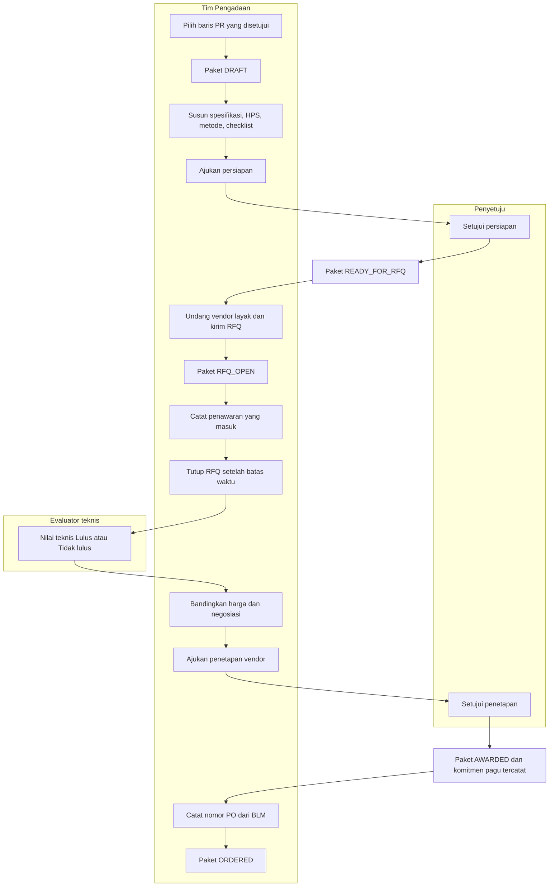

# Pemilihan Penyedia — Alur Utama

Jalur normal dari PR yang disetujui sampai paket "Sudah dipesan". Percabangan dan jalur gagal ada di berkas proses:
[persiapan-paket.md](persiapan-paket.md), [penawaran-dan-evaluasi.md](penawaran-dan-evaluasi.md),
[penetapan-dan-pesanan.md](penetapan-dan-pesanan.md).

| Langkah | Pelaku | Masukan | Keluaran | Bila gagal |
| --- | --- | --- | --- | --- |
| 1. Pilih baris PR | Tim Pengadaan | PR yang disetujui | Paket `DRAFT` | Baris sudah di paket lain → pilih baris lain |
| 2. Susun persiapan | Tim Pengadaan | Spesifikasi, HPS per barang, metode yang disarankan | Persiapan lengkap | Checklist belum lengkap → unggah dokumen wajib |
| 3. Setujui persiapan | Penyetuju | Pengajuan persiapan | Paket `READY_FOR_RFQ` | Dikembalikan → perbaiki dan ajukan ulang |
| 4. Kirim RFQ | Tim Pengadaan | Vendor layak, batas waktu | Paket `RFQ_OPEN`; dokumen RFQ dikirim lewat email | Vendor tidak layak → pilih vendor lain |
| 5. Catat penawaran | Tim Pengadaan | Berkas penawaran vendor | Penawaran tercatat | Terlambat → tercatat tetapi tidak sah |
| 6. Evaluasi teknis | Evaluator | Data teknis tanpa harga | Lulus / Tidak lulus | Semua tidak lulus → RFQ ulang |
| 7. Banding dan negosiasi | Tim Pengadaan | Penawaran sah dan lulus | Harga akhir | Di atas HPS → negosiasi atau alasan |
| 8. Setujui penetapan | Penyetuju | Vendor, nilai, peringkat, alasan | Paket `AWARDED`; komitmen pagu | Vendor tidak layak saat disetujui → kembali ke evaluasi |
| 9. Catat nomor PO | Tim Pengadaan | Nomor PO dari BLM | Paket `ORDERED` | Nomor sudah dipakai → periksa ulang nomor di BLM |
