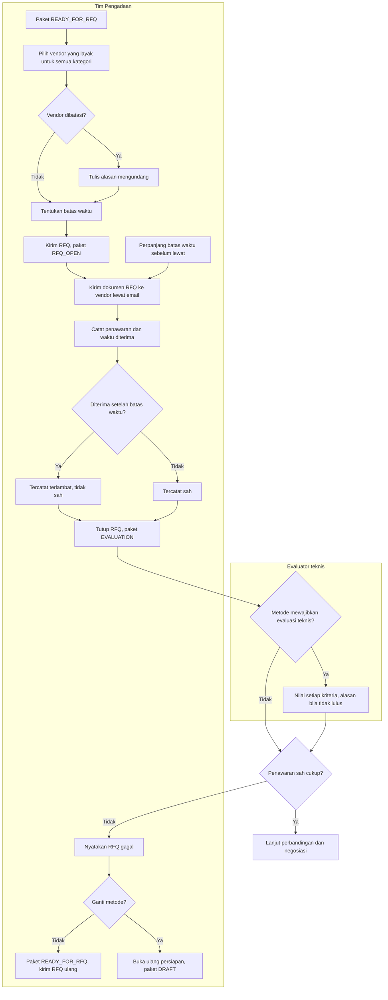

# Proses — RFQ, Penawaran, dan Evaluasi Teknis

| Langkah | Pelaku | Masukan | Keluaran | Bila gagal |
| --- | --- | --- | --- | --- |
| Pilih vendor | Tim Pengadaan | Daftar vendor layak per kategori paket | Undangan | Vendor tidak layak tidak tampil; vendor dibatasi butuh alasan |
| Kirim RFQ | Tim Pengadaan | Undangan, batas waktu | Nomor RFQ; paket `RFQ_OPEN` | Batas waktu lampau → ubah batas waktu |
| Catat penawaran | Tim Pengadaan | Berkas penawaran, PPN vendor | Penawaran tercatat dan harga akhir | Vendor tidak diundang → tidak bisa dicatat |
| Perpanjang | Tim Pengadaan | Batas waktu baru, alasan | Batas waktu baru untuk semua vendor | Sudah lewat → tidak bisa diperpanjang; nyatakan gagal atau tutup |
| Tutup RFQ | Tim Pengadaan | — | Paket `EVALUATION` | Batas waktu belum lewat dan masih ada vendor belum membalas → tunggu |
| Evaluasi | Evaluator | Data teknis tanpa harga | Lulus / Tidak lulus per kriteria | Evaluator mencatat penawaran itu sendiri → tugaskan evaluator lain |
| RFQ gagal | Tim Pengadaan | Alasan | RFQ ulang atau persiapan ulang | — |
