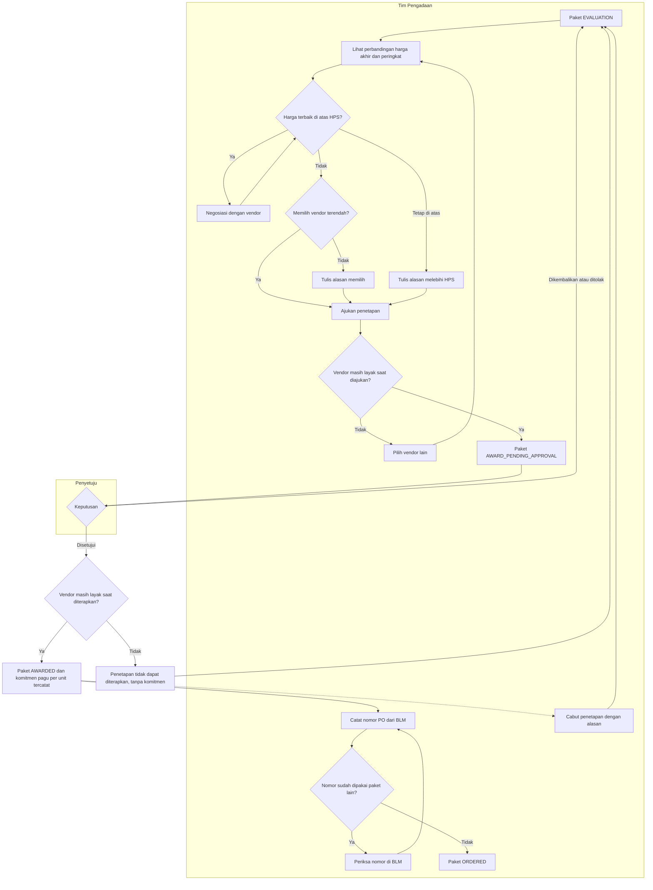

# Proses — Perbandingan, Negosiasi, Penetapan, dan Nomor PO

| Langkah | Pelaku | Masukan | Keluaran | Bila gagal |
| --- | --- | --- | --- | --- |
| Bandingkan | Tim Pengadaan | Penawaran sah dan lulus | Peringkat harga akhir termasuk PPN | Jumlah penawaran sah kurang dari minimum → RFQ ulang |
| Negosiasi | Tim Pengadaan | Berita acara | Harga baru per barang | Harga baru lebih tinggi → ditolak |
| Ajukan penetapan | Tim Pengadaan | Vendor, alasan bila bukan terendah atau di atas HPS | Paket `AWARD_PENDING_APPROVAL` | Vendor tidak layak → pilih vendor lain atau tunggu dokumen vendor diverifikasi |
| Putuskan | Penyetuju | Vendor, nilai, peringkat, alasan | Disetujui / dikembalikan / ditolak | Dikembalikan → ubah pilihan atau alasan |
| Terapkan | Sistem | Keputusan disetujui | Paket `AWARDED`; komitmen per unit, kategori, sumber dana | Vendor tidak layak atau pagu belum ada → paket kembali ke evaluasi / sinkron ulang setelah pagu disusun |
| Catat PO | Tim Pengadaan | Nomor PO BLM | Paket `ORDERED`; diserahkan ke kontrak-pelaksanaan | Nomor ganda → periksa ulang |
| Cabut | Manajer Pengadaan | Alasan | Paket `EVALUATION`; komitmen dilepas | Nomor PO sudah dicatat → tidak bisa dicabut |
