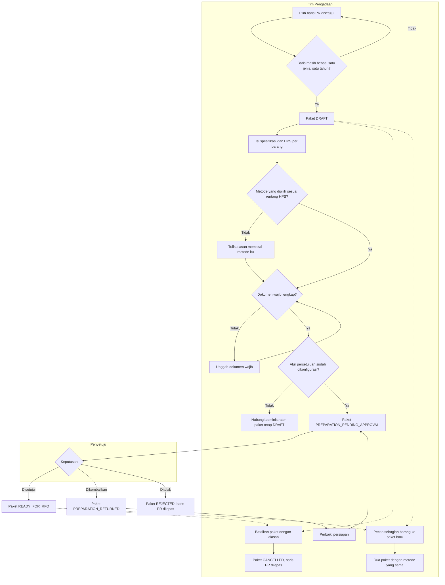

# Proses — Pembentukan dan Persiapan Paket

Mencakup pembentukan paket dari baris PR, persiapan, persetujuan persiapan, pecah paket, dan pembatalan sebelum RFQ.

| Langkah | Pelaku | Masukan | Keluaran | Bila gagal |
| --- | --- | --- | --- | --- |
| Pilih baris | Tim Pengadaan | Daftar baris PR siap paket | Paket `DRAFT` | Baris sudah dipaketkan petugas lain → muat ulang daftar |
| Isi HPS | Tim Pengadaan | Harga perkiraan PR (termasuk PPN), dasar harga | HPS per barang | HPS kosong → pengajuan ditolak |
| Pilih metode | Tim Pengadaan | Saran sistem dari HPS | Metode tersalin ke paket | Di luar rentang tanpa alasan → isi alasan |
| Lengkapi checklist | Tim Pengadaan | Dokumen KAK/TOR, dasar HPS, dll. | Checklist terpenuhi | Jenis dokumen tidak ada di daftar → minta admin menambah jenisnya |
| Ajukan | Tim Pengadaan | Persiapan lengkap | `PREPARATION_PENDING_APPROVAL` | Alur belum dikonfigurasi → admin `Wfl` mengisi matriks |
| Putuskan | Penyetuju | HPS, metode, alasan | `READY_FOR_RFQ` / `PREPARATION_RETURNED` / `REJECTED` | Dikembalikan → perbaiki sesuai catatan |
| Pecah | Tim Pengadaan | Barang yang dipindah, alasan | Paket baru berstatus sama, metode sama | Sedang menunggu persetujuan → tarik dulu |
| Batal | Tim Pengadaan | Alasan | `CANCELLED`; baris PR kembali bebas | Sedang menunggu persetujuan → tarik dulu |
