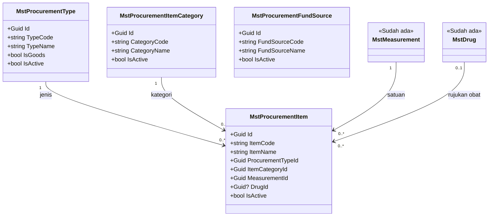
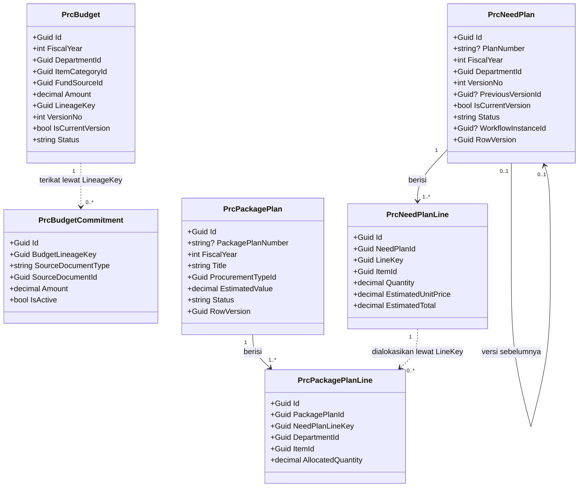
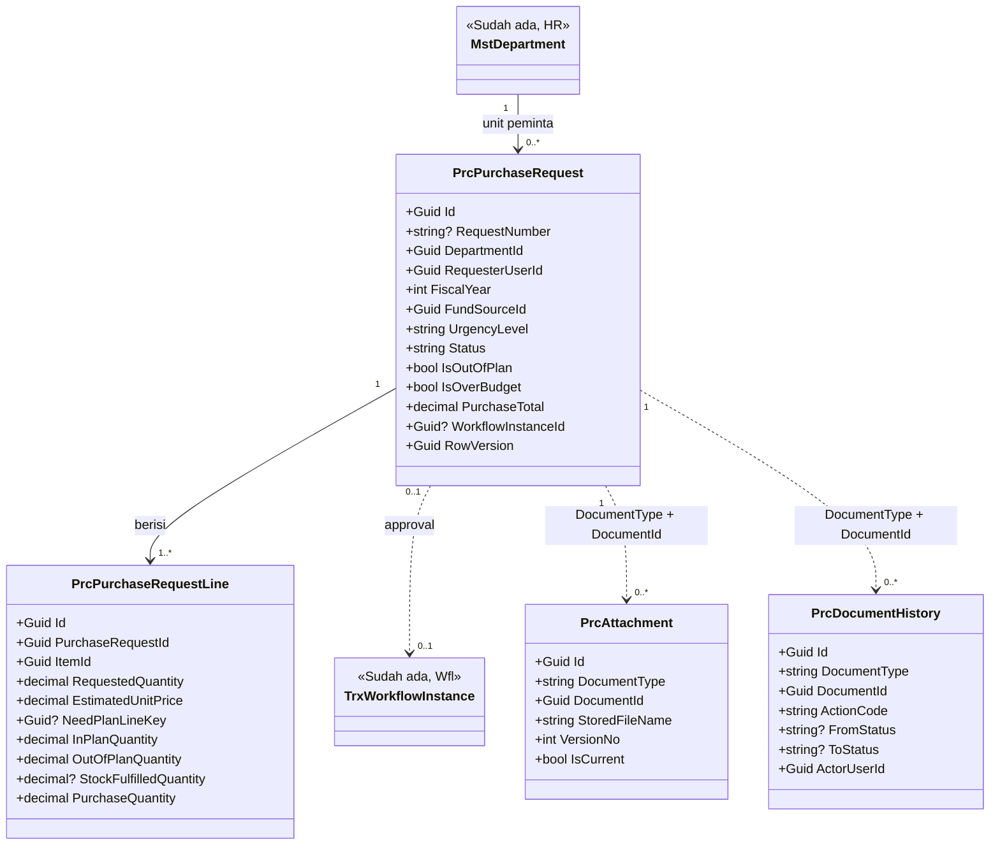
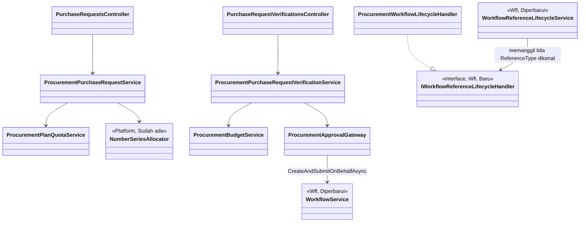

# Perencanaan & Permintaan — Arsitektur Backend

| Field | Nilai |
| --- | --- |
| Blueprint | `PBJ-BP-001` revisi 2, sub-modul `perencanaan-permintaan` (`PBJ-PP`) |
| Status | `approved` — pengguna sesi, 12 November 2026 (`PBJ-DEC-034`) |
| Masukan | `PBJ-DEC-001`..`030`; capability map revisi 1; penilaian kelengkapan revisi 2 (`READY_FOR_DOMAIN_DESIGN`) |
| Arsitektur domain | `DOMAIN_ARCHITECTURE_NOT_RUN`: modul administratif, tanpa data klinis maupun tagihan pasien |
| SHA | BE `100c011d`, FE `763d665b` |
| Prasyarat implementasi | Registry prefix `Prc` + Area `Corporate / ProcurementManagement` — **terpenuhi** 12 November 2026 (`PBJ-DEC-035`) |

> Nama `Prc*`, `Mst*Procurement*`, dan folder `Areas/Corporate/ProcurementManagement/` adalah **usulan** yang
> menunggu registry. Butir berlabel **[DIKONFIRMASI `PBJ-DEC-033`]** semula gap `PROPOSED` dan sudah dikonfirmasi pemilik.
> Butir **[NILAI AWAL]** adalah nilai bawaan yang dapat dikonfigurasi.

---

## 1. Batas konteks, aggregate, dan invariant

| Konteks | Aggregate root | Isi | Invariant utama |
| --- | --- | --- | --- |
| Katalog Pengadaan | `MstProcurementItem` | Barang/jasa, kategori, jenis, sumber dana | Kode katalog unik dan dibuat server. Barang yang pernah dipakai tidak dihapus, hanya dinonaktifkan |
| Rencana Kebutuhan | `PrcNeedPlan` (per unit × tahun × versi) | Baris kebutuhan | Hanya satu versi berlaku per unit dan tahun. Versi yang disetujui tidak bisa diubah; perubahan dibuat sebagai versi baru |
| Rencana Paket | `PrcPackagePlan` | Alokasi baris rencana ke paket | Jumlah alokasi per baris rencana ≤ kuantitas baris rencana |
| Pagu | `PrcBudget` (per tahun × unit × kategori × sumber dana × versi) | Nilai pagu, komitmen | Sisa pagu = pagu berlaku − komitmen aktif, dihitung server |
| Permintaan Pengadaan | `PrcPurchaseRequest` | Baris PR, hasil cek stok | Nominal approval = nilai kebutuhan beli (`PBJ-DEC-027`). Pengusul tidak menyetujui PR sendiri. Kuantitas dalam rencana per baris ≤ sisa rencana saat diajukan (`PBJ-DEC-029`) |
| Dokumen bersama | `PrcAttachment`, `PrcDocumentHistory` | Lampiran dan riwayat semua dokumen Pengadaan | Berkas tidak pernah ditimpa. Riwayat hanya ditambah, tidak diubah |

**Batas transaksi.** Setiap aksi yang mengubah status (ajukan, selesaikan verifikasi, batal, sinkron hasil
approval) berjalan dalam **satu transaksi database**: perubahan status, baris riwayat, alokasi nomor, dan
pembuatan instance approval di `Wfl`. Bila salah satu gagal, semuanya dibatalkan.

**Catatan nomor:** `NumberSeriesAllocator` membuka koneksinya sendiri lewat `IDbContextFactory`, sehingga
nomor yang sudah dialokasikan **hangus** bila transaksi PR gagal. Ini sesuai `DEC-PLT-008` (nomor hangus,
tidak dipakai ulang).

**Kesamaan waktu.**
- PR, rencana, rencana paket, dan pagu memakai kolom `RowVersion` (`Guid`, pola sama dengan
  `FinPurchaseOrder.RowVersion`). Klien mengirim `ExpectedRowVersion` saat mengubah data; nilai yang tidak
  cocok ditolak dengan kode 409.
- Aksi "Ajukan" PR mengunci baris rencana yang dirujuk lewat *advisory lock* PostgreSQL per
  `NeedPlanLineKey`. Tanpa kunci ini, dua PR yang diajukan bersamaan bisa sama-sama memakai sisa rencana
  yang sama.

## 2. Kepemilikan data sub-modul ini

Tabel kepemilikan seluruh modul ada di [`../02-module-map.md`](../02-module-map.md) bagian 2. Kelompok data
milik sub-modul ini: katalog dan master Pengadaan, lampiran, riwayat dokumen, rencana kebutuhan, rencana paket,
pagu dan komitmen, serta PR dan cek stok.

Data yang **dipakai tanpa dibuat ulang**: `MstDepartment` (unit), `ApplicationUserOrganization`
(`AspNetUserOrganization`, penempatan pengguna), `MstMeasurement` (satuan), `MstDrug` (obat), mesin `Wfl`,
dan `NumberSeriesAllocator`.

## 3. Class diagram

### 3.1 Katalog dan master



### 3.2 Rencana kebutuhan, rencana paket, dan pagu



### 3.3 Permintaan pengadaan dan dokumen bersama



### 3.4 Service, controller, dan perluasan `Wfl`



## 4. Penjelasan class

### 4.1 Model

| Class | Status | Lokasi file | Tanggung jawab | Catatan desain |
| --- | --- | --- | --- | --- |
| `MstProcurementType` | Baru | `Areas/Corporate/ProcurementManagement/MasterData/Models/MstProcurementType.cs` | Empat jenis pengadaan (`PBJ-DEC-024`). `IsGoods` menentukan jalur serah terima | Disimpan sebagai data agar bisa ditambah. Kode jenis yang sudah dipakai tidak bisa diubah |
| `MstProcurementItemCategory` | Baru | `.../MasterData/Models/MstProcurementItemCategory.cs` | Kategori katalog, juga kunci pagu | Daftar dikonfigurasi **[DIKONFIRMASI `PBJ-DEC-033`, `G-07`]** |
| `MstProcurementFundSource` | Baru | `.../MasterData/Models/MstProcurementFundSource.cs` | Sumber dana pagu dan PR | Nilai awal dapat dikonfigurasi (`G-10`) |
| `MstProcurementItem` | Baru | `.../MasterData/Models/MstProcurementItem.cs` | Katalog barang/jasa (`PBJ-DEC-022`) | `ItemCode` `KTL-…` dari NumberSeries. `DrugId` opsional untuk obat. Tidak menyimpan harga; harga ada di estimasi baris |
| `PrcNeedPlan` | Baru | `Areas/Corporate/ProcurementManagement/Planning/Models/PrcNeedPlan.cs` | Rencana kebutuhan tahunan satu unit, berversi (`G-05`) | Revisi = baris baru dengan `PreviousVersionId`; `IsCurrentVersion` dipindah saat versi baru disetujui |
| `PrcNeedPlanLine` | Baru | `.../Planning/Models/PrcNeedPlanLine.cs` | Satu barang dalam rencana | `LineKey` stabil antar versi, sehingga PR dan rencana paket tetap tertaut walau rencana direvisi |
| `PrcPackagePlan` | Baru | `.../Planning/Models/PrcPackagePlan.cs` | Rencana paket (`PBJ-DEC-028`) | Bukan paket eksekusi; paket eksekusi milik `pemilihan-penyedia` |
| `PrcPackagePlanLine` | Baru | `.../Planning/Models/PrcPackagePlanLine.cs` | Alokasi baris rencana ke rencana paket, dengan unit asal tersimpan | Hasil konsolidasi (2.2) tersimpan di sini |
| `PrcBudget` | Baru | `.../Planning/Models/PrcBudget.cs` | Pagu per tahun × unit × kategori × sumber dana, berversi | — |
| `PrcBudgetCommitment` | Baru | `.../Planning/Models/PrcBudgetCommitment.cs` | Komitmen pagu dari dokumen sub-modul lain (`PBJ-DEC-009`) | Menunjuk `PrcBudget.LineageKey` (garis keturunan versi), bukan `Id` versi, agar komitmen tetap menempel saat pagu direvisi. Kosong selama MVP sub-modul ini; ditulis `pemilihan-penyedia` lewat service pemilik |
| `PrcPurchaseRequest` | Baru | `Areas/Corporate/ProcurementManagement/Request/Models/PrcPurchaseRequest.cs` | Kepala PR | `RequestNumber` kosong saat draft, terisi saat diajukan (`PBJ-DEC-025`) |
| `PrcPurchaseRequestLine` | Baru | `.../Request/Models/PrcPurchaseRequestLine.cs` | Baris PR beserta pembagian dalam/luar rencana dan hasil cek stok | `PurchaseQuantity` dihitung server, tidak pernah dikirim klien |
| `PrcAttachment` | Baru | `Areas/Corporate/ProcurementManagement/Common/Models/PrcAttachment.cs` | Lampiran semua dokumen Pengadaan (`PBJ-DEC-023`) | Berkas baru membuat versi baru; versi lama `IsCurrent = false` |
| `PrcDocumentHistory` | Baru | `.../Common/Models/PrcDocumentHistory.cs` | Riwayat aksi dan status semua dokumen Pengadaan | Hanya ditambah. Menjadi sumber "Riwayat Pengajuan" dan laporan audit |
| `MstWorkflowStep` | **Diperbarui** | `Areas/Corporate/HumanResource/MasterData/Workflow/Models/MstWorkflowStep.cs` | Tambah satu kolom: `ActivationConditionCode` (`string?`, maks. 50) | Langkah dengan kode ini hanya dibuat bila konteks permohonan memuat kode yang sama. Langkah HR yang ada bernilai `null`, sehingga perilakunya tidak berubah |
| `TrxWorkflowInstance`, `MstWorkflowDefinition`, `MstApprovalMatrix` | Sudah ada | `Areas/Corporate/HumanResource/WorkflowManagement/Models/`, `.../MasterData/Workflow/Models/` | Dipakai apa adanya | `WorkflowCategory = "Procurement"` untuk definisi Pengadaan |
| `MstDepartment`, `ApplicationUserOrganization`, `MstMeasurement`, `MstDrug` | Sudah ada | file masing-masing | Dirujuk | Tidak disalin |

### 4.2 Service

Semua service didaftarkan `AddScoped<T>()` di `ProcurementManagementServiceCollectionExtensions.AddProcurementManagement()`
(baru, `Areas/Corporate/ProcurementManagement/ProcurementManagementServiceCollectionExtensions.cs`), lalu dipanggil
dari `Program.cs`.

| Service | Status | Fungsi utama | Dipanggil oleh | Membuka transaksi |
| --- | --- | --- | --- | --- |
| `ProcurementCatalogService` | Baru | CRUD katalog, kategori, jenis, sumber dana; alokasi kode `KTL` | `ProcurementItemsController`, `ProcurementMasterDataController` | Ya, saat membuat barang |
| `ProcurementNeedPlanService` | Baru | Draft, ajukan, batal, buat revisi, banding versi | `NeedPlansController`, penangan approval | Ya |
| `ProcurementPlanConsolidationService` | Baru | Menggabungkan baris rencana berlaku per barang | `PlanConsolidationsController` | Tidak (hanya baca) |
| `ProcurementPackagePlanService` | Baru | Rencana paket, validasi alokasi | `PackagePlansController`, penangan approval | Ya |
| `ProcurementBudgetService` | Baru | Pagu, revisi, sisa pagu, uji melebihi pagu | `BudgetsController`, verifikasi PR | Ya |
| `ProcurementBudgetCommitmentService` | Baru | Menulis/melepas komitmen (dipakai sub-modul lain) | `pemilihan-penyedia` (kelak) | Ya, ikut transaksi pemanggil |
| `ProcurementPlanQuotaService` | Baru | Menghitung sisa rencana per `LineKey` dan membagi kuantitas dalam/luar rencana; memasang advisory lock | Service PR | Ikut transaksi pemanggil |
| `ProcurementPurchaseRequestService` | Baru | Draft, ubah, ajukan, batal oleh pengusul, riwayat; pembatasan per unit | `PurchaseRequestsController`, penangan approval | Ya |
| `ProcurementPurchaseRequestVerificationService` | Baru | Catat cek stok, selesaikan verifikasi, kembalikan, tolak, batal setelah disetujui | `PurchaseRequestVerificationsController` | Ya |
| `ProcurementApprovalGateway` | Baru | Satu-satunya pintu Pengadaan ke `Wfl`: memilih kode definisi, menyusun konteks (`amount`, `conditionCodes`), memanggil `WorkflowService.CreateAndSubmitOnBehalfAsync` atas nama pemohon asli dengan `IdempotencyKey` (`PBJ-DEC-038`) | Service PR, rencana, paket, pagu | Tidak ikut transaksi pemanggil: `Wfl` dulu, status dokumen sesudahnya |
| `ProcurementWorkflowLifecycleHandler` | Baru | Implementasi `IWorkflowReferenceLifecycleHandler` untuk `ReferenceType` berawalan `PBJ_`. Menurunkan status dokumen dari status workflow | `WorkflowReferenceLifecycleService` | Ya |
| `ProcurementAttachmentService` | Baru | Unggah dengan validasi tipe, isi, dan ukuran; unduh dengan cek hak atas dokumen induk | `ProcurementAttachmentsController` | Ya |
| `ProcurementDocumentHistoryWriter` | Baru | Menulis riwayat; tidak pernah mengubah baris lama | Semua service di atas | Ikut transaksi pemanggil |
| `ProcurementDataScopeService` | Baru | Menentukan departemen yang boleh dilihat pengguna dari `AspNetUserOrganization` aktif, atau semua bila punya `<resource dokumen> : ReadAllUnits` (`PBJ-DEC-036`; semula `ProcurementCrossUnit : Read`) | Semua service baca/tulis | Tidak |
| `WorkflowReferenceLifecycleService` | **Diperbarui** | Sebelum mengembalikan `IsHandled = false`, memanggil `IEnumerable<IWorkflowReferenceLifecycleHandler>` yang `CanHandle(referenceType)` | `WorkflowService` (sudah ada) | Tidak berubah |
| `WorkflowService` | **Diperbarui** | Saat membuat langkah, melewati `MstWorkflowStep` yang `ActivationConditionCode`-nya tidak ada pada `RequestContext.conditionCodes` | Sudah ada | Tidak berubah |

**Pengecualian pola "service tanpa interface":** `IWorkflowReferenceLifecycleHandler` adalah titik
perluasan, bukan abstraksi service biasa. Interface dibutuhkan agar `Wfl` bisa memanggil penangan modul lain
tanpa merujuk modul itu. Ini jawaban langsung atas temuan `PBJ-CAP-001`.

### 4.3 Controller

Semua controller memakai `[ApiController]`, `[Authorize]`, `[AccessController(...)]`, dan `[Tags(...)]`.
Setiap endpoint memakai `[AccessAction]` dan `[AccessPermission]`. Controller tidak mengakses
`ApplicationDbContext` langsung (`QBE-SVC-001`). Lokasi: `Areas/Corporate/ProcurementManagement/<Folder>/Controllers/`.

| Controller | Folder | Service yang dipakai | Grup Swagger |
| --- | --- | --- | --- |
| `ProcurementItemsController` | `MasterData` | `ProcurementCatalogService` | `Corporate / Procurement Management / Master Data / Item` |
| `ProcurementMasterDataController` | `MasterData` | `ProcurementCatalogService` | `Corporate / Procurement Management / Master Data / Reference` |
| `NeedPlansController` | `Planning` | `ProcurementNeedPlanService` | `Corporate / Procurement Management / Planning / Need Plan` |
| `PlanConsolidationsController` | `Planning` | `ProcurementPlanConsolidationService` | `Corporate / Procurement Management / Planning / Consolidation` |
| `PackagePlansController` | `Planning` | `ProcurementPackagePlanService` | `Corporate / Procurement Management / Planning / Package Plan` |
| `BudgetsController` | `Planning` | `ProcurementBudgetService` | `Corporate / Procurement Management / Planning / Budget` |
| `PurchaseRequestsController` | `Request` | `ProcurementPurchaseRequestService` | `Corporate / Procurement Management / Request / Purchase Request` |
| `PurchaseRequestVerificationsController` | `Request` | `ProcurementPurchaseRequestVerificationService` | `Corporate / Procurement Management / Request / Verification` |
| `ProcurementAttachmentsController` | `Common` | `ProcurementAttachmentService` | `Corporate / Procurement Management / Common / Attachment` |

Endpoint lengkap ada di [`contracts/api-contract.md`](contracts/api-contract.md).

### 4.4 DTO dan enum

| File | Isi |
| --- | --- |
| `MasterData/DTOs/ProcurementCatalogDtos.cs` | `CreateProcurementItemRequest`, `UpdateProcurementItemRequest`, `ProcurementItemResponse`, `ProcurementItemQuery`, `ProcurementItemOption`, DTO kategori, jenis, sumber dana |
| `Planning/DTOs/NeedPlanDtos.cs` | `CreateNeedPlanRequest`, `UpdateNeedPlanRequest` (`ExpectedRowVersion`), `NeedPlanLineRequest`, `NeedPlanResponse`, `NeedPlanQuery`, `NeedPlanVersionCompareResponse`, `PlanLineQuotaResponse` |
| `Planning/DTOs/PackagePlanDtos.cs` | `CreatePackagePlanRequest`, `PackagePlanLineRequest`, `PackagePlanResponse`, `PlanConsolidationRow` |
| `Planning/DTOs/BudgetDtos.cs` | `CreateBudgetRequest`, `UpdateBudgetRequest`, `BudgetResponse` (dengan `CommittedAmount`, `RemainingAmount`), `BudgetQuery`, `BudgetRemainingQuery` |
| `Request/DTOs/PurchaseRequestDtos.cs` | `CreatePurchaseRequestRequest`, `UpdatePurchaseRequestRequest`, `PurchaseRequestLineRequest`, `PurchaseRequestResponse`, `PurchaseRequestListItem`, `PurchaseRequestQuery`, `CancelPurchaseRequestRequest` |
| `Request/DTOs/PurchaseRequestVerificationDtos.cs` | `RecordStockCheckRequest` (per baris), `CompleteVerificationRequest`, `ReturnPurchaseRequestRequest`, `RejectPurchaseRequestRequest`, `StockCheckListItem` |
| `Common/DTOs/ProcurementAttachmentDtos.cs` | `UploadAttachmentRequest` (multipart), `AttachmentResponse` |
| `Common/DTOs/DocumentHistoryDtos.cs` | `DocumentHistoryResponse` |
| `Common/Constants/ProcurementDocumentTypes.cs` | `PBJ_PR`, `PBJ_NEED_PLAN`, `PBJ_PACKAGE_PLAN`, `PBJ_BUDGET`, `PBJ_ITEM` (nilai `DocumentType` dan `ReferenceType`) |
| `Common/Constants/ProcurementStatuses.cs` | Status PR, rencana, rencana paket, pagu (lihat `contracts/state-transition-matrix.md`) |
| `Common/Constants/ProcurementNumberSeries.cs` | Kunci, awalan, dan kebijakan deret nomor (bagian 9) |
| `Common/Constants/ProcurementWorkflowCodes.cs` | Kode definisi dan kode kondisi `Wfl` (bagian 8) |

Status disimpan sebagai `string` (pola `FinPurchaseOrder.Status`), bukan enum integer, agar terbaca di basis
data dan konsisten dengan Finance Purchasing.

## 5. Arsitektur folder

```text
Areas/Corporate/ProcurementManagement/                      [Baru — registry `Prc` ACTIVE, PBJ-DEC-035]
├── ProcurementManagementServiceCollectionExtensions.cs     [Baru]
├── MasterData/
│   ├── Models/      MstProcurementType.cs, MstProcurementItemCategory.cs,
│   │                MstProcurementFundSource.cs, MstProcurementItem.cs          [Baru]
│   ├── DTOs/        ProcurementCatalogDtos.cs                                   [Baru]
│   ├── Services/    ProcurementCatalogService.cs                                [Baru]
│   └── Controllers/ ProcurementItemsController.cs, ProcurementMasterDataController.cs [Baru]
├── Planning/
│   ├── Models/      PrcNeedPlan.cs, PrcNeedPlanLine.cs, PrcPackagePlan.cs,
│   │                PrcPackagePlanLine.cs, PrcBudget.cs, PrcBudgetCommitment.cs [Baru]
│   ├── DTOs/        NeedPlanDtos.cs, PackagePlanDtos.cs, BudgetDtos.cs          [Baru]
│   ├── Services/    ProcurementNeedPlanService.cs, ProcurementPlanConsolidationService.cs,
│   │                ProcurementPackagePlanService.cs, ProcurementBudgetService.cs,
│   │                ProcurementBudgetCommitmentService.cs, ProcurementPlanQuotaService.cs [Baru]
│   └── Controllers/ NeedPlansController.cs, PlanConsolidationsController.cs,
│                    PackagePlansController.cs, BudgetsController.cs             [Baru]
├── Request/
│   ├── Models/      PrcPurchaseRequest.cs, PrcPurchaseRequestLine.cs            [Baru]
│   ├── DTOs/        PurchaseRequestDtos.cs, PurchaseRequestVerificationDtos.cs  [Baru]
│   ├── Services/    ProcurementPurchaseRequestService.cs,
│   │                ProcurementPurchaseRequestVerificationService.cs            [Baru]
│   └── Controllers/ PurchaseRequestsController.cs, PurchaseRequestVerificationsController.cs [Baru]
└── Common/
    ├── Constants/   ProcurementDocumentTypes.cs, ProcurementStatuses.cs,
    │                ProcurementNumberSeries.cs, ProcurementWorkflowCodes.cs     [Baru]
    ├── Models/      PrcAttachment.cs, PrcDocumentHistory.cs                      [Baru]
    ├── DTOs/        ProcurementAttachmentDtos.cs, DocumentHistoryDtos.cs        [Baru]
    ├── Services/    ProcurementApprovalGateway.cs, ProcurementWorkflowLifecycleHandler.cs,
    │                ProcurementAttachmentService.cs, ProcurementDocumentHistoryWriter.cs,
    │                ProcurementDataScopeService.cs                              [Baru]
    └── Controllers/ ProcurementAttachmentsController.cs                         [Baru]

Repositories/Configurations/Corporate/ProcurementManagement/
├── MasterData/  satu Configuration per model Mst*                               [Baru]
├── Planning/    satu Configuration per model Prc* Planning                      [Baru]
├── Request/     PrcPurchaseRequestConfiguration.cs, PrcPurchaseRequestLineConfiguration.cs [Baru]
└── Common/      PrcAttachmentConfiguration.cs, PrcDocumentHistoryConfiguration.cs [Baru]

Repositories/ApplicationDbContext.cs                       [Diperbarui — 14 DbSet baru]
Program.cs                                                 [Diperbarui — builder.Services.AddProcurementManagement()]

Areas/Corporate/HumanResource/WorkflowManagement/                               [Wfl, milik pengguna sesi PBJ-DEC-026]
├── Services/IWorkflowReferenceLifecycleHandler.cs         [Baru]
├── Services/WorkflowReferenceLifecycleService.cs          [Diperbarui — panggil penangan terdaftar]
└── Services/WorkflowService.cs                            [Diperbarui — saring langkah berdasarkan kode kondisi]
Areas/Corporate/HumanResource/MasterData/Workflow/Models/MstWorkflowStep.cs     [Diperbarui — 1 kolom]
```

**Utang teknis yang terlihat dan sengaja tidak ditiru:**
- `Wfl` tinggal di bawah folder `HumanResource` walaupun kategorinya shared platform.
- `FinancePurchaseOrderService` didaftarkan di `BillingManagementServiceCollectionExtensions`.
- Jalur V2 `WorkflowInstanceCreationService` memakai pegawai sembarang bila pengaju tidak ditemukan
  (`FirstOrDefaultAsync()`), dan `WorkflowRoutingMatrixService` menulis jenjang langsung di kode.

Pengadaan **tidak memakai** jalur V2 itu. Perapiannya bukan bagian sub-modul ini: dicatat sebagai temuan
untuk pemilik `Wfl` (lihat bagian 12).

## 6. Status model dan dampak migration

| Tabel | Status | Kolom berubah | Dampak migration |
| --- | --- | --- | --- |
| `MstWorkflowStep` | Diperbarui | `ActivationConditionCode varchar(50) NULL` | Tambah kolom nullable; tanpa downtime; data lama `NULL` |
| `MstProcurementType`, `MstProcurementItemCategory`, `MstProcurementFundSource`, `MstProcurementItem` | Baru | Seluruh kolom | Tabel baru + data awal |
| `PrcAttachment`, `PrcDocumentHistory` | Baru | Seluruh kolom | Tabel baru |
| `PrcPurchaseRequest`, `PrcPurchaseRequestLine` | Baru | Seluruh kolom | Tabel baru |
| `PrcNeedPlan`, `PrcNeedPlanLine` | Baru | Seluruh kolom | Tabel baru |
| `PrcBudget`, `PrcBudgetCommitment` | Baru | Seluruh kolom | Tabel baru |
| `PrcPackagePlan`, `PrcPackagePlanLine` | Baru | Seluruh kolom | Tabel baru |

Rincian kolom ada di [`data/data-dictionary.md`](data/data-dictionary.md).

## 7. Rencana migration (di dalam sub-modul)

| Urutan | Nama | Tanpa downtime | Data lama | Langkah mundur |
| ---: | --- | --- | --- | --- |
| 1 | `AddWorkflowStepActivationCondition` | Ya, kolom nullable | Tidak ada | `Down()` menghapus kolom; aman selama belum ada langkah ber-kode |
| 2 | `AddProcurementFoundation` | Ya, tabel baru | Data awal master (bagian 10) lewat seeder idempoten, bukan di migration | `Down()` menghapus tabel; aman sebelum ada transaksi |
| 3 | `AddProcurementPurchaseRequest` | Ya | — | `Down()` |
| 4 | `AddProcurementNeedPlan` | Ya | — | `Down()` |
| 5 | `AddProcurementBudget` | Ya | — | `Down()` |
| 6 | `AddProcurementPackagePlan` | Ya | — | `Down()` |

Urutan rilis: **database dulu, lalu aplikasi**. Model `MstWorkflowStep` yang baru tidak boleh aktif di server
sebelum kolomnya ada, karena semua query langkah workflow (termasuk HR) akan gagal. Pembuatan dan penerapan
migration mengikuti wewenang task di `AGENTS.md`; blueprint ini tidak memberi wewenang itu.

## 8. Approval lewat `Wfl` (`PBJ-DEC-005`, `007`, `016`, `019`, `027`, `030`)

| Dokumen | `ReferenceType` | Kode definisi | Nominal (`amount`) | Kode kondisi yang mungkin |
| --- | --- | --- | --- | --- |
| PR normal | `PBJ_PR` | `PBJ-PR` | Nilai kebutuhan beli (`PurchaseTotal`) | `PBJ_OUT_OF_PLAN`, `PBJ_OVER_BUDGET` |
| PR mendesak | `PBJ_PR` | `PBJ-PR-MENDESAK` | Idem | Idem |
| Rencana kebutuhan / revisi | `PBJ_NEED_PLAN` | `PBJ-RKB` | Total estimasi | — |
| Rencana paket | `PBJ_PACKAGE_PLAN` | `PBJ-RPK` | Estimasi nilai | — |
| Pagu / revisi pagu | `PBJ_BUDGET` | `PBJ-PAGU` | Nilai pagu | — |

**Cara kerja kode kondisi.** `MstWorkflowStep.ActivationConditionCode` menandai langkah yang hanya muncul
pada kondisi tertentu.

**Contoh:** definisi `PBJ-PR` punya tiga langkah:
1. Kepala Unit (`ActivationConditionCode = null`);
2. Manajer Pengadaan (`null`);
3. Direktur Keuangan (`PBJ_OVER_BUDGET`).

PR Rp 45 juta yang melebihi pagu dikirim dengan `conditionCodes = ["PBJ_OVER_BUDGET"]`, sehingga ketiga langkah
dibuat. PR yang sama tanpa kelebihan pagu hanya mendapat langkah 1 dan 2. Ambang nominal per langkah tetap
diatur `MstApprovalMatrix` (`MinimumAmount`/`MaximumAmount`).

**Anti-setujui-sendiri:** seluruh langkah definisi `PBJ-*` di-seed dengan `AllowSelfApproval = false`. Penjaga
yang ada di `WorkflowService` (membandingkan `actorContext.UserId` dengan `instance.RequestedByUserId`) menolak
pengusul. Selain itu, `ProcurementWorkflowLifecycleHandler` memeriksa ulang sebelum menerapkan `Approved`.

**Idempotensi:** `IdempotencyKey = "<ReferenceType>:<DocumentId>:<VersiAjuan>"`. Mengajukan ulang karena
koneksi putus tidak membuat dua instance.

**Atas nama pemohon (`PBJ-DEC-038`, `BE-PBJ-005`).** PR masuk approval saat verifikator menyelesaikan
verifikasi, jadi gerbang memanggil `WorkflowService.CreateAndSubmitOnBehalfAsync(request, requesterUserId)`.
Pengaju dan konteks organisasinya diambil dari pemohon asli, sehingga langkah "atasan pemohon" menunjuk
atasan pengusul, bukan atasan verifikator. Urutannya "`Wfl` dulu, baru status dokumen": bila `Wfl` gagal,
dokumen belum berubah dan pengulangan dengan kunci yang sama memakai instance yang sudah ada.

**Data awal definisi.** Kelima definisi `PBJ-*` di-seed `WorkflowStatus = "Draft"`, `IsActive = false`,
**tanpa** baris matriks. Admin mengisi matriks dari SOP (`PBJ-OQ-019`) lalu mengaktifkan definisinya.
Sebelum itu setiap pengajuan dijawab `PBJ-VAL-091` (fail-closed); tidak ada penyetuju yang dikarang.

**Kegagalan sinkron:** bila penangan gagal setelah keputusan approval sah, perilaku `Wfl` dipertahankan.
Keputusan tetap sah, galat dicatat, dan sinkron dapat diulang lewat endpoint `synchronize` yang sudah ada.
PR tetap `PENDING_APPROVAL` sampai sinkron berhasil.

## 9. Penomoran (`PBJ-DEC-025`)

| Dokumen | `SequenceKey` | Awalan | Contoh |
| --- | --- | --- | --- |
| PR | `PBJ_PR` | `PR` | `PR-000031` |
| Rencana kebutuhan | `PBJ_NEED_PLAN` | `RKB` | `RKB-000004` |
| Rencana paket | `PBJ_PACKAGE_PLAN` | `RPK` | `RPK-000002` |
| Katalog | `PBJ_ITEM` | `KTL` | `KTL-000045` |

> **Diputuskan `PBJ-DEC-031`** (menutup `PBJ-OQ-031`, menggantikan bagian format `PBJ-DEC-025`): mengikuti
> invariant Platform `INV-PLT-004`. Deret **tidak pernah direset** (`ResetPolicy = NEVER`), 6 digit, tanpa
> tahun di nomor. Contoh `PR-000031`, `RKB-000004`, `RPK-000002`, `KTL-000045`. Tahun tetap terbaca dari
> tanggal dan kolom tahun anggaran.

Nomor dialokasikan saat **diajukan**, bukan saat draft. Draft yang dibatalkan tidak pernah memakan nomor.

## 10. Data master awal

| Master | Isi minimum | Sumber nilai |
| --- | --- | --- |
| `MstProcurementType` | `STOCK` Barang stok (`IsGoods = true`); `ASSET` Aset (`true`); `NON_STOCK` Barang nonstok (`true`); `SERVICE` Jasa (`false`) | `PBJ-DEC-024` |
| `MstProcurementItemCategory` | Minimal satu: `UMUM` Umum. Daftar lengkap diisi Tim Pengadaan | **[DIKONFIRMASI `PBJ-DEC-033`, `G-07`]** |
| `MstProcurementFundSource` | `OPERASIONAL` Operasional, `INVESTASI` Investasi | **[NILAI AWAL `G-10`]**, dapat diubah |
| `MstWorkflowDefinition` + `MstWorkflowStep` | Lima definisi `PBJ-PR`, `PBJ-PR-MENDESAK`, `PBJ-RKB`, `PBJ-RPK`, `PBJ-PAGU` dengan `WorkflowCategory = "Procurement"`, `AllowSelfApproval = false` | Struktur dari `PBJ-DEC-007`; peran dan ambang **menunggu SOP** (`PBJ-OQ-019`, `G-13`) |
| `MstApprovalMatrix` | Satu baris fallback per langkah (`IsFallback = true`) **[NILAI AWAL]** |
| Izin peran | Butir `[AccessPermission]` Pengadaan untuk peran awal (lihat `contracts/permission-audit-matrix.md`) | Diturunkan seeder izin otomatis |

Konfigurasi lampiran di `appsettings` (pola `HumanResource:WorkflowAttachment:*`):
`Procurement:Attachment:RelativeRootPath = uploads/corporate/procurement`,
`AllowedExtensions = .pdf,.jpg,.jpeg,.png,.docx,.xlsx`, `MaxFileSizeBytes = 10485760` **[NILAI AWAL `G-09`]**.

## 11. Keamanan, privasi, dan pencatatan

- **Pembatasan unit (`PBJ-DEC-020`):** setiap query PR, rencana, dan pagu disaring
  `DepartmentId ∈ ProcurementDataScopeService.GetVisibleDepartments(user)`. Akses ke dokumen di luar cakupan
  menghasilkan **404**, bukan 403, agar keberadaan dokumen unit lain tidak bocor (UAT-03 BRD).
- **Lampiran:** ekstensi harus ada di daftar izin **dan** tanda tangan berkas (*magic number*) harus cocok:
  PDF `%PDF`, PNG `89 50 4E 47`, JPEG `FF D8 FF`, DOCX/XLSX `PK 03 04` + entri `[Content_Types].xml`. Nama yang
  disimpan diacak (`Guid` + ekstensi). Unduhan lewat endpoint yang memeriksa hak atas dokumen induknya, dengan
  `Content-Disposition: attachment`. Berkas HTML/SVG/EXE selalu ditolak.
- **Pencatatan:** mengikuti konvensi project. `GET` tidak dicatat; aksi lain dicatat dengan `EntityId`,
  controller, action, dan status saja. Isi justifikasi, alasan, dan nama berkas tidak masuk logger.

## 12. Yang sengaja tidak dibuat

| Yang ditolak | Alasan |
| --- | --- |
| Tabel approval milik Pengadaan | `PBJ-DEC-019`: memakai `Wfl` |
| Memakai `WorkflowInstanceCreationService` / `WorkflowRoutingMatrixService` (jalur V2) | Jenjang tertulis di kode dan ada fallback pegawai sembarang. Bertentangan dengan `PBJ-DEC-007` |
| Delapan definisi workflow (kombinasi mendesak × luar rencana × lewat pagu) | Konfigurasi berlipat dan mudah tidak sinkron. Kode kondisi pada langkah lebih sederhana |
| Master barang umum lintas modul | Di luar wewenang; `PBJ-DEC-022` menetapkan katalog milik Pengadaan |
| Tabel reservasi stok | `PBJ-DEC-008`: cek stok hanya dicatat, tanpa reservasi |
| FK fisik dari baris PR ke `PrcNeedPlanLine.Id` | Baris rencana berganti `Id` pada setiap revisi. Tautan memakai `NeedPlanLineKey` yang stabil |
| Tabel paket eksekusi | Milik `pemilihan-penyedia` (`PBJ-DEC-028`) |
| Enum integer untuk status | Mengikuti pola Finance Purchasing (status `string`) |
| Kolom harga di katalog | Harga berubah per waktu dan per vendor; estimasi disimpan per baris dokumen |

**Temuan untuk pemilik `Wfl` (di luar scope, tidak dikerjakan di sini):** fallback `FirstOrDefaultAsync()` pada
`WorkflowInstanceCreationService.CreateInstanceAsync` dan jenjang tertulis di kode pada
`WorkflowRoutingMatrixService.ResolveApprovalStepsAsync` berstatus `Repair`. Keduanya tidak dipakai Pengadaan.
