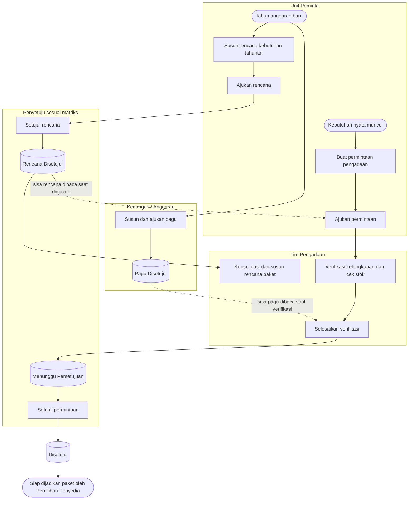

# Perencanaan & Permintaan — Alur Utama

Status dokumen: `approved` (`PBJ-DEC-034`). Jalur normal saja; percabangan dan jalur gagal ada di file proses masing-masing.

| Langkah | Pelaku | Masukan | Keluaran | Bila gagal |
| --- | --- | --- | --- | --- |
| Susun dan ajukan pagu | Keuangan / Anggaran | Tahun, unit, kategori, sumber dana, nilai | Pagu `APPROVED` setelah disetujui | Pagu belum ada → PR tetap bisa diajukan, tetapi ditandai melebihi pagu |
| Susun dan ajukan rencana kebutuhan | Unit Peminta | Barang dari katalog, jumlah, perkiraan harga | Rencana `APPROVED` | Dikembalikan → unit memperbaiki dan mengajukan ulang |
| Konsolidasi dan rencana paket | Tim Pengadaan | Rencana berlaku semua unit | Rencana paket `APPROVED` | Lihat `konsolidasi-rencana-paket.md` |
| Buat dan ajukan PR | Unit Peminta | Barang, jumlah, alasan, sumber dana | PR `SUBMITTED` bernomor | Isian ditolak → unit melengkapi |
| Verifikasi dan cek stok | Tim Pengadaan | PR `SUBMITTED` | Kebutuhan beli per baris | Dikembalikan atau ditolak |
| Persetujuan | Penyetuju | PR `PENDING_APPROVAL` | PR `APPROVED` | Ditolak atau dikembalikan |
