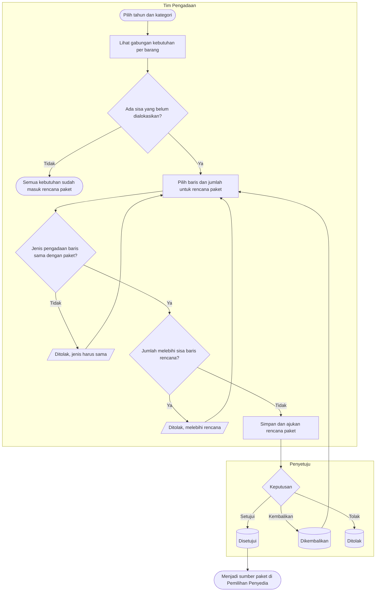

# Proses — Konsolidasi Kebutuhan dan Rencana Paket

Status dokumen: `approved` (`PBJ-DEC-034`). Keputusan: `PBJ-DEC-022`, `028`.

**Tujuan:** kebutuhan yang sama dari banyak unit dikelompokkan menjadi rencana paket, tanpa kehilangan asal
setiap unit.
**Pemicu:** rencana kebutuhan unit sudah disetujui.
**Prasyarat:** rencana berlaku (`APPROVED`) tersedia untuk tahun yang dipilih.

| Langkah | Pelaku | Masukan | Keluaran | Bila gagal |
| --- | --- | --- | --- | --- |
| Lihat gabungan | Tim Pengadaan | Tahun, kategori, jenis | Baris gabungan per barang beserta unit asal dan sisa | Tidak ada rencana berlaku → meminta unit menyelesaikan rencana |
| Alokasi ke rencana paket | Tim Pengadaan | Baris dan jumlah | Rencana paket `DRAFT` | Jenis berbeda atau melebihi sisa → memperbaiki |
| Ajukan dan setujui | Tim Pengadaan / Penyetuju | — | Rencana paket `APPROVED` | Dikembalikan → memperbaiki |
| Batalkan | Tim Pengadaan | Alasan | `CANCELLED`; alokasi dilepas | Sudah dipakai paket eksekusi → tidak bisa |

**Contoh:** rencana 2027 untuk KTL-000045 Kursi Roda Standar: IGD 3, Rawat Inap 5, Poli 22, total 30. Tim
Pengadaan membuat rencana paket "Alat Bantu Mobilitas 2027" berisi 30 unit dengan tiga baris unit asal. Bila
kemudian rencana Poli direvisi turun menjadi 20, revisi itu ditolak sampai alokasi paketnya diturunkan lebih
dulu, karena 22 unit sudah dialokasikan.
