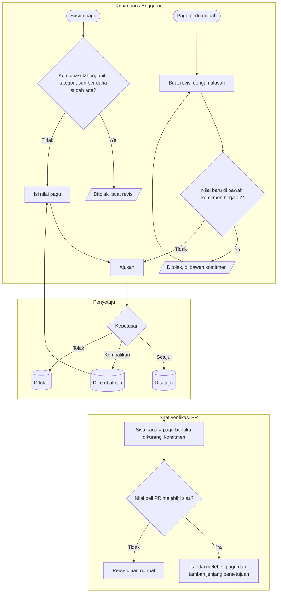

# Proses — Pagu Anggaran

Status dokumen: `approved` (`PBJ-DEC-034`). Keputusan: `PBJ-DEC-009`, `030`. Siklus pagu **[DIKONFIRMASI `PBJ-DEC-033`, `G-05`]**.

**Tujuan:** setiap unit tahu batas belanja per kategori dan sumber dana, dan setiap PR yang melebihinya
terlihat dan mendapat jenjang persetujuan tambahan.
**Pemicu:** penyusunan anggaran tahunan atau perubahan anggaran.
**Prasyarat:** kategori dan sumber dana aktif.

| Langkah | Pelaku | Masukan | Keluaran | Bila gagal |
| --- | --- | --- | --- | --- |
| Susun pagu | Keuangan | Tahun, unit, kategori, sumber dana, nilai | Pagu `DRAFT` | Kombinasi sudah ada → membuat revisi |
| Ajukan dan setujui | Keuangan / Penyetuju | — | Pagu `APPROVED` berlaku | Dikembalikan → memperbaiki |
| Revisi | Keuangan | Alasan, nilai baru | Versi baru; komitmen tetap menempel | Di bawah komitmen → ditolak |
| Uji PR | Sistem saat verifikasi | Nilai beli per kategori | Tanda melebihi pagu dan jumlah kelebihan | Pagu tidak ada → dianggap sisa 0, PR tetap diproses dengan tanda |

**Contoh:** pagu Radiologi 2027 kategori Alat Medis, sumber Investasi = Rp 500 juta, komitmen Rp 470 juta, sisa
Rp 30 juta. PR baru senilai Rp 45 juta mendapat tanda "Melebihi pagu Rp 15.000.000" dan langkah Direktur
Keuangan. Pagu **tidak** berkurang saat PR disetujui. Komitmen baru tercatat saat penetapan vendor di
`pemilihan-penyedia`.
