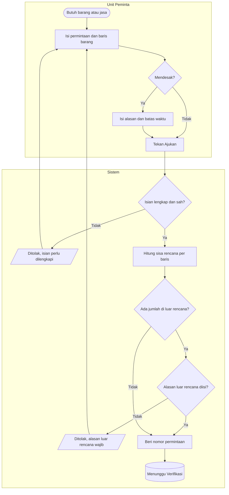
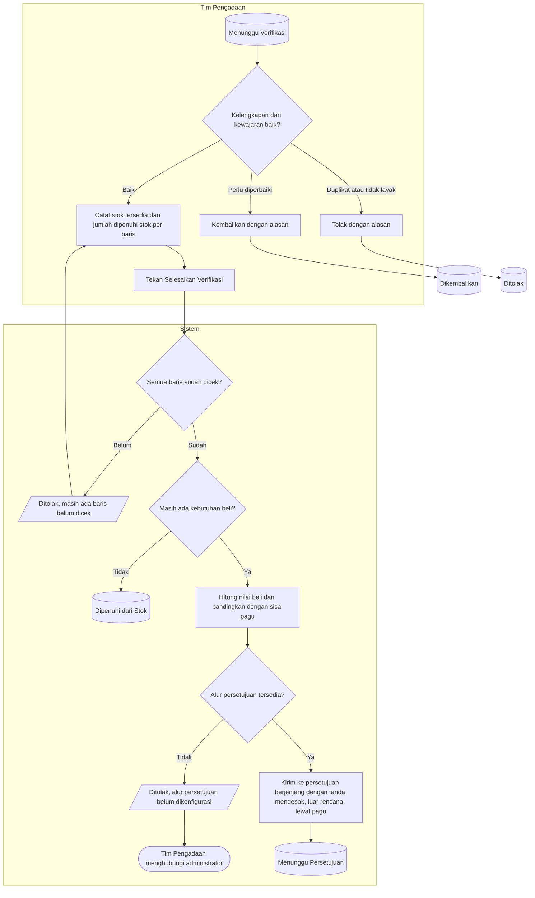
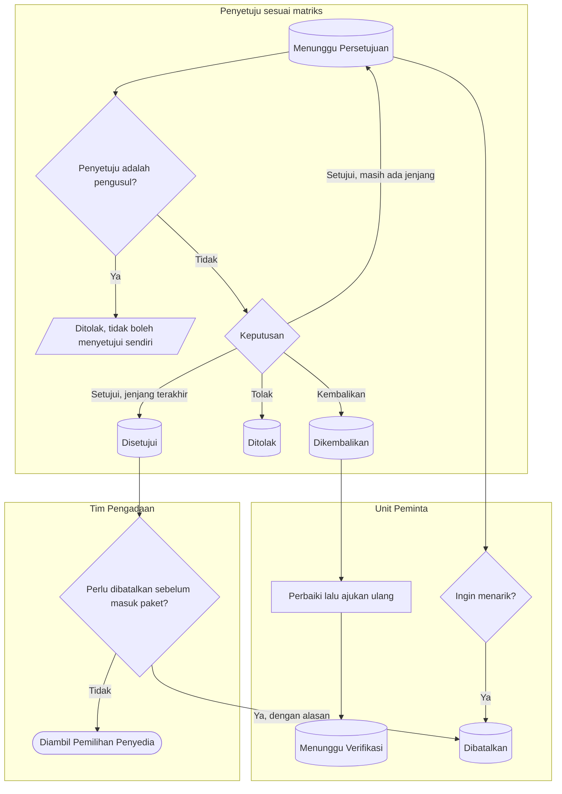

# Proses — Pengajuan, Verifikasi, dan Persetujuan PR

Status dokumen: `approved` (`PBJ-DEC-034`). Keputusan: `PBJ-DEC-008`, `014`, `016`, `027`, `029`, `030`.

**Tujuan:** kebutuhan unit menjadi permintaan yang terverifikasi dan disetujui atas nilai yang benar-benar
akan dibeli.
**Pemicu:** unit membutuhkan barang/jasa.
**Prasyarat:** pengusul punya penempatan aktif di unit; barang ada di katalog; alur persetujuan `PBJ-PR`
sudah dikonfigurasi.

## 1. Pengajuan

## 2. Verifikasi dan cek stok

## 3. Persetujuan dan pembatalan

## 4. Tabel langkah

| Langkah | Pelaku | Masukan | Keluaran | Bila gagal |
| --- | --- | --- | --- | --- |
| Isi permintaan | Unit Peminta | Unit, tahun, sumber dana, tanggal dibutuhkan, alasan, baris barang | PR `DRAFT` | — |
| Ajukan | Unit Peminta | PR `DRAFT`/`RETURNED` | PR `SUBMITTED` bernomor; pembagian dalam/luar rencana per baris | Melengkapi isian yang disebut pesan, lalu mengajukan ulang |
| Kembalikan | Tim Pengadaan | Alasan | PR `RETURNED` | — |
| Tolak | Tim Pengadaan | Alasan | PR `REJECTED`, final | Unit membuat PR baru bila masih perlu |
| Catat cek stok | Tim Pengadaan | Stok tersedia, dipenuhi stok, catatan sumber | Kebutuhan beli per baris | Memperbaiki angka yang melebihi stok atau permintaan |
| Selesaikan verifikasi | Tim Pengadaan | Semua baris tercek | `FULFILLED_FROM_STOCK` atau `PENDING_APPROVAL` | Belum dicek → melengkapi; alur belum ada → menghubungi administrator, PR tetap `SUBMITTED` |
| Persetujuan | Penyetuju | Tugas di kotak masuk | `APPROVED`, `REJECTED`, atau `RETURNED` | Pengusul tidak dapat menyetujui sendiri; tugas diarahkan ke penyetuju lain sesuai matriks |
| Tarik | Unit Peminta | PR `PENDING_APPROVAL` | `CANCELLED` | Bila approval sudah final, penarikan ditolak |
| Batal setelah disetujui | Tim Pengadaan | Alasan | `CANCELLED`; sisa rencana kembali | Sudah masuk paket → tidak bisa dari sini |

**Hasil akhir:** PR `APPROVED` dengan nilai beli yang tercatat dan jejak siapa menyetujui pada jenjang apa,
atau PR yang selesai dari stok tanpa pembelian.
