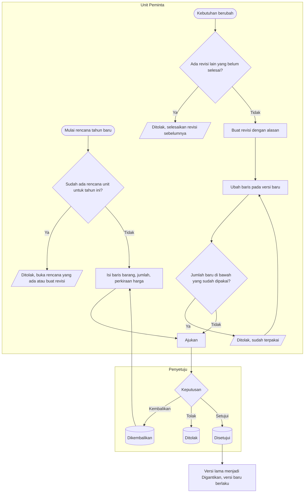

# Proses — Rencana Kebutuhan Tahunan dan Revisi

Status dokumen: `approved` (`PBJ-DEC-034`). Siklus rencana **[DIKONFIRMASI `PBJ-DEC-033`, `G-05`]**.

**Tujuan:** setiap unit punya satu rencana kebutuhan berlaku per tahun, dengan perubahan yang tercatat
sebagai versi.
**Pemicu:** awal penyusunan anggaran tahunan, atau perubahan kebutuhan di tengah tahun.
**Prasyarat:** barang ada di katalog.

| Langkah | Pelaku | Masukan | Keluaran | Bila gagal |
| --- | --- | --- | --- | --- |
| Buat rencana | Unit Peminta | Tahun, unit | Rencana `DRAFT` versi 1 | Sudah ada → membuka rencana yang ada |
| Ajukan | Unit Peminta | Minimal satu baris | `PENDING_APPROVAL`, nomor `RKB` | Melengkapi baris |
| Buat revisi | Unit Peminta / Tim Pengadaan | Alasan revisi | Versi baru `DRAFT`, baris disalin dengan kunci baris yang sama | Revisi lain masih berjalan → menyelesaikannya dulu |
| Turunkan jumlah | Unit Peminta | Jumlah baru | — | Di bawah pemakaian PR atau rencana paket → ditolak |
| Disetujui | Penyetuju | — | Versi baru berlaku, versi lama `SUPERSEDED` | — |

**Contoh revisi:** rencana IGD 2027 v1 berisi 10 monitor; 6 sudah dipakai PR. Revisi v2 menaikkan menjadi
12. Setelah disetujui, sisa = 12 − 6 = 6. PR yang merujuk baris ini tetap tertaut, karena kunci barisnya sama.

**Banding versi (2.5):** layar revisi menampilkan per baris jumlah dan nilai sebelum–sesudah, beserta alasan
revisi.
