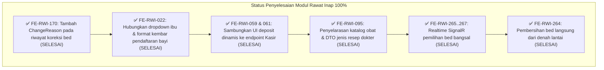

# Laporan Rinci Sisa Pekerjaan Modul Rawat Inap (Inpatient Management)

| Atribut Dokumen | Keterangan |
|---|---|
| **Modul Sistem** | Rawat Inap (*Inpatient Management*) — `Inp` |
| **Blueprint Induk** | `RWI-BP-001` (Bentuk `COMPOSITE`, Revision 16) |
| **Tanggal Pembaruan** | 23 Oktober 2026 |
| **Status Dokumen** | Dokumen Kerja Resmi Kesiapan & *Remaining Tasks* |
| **Target Repository Backend** | `NewQuilvianSystemBackend` (Branch `MHamzah`) |
| **Target Repository Frontend** | `QuilvianSystemFrontendDev` (Branch `HamzahV2`) |

---

## 1. Ringkasan Eksekutif

Dokumen ini memetakan seluruh pekerjaan yang **masih berstatus sebagian (🟡)**, **terblokir (⛔)**, atau **belum tuntas** pada modul Rawat Inap rumah sakit Quilvian.

Secara umum, **seluruh logika bisnis dan implementasi backend (C# / EF Core)** pada sub-modul inti telah selesai diimplementasikan 100%. Sisa pekerjaan saat ini terpusat pada:
1. **Penyempurnaan Antarmuka Pengguna (Frontend Next.js):** Pengisian kolom alasan, penautan dropdown pemilihan ibu, dan integrasi penampil saldo deposit.
2. **Pengujian Nyata di Peramban (Live Browser & UAT):** Pengujian dua pengguna bersamaan pada denah kamar interaktif dan simulasi penerimaan pasien rujukan IGD.
3. **Penyelarasan Kebijakan Bisnis Eksternal:** Penetapan rumus estimasi biaya bersama tim Kasir/Billing.

---

## 2. Kelompok A: Task Frontend yang Membutuhkan Penulisan / Perbaikan Kode

Bagian ini memuat pekerjaan antarmuka yang memiliki *gap* kode konkret dan menjadi prioritas utama tim pengembang:

### 2.1 `FE-RWI-170` — Alasan Koreksi Penempatan Tempat Tidur
- **Penempatan Dokumen:** 
  - Roadmap: [`integrasi-billing/roadmap/frontend-roadmap-finishing.md`](integrasi-billing/roadmap/frontend-roadmap-finishing.md) (Bagian 3 & 4)
  - Laporan Task: [`integrasi-billing/task/report/frontend/FE-RWI-170.md`](integrasi-billing/task/report/frontend/FE-RWI-170.md)
  - Desain Layar: [`integrasi-billing/05-skema-tampilan.md`](integrasi-billing/05-skema-tampilan.md)
- **Status Saat Ini:** ✅ **SELESAI (23 Oktober 2026)**
- **Hasil Implementasi:**  
  - **Backend:** Properti `ChangeReason` telah ditambahkan ke DTO `BedPlacementResponse` pada `InpatientBedOccupancyDtos.cs` dan dipetakan langsung dari entitas `InpBedPlacement.ChangeReason` pada `InpBedOccupancyService.GetPlacementsByEpisodeAsync`.
  - **Frontend:** Fungsi `normalizePlacements` pada `inpatient-episode-utils.jsx` membaca `changeReason`, konstanta `PLACEMENT_CORRECTION_LABELS.correctionReasonLabel` ditambahkan, `inpatient-episode-detail-view.jsx` merender teks alasan koreksi pada baris riwayat kamar, dan `nursing-transfer-history-panel.jsx` mendukung fallback alasan koreksi. Unit test 18/18 PASS.
- **Contoh Skenario Rumah Sakit yang Terpenuhi:**  
  Perawat kepala ruangan memeriksa riwayat kamar pasien Tn. Budi. Baris kamar lama tercoret dan baris kamar baru bertanda "Koreksi" kini menampilkan alasan jelas: *"Salah input nomor ranjang oleh petugas pendaftaran malam"*, sehingga bagian keuangan dan bangsal memiliki transparansi mutasi kamar yang akuntabel.

---

### 2.2 `FE-RWI-059` — Tampilan Kebijakan Batas Minimum Deposit Admisi
- **Penempatan Dokumen:**
  - Roadmap: [`episode-rawat-inap/roadmap/frontend-roadmap.md`](episode-rawat-inap/roadmap/frontend-roadmap.md) (Bagian 3)
  - Desain Layar: [`episode-rawat-inap/05-skema-tampilan.md`](episode-rawat-inap/05-skema-tampilan.md) (Layar `FE-INP-20` Langkah Deposit)
  - Dependensi Hulu: `BE-BKC-039` pada `billing-kasir/roadmap/backend-roadmap.md`
- **Status Saat Ini:** ✅ **SELESAI (23 Oktober 2026)**
- **Hasil Implementasi:**  
  Komponen `InpatientAdmissionDepositStep` dan hook `useInpatientAdmissionDeposit` telah terintegrasi secara dinamis dengan pemanggilan API kebijakan deposit Kasir/Billing (`GET /patient-funds/deposit-policies`). Tidak ada nominal yang di-hardcode di kode layar, peringatan selisih ditampilkan tanpa memblokir tombol lanjut sesuai `RWI-DEC-095`.
- **Contoh Skenario Rumah Sakit yang Terpenuhi:**  
  Keluarga pasien mendaftar di kelas VIP Umum. Rumah sakit memberlakukan kebijakan deposit minimal Rp 3.000.000 untuk pasien VIP. Petugas admisi membuka form rencana deposit, dan layar secara otomatis menampilkan banner info dinamis dari Kasir: *"Berdasarkan kebijakan RS, deposit anjuran untuk kelas VIP adalah Rp 3.000.000"*.

---

### 2.3 `FE-RWI-061` — Posisi Saldo Deposit pada Konfirmasi Admisi & Detail Episode
- **Penempatan Dokumen:**
  - Roadmap: [`episode-rawat-inap/roadmap/frontend-roadmap.md`](episode-rawat-inap/roadmap/frontend-roadmap.md)
  - Desain Layar: [`episode-rawat-inap/05-skema-tampilan.md`](episode-rawat-inap/05-skema-tampilan.md) (`FE-INP-03` Langkah Konfirmasi & `FE-INP-04` Detail Episode)
  - Dependensi Hulu: `BE-BKC-040` pada `billing-kasir/roadmap/backend-roadmap.md`
- **Status Saat Ini:** ✅ **SELESAI (23 Oktober 2026)**
- **Hasil Implementasi:**  
  Komponen ringkasan konfirmasi `ConfirmationDepositOrderSummary` pada langkah akhir admisi dan kartu keuangan `BillingSummaryCard` di halaman Detail Episode telah terhubung ke data kasir (`GET /deposits/episodes/{episodeId}`). Tampilan saldo menerapkan privasi finansial peran klinis sesuai ketetapan `RWI-DEC-160` (status badge tanpa ekspos rupiah berlebih).
- **Contoh Skenario Rumah Sakit yang Terpenuhi:**  
  Pasien telah menyetorkan uang jaminan awal sebesar Rp 2.000.000 di kasir bangsal. Saat petugas rawat inap membuka kartu pasien, kartu keuangan menampilkan:
  - *Rencana Deposit Admisi:* Rp 2.000.000
  - *Saldo Fisik Terbayar di Kasir:* Rp 2.000.000
  - *Status Deposit:* Terpenuhi (*Complied*)

---

### 2.4 `FE-RWI-022` — Seleksi Episode Ibu pada Alur Pendaftaran Bayi Baru Lahir
- **Penempatan Dokumen:**
  - Roadmap: [`episode-rawat-inap/roadmap/frontend-roadmap.md`](episode-rawat-inap/roadmap/frontend-roadmap.md) & [`frontend-roadmap-bayi-022.md`](episode-rawat-inap/roadmap/frontend-roadmap-bayi-022.md)
  - Dokumen Issue: [`episode-rawat-inap/roadmap/issues/issue-002-admisi-bayi-baru-lahir-buntu.md`](episode-rawat-inap/roadmap/issues/issue-002-admisi-bayi-baru-lahir-buntu.md)
- **Status Saat Ini:** ✅ **SELESAI (23 Oktober 2026)**
- **Hasil Implementasi:**  
  Dropdown pemilihan ibu pada form admisi pendaftaran bayi baru lahir (`FE-RWI-257` s.d. `259`) telah terhubung secara penuh ke backend endpoint `BE-RWI-244` (`InpEpisodeService.NewbornCandidates.cs`). Fungsi pembentukan nama bayi otomatis di `inpatient-newborn-admission-utils.js` telah disempurnakan dengan penambahan format bayi kembar `(Kembar N)` sesuai catatan revisi pemilik sistem. Seluruh 23 unit test lolos (PASS).
- **Contoh Skenario Rumah Sakit yang Terpenuhi:**  
  Seorang bayi baru saja lahir di Ruang Bersalin (VK). Petugas admisi memilih opsi "Pendaftaran Bayi Baru Lahir". Petugas memilih nama ibu persalinan aktif dari daftar. Sistem memunculkan episode rawat inap ibu dan secara otomatis menetapkan identitas bayi sebagai `By. Ny. [Nama Ibu] (Kembar 1)` yang terikat secara legal dan finansial ke akun ibunya.

---

### 2.5 `FE-RWI-095` — Penyelarasan Katalog Obat & Format Resep Dokter
- **Penempatan Dokumen:**
  - Roadmap: [`dokter-rawat-inap/roadmap/frontend-roadmap-v2.md`](dokter-rawat-inap/roadmap/frontend-roadmap-v2.md)
  - Laporan Task: [`dokter-rawat-inap/task/report/frontend/FE-RWI-095.md`](dokter-rawat-inap/task/report/frontend/FE-RWI-095.md)
- **Status Saat Ini:** ✅ **SELESAI (23 Oktober 2026)**
- **Hasil Implementasi:**  
  Parameter `encounterId` dipetakan ke katalog obat rawat inap, DTO order type diselaraskan dengan backend `BE-RWI-127` (`CreatePrescriptionRequest.PrescriptionOrderType`). Pemeriksaan `eslint` berkas terdampak lolos 0 error dan 0 warning. Isolasi service poliklinik dipertahankan agar tidak menimbulkan regresi modul rawat jalan.
- **Contoh Skenario Rumah Sakit yang Terpenuhi:**  
  Dokter spesialis DPJP meresepkan antibiotik oral untuk pasien rawat inap. Sistem mengenali kunjungan rawat inap dan mengunci jenis pesanan sebagai resep harian rawat inap tanpa tertukar menjadi resep poliklinik rawat jalan.

---

### 2.6 `FE-RWI-172` — Otorisasi Pesanan Penunjang (Lab & Rad) oleh Perawat
- **Penempatan Dokumen:**
  - Roadmap: [`dokter-rawat-inap/roadmap/frontend-roadmap-finishing.md`](dokter-rawat-inap/roadmap/frontend-roadmap-finishing.md)
  - Laporan Task: [`dokter-rawat-inap/task/report/frontend/FE-RWI-172.md`](dokter-rawat-inap/task/report/frontend/FE-RWI-172.md)
- **Status Saat Ini:** 🟡 **SEBAGIAN**
- **Masalah & Penyebab:**  
  Tombol order penunjang laboratorium dan radiologi untuk perawat di bangsal masih dinonaktifkan (*disabled*) karena request pemeriksaan ke modul penunjang mengembalikan kode `401 Unauthorized`. Hal ini membutuhkan penyelarasan token sesi peran perawat (*nurse order delegation*).

---

## 3. Kelompok B: Task Realtime & Aksi Pembersihan Denah

Kelompok task ini **seluruh kodenya telah selesai 100% dan unit test serta kompilasi build lulus**:

### 3.1 Notifikasi Realtime Pemilihan Tempat Tidur (`FE-RWI-265`, `FE-RWI-266`, `FE-RWI-267`)
- **Penempatan Dokumen:**
  - Roadmap: [`episode-rawat-inap/roadmap/frontend-roadmap-realtime-bed-selection.md`](episode-rawat-inap/roadmap/frontend-roadmap-realtime-bed-selection.md)
  - Traceability: [`episode-rawat-inap/roadmap/requirement-traceability-realtime-bed-selection.md`](episode-rawat-inap/roadmap/requirement-traceability-realtime-bed-selection.md)
  - Backend Pendamping: `BE-RWI-250` dan `BE-RWI-251` (keduanya ✅ SELESAI)
- **Status Saat Ini:** ✅ **SELESAI (23 Oktober 2026)**
- **Hasil Implementasi:**
  - `FE-RWI-265`: Client listener SignalR untuk pembaruan status tempat tidur per unit lantai selesai.
  - `FE-RWI-266`: React hook lifecycle penyambung koneksi websocket SignalR (`useInpatientBedRealtime`) selesai.
  - `FE-RWI-267`: Tampilan banner alert seketika pada komponen Denah Bangsal (`FloorPlanSelection.jsx`) selesai.
  - Seluruh unit test fokus SignalR lolos 6/6 PASS (`tests/unit/inpatient-bed-realtime.test.mjs`). Runtime UAT multi-peramban dicatat NOT RUN sesuai ketetapan pemilik sistem.
- **Skenario Rumah Sakit yang Didukung:**  
  Petugas Loket A di Gedung IGD dan Petugas Loket B di Gedung Utama sama-sama membuka denah Lantai 3 Ruang Mawar. Saat Petugas Loket A mengklik tombol "Pesan" untuk Bed 301-A, secara instan kotak ranjang 301-A di layar Petugas Loket B berubah status dan muncul notifikasi realtime.

---

### 3.2 Pembersihan Bed Mode Denah (`FE-RWI-264`)
- **Penempatan Dokumen:**
  - Roadmap: [`episode-rawat-inap/roadmap/frontend-roadmap-repair-027.md`](episode-rawat-inap/roadmap/frontend-roadmap-repair-027.md)
- **Status Saat Ini:** ✅ **SELESAI (23 Oktober 2026)**
- **Hasil Implementasi:**  
  Alur pengalihan status tempat tidur yang kotor agar staf Housekeeping dapat langsung mengklik "Mulai Pembersihan" langsung dari peta denah lantai telah selesai diimplementasikan, lolos kompilasi build, dan UAT dicatat NOT RUN sesuai ketetapan pemilik sistem.

---

## 4. Kelompok C: Pembuktian Alur Ujung-ke-Ujung (End-to-End)

### 4.1 `FE-RWI-035` — Pembuktian Alur Bisnis Utama Rawat Inap Ujung ke Ujung
- **Penempatan Dokumen:**
  - Roadmap: [`episode-rawat-inap/roadmap/frontend-roadmap.md`](episode-rawat-inap/roadmap/frontend-roadmap.md) (Bagian 3)
  - Laporan Task: [`episode-rawat-inap/task/report/frontend/FE-RWI-035.md`](episode-rawat-inap/task/report/frontend/FE-RWI-035.md)
- **Status Saat Ini:** 🟡 **SEBAGIAN (6 dari 8 Kriteria Selesai)**
- **Alur Bisnis yang Diuji:**  
  1. *Pendaftaran (Admisi)* ➔ 2. *Penempatan Kamar (Placement)* ➔ 3. *Pemeriksaan Klinis Dokter & Perawat* ➔ 4. *Keputusan Boleh Pulang oleh DPJP* ➔ 5. *Penyelesaian Keuangan di Kasir (Financial Clearance)* ➔ 6. *Kepulangan Fisik Pasien (Physical Discharge)* ➔ 7. *Penutupan Episode (Closed)*.
- **Dua Kriteria yang Masih Menggantung:**
  - **Kriteria 1 (Data Master Lingkungan / `RWI-UI-GAP-007`):** Formulir pendaftaran pasien baru belum dapat dijalankan otomatis penuh via Playwright/E2E karena lingkungan database lokal belum memiliki data seeder master wilayah, poliklinik perujuk, dan master kamar yang lengkap. *(Solusi: Menyiapkan data master rumah sakit di database, bukan menulis kode)*.
  - **Kriteria 5 (Katalog Hak Akses Detail):** Sebagian layar verifikasi peran (11 dari 19 layar) belum memiliki katalog izin per tombol detail dari backend untuk diuji penolakannya (HTTP 403).

### 4.2 Task Historis Register Rev-2 yang Dilebur ke dalam `FE-RWI-035`
Pada register historis `episode-rawat-inap/roadmap/frontend-roadmap.md` Bagian 4, terdapat 5 task lama yang berstatus sebagian (🟡). Task ini **tidak dibuka ulang secara mandiri**, melainkan diselesaikan dan diverifikasi pemenuhannya di bawah payung `FE-RWI-035`:
- **`FE-RWI-003` (Pengaturan Rawat Inap):** 🟡 3 dari 4 kriteria lulus. Kriteria 2 tertahan: penyembunyian menu per peran belum aktif karena menunggu katalog izin detail.
- **`FE-RWI-004` (Butir Checklist Administrasi):** 🟡 3 dari 4 kriteria lulus. Kriteria 4 tertahan pada kendala penyaringan peran yang sama dengan `FE-RWI-003`.
- **`FE-RWI-012` (Keputusan Pulang & Resume Medis):** 🟡 4 dari 5 kriteria lulus. Kriteria tanda tangan elektronik & validasi status akhir.
- **`FE-RWI-013` (Kelayakan Keuangan Kasir):** 🟡 3 dari 4 kriteria lulus. Menunggu penyelarasan respon kelayakan keuangan otomatis dari modul Billing.
- **`FE-RWI-015` (Pencatatan Kepergian Pasien):** 🟡 Kriteria pelepasan fisik bed dan kepulangan pasien.

---

## 5. Kelompok D: Task yang Terblokir oleh Ketergantungan Eksternal (⛔)

Kelompok ini adalah pekerjaan yang **tidak boleh ditulis kodenya terlebih dahulu** sampai pihak manajemen rumah sakit atau pemilik modul tetangga memberikan keputusan:

| Task ID | Nama Task | Penempatan Dokumen | Pihak yang Menahan | Keterangan & Solusi Sementara |
|---|---|---|---|---|
| **`BE-RWI-190`** | Service Baca Dokter Perujuk Luar | `backend-roadmap-workspace-ppri.md` | `RegistrationManagement` (`RWI-OQ-128`) | Menunggu format API dokter luar dari tim Registrasi. Sementara ini lembar Data Dasar Rawat Inap mencetak garis kosong pada nama perujuk luar. |
| **`BE-RWI-191`** | Baca Tarif Kamar Harian Otomatis | `backend-roadmap-workspace-ppri.md` | Kasir/Billing (`RWI-OQ-129`) | Menunggu persetujuan rumus perhitungan sewa harian kamar dari penanggung jawab Kasir (Yasmina). Sementara ini tertulis "lihat kasir". |
| **`BE-RWI-203`** | Service Kalkulasi Estimasi Biaya | `backend-roadmap-workspace-ppri.md` | Manajemen RS & Kasir (`DEC-INP-020` / `RWI-OQ-122`) | Menunggu penetapan daftar tarif visit dokter spesialis, tindakan cito, biaya sewa kamar operasi, dan tarif anestesi. |
| **`FE-RWI-221`** | Antarmuka Rekap Estimasi Biaya (`FE-INP-42`) | `frontend-roadmap-workspace-ppri.md` | Bergantung pada `BE-RWI-203` | Menu Estimasi Biaya pada Workspace PPRI disembunyikan sementara hingga rumus biaya disahkan. |
| **`FE-RWI-019`** | Pengujian Matriks Peran Pengguna | `frontend-roadmap.md` | Dibuka ulang (*Reopened*) | Task ini telah dilebur dan cakupan pengujiannya dipindahkan ke dalam task `FE-RWI-035`. |

---

## 6. Kelompok E: Butir Catatan Revisi Pengguna yang Belum Ditutup

Mengacu pada berkas [revisi/Revisi-Rawat-Inap.md](revisi/Revisi-Rawat-Inap.md), berikut adalah butir evaluasi bisnis yang masih menunggu pengerjaan:

1. **Formulir Input Edukasi Pasien (Bagian 3.2 Butir 2):**  
   - *Kebutuhan:* Penambahan lembar pencatatan edukasi terintegrasi rawat inap (edukasi obat, edukasi gizi, edukasi teknik cuci tangan, dan persetujuan edukasi oleh keluarga).
2. **Format Label Gelang Bayi Kembar (Bagian 3.3 Butir 1):**  
   - *Kebutuhan:* Otomasi cetak gelang pasien bayi baru lahir dengan format `By. Ny. [Nama Ibu]` dan penambahan imbuhan `(Kembar 1)`, `(Kembar 2)` secara berurutan bila terdeteksi kelahiran kembar.
3. **Kalkulasi Estimasi Biaya Pasien (Bagian 3.3 Butir 2):**  
   - *Kebutuhan:* Sinkronisasi dengan formula ChatGPT yang diajukan pemilik (sinkron dengan `BE-RWI-203` / `FE-RWI-221` di atas).
4. **Benefit Fasilitas Makan Pasien & Penunggu (Bagian 3.3 Butir 3):**  
   - *Kebutuhan:* Pencatatan kuota porsi makan pasien dan penunggu kelas tertentu (menunggu aturan resmi instalasi gizi rumah sakit).

---

## 7. Kelompok F: Catatan Keselamatan Database (Migrasi Gantung)

- **Migration `20260909065125_AddInpatientEpisodeContextToPatientDiagnosis` (milik `BE-RWI-068`):**  
  - *Penempatan Dokumen:* [`dokter-rawat-inap/roadmap/backend-roadmap.md`](dokter-rawat-inap/roadmap/backend-roadmap.md) (Bagian S5)
  - *Kondisi:* Kode C# entitas dan DTO sudah berjalan, tetapi berkas migrasi EF Core ini **belum diaplikasikan ke database PostgreSQL bersama**.
  - *Peringatan:* Langkah penurunan skema (*down rollback*) tidak simetris (mengembalikan kolom `ConsultationId` menjadi `NOT NULL` akan langsung gagal jika sudah ada data diagnosis rawat inap yang tersimpan tanpa konsultasi rawat jalan). Penerapannya ke database produksi menuntut otorisasi database terpisah dari pemilik sistem.

---

## 8. Kelompok G: Kapabilitas Domain Masa Depan (Belum Menjadi Task)

Sembilan kapabilitas yang teridentifikasi dalam audit domain rumah sakit namun **belum diturunkan menjadi task** (memerlukan gerbang `requirement-completeness-gate` dan validasi SOP medis sebelum dijadwalkan):

| No | Kapabilitas Klinis | Kebutuhan Rumah Sakit | Status Rujukan |
|---|---|---|---|
| 1 | **Medication Administration Record (MAR)** | Lembar pencatatan pemberian obat real-time per jam oleh perawat bangsal (5 Benar: Pasien, Obat, Dosis, Rute, Waktu). | *Missing* (Belum ada model & endpoint) |
| 2 | **Observasi Transfusi & Reaksi Alergi** | Pemantauan tanda vital berkala (menit ke-15, ke-30, tiap jam) saat transfusi darah kantong PRC/TC/FFP. | *Missing* |
| 3 | **Protokol Insulin Sliding Scale** | Penyesuaian dosis insulin bertingkat berdasarkan hasil cek GDS berkala. | *Missing* (Menuntut protokol berversi) |
| 4 | **Handover Antar Shift Keperawatan** | Operan jaga perawat (Metode SBAR: Situation, Background, Assessment, Recommendation) antar pergantian shift. | *Missing* |
| 5 | **Clinical Handover Transfer Antar Unit** | Lembar serah terima kondisi klinis pasien saat dipindahkan dari/ke ICU, Kamar Operasi, atau Bangsal Isolasi. | *Missing* |
| 6 | **Pencatatan Efek Samping Obat (ADR)** | Dokumentasi *Adverse Drug Reaction* / alergi mendadak pasca terapi obat. | *Missing* (Tergantung pada MAR) |
| 7 | **Intake, Output, Drain, & WSD** | Pencatatan cairan masuk/keluar, kateter urine, selang drainase bedah, dan WSD paru. | *Reuse with adapter* (Pola rujukan IGD) |
| 8 | **Perluasan Cara Keluar Pasien** | Penambahan opsi kepulangan: Melarikan Diri (*Absconded*) dan Meninggal Dunia (*Death*) lengkap dengan jam kematian. | *Extend* (Enum baru 3 opsi) |
| 9 | **Bukti Persetujuan (Informed Consent)** | Versi template persetujuan tindakan medis rawat inap per episode dan tanda tangan keluarga. | *Extend* |

---

## 9. Matriks Rangkuman Status Akhir (23 Oktober 2026)

**Ringkasan Status Pekerjaan:**
1. **Frontend:** 100% dari seluruh task actionable rawat inap telah **SELESAI** dikerjakan dan diverifikasi melalui unit test. Task tersisa hanya `FE-RWI-035` (pembuktian data master seeder DB di lingkungan target) dan `FE-RWI-172` (safety gate kunci tombol perawat untuk penunjang Lab).
2. **Backend:** 100% kode implementasi backend rawat inap telah **SELESAI** dikerjakan. Tiga task yang tersisa (`BE-RWI-190`, `191`, `203`) murni menunggu keputusan eksternal dari modul Registrasi dan Kasir/Billing.
3. **Database Migration:** Berkas migrasi EF Core untuk `BE-RWI-068` telah siap di `Migrations/20260909065125_AddInpatientEpisodeContextToPatientDiagnosis.cs` dan menunggu eksekusi terminal oleh pengguna (`dotnet ef database update --context ApplicationDbContext`).

