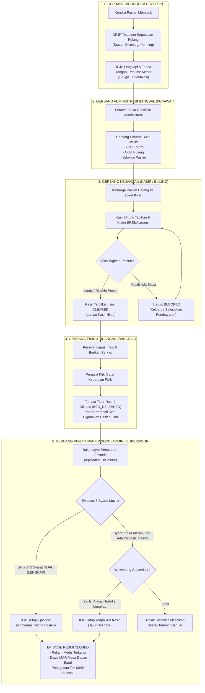
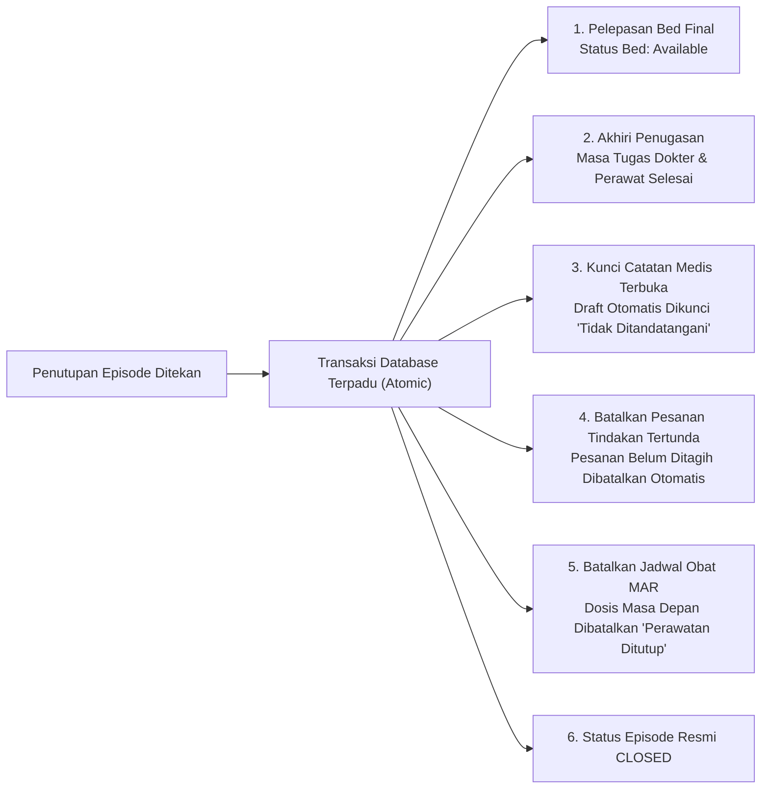

# Panduan & Tutorial Praktis: Tata Cara Penutupan Episode Pasien Rawat Inap
## Sistem Informasi Rumah Sakit Quilvian (Quilvian Health System)

---

## Daftar Isi
1. [Pendahuluan & Gambaran Umum](#1-pendahuluan--gambaran-umum)
2. [Kamus Istilah & Peran Pengguna](#2-kamus-istilah--peran-pengguna)
3. [Diagram Alur Proses Bisnis Penutupan Episode](#3-diagram-alur-proses-bisnis-penutupan-episode)
4. [Tutorial Langkah demi Langkah (Step-by-Step)](#4-tutorial-langkah-demi-langkah-step-by-step)
   - [Langkah 1: Dokter DPJP Menetapkan Keputusan Pulang](#langkah-1-dokter-dpjp-menetapkan-keputusan-pulang)
   - [Langkah 2: Dokter DPJP Mengisi dan Menandatangani Resume Medis Pulang (E-Sign)](#langkah-2-dokter-dpjp-mengisi-dan-menandatangani-resume-medis-pulang-e-sign)
   - [Langkah 3: Perawat Menyelesaikan Checklist Butir Administrasi Bangsal](#langkah-3-perawat-menyelesaikan-checklist-butir-administrasi-bangsal)
   - [Langkah 4: Bagian Kasir / Billing Menerbitkan Izin Pulang (Financial Clearance)](#langkah-4-bagian-kasir--billing-menerbitkan-izin-pulang-financial-clearance)
   - [Langkah 5: Perawat Mencatat Kepergian Fisik & Pelepasan Tempat Tidur](#langkah-5-perawat-mencatat-kepergian-fisik--pelepasan-tempat-tidur)
   - [Langkah 6: Evaluasi 5 Syarat Mutlak pada Layar Penutupan Episode](#langkah-6-evaluasi-5-syarat-mutlak-pada-layar-penutupan-episode)
   - [Langkah 7: Eksekusi Resmi Penutupan Episode (Close Episode)](#langkah-7-eksekusi-resmi-penutupan-episode-close-episode)
   - [Langkah 8: Prosedur Khusus Supervisor — Tutup Tanpa Izin Kasir (Override)](#langkah-8-prosedur-khusus-supervisor--tutup-tanpa-izin-kasir-override)
5. [Tindakan Otomatis Sistem Pasca Penutupan (Side Effects)](#5-tindakan-otomatis-sistem-pasca-penutupan-side-effects)
6. [Simulasi Kasus Nyata: Pemulangan Pasien Ny. Siti Rahmawati](#6-simulasi-kasus-nyata-pemulangan-pasien-ny-siti-rahmawati)
7. [Tanya Jawab & Pemecahan Masalah (Troubleshooting & FAQ)](#7-tanya-jawab--pemecahan-masalah-troubleshooting--faq)
8. [Spesifikasi Teknis Endpoint API (Bergaya Swagger)](#8-spesifikasi-teknis-endpoint-api-bergaya-swagger)

---

## 1. Pendahuluan & Gambaran Umum

Dalam sistem rumah sakit modern Quilvian, **Episode Rawat Inap (`InpEpisode`)** merepresentasikan satu rangkaian utuh masa rawat pasien di bangsal—dimulai sejak pendaftaran admisi (*Check-in*), pemanfaatan tempat tidur, pemeriksaan harian oleh dokter, tindakan keperawatan, konsumsi obat, hingga kepulangan pasien.

### Mengapa Penutupan Episode Sangat Penting?
1. **Kepastian Rekam Medis**: Mengunci seluruh berkas klinis agar sah secara medikolegal dan tidak dapat dimanipulasi atau disunting susulan.
2. **Keutuhan Finansial & Akuntansi**: Memastikan tidak ada pelayanan medis yang lolos dari buku tagihan (*Billing Folio*), serta memastikan tanggungan pasien (tunai, BPJS, atau asuransi) sudah dihitung lunas.
3. **Efisiensi Tempat Tidur (Bed Management)**: Tempat tidur yang sudah tidak digunakan pasien resmi dilepaskan ke status *Tersedia / Menunggu Pembersihan* sehingga pasien antrean admisi atau IGD dapat segera menempatinya.
4. **Pencegahan Anomali Sistem**: Menghentikan penugasan dokter/perawat aktif, membatalkan dosis obat terjadwal masa depan di lembar MAR, dan membatalkan pesanan tindakan yang belum sempat dikerjakan.

> [!IMPORTANT]
> **Prinsip Keselamatan Gerbang Berlapis Quilvian**:
> Tombol "Tutup Episode" **bukan sekadar tombol biasa**. Sistem tidak mengizinkan penutupan sembarangan jika salah satu gerbang keselamatan medis, administrasi, atau finansial belum tuntas.

---

## 2. Kamus Istilah & Peran Pengguna

### Kamus Istilah
| Istilah | Keterangan untuk Pengguna |
| :--- | :--- |
| **`InpEpisode` (Episode Rawat Inap)** | Satu kurun waktu perawatan pasien di instalasi rawat inap. |
| **`DischargePending`** | Status episode saat dokter sudah menyatakan pasien boleh pulang, namun proses administrasi dan kasir masih berjalan. |
| **`CLOSED`** | Status akhir episode yang menandakan seluruh kewajiban klinis dan administrasi selesai 100%. |
| **DPJP** | Dokter Penanggung Jawab Pelayanan yang memegang otoritas klinis atas pasien. |
| **Resume Medis Pulang (*Discharge Summary*)** | Ringkasan riwayat medis kepulangan pasien yang wajib ditandatangani dokter secara elektronik (*E-Sign*). |
| **Clearance Checklist** | Daftar periksa administrasi bangsal (surat kontrol, edukasi obat, surat keterangan). |
| **Financial Clearance (Izin Kasir)** | Surat izin kelayakan dari kasir yang menyatakan tagihan telah lunas (`CLEARED`). |
| **Auto-Reblock** | Fitur proteksi Quilvian yang otomatis mencabut izin kasir menjadi `REVOKED` jika ada tagihan baru yang masuk susulan setelah kasir menerbitkan izin. |
| **Kepergian Fisik (*Record Departure*)** | Pencatatan waktu aktual saat pasien secara fisik melangkah keluar dari ruangan rawat inap. |

### Peran Pengguna (User Roles) & Hak Akses
- **Dokter Spesialis / DPJP**: Menetapkan cara pulang (`Decide Discharge`) dan menandatangani resume medis pulang (`Sign Summary`).
- **Perawat Bangsal**: Memeriksa checklist administrasi (`Mark Clearance`) dan mencatat pasien keluar ruangan (`Record Departure`).
- **Petugas Kasir / Billing**: Memverifikasi biaya dan menerbitkan status kelayakan pembayaran (`Evaluate Clearance`).
- **Kepala Ruangan / Petugas Administrasi Rawat Inap**: Memeriksa kelengkapan 5 syarat dan mengeksekusi penutupan episode (`Close Episode`).
- **Supervisor Rawat Inap / Manajer Medis**: Memiliki wewenang menutup episode menembus syarat kasir dengan alasan tertulis resmi (`Close with Override`).

---

## 3. Diagram Alur Proses Bisnis Penutupan Episode

---

## 4. Tutorial Langkah demi Langkah (Step-by-Step)

Berikut panduan praktis yang dapat diikuti oleh staf rumah sakit melalui layar antarmuka pengguna (UI) Quilvian:

### Langkah 1: Dokter DPJP Menetapkan Keputusan Pulang
1. Masuk ke modul **Rawat Inap** (`Inpatient Management`).
2. Buka daftar episode aktif, lalu pilih pasien yang bersangkutan.
3. Klik tombol atau menu **Keputusan Pulang & Resume** (rute: `/health-services/inpatient-management/episodes/[id]/discharge`).
4. Pada panel **Keputusan Pemulangan**, pilih **Cara Pulang**:
   - `Sembuh / Perbaikan Klinis` (Pasien pulang atas izin dokter).
   - `Dirujuk ke Faskes Lain` (Memerlukan rujukan ke rumah sakit lain).
   - `Pulang Atas Permintaan Sendiri (PAPS)` (Pasien/keluarga menolak melanjutkan rawat).
   - `Meninggal Dunia`.
5. Tuliskan alasan klinis pada kolom **Alasan Keputusan Pulang** (contoh: *"Keadaan umum stabil, afebris 24 jam, trombosit 165.000/uL"*).
6. Klik tombol **Simpan Keputusan Pulang**.
   > **Hasil Sistem**: Status episode berpindah dari `Admitted` menjadi **`DischargePending`**. Pasien masih tercatat di tempat tidur kamar rawat.

---

### Langkah 2: Dokter DPJP Mengisi dan Menandatangani Resume Medis Pulang (E-Sign)
1. Pada halaman yang sama, gulir ke panel **Resume Medis Pulang (*Discharge Summary*)**.
2. Periksa isian otomatis yang disiapkan sistem (*Prefill*):
   - **Diagnosis Utama** (Wajib diisi).
   - **Diagnosis Sekunder / Komorbid**.
   - **Ringkasan Perjalanan Penyakit & Temuan Penting (Lab/Radiologi)**.
   - **Tindakan Medis yang Diberikan**.
   - **Daftar Obat Pulang & Aturan Minum**.
   - **Anjuran Istirahat & Jadwal Kontrol Ulang**.
3. Klik **Simpan Draf Resume**.
4. Setelah seluruh data medis akurat, klik tombol **Tanda Tangani Resume (E-Sign)**.
   > **Hasil Sistem**: Syarat medis ke-1 dan ke-2 kini berstatus **HIJAU / LENGKAP**. Resume terkunci permanen demi kepatuhan hukum rekam medis.

---

### Langkah 3: Perawat Menyelesaikan Checklist Butir Administrasi Bangsal
1. Perawat bangsal membuka menu **Penutupan Episode** (rute: `/health-services/inpatient-management/episodes/[id]/closure`) atau tab **Butir Administrasi**.
2. Sistem akan menampilkan daftar checklist administrasi (Clearance Checklist):
   - `Surat Kontrol Poliklinik`: Pastikan tanggal kontrol sudah ditentukan dan diserahkan ke keluarga.
   - `Salinan Resume Pulang`: Pastikan salinan cetak telah diserahkan.
   - `Edukasi Perawatan Rumah`: Pastikan edukasi gizi dan perawatan mandiri telah dipahami keluarga.
   - `Penyerahan Obat Pulang`: Pastikan obat dari apotek telah diverifikasi dan diserahterimakan.
3. Untuk setiap butir yang telah selesai, klik tombol **Tandai Butir Ini**. Anda dapat menambahkan catatan bila perlu.
   > **Hasil Sistem**: Bila semua butir wajib (*Mandatory*) sudah ditandai, indikator Syarat ke-3 (**`CLEARANCE_COMPLETE`**) akan berubah menjadi **HIJAU / SUDAH**.

---

### Langkah 4: Bagian Kasir / Billing Menerbitkan Izin Pulang (Financial Clearance)
1. Pasien atau keluarga mendatangi loket kasir rumah sakit.
2. Petugas kasir membuka menu **Billing Management** -> **Kelayakan Kepulangan Rawat Inap**.
3. Kasir memverifikasi total tagihan (sewa kamar, visite dokter, tindakan bangsal, lab, radiologi, dan resep farmasi).
4. Kasir memproses pembiayaan:
   - Klaim BPJS Kesehatan / Asuransi Swasta.
   - Pemotongan deposit uang muka (bila ada).
   - Pembayaran tunai/kartu/QRIS untuk selisih biaya (*ekses*).
5. Begitu saldo tagihan nihil (`Rp 0`) atau telah dijamin penuh pihak asuransi, kasir memproses evaluasi kelayakan.
   > **Hasil Sistem**: Status billing pasien berubah menjadi **`CLEARED`**. Di layar komputer perawat bangsal, kartu ringkasan tagihan (*Billing Summary Card*) seketika menyala **Lampu Hijau (Kasir Memberi Izin Pulang)**.

> [!WARNING]
> **Waspada Fitur Auto-Reblock**:
> Bila izin kasir sudah terbit (`CLEARED`), jangan sekali-kali menginput resep obat baru atau tindakan tambahan di sistem bangsal! Tindakan itu akan memicu *Auto-Reblock* yang seketika mencabut izin kasir kembali menjadi `REVOKED`.

---

### Langkah 5: Perawat Mencatat Kepergian Fisik & Pelepasan Tempat Tidur
1. Setelah perawat melihat izin kasir berwarna hijau, perawat melepas infus dan mempersilakan pasien meninggalkan ruangan.
2. Perawat membuka menu pemulangan pasien dan mengeklik tombol **Catat Kepergian Fisik (*Record Departure*)**.
3. Konfirmasi jam pasien keluar dari bangsal.
   > **Hasil Sistem**:
   > - Status tempat tidur seketika berubah menjadi **`BED_RELEASED`** (Tempat tidur kosong dan siap di-*booking* pasien lain di Papan Ketersediaan Bed).
   > - Sistem Billing secara presisi mengunci jam akhir sewa tempat tidur.
   > - Pemakaian alat medis bangsal yang masih berjalan otomatis dihentikan.
   > - Syarat ke-5 (**`BED_STATE_RESOLVED`**) seketika berubah menjadi **HIJAU / SUDAH**.

---

### Langkah 6: Evaluasi 5 Syarat Mutlak pada Layar Penutupan Episode
Buka layar **Penutupan Episode** (`/health-services/inpatient-management/episodes/[id]/closure`). Periksa kartu **5 Syarat Penutupan Episode**:

| No | Nama Syarat | Kode Syarat | Kriteria Pemenuhan | Status Wajib |
| :---: | :--- | :--- | :--- | :---: |
| **1** | **Keputusan Pulang DPJP** | `DISCHARGE_DECIDED` | Dokter DPJP telah memilih cara dan alasan pulang | **HIJAU** |
| **2** | **Resume Pulang Bertanda Tangan** | `SUMMARY_SIGNED` | Resume medis pulang sudah di-E-Sign oleh DPJP | **HIJAU** |
| **3** | **Checklist Administrasi Bangsal** | `CLEARANCE_COMPLETE` | Seluruh butir checklist wajib telah ditandai perawat | **HIJAU** |
| **4** | **Izin Kasir / Billing** | `FINANCIAL_CLEARED` | Kasir menerbitkan izin lunas / garansi (`CLEARED`) | **HIJAU** |
| **5** | **Keadaan Tempat Tidur Pasien** | `BED_STATE_RESOLVED` | Tempat tidur sudah dilepas atau kepergian fisik tercatat | **HIJAU** |

Jika kelima syarat sudah bertanda badge **"Sudah"** (Lampu Hijau), maka panel aksi penutupan akan menampilkan banner hijau: **"Episode Siap Ditutup"**.

---

### Langkah 7: Eksekusi Resmi Penutupan Episode (Close Episode)
1. Gulir ke bagian formulir **Tutup Episode** di bagian bawah layar penutupan.
2. (Opsional) Masukkan **Catatan Penutupan** jika ada memo serah terima khusus (misal: *"Pasien dijemput ambulans puskesmas"*).
3. Klik tombol utama berwarna biru: **Tutup Episode**.
4. Sistem akan menampilkan jendela konfirmasi (*Modal Pop-Up*):
   - Judul: *"Tutup episode rawat inap?"*
   - Pesan: *"Episode [Nama Pasien] ditutup dengan cara pulang [Cara Pulang]. Tempat tidur dilepas pada tindakan yang sama, dan penugasan DPJP beserta perawat ikut ditutup."*
5. Klik tombol penegas: **Tutup Episode**.
6. Sistem menampilkan notifikasi sukses hijau: **"Episode berhasil ditutup"**.

---

### Langkah 8: Prosedur Khusus Supervisor — Tutup Tanpa Izin Kasir (Override)
Dalam kondisi mendesak di mana pasien harus segera pulang (misal: rujukan ambulans darurat malam hari saat loket kasir perbankan tutup, atau pasien dengan jaminan sosial khusus direksi):
1. Pengguna dengan kewenangan **Supervisor Rawat Inap** (`InpatientDischarge : CloseOverride`) akan melihat panel khusus berwana kuning: **Tutup Tanpa Izin Kasir**.
2. **Aturan Ketat**:
   - Syarat 1 (Keputusan DPJP), Syarat 2 (Resume E-Sign), Syarat 3 (Checklist), dan Syarat 5 (Bed) **MUTLAK TETAP WAJIB HIJAU**.
   - Hanya Syarat 4 (Kasir) yang diizinkan untuk dilewati.
3. Masukkan **Alasan Menutup Tanpa Izin Kasir** dengan kalimat yang jelas dan formal (contoh: *"Pasien gawat dirujuk segera ke RSUP Sanglah atas persetujuan manajer medis, jaminan biaya menyusul sesuai disposisi Direksi No. 042/DIR/X/2026"*).
4. Klik tombol **Tutup tanpa izin kasir…**.
5. Konfirmasi modal pop-up yang mengingatkan bahwa episode ini akan dicatat dalam **Daftar Pantau Audit Keuangan**.
6. Klik **Tutup Tanpa Izin Kasir**.

---

## 5. Tindakan Otomatis Sistem Pasca Penutupan (Side Effects)

Ketika tombol penutupan episode berhasil diproses, sistem backend Quilvian secara otomatis mengeksekusi serangkaian proses pembersihan data dalam satu transaksi database:

1. **Pelepasan Tempat Tidur Final**: Jika tempat tidur belum sempat dilepas saat perawat mencatat kepergian, penutupan episode memastikan tempat tidur dilepaskan seketika (`InpBedPlacementEndReason.EpisodeClosed`).
2. **Penyelesaian Masa Penugasan**: Catatan riwayat penugasan dokter DPJP dan perawat jaga resmi ditutup dengan jam penutupan (`EndDateTime = Now`), sehingga tidak timbul anomali dokter masih bertanggung jawab atas pasien yang telah pulang berbulan-bulan lalu.
3. **Penguncian Catatan Medis Terbuka (*Integrity Lock*)**: Bila masih ada draft catatan dokter yang belum sempat ditandatangani, sistem otomatis menguncinya apa adanya dengan status *"Tidak Ditandatangani"*. Sistem menolak menghapus (karena menghilangkan riwayat medis) dan menolak memalsukan tanda tangan otomatis dokter.
4. **Pembatalan Pesanan Tindakan Tertunda**: Seluruh order tindakan medis rawat inap yang belum dikerjakan dan belum terbit tagihannya otomatis dibatalkan sistem.
5. **Pembatalan Dosis Masa Depan Lembar MAR**: Jadwal pemberian obat bangsal yang jatuh tempo setelah jam penutupan episode otomatis dibatalkan beralasan *"Perawatan Ditutup"*. Dosis yang sudah diberikan (*Administered*) tidak disentuh.

---

## 6. Simulasi Kasus Nyata: Pemulangan Pasien Ny. Siti Rahmawati

Untuk memperjelas panduan di atas, perhatikan simulasi kasus nyata berikut:

### Profil Pasien
- **Nama Pasien**: Ny. Siti Rahmawati (Perempuan, 45 Tahun)
- **No. Rekam Medis**: `RM-2026-04182`
- **Ruang Perawatan**: Bangsal Melati, Kamar 204, Bed 02 (Kelas 1)
- **Dokter DPJP**: dr. Ahmad Fauzi, Sp.PD
- **Penjamin Biaya**: BPJS Kesehatan (Hak Kelas 1)

---

### Kronologi Penutupan Episode:

#### Jam 08.00 WIB — Visite & Keputusan Dokter
1. dr. Ahmad Fauzi, Sp.PD melakukan visite di Bangsal Melati. Pasien pasca perawatan Tipes (Demam Tifoid) hari ke-5 sudah tidak demam dan nafsu makan baik.
2. Dokter membuka menu **Keputusan Pulang & Resume** (`/episodes/EPS-04182/discharge`).
3. Dokter memilih cara pulang: **Sembuh / Perbaikan Klinis**, lalu mengetik alasan: *"Tanda vital stabil, toleransi diet lunak baik, demam turun hari ke-3"*. Klik **Simpan**.
4. Dokter mengisi form Resume Pulang:
   - Diagnosis Utama: *Demam Tifoid (A01.0)*.
   - Terapi Pulang: *Ciprofloxacin 500 mg 2x1 tab, Paracetamol 500 mg 3x1 tab prn*.
   - Rencana Kontrol: *Poli Penyakit Dalam hari Senin depan*.
5. Dokter menekan tombol **Tanda Tangani Resume (E-Sign)**.
   * *Status di Sistem: Syarat 1 dan Syarat 2 BERUBAH MENJADI HIJAU.*

#### Jam 09.00 WIB — Verifikasi Checklist Bangsal
1. Perawat Ns. Dewi membuka menu **Penutupan Episode** -> Tab **Butir Administrasi**.
2. Ns. Dewi menyerahkan surat kontrol dan menjelaskan aturan minum obat pulang kepada keluarga Ny. Siti.
3. Ns. Dewi mencentang dan menandai butir:
   - *"Penyerahan Surat Kontrol Poliklinik"* -> Ditandai.
   - *"Edukasi Diet dan Obat Pulang"* -> Ditandai.
   - *"Pelepasan Jarum Infus"* -> Ditandai.
   * *Status di Sistem: Syarat 3 (Checklist Lengkap) BERUBAH MENJADI HIJAU.*

#### Jam 10.00 WIB — Izin Kasir Terbit
1. Suami Ny. Siti menuju Loket Billing Rawat Inap membawa berkas kepulangan.
2. Petugas kasir memproses berkas klaim BPJS Kesehatan. Seluruh biaya rawat inap dijamin penuh oleh BPJS sesuai tarif INA-CBG. Tidak ada selisih biaya pribadi (*Iur Bayar Rp 0*).
3. Kasir memproses evaluasi kelayakan pulang: **Status CLEARED**.
   * *Status di Sistem: Lampu status kasir di layar bangsal seketika BERUBAH MENJADI HIJAU (Syarat 4 LENGKAP).*

#### Jam 10.30 WIB — Pelepasan Tempat Tidur
1. Ns. Dewi melepas jarum infus Ny. Siti dan keluarga berpamitan pulang.
2. Ns. Dewi mengeklik tombol **Catat Kepergian Fisik**.
3. Jam kepergian tercatat: `10:30 WIB`.
   * *Status di Sistem: Bed Melati 204-02 langsung KOSONG di papan Bed Board. Syarat 5 BERUBAH MENJADI HIJAU.*

#### Jam 10.45 WIB — Eksekusi Tutup Episode
1. Kepala Ruangan Bangsal Melati membuka layar `/episodes/EPS-04182/closure`.
2. Kelima lampu syarat sudah menyala **HIJAU LENGKAP (5 dari 5 Terpenuhi)**.
3. Kepala Ruangan mengeklik tombol **Tutup Episode**.
4. Muncul jendela konfirmasi: *"Tutup episode rawat inap Ny. Siti Rahmawati dengan cara pulang Sembuh / Perbaikan Klinis?"*.
5. Kepala Ruangan menekan konfirmasi **Tutup Episode**.
6. **Selesai!** Status episode resmi berubah menjadi **`CLOSED`**. Seluruh riwayat perawatan Ny. Siti tersimpan aman di rekam medis digital.

---

## 7. Tanya Jawab & Pemecahan Masalah (Troubleshooting & FAQ)

### Q1: Mengapa tombol "Tutup Episode" berwarna abu-abu / tidak dapat diklik?
**Jawaban**:
Tombol Tutup Episode hanya aktif bila **kelima syarat penutupan berstatus Hijau**. Gulir ke panel *5 Syarat Penutupan Episode* dan periksa syarat mana yang masih berwarna kuning/merah:
- Jika Syarat 2 merah: Minta dokter DPJP menandatangani resume medis pulang.
- Jika Syarat 3 merah: Minta perawat mencentang seluruh butir checklist administrasi yang masih menahan (*Blocking*).
- Jika Syarat 4 merah: Pasien belum menyelesaikan administrasi di loket kasir.
- Jika Syarat 5 merah: Catat kepergian fisik pasien terlebih dahulu atau lepaskan tempat tidur.

### Q2: Kasir sudah menyatakan lunas, tetapi mengapa Syarat 4 masih berstatus "Belum / Menahan"?
**Jawaban**:
1. Pastikan kasir sudah mengeklik tombol **Evaluasi Kelayakan** dan statusnya berubah menjadi `CLEARED`.
2. Layar penutupan memperbarui status kasir setiap 10 detik. Anda dapat menekan tombol **Muat Ulang (Refresh)** pada browser atau tombol *Coba Lagi*.
3. Periksa apakah sempat ada perawat atau dokter yang menginput resep/tindakan baru setelah kasir menyatakan lunas. Jika ada, mekanisme *Auto-Reblock* telah mencabut izin kasir, sehingga kasir harus mengevaluasi ulang invoice pasien.

### Q3: Pasien memaksa pulang sendiri (PAPS) atau melarikan diri tanpa membayar, bagaimana menutupnya?
**Jawaban**:
1. Dokter DPJP tetap wajib mengisi keputusan pulang dengan cara: **Pulang Atas Permintaan Sendiri (PAPS)** dan menandatangani resume medis.
2. Perawat menandai checklist administrasi dan mencatat kepergian fisik pasien.
3. Karena tagihan belum lunas di kasir (Syarat 4 Merah), gunakan wewenang **Supervisor Rawat Inap** untuk melakukan **Tutup Tanpa Izin Kasir (Override)**.
4. Tuliskan alasan dengan jelas: *"Pasien melarikan diri / menolak membayar, berkas diteruskan ke bagian piutang hukum RS"*. Episode ini akan masuk ke daftar pantau pengawasan piutang.

### Q4: Mengapa muncul pesan kesalahan "Versi episode berubah. Muat ulang" (HTTP 409 Conflict)?
**Jawaban**:
Hal ini terjadi karena ada petugas lain (misal perawat lain atau dokter) yang baru saja memperbarui data episode tersebut pada saat yang bersamaan. Cukup segarkan (*refresh*) halaman browser Anda, periksa data terbaru, lalu lakukan penutupan kembali.

---

## 8. Spesifikasi Teknis Endpoint API (Bergaya Swagger)

Bagi pengembang sistem, integrasi backend, dan tim teknis IT rumah sakit, berikut spesifikasi API yang menangani alur penutupan episode:

### Tag Grup: `[Tags("Health Services / Inpatient Management / Inpatient Discharge")]`

| Method | Path Endpoint | Deskripsi Fungsi Bisnis | Otorisasi / Permission | Request Body Utama | Response Sukses |
| :---: | :--- | :--- | :--- | :--- | :--- |
| `POST` | `/api/v1/health-services/inpatient-management/discharges/{episodeId}/decide` | DPJP menetapkan cara dan alasan pemulangan | `InpatientDischarge : Update` *(DPJP Aktif)* | `DecideDischargeRequest` - `dischargeType` (int) - `reason` (string) | `200 OK` `InpatientEpisodeDetailResponse` |
| `GET` | `/api/v1/health-services/inpatient-management/discharges/{episodeId}/summary` | Mengambil isi resume medis pulang dan riwayat revisi | `InpatientDischarge : Read` | Query params: `includeRevisions=true` | `200 OK` `DischargeSummaryResponse` |
| `PUT` | `/api/v1/health-services/inpatient-management/discharges/{episodeId}/summary` | Menyimpan draf isi resume medis pulang | `InpatientDischarge : Update` *(DPJP Aktif)* | `UpsertDischargeSummaryRequest` - `primaryDiagnosisText` - `clinicalSummary` - dll | `200 OK` `DischargeSummaryResponse` |
| `PATCH` | `/api/v1/health-services/inpatient-management/discharges/{episodeId}/summary/sign` | Membubuhkan tanda tangan digital (E-Sign) pada resume | `InpatientDischarge : Sign` *(DPJP Aktif)* | `SignDischargeSummaryRequest` - `signatureNote` (string) | `200 OK` `DischargeSummaryResponse` |
| `GET` | `/api/v1/health-services/inpatient-management/discharges/{episodeId}/clearance` | Membaca daftar checklist administrasi bangsal | `InpatientDischarge : Read` | Tidak ada | `200 OK` `ClearanceChecklistResponse` |
| `POST` | `/api/v1/health-services/inpatient-management/discharges/{episodeId}/clearance/{itemId}/mark` | Perawat menandai butir administrasi bangsal | `InpatientDischarge : Update` | `MarkClearanceItemRequest` - `note` (string) | `200 OK` `ClearanceChecklistResponse` |
| `POST` | `/api/v1/health-services/inpatient-management/discharges/{episodeId}/record-departure` | Mencatat pasien keluar fisik & melepas tempat tidur | `InpatientDischarge : RecordDeparture` | `RecordDepartureRequest` - `departedAt` (DateTime) - `clearanceWarningAcknowledged` (bool) | `200 OK` `InpatientDepartureResponse` |
| `GET` | `/api/v1/health-services/inpatient-management/discharges/{episodeId}/closure-readiness` | Mengevaluasi status kelayakan 5 syarat penutupan | `InpatientDischarge : Read` | Tidak ada | `200 OK` `ClosureReadinessResponse` |
| `POST` | `/api/v1/health-services/inpatient-management/discharges/{episodeId}/close` | Menutup episode rawat inap resmi (5 syarat lengkap) | `InpatientDischarge : Close` | `CloseEpisodeRequest` - `expectedVersion` (int) - `note` (string) | `200 OK` `InpatientEpisodeDetailResponse` |
| `POST` | `/api/v1/health-services/inpatient-management/discharges/{episodeId}/close-with-override` | Supervisor menutup episode menembus syarat kasir | `InpatientDischarge : CloseOverride` *(Supervisor)* | `CloseEpisodeOverrideRequest` - `reason` (string, wajib) - `expectedVersion` (int) | `200 OK` `InpatientEpisodeDetailResponse` |

---

### Tag Grup: `[Tags("Health Services / Billing Management / Inpatient Clearance")]`

| Method | Path Endpoint | Deskripsi Fungsi Bisnis | Otorisasi / Permission | Request Body Utama | Response Sukses |
| :---: | :--- | :--- | :--- | :--- | :--- |
| `GET` | `/api/v1/health-services/billing-management/inpatient-clearances/encounters/{encounterId}/latest` | Membaca status izin kelayakan keuangan kasir real-time | `InpatientClearance : Read` | Tidak ada | `200 OK` `InpatientClearanceStatusView` |
| `POST` | `/api/v1/health-services/billing-management/inpatient-clearances/evaluate` | Kasir mengevaluasi pelunasan & menerbitkan status izin | `InpatientClearance : Evaluate` | `EvaluateClearanceRequest` - `encounterId` (Guid) - `reasonCode` (string) | `200 OK` `BilInpatientClearanceHandoff` |

---

*Dokumen ini merupakan pedoman resmi pengoperasian sistem modul Rawat Inap dan Billing Quilvian Health System.*
