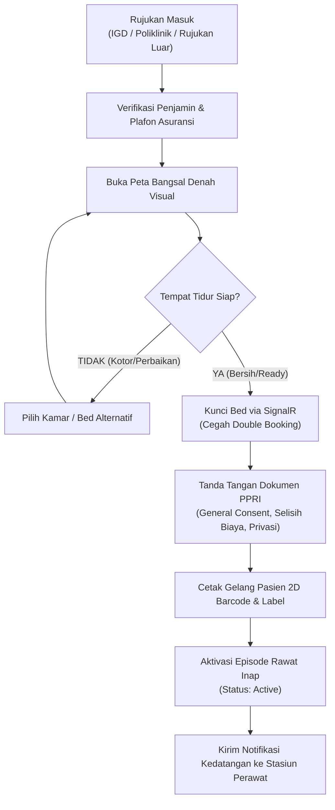
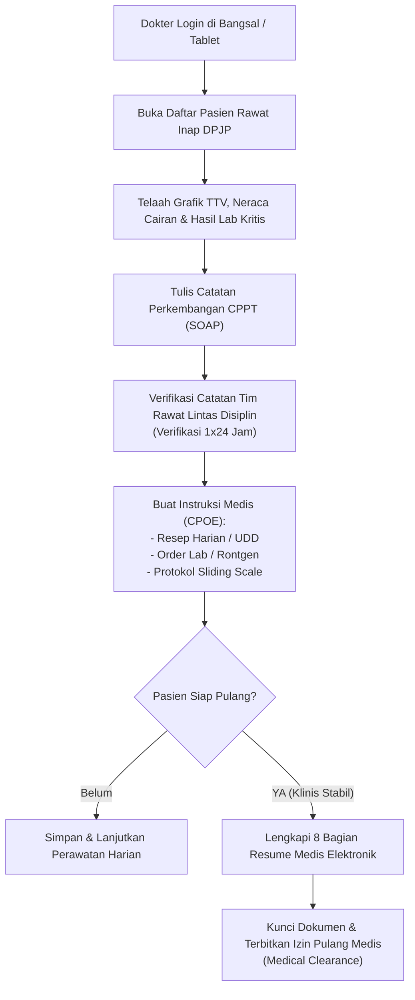
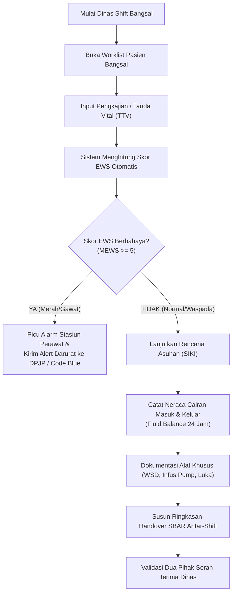
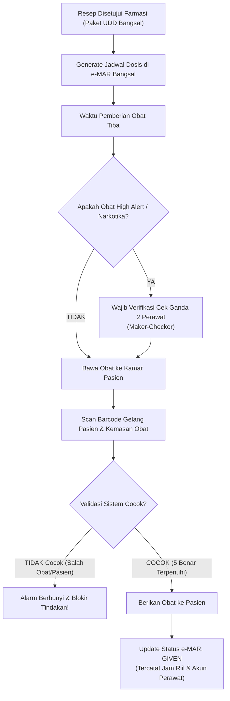
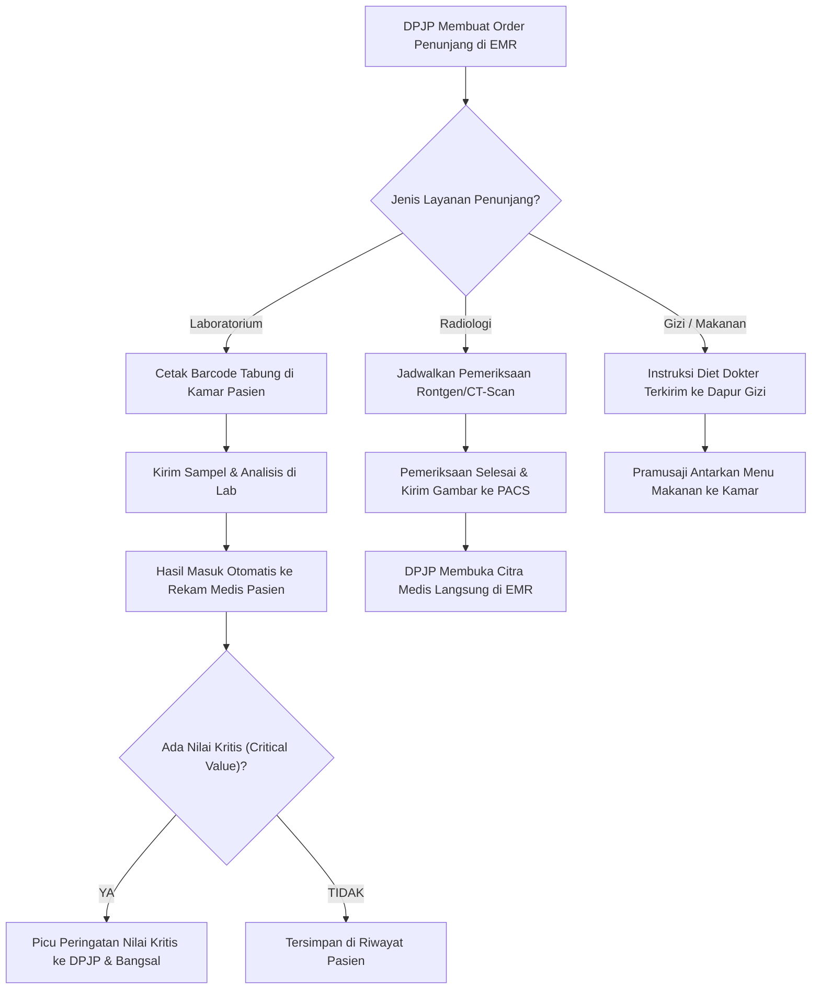
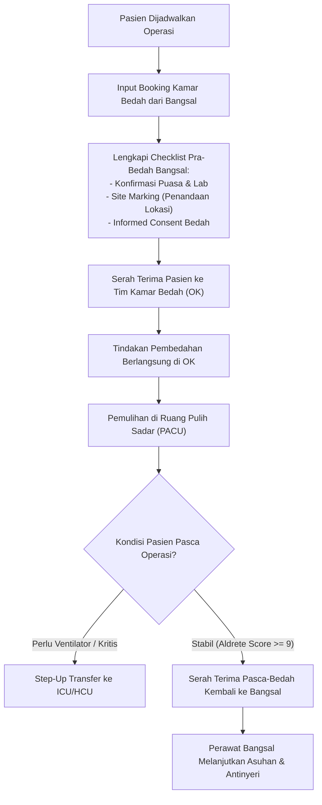
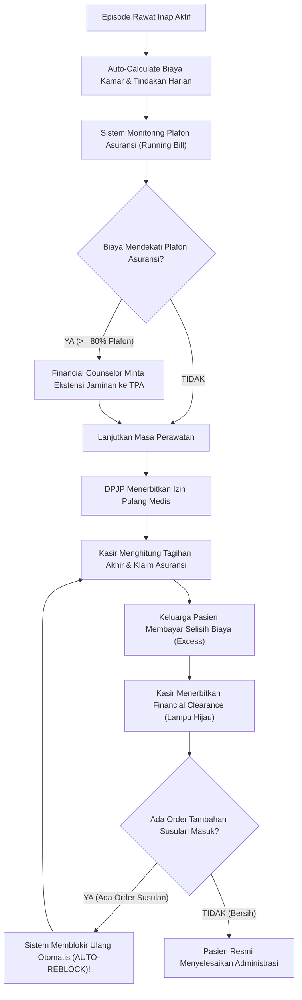
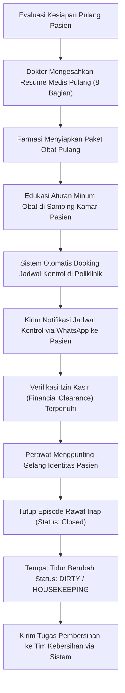

# Analisis Modul Rawat Inap Standar RS Sekelas RS MMC
## Pemetaan Sub-Modul, Bisnis Proses, Flowchart, Progres Implementasi Kode, dan Gap Analisis Menuju 100%

---

## 1. Identitas Dokumen

| Parameter | Keterangan |
|---|---|
| **Nomor Dokumen** | `DOC-RWI-MMC-001` |
| **Judul** | Analisis Komprehensif Sub-Modul Rawat Inap Berbasis Standar RS Sekelas RS MMC |
| **Lokasi Penyimpanan** | `NewQuilvianSystemBackend/docs/Modul-RS/Rawat-Inap/07-analisis-sub-modul-rawat-inap-standar-rs-mmc.md` |
| **Target Acuan** | Standar Operasional RS Swasta Kelas B/A Utama (Benchmark: RS MMC Jakarta / JCI / KARS Paripurna) |
| **Dasar Penilaian Kode** | Snapshot Implementasi Quilvian Backend (`NewQuilvianSystemBackend@MHamzah`) & Frontend (`QuilvianSystemFrontendDev@HamzahV2`) |
| **Status Dokumen** | **FINAL — Panduan Arsitektur Bisnis & Roadmap Penyempurnaan** |

---

## 2. Ringkasan Eksekutif

Modul Rawat Inap (*Inpatient Management System*) pada ekosistem rumah sakit swasta kelas utama seperti **RS MMC (Metropolitan Medical Centre Jakarta)** memiliki standar operasional yang berorientasi pada **kecepatan layanan eksekutif, akurasi keselamatan pasien (*Patient Safety Goals*), integrasi asuransi komersial/korporat yang ketat, serta efisiensi waktu pemulangan (*Discharge SLA*)**.

Sistem dipecah menjadi **8 Sub-Modul Fungsional Standar**. Tabel di bawah menyajikan rekapitulasi progres implementasi kode pada sistem saat ini dibandingkan dengan target standar 100% kelas RS MMC:

| No | Sub-Modul Standar Kelas RS MMC | Padanan pada Arsitektur Quilvian | Progres Kode Saat Ini | Gap Utama untuk Mencapai 100% | Prioritas Upgrade |
|:---:|---|---|:---:|---|:---:|
| **1** | **Admitting Office & Concierge Bed Management** | `episode-rawat-inap` (PPRI, Denah, Realtime Bed) | **92%** | *Paperless tablet signature* & validasi plafon awal TPA | **P1** |
| **2** | **Physician Clinical Workspace (EMR DPJP)** | `dokter-rawat-inap` (SOAP, CPPT, CPOE, Visite) | **88%** | Tampilan sentuh tablet visite & viewer PACS radiologi tersemat | **P1** |
| **3** | **Smart Ward Nursing Station** | `keperawatan` (Kajian 3S, TTV, Cairan, WSD, PPI) | **82%** | Kalkulator otomatis skor **EWS/MEWS** & lembar handover **SBAR** | **P0 (Kritis)** |
| **4** | **e-MAR & Inpatient Medication Safety** | `keperawatan` & `dokter-rawat-inap` (MAR, Sliding Scale) | **85%** | Integrasi scanner barcode fisik (*Closed-Loop BCMA*) | **P1** |
| **5** | **Inter-Service Orders & Diagnostics (CPOE)** | `dokter-rawat-inap` & `keperawatan` (Lab, Rad, Darah) | **70%** | Pemesanan menu makanan gizi (*Room Service Diet*) | **P0 (Kritis)** |
| **6** | **Perioperative & Critical Care Coordination** | `episode-rawat-inap` & `keperawatan` (Pre-Op, PACU) | **65%** | Integrasi jadwal Kamar Operasi (OK) & alur step-up ICU/HCU | **P1** |
| **7** | **Financial Counseling & Billing Clearance** | `integrasi-billing` (Outbox, Auto-Charge, Reblock) | **90%** | Dashboard *Running Bill* vs Plafon Asuransi & Interim Billing | **P1** |
| **8** | **Discharge Planning & Continuity of Care** | `episode-rawat-inap` (Resume Medis 8 Bagian, Edukasi) | **80%** | *Auto-booking* kontrol poliklinik & TTE tersertifikasi BSrE | **P2** |
| | **RATA-RATA TOTAL KESIAPAN SISTEM** | | **81.5%** | **Memerlukan 6 Penambahan Fitur untuk Mencapai 100%** | |

---

## 3. Pembahasan Mendalam per Sub-Modul

---

### SUB-MODUL 1: Admitting Office & Concierge Bed Management (Pusat Admisi & Tempat Tidur)

#### A. Deskripsi & Peran Bisnis
Sub-modul ini adalah gerbang utama pasien masuk ke rawat inap (baik dari IGD, Poliklinik Rawat Jalan, rujukan luar, maupun rujukan bedah terencana). Pada kelas RS MMC, admisi beroperasi mirip meja *concierge* hotel berbintang: memastikan pasien memperoleh kamar yang sesuai dengan preferensi kenyamanan dan hak penjaminannya, tanpa ada keterlambatan penempatan tempat tidur (*bed turnaround time*).

#### B. Alur Bisnis Proses (Tahap demi Tahap)
1. **Penerimaan Rujukan Rawat Inap:** Petugas menerima Surat Pengantar Rawat Inap (SPRI) dari dokter IGD atau dokter poliklinik via sistem.
2. **Verifikasi Hak Penjamin & Asuransi:** Petugas mengecek kelayakan asuransi (Asuransi Swasta/AdMedika/Fullerton/BPJS). Menentukan apakah plafon menutupi kelas yang diminta.
3. **Pemilihan Kamar via Denah Visual Interaktif:** Petugas dan keluarga pasien memilih kamar secara visual pada denah lantai bangsal (Suite, VIP, Kelas 1, Isolasi).
4. **Penguncian Tempat Tidur (*Real-Time Locking*):** Sistem mengunci tempat tidur tersebut dengan SignalR agar tidak dapat dipilih oleh petugas lain.
5. **Penandatanganan Dokumen PPRI Digital:** Pasien menandatangani *General Consent*, Tata Tertib, Formulir Hak Privasi, dan Surat Pernyataan Selisih Biaya (bila naik kelas) menggunakan tablet sentuh.
6. **Cetak Gelang Pasien & Label:** Sistem mencetak gelang identitas pasien (tahan air) berbarcode 2D serta stiker label spesimen.
7. **Pemberitahuan ke Bangsal:** Sistem memicu notifikasi kedatangan pasien ke stasiun perawat lantai terkait.

#### C. Diagram Alur Kerja (Flowchart)

#### D. Status Implementasi Kode Saat Ini
* **Backend:** Selesai 100% pada `episode-rawat-inap` (`InpEpisode`, `InpBedPlacement`, `InpAdmissionDocument`, SignalR hub `/hubs/queues`, `BE-RWI-250` s.d. `BE-RWI-251`).
* **Frontend:** Selesai pada `FE-BM-01` (Denah Bangsal interaktif), `FE-INP-03` (Wizard Admisi), dan `FE-INP-35` (Workspace PPRI dokumen admisi).
* **Persentase Kesiapan:** **92%**.

#### E. Kekurangan untuk Mencapai 100% Standar RS MMC
1. Belum ada kanvas tanda tangan sentuh (*paperless touch signature*) langsung di layar tablet; saat ini tanda tangan dicatat sebagai bukti fisik kertas/atestasi internal.
2. Belum ada pembacaan batas plafon asuransi otomatis saat penempatan kamar (petugas masih menghitung manual selisih tarif).

#### F. Rencana Aksi Penyempurnaan (Action Plan)
* Tambahkan komponen UI `DigitalSignaturePad` pada formulir persetujuan PPRI.
* Integrasikan master plafon penjamin di langkah pemilihan kamar untuk memunculkan estimasi selisih biaya secara otomatis.

---

### SUB-MODUL 2: Physician Clinical Workspace / EMR DPJP (Ruang Kerja Dokter Spesialis)

#### A. Deskripsi & Peran Bisnis
Ruang kerja digital khusus Dokter Penanggung Jawab Pelayanan (DPJP) dan konsulen. Dokter spesialis di RS sekelas MMC membutuhkan sistem yang ringkas dan responsif untuk ronde visite harian, pengkajian medis awal, penulisan instruksi medis (CPOE), penelaahan hasil penunjang, hingga penulisan resume pulang.

#### B. Alur Bisnis Proses (Tahap demi Tahap)
1. **Daftar Pasien Visite:** Dokter membuka daftar pasien yang dirawatnya melalui tablet saat visite pagi.
2. **Kajian Medis Awal (1x24 Jam Pertama):** Mengisi anamnesis, riwayat penyakit terdahulu, pemeriksaan fisik sistemik, diagnosis kerja ICD-10, dan sasaran perawatan.
3. **Entri CPPT Terintegrasi (SOAP):** Dokter mencatat perkembangan subjektif, objektif terkini, asesmen, dan rencana instruksi harian.
4. **Verifikasi CPPT 1x24 Jam:** DPJP utama menelaah dan membubuhkan stempel verifikasi pada catatan yang ditulis oleh dokter residen/dokter ruangan/konsulen lain.
5. **Peresepan Elektronik & CPOE:** Dokter memilih template resep harian, memasukkan instruksi diet, serta memesan pemeriksaan lab atau foto radiologi.
6. **Pemantauan Protokol Khusus:** Memeriksa grafik gula darah dan menginstruksikan dosis sliding scale insulin.
7. **Pengesahan Resume Medis Kepulangan:** Saat pasien dinyatakan stabil, dokter melengkapi dan mengunci dokumen resume medis kepulangan.

#### C. Diagram Alur Kerja (Flowchart)

#### D. Status Implementasi Kode Saat Ini
* **Backend:** Selesai 100% pada `dokter-rawat-inap` (`TrxPatientAssessment`, `TrxPatientIntegratedProgressNote`, `CliPhysicianVisit`, `PhmSlidingScaleOrder`, `BE-RWI-088` s.d. `BE-RWI-105`, `BE-RWI-160` s.d. `BE-RWI-164`).
* **Frontend:** Selesai pada `FE-DOK-09` (Ruang Kerja Dokter Rawat Inap), tab SOAP/CPPT, resep harian, dan protokol insulin.
* **Persentase Kesiapan:** **88%**.

#### E. Kekurangan untuk Mencapai 100% Standar RS MMC
1. Belum ada antarmuka yang dioptimalkan khusus layar sentuh (*mobile-responsive / tablet view*) untuk mempermudah dokter konsulen melakukan visite tanpa mouse.
2. Penampil gambar rontgen/CT-Scan (DICOM/PACS viewer) belum disematkan langsung di dalam layar CPPT dokter (dokter masih harus membuka sistem radiologi terpisah).
3. Pengecekan interaksi obat (*drug-drug interaction*) otomatis saat dokter meresepkan kombinasi obat belum aktif.

#### F. Rencana Aksi Penyempurnaan (Action Plan)
* Tambahkan mode tampilan *Tablet Card View* pada dashboard pasien visite.
* Pasang *lightweight DICOM web viewer* terintegrasi pada riwayat order radiologi.
* Hubungkan CPOE peresepan dengan mesin validasi kontraindikasi farmasi.

---

### SUB-MODUL 3: Smart Ward Nursing Station (Stasiun Perawat Bangsal Cerdas)

#### A. Deskripsi & Peran Bisnis
Pusat komando perawatan pasien 24 jam di bangsal. Sub-modul ini memastikan seluruh kebutuhan pemantauan kondisi vital pasien, keseimbangan cairan, pemberian asuhan keperawatan 3S (SDKI/SLKI/SIKI), perawatan alat medis, serta kepatuhan pencegahan infeksi rumah sakit (PPI) tercatat secara akurat dan tepat waktu.

#### B. Alur Bisnis Proses (Tahap demi Tahap)
1. **Penerimaan Shift Dinas (Handover SBAR):** Perawat dinas membaca kondisi pasien dari shift sebelumnya.
2. **Pengkajian Keperawatan Awal & Ulang:** Mengisi asesmen keperawatan berbasis instrumen klinis berversi (skala nyeri, skrining dekubitus Braden, risiko jatuh Morse).
3. **Penyusunan Rencana Asuhan Keperawatan:** Menentukan diagnosis keperawatan (SDKI), menetapkan target luaran (SLKI), dan memilih intervensi tindakan (SIKI).
4. **Input Pemantauan Rutin (TTV & Cairan):** Perawat mencatat Tekanan Darah, Nadi, Pernapasan, Suhu, Saturasi O2, serta volume cairan masuk/keluar.
5. **Kalkulasi Otomatis EWS (Early Warning System):** Sistem menghitung skor risiko perburukan pasien. Bila skor memburuk, sistem memicu peringatan darurat.
6. **Dokumentasi Tindakan Khusus:** Mencatat pemakaian alat (infus pump), observasi selang WSD, dan surveilans luka operasi.
7. **Timbang Terima Shift Berikutnya:** Menyusun ringkasan kondisi dan instruksi yang masih tertunda untuk diserahterimakan ke perawat dinas berikutnya.

#### C. Diagram Alur Kerja (Flowchart)

#### D. Status Implementasi Kode Saat Ini
* **Backend:** Selesai 100% pada `keperawatan` (`CliFluidBalanceEntry`, `CliBloodGlucoseReading`, `CliDailyObservation`, `CliEquipmentUsage`, `CliWsdDrain`, `CliSurgicalSiteSurveillance`, `BE-RWI-106` s.d. `BE-RWI-126`).
* **Frontend:** Selesai pada `FE-KEP-07` (Ruang Kerja Keperawatan V2), form cairan, GDS bangsal, pemakaian alat medis, dan WSD.
* **Persentase Kesiapan:** **82%**.

#### E. Kekurangan untuk Mencapai 100% Standar RS MMC
1. **Early Warning System (EWS / MEWS) belum memiliki kalkulator otomatis**: Data TTV saat ini tersimpan sebagai angka individual tanpa perhitungan skor risiko dan indikator warna otomatis (syarat mutlak Akreditasi KARS Sasaran Keselamatan Pasien).
2. Formulir serah terima shift perawat (*Shift Handover*) terstruktur metode SBAR belum memiliki layar khusus untuk tandatangan perawat pengirim dan penerima.

#### F. Rencana Aksi Penyempurnaan (Action Plan)
* Tambahkan fungsi kalkulasi skor otomatis EWS pada entitas `TrxPatientVitalSign` dengan pemicu peringatan visual (*badge* Hijau/Kuning/Merah).
* Bangun layar `NursingShiftHandoverView` berbasis template SBAR (*Situation, Background, Assessment, Recommendation*).

---

### SUB-MODUL 4: e-MAR & Inpatient Medication Safety (Pemberian Obat Berbasis Barcode)

#### A. Deskripsi & Peran Bisnis
Sub-modul ini memastikan prinsip **5 Benar Pemberian Obat** (Benar Pasien, Benar Obat, Benar Dosis, Benar Rute, Benar Waktu) terjamin 100% di ruang rawat inap melalui integrasi dengan Farmasi bangsal dan verifikasi ganda.

#### B. Alur Bisnis Proses (Tahap demi Tahap)
1. **Verifikasi Resep oleh Farmasi Bangsal:** Resep dokter diproses dalam kemasan siap minum (*Unit Dose Dispensing* / UDD).
2. **Sinkronisasi Jadwal e-MAR:** Sistem membuat jadwal pemberian obat per jam di lembar kerja perawat bangsal.
3. **Pemeriksaan Obat High-Alert:** Jika obat tergolong konsentrasi tinggi atau narkotika, sistem mewajibkan verifikasi akun dari dua perawat (*Double-Check Sign-off*).
4. **Verifikasi Closed-Loop Barcode:** Di samping tempat tidur, perawat memindai barcode gelang pasien dan barcode kemasan obat.
5. **Eksekusi Pemberian Obat:** Obat disuntikkan atau diminumkan ke pasien; status berubah menjadi *Given* lengkap dengan stempel waktu dan identitas perawat.
6. **Penanganan Dosis Tertunda (*Held*):** Jika pasien menolak atau puasa, status diubah menjadi *Held* disertai alasan klinis yang sah.
7. **Pemberian Insulin Berdasarkan Hasil GDS:** Membaca hasil gula darah terkini bangsal untuk menentukan unit insulin sliding scale yang harus disuntikkan.

#### C. Diagram Alur Kerja (Flowchart)

#### D. Status Implementasi Kode Saat Ini
* **Backend:** Selesai 100% pada `keperawatan` & `dokter-rawat-inap` (`PhmMedicationAdministration`, `PhmMedicationScheduleTime`, `PhmSlidingScaleExecution`, `BE-RWI-116` s.d. `BE-RWI-125`).
* **Frontend:** Selesai pada jadwal e-MAR bangsal, dialog verifikasi cek ganda, dan eksekusi sliding scale insulin.
* **Persentase Kesiapan:** **85%**.

#### E. Kekurangan untuk Mencapai 100% Standar RS MMC
1. Integrasi perangkat keras *hardware barcode scanner* nirkabel belum diuji coba secara fisik di samping tempat tidur pasien (*Bedside Closed-Loop BCMA*).
2. Mekanisme pengembalian obat sisa/retur farmasi rawat inap dari bangsal belum memiliki alur rekonsiliasi stok otomatis.

#### F. Rencana Aksi Penyempurnaan (Action Plan)
* Tambahkan *event listener input* pemindai barcode pada dialog konfirmasi pemberian obat di frontend.
* Tambahkan modul alur retur obat bangsal ke instalasi farmasi.

---

### SUB-MODUL 5: Inter-Service Orders & Diagnostics / CPOE (Integrasi Layanan Penunjang)

#### A. Deskripsi & Peran Bisnis
Mengelola pertukaran data pemeriksaan penunjang (Laboratorium, Radiologi, Bank Darah, dan Konsultasi Gizi) tanpa mengharuskan perawat atau staf kurir membawa lembaran formulir manual.

#### B. Alur Bisnis Proses (Tahap demi Tahap)
1. **Pemesanan Pemeriksaan Penunjang:** Dokter mengklik order pemeriksaan (misal: Darah Lengkap, Rontgen Thorax, Transfusi Darah, atau Konsultasi Diet Jantung).
2. **Pencetakan Barcode Tabung Spesimen di Samping Bed:** Perawat bangsal mencetak stiker tabung darah langsung di kamar pasien saat pengambilan darah.
3. **Pengiriman & Penerimaan Spesimen:** Petugas laboratorium menerima sampel darah dan memvalidasi kecukupan sampel di sistem LIS.
4. **Pemberitahuan Nilai Kritis (*Critical Value Notification*):** Bila ada hasil darah yang membahayakan (misal: Trombosit < 20.000), alarm otomatis terkirim ke bangsal.
5. **Penayangan Gambar Radiologi Langsung:** Citra rontgen atau CT-Scan yang selesai dianalisis dokter radiologi langsung dapat dilihat oleh DPJP di ruang rawat inap.
6. **Pemesanan Menu Makanan Pasien Berbasis Diet:** Pasien memilih menu hidangan sesuai kelas perawatannya dengan batasan kalori dan pantangan medis yang telah ditentukan instalasi gizi.

#### C. Diagram Alur Kerja (Flowchart)

#### D. Status Implementasi Kode Saat Ini
* **Backend:** Selesai untuk Laboratorium dan Radiologi (`LabOrder`, `RadOrder` kolom instruksi rawat inap, transmisi catatan klinis, `BE-RWI-104`). Selesai untuk pemantauan transfusi darah (`BbkBloodOrder`, `CliTransfusionMonitoring`).
* **Frontend:** Selesai pada tab Penunjang Medis ruang kerja dokter dan keperawatan.
* **Persentase Kesiapan:** **70%**.

#### E. Kekurangan untuk Mencapai 100% Standar RS MMC
1. **Pemesanan Diet Gizi (`CAP-015-GIZ`) masih berstatus *"Integrasi belum tersedia"*:** Dokter dan perawat belum bisa memilih jenis diet makanan dan menu harian pasien rawat inap ke instalasi dapur/gizi.
2. Belum ada penampil citra radiologi tersemat (*embedded PACS DICOM viewer*).

#### F. Rencana Aksi Penyempurnaan (Action Plan)
* Buka integrasi API dengan modul `NutritionManagement` untuk mengirimkan pesanan diet pasien harian.
* Sediakan antarmuka pemilihan menu makanan pasien eksekutif berbasis restriksi kalori dokter.

---

### SUB-MODUL 6: Perioperative & Critical Care Coordination (Koordinasi Bedah & Ruang Kritis)

#### A. Deskripsi & Peran Bisnis
Mengatur pergerakan pasien rawat inap yang membutuhkan pembedahan di Kamar Operasi (OK) atau pemindahan ke unit perawatan intensif (ICU/ICCU/HCU), menjamin tidak ada instruksi medis atau alat pendukung yang tercecer saat transfer antar ruangan.

#### B. Alur Bisnis Proses (Tahap demi Tahap)
1. **Pemesanan Jadwal Kamar Operasi dari Bangsal:** Dokter bedah menjadwalkan tindakan operasi (jenis anestesi, dokter operator, perkiraan durasi, dan permintaan cadangan darah).
2. **Checklist Persiapan Pra-Bedah di Bangsal:** Perawat bangsal memverifikasi puasa pasien, pelepasan gigi tiruan/perhiasan, penandaan lokasi sayatan bedah (*surgical site marking*), dan surat persetujuan tindakan anestesi/operasi.
3. **Serah Terima Pasien ke Petugas Kamar Operasi:** Petugas OK menjemput pasien di bangsal dengan verifikasi formulir transfer pra-bedah.
4. **Pemantauan di Ruang Pulih Sadar (PACU):** Pasca operasi, pasien diobservasi hingga memenuhi kriteria skor pemulihan (*Aldrete Score* $\ge$ 9).
5. **Serah Terima Pasca-Bedah Kembali ke Bangsal:** Perawat PACU menyerahkan pasien kembali ke bangsal rawat inap disertai catatan instruksi pasca-operasi, pemantauan drain/luka, dan terapi antinyeri.
6. **Alur Step-Up ke ICU:** Jika kondisi pasien memburuk, sistem memfasilitasi alur pemindahan darurat ke ICU lengkap dengan ringkasan transfer kritis.

#### C. Diagram Alur Kerja (Flowchart)

#### D. Status Implementasi Kode Saat Ini
* **Backend:** Selesai untuk formulir persiapan pra-bedah bangsal (`OprWardPreOpNote`, `OprWardPreOpItem`, `OprWardPreOpSiteMark`, `InpAdmissionReferral` dari PACU, `BE-RWI-173`).
* **Frontend:** Selesai pada `FE-INP-26` (Daftar Kasus Operasi Bangsal), `FE-INP-27` (Catatan Pra-Operasi), dan `FE-INP-28` (Serah Terima Pasca Operasi).
* **Persentase Kesiapan:** **65%**.

#### E. Kekurangan untuk Mencapai 100% Standar RS MMC
1. Modul `OperatingRoomManagement` masih berstatus modul terpisah; belum ada sinkronisasi jadwal ketersediaan meja operasi dan dokter anestesi secara dua arah.
2. Alur transfer darurat *Step-Up* ke ICU belum memiliki format ringkasan transfer kritis (*Critical Care Handover*) yang terintegrasi ke ventilator monitoring.

#### F. Rencana Aksi Penyempurnaan (Action Plan)
* Sambungkan endpoint pemesanan bedah bangsal dengan modul jadwal meja operasi.
* Kembangkan form transfer *Step-Up/Step-Down* intensif berbasis kriteria transfer Kemenkes.

---

### SUB-MODUL 7: Financial Counseling & Inpatient Billing Clearance (Pusat Kendali Biaya & Kasir)

#### A. Deskripsi & Peran Bisnis
Memastikan transparansi biaya rawat inap kepada pasien/keluarga, mencegah penumpukan tagihan yang melampaui plafon asuransi (*over-limit*), serta memvalidasi bahwa seluruh biaya telah terselesaikan sebelum pasien meninggalkan gedung rumah sakit.

#### B. Alur Bisnis Proses (Tahap demi Tahap)
1. **Pemantauan Biaya Berjalan (*Running Bill*):** Sistem mengalkulasi total tagihan akumulatif secara harian (kamar, visite dokter, tindakan, obat, lab).
2. **Peringatan Batas Plafon Asuransi:** Jika tagihan mendekati batas surat jaminan asuransi (misal: 80% dari plafon), staf *Financial Counselor* menerima notifikasi untuk meminta surat jaminan lanjutan (*guarantee extension*) ke pihak asuransi.
3. **Perhitungan Otomatis Biaya Kamar (*Auto-Room Charge*):** Dihitung otomatis berbasis durasi jam fisik tempat tidur terisi (*occupied*) menggunakan *Transactional Outbox Pattern*.
4. **Izin Pulang Medis Terbit:** Dokter menyatakan pasien boleh pulang di EMR.
5. **Verifikasi Tagihan oleh Kasir (*Financial Clearance*):** Kasir memvalidasi seluruh rincian tagihan, memisahkan bagian yang dijamin asuransi dan selisih biaya pribadi (*excess claim*), lalu menerbitkan kwitansi pelunasan.
6. **Mekanisme Kunci Ulang Otomatis (*Auto-Reblock*):** Jika ada tindakan atau obat susulan yang diinput staf bangsal setelah kasir memberikan izin, sistem secara instan membatalkan status izin pulang (*reblock*) agar tidak terjadi kebocoran pendapatan (*revenue leakage*).

#### C. Diagram Alur Kerja (Flowchart)

#### D. Status Implementasi Kode Saat Ini
* **Backend:** Selesai 100% pada `integrasi-billing` (`InpIntegrationOutboxes`, `BilInpatientEventReceipt`, `BilInvoiceEncounterLink`, `BE-RWI-127` s.d. `BE-RWI-134`, `BE-RWI-146` s.d. `BE-RWI-159`).
* **Frontend:** Selesai pada `FE-INT-01` s.d. `06` (Antarmuka Kasir, status *Financial Clearance*, deteksi order susulan).
* **Persentase Kesiapan:** **90%**.

#### E. Kekurangan untuk Mencapai 100% Standar RS MMC
1. Belum ada dasbor interaktif *Running Bill Monitoring* yang dapat diakses langsung oleh tim *Financial Counselor* / Manajer Pelayanan Pasien (MPP) untuk membandingkan tagihan berjalan dengan batas plafon surat jaminan TPA/Asuransi.
2. Belum ada fitur cetak tagihan sementara (*Interim Invoicing*) resmi per 3 hari untuk diserahkan ke keluarga pasien.

#### F. Rencana Aksi Penyempurnaan (Action Plan)
* Bangun dasbor `FinancialCounselingView` yang memetakan tagihan berjalan terhadap nilai *Guarantee Letter* aktif.
* Sediakan template laporan cetak *Interim Bill* rawat inap.

---

### SUB-MODUL 8: Discharge Planning & Continuity of Care (Kepulangan & Pasca Rawat)

#### A. Deskripsi & Peran Bisnis
Mengatur proses akhir kepulangan pasien dari rumah sakit secara cepat, aman, dan berkesinambungan. Menjamin pasien memahami instruksi perawatan di rumah serta memiliki jadwal kontrol ulang yang pasti.

#### B. Alur Bisnis Proses (Tahap demi Tahap)
1. **Perencanaan Pemulangan Pasien Sejak Awal Masuk (*Discharge Planning*):** Pengkajian kebutuhan alat bantu di rumah, pendampingan keluarga, atau kebutuhan *homecare*.
2. **Penyusunan Resume Medis Pemulangan:** Dokter menyelesaikan resume medis elektronik yang memuat riwayat terapi, obat pulang, dan pantangan.
3. **Penyerahan Obat Pulang di Kamar (*Bedside Medication Dispensing*):** Farmasis menyerahkan obat pulang ke kamar pasien disertai penjelasan aturan minum obat.
4. **Pemesanan Jadwal Kontrol Otomatis (*Auto-Booking Appointment*):** Sistem membuatkan nomor antrean kontrol ulang di Poliklinik Rawat Jalan sesuai instruksi dokter (misal: kontrol 7 hari lagi) dan mengirimkan konfirmasi via WhatsApp/SMS ke pasien.
5. **Pelepasan Gelang Identitas & Pasien Pulang:** Setelah kasir memberikan lampu hijau (*Financial Clearance*), perawat menggunting gelang identitas pasien dan mengantar pasien ke lobi keluar.
6. **Penutupan Episode & Pelepasan Kamar:** Petugas bangsal menutup episode di sistem; tempat tidur berubah status menjadi *Dirty (Kotor)* dan memicu tugas ke tim *Housekeeping* untuk dibersihkan.

#### C. Diagram Alur Kerja (Flowchart)

#### D. Status Implementasi Kode Saat Ini
* **Backend:** Selesai 100% pada `episode-rawat-inap` (`InpDischargeSummary`, penutupan episode, pelepasan status bed, `BE-RWI-026` s.d. `BE-RWI-028`, `BE-RWI-082`).
* **Frontend:** Selesai pada `FE-INP-06` (Keputusan Pulang & Resume Medis), `FE-INP-07` (Penutupan Episode), dan `FE-INP-14` (Pencatatan Kepergian Pasien).
* **Persentase Kesiapan:** **80%**.

#### E. Kekurangan untuk Mencapai 100% Standar RS MMC
1. Belum ada koneksi otomatis antara instruksi kontrol resume medis dengan sistem *Booking Antrean Poliklinik* (pasien masih harus mendaftar kontrol secara manual di konter rawat jalan).
2. Resume medis belum terintegrasi dengan Tanda Tangan Elektronik (TTE) tersertifikasi BSrE / Kominfo dan belum mengirimkan data ke SATUSEHAT Kemenkes RI (*Encounter Inpatient*).

#### F. Rencana Aksi Penyempurnaan (Action Plan)
* Tambahkan integrasi pembuatan *appointment* otomatis ke modul `RegistrationManagement` saat tanggal kontrol diisi pada resume medis.
* Siapkan integrasi API TTE BSrE dan bridging SATUSEHAT Kemenkes RI untuk resource *Encounter* dan *Discharge Summary*.

---

## 4. Matriks Konsolidasi Gap & Roadmap Menuju 100% Paripurna

Tabel berikut merangkum seluruh kekurangan yang harus diselesaikan untuk mengangkat modul Rawat Inap Quilvian dari status saat ini (81.5%) menjadi **100% Standar Paripurna RS Sekelas RS MMC**:

| ID Gap | Sub-Modul Terkait | Deskripsi Kebutuhan Teknis / Bisnis | Prioritas | Estimasi Kompleksitas | Dampak pada Akreditasi / Operasional |
|:---:|---|---|:---:|:---:|---|
| **GAP-01** | Sub-Modul 3 (Keperawatan) | **Kalkulator Skor Otomatis EWS/MEWS/PEWS** dari entitas TTV beserta indikator visual peringatan dini. | **P0 (Kritis)** | Sedang (Backend + Frontend) | **Wajib Akreditasi KARS / STARKES (Sasaran Keselamatan Pasien).** |
| **GAP-02** | Sub-Modul 5 (Penunjang) | **Pemesanan Menu Makanan Diet Pasien (`NutritionManagement`)** dari bangsal rawat inap ke instalasi gizi. | **P0 (Kritis)** | Sedang (Integrasi Antar Modul) | Memenuhi standar pelayanan gizi klinis rawat inap rumah sakit. |
| **GAP-03** | Sub-Modul 4 (e-MAR) | **Integrasi Scanner Barcode Fisik (Closed-Loop BCMA)** untuk verifikasi gelang pasien dan etiket obat. | **P1 (Tinggi)** | Ringan (Frontend UI Event) | Mencegah insiden salah pasien / salah obat (*Zero Medication Error*). |
| **GAP-04** | Sub-Modul 7 (Finansial) | **Dasbor Running Bill vs Plafon Asuransi (TPA Hub)** untuk tim Financial Counselor / Manajer Pelayanan Pasien (MPP). | **P1 (Tinggi)** | Sedang (Backend Query + UI) | Mencegah penolakan klaim asuransi dan komplain lonjakan tagihan. |
| **GAP-05** | Sub-Modul 2 (Dokter EMR) | **Tampilan Khusus Tablet / Layar Sentuh** untuk visite keliling dokter spesialis dan penampil PACS rontgen. | **P1 (Tinggi)** | Sedang (Frontend UI/UX) | Meningkatkan kepatuhan dokter konsulen dalam mengisi rekam medis digital. |
| **GAP-06** | Sub-Modul 6 (Bedah/Kritis) | **Sinkronisasi Jadwal Kamar Operasi (OK)** dua arah dan alur transfer kritis Step-Up/Down ICU. | **P1 (Tinggi)** | Kompleks (Lintas Modul OK & ICU) | Mengintegrasikan koordinasi bedah elektif dan ruang intensif. |
| **GAP-07** | Sub-Modul 8 (Discharge) | **Auto-Booking Jadwal Kontrol Poliklinik** dari resume medis dan pengiriman notifikasi pengingat ke pasien. | **P2 (Menengah)** | Ringan (Event Trigger ke Registrasi) | Meningkatkan *continuity of care* dan kepuasan pasien pasca rawat. |
| **GAP-08** | Regulasi Nasional | **Integrasi TTE Tersertifikasi BSrE & SATUSEHAT FHIR Inpatient** pada dokumen resume kepulangan. | **P2 (Menengah)** | Sedang (Integrasi Eksternal API) | Kepatuhan regulasi Permenkes No. 24 Tahun 2022 tentang Rekam Medis Elektronik. |

---

## 5. Kesimpulan & Rekomendasi Langkah Kerja

1. **Pencapaian Fondasi Sangat Kuat:**  
   Modul Rawat Inap Quilvian saat ini telah berhasil membangun arsitektur inti yang sangat disiplin (pemisahan konteks administratif episode, rekam medis klinis, asuhan keperawatan, dan kasir dengan *Transactional Outbox*). Kesiapan fitur seperti **Denah Bangsal Realtime SignalR, Workspace PPRI, Protokol Sliding Scale, dan Auto-Reblock Kasir** sudah berada di atas rata-rata SIMRS yang beredar di Indonesia.

2. **Fokus Penyempurnaan Menuju 100%:**  
   Untuk mencapai standar layanan setara RS MMC Jakarta, tim pengembang disarankan memfokuskan pengerjaan berikutnya pada **GAP-01 (Kalkulator Otomatis EWS)** dan **GAP-02 (Pemesanan Diet Gizi)** sebagai prioritas utama P0, diikuti oleh penyediaan antarmuka ramah tablet bagi dokter visite (P1).

---
*Dokumen ini disusun sebagai panduan resmi arsitektur dan bisnis proses modul Rawat Inap Quilvian.*
