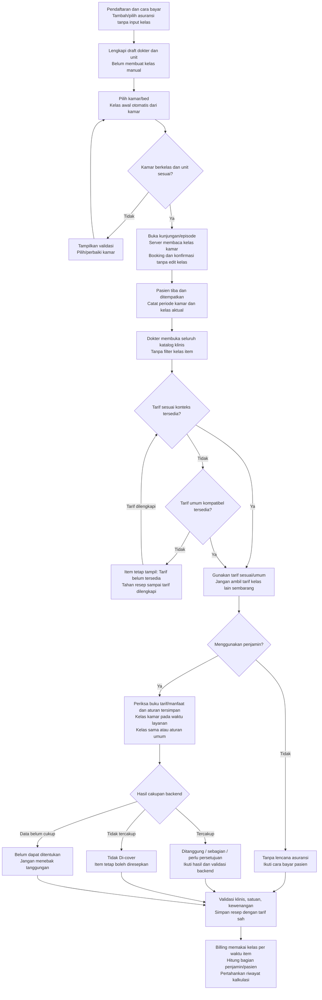

# PLAN-REPAIR-006 — Kelas kamar dan cakupan asuransi per item

```yaml
plan_id: PLAN-REPAIR-DOK-006
issue: ../issue/issue-006-kelas-perawatan-dan-cakupan-asuransi.md
status_rencana: SELESAI
tanggal_rencana: "2026-10-12"
diputuskan_oleh: pemilik melalui percakapan
tanggal_keputusan: "2026-10-12"
tanggal_validasi: "2026-10-13"
tanggal_penutupan: "2026-10-13"
basis_source_backend: d908988248f6652ed7f2ce84aae9eb3e38dd36a0
basis_source_frontend: affcfcb4ea9f5177b1ff9a3ca0c09d15183af248
commit_implementasi_backend: 8551291f
commit_implementasi_frontend: 2d0a6890e
head_penutupan_backend: 4ec02370
head_penutupan_frontend: f4495aa14
kontrak: RWI-KELAS-006-1.0
kontrak_sha256: 439623315c8cb4922e4794b7efb2218228d9e88fbd5f25e1473decd5087cd112
```

Pemilik telah memerintahkan seluruh perbaikan dilaksanakan. Dokumen ini memuat keputusan final termasuk jawaban tambahan tentang tarif: **pakai tarif umum bila tersedia; tahan resep bila semua tarif sesuai/umum tidak tersedia**. Ketetapan ini menggantikan rekomendasi audit awal yang membolehkan resep tanpa harga. Riwayat audit awal tetap ada pada issue.

## 1. Register status pengerjaan

| Perbaikan | Temuan | Outcome | Task dan bukti | Status |
| --- | --- | --- | --- | --- |
| FIX-DOK-006-01 | ISS-DOK-006-01/02 | Kunci kelas aktual, hak polis, tarif, dan API | [Kontrak RWI-KELAS-006-1.0](../../contracts/kelas-perawatan-repair-006.md), SHA256 `439623315c8cb4922e4794b7efb2218228d9e88fbd5f25e1473decd5087cd112` cocok saat penutupan; amandemen dokumen hulu bagian 7 | ✅ Selesai 2026-10-13 |
| FIX-DOK-006-02 | ISS-DOK-006-02 | Kelas menurut periode penempatan/waktu layanan | ✅ [BE-RWI-224](../../../episode-rawat-inap/task/report/backend/BE-RWI-224.md), ✅ [BE-RWI-225](../../../integrasi-billing/task/report/backend/BE-RWI-225.md) | ✅ Selesai 2026-10-13 |
| FIX-DOK-006-03 | ISS-DOK-006-01 | Tarif umum; tanpa tarif sesuai/umum resep ditahan, item tetap tampil | ✅ [BE-RWI-226](../../task/report/backend/BE-RWI-226.md) | ✅ Selesai 2026-10-13 |
| FIX-DOK-006-04 | ISS-DOK-006-03 | Aturan hanya cocok untuk kelas sama/umum; urutan Clinical/Billing sama | ✅ [BE-RWI-223](../../task/report/backend/BE-RWI-223.md), ✅ [BE-RWI-225](../../../integrasi-billing/task/report/backend/BE-RWI-225.md) | ✅ Selesai 2026-10-13 |
| FIX-DOK-006-05 | ISS-DOK-006-04 | Lencana dari status backend | ✅ [FE-RWI-239](../../task/report/frontend/FE-RWI-239.md) | ✅ Selesai 2026-10-13 |
| FIX-DOK-006-06 | ISS-DOK-006-02 | Admisi tanpa input kelas; kelas dari kamar | ✅ [FE-RWI-240](../../../episode-rawat-inap/task/report/frontend/FE-RWI-240.md), ✅ [BE-RWI-224](../../../episode-rawat-inap/task/report/backend/BE-RWI-224.md) | ✅ Selesai 2026-10-13 |

Tidak membuat migration, menjalankan database, melakukan commit/push, atau deploy. Temuan tambahan Gizi/Bank Darah ISS-DOK-006-T1 tetap tindak lanjut terpisah pemilik modul; tidak menjanjikan estimasi cakupan yang belum tersedia.

**Penutupan 13 Oktober 2026.** Seluruh acceptance criteria dibaca ulang terhadap diff source `basis..HEAD`. Audit ini menemukan satu celah pada BE-RWI-224: konteks asuransi dan perusahaan masih mengisi `PatientClassName` dari kelas awal encounter dan bisa jatuh ke nama kelas polis. Celah itu diperbaiki dua baris pada `EncounterInsuranceService.cs` (belum di-commit), lalu build dan QBE dijalankan ulang. Uji UI runtime tetap belum dilakukan; lihat bagian 9.

Register pemilik: [traceability dokter](../../roadmap/requirement-traceability-kelas-perawatan.md), [traceability episode](../../../episode-rawat-inap/roadmap/requirement-traceability-kelas-perawatan.md), [traceability integrasi-billing](../../../integrasi-billing/roadmap/requirement-traceability-kelas-perawatan.md); ketiganya juga terdaftar pada `blueprint-manifest.md` sub-modul masing-masing.

## 2. Solusi terpilih

1. Pisahkan kelas kamar yang berlaku pada waktu layanan, kelas awal historis episode/kunjungan, dan hak/manfaat polis. Riwayat penempatan menjadi sumber kelas aktual; jangan mengganti kelas historis seluruh kunjungan setelah transfer.
2. Katalog tetap berisi semua item valid bagi konteks klinis. Kelas memengaruhi pemilihan tarif dan aturan pertanggungan, bukan daftar master item.
3. Harga dan cakupan diperiksa terpisah. Tidak ditanggung tetap dapat diresepkan bila tarif dan persyaratan klinis tersedia. Tarif kelas lain tidak diambil sembarang; tarif umum yang kompatibel boleh dipakai. Tidak ada tarif sesuai/umum berarti resep ditahan sampai tarif dilengkapi.
4. Aturan asuransi cocok bila kelasnya kosong atau sama dengan kelas aktual. Tidak ada hierarki otomatis yang menganggap polis kelas 1 mencakup item kelas 2. Dalam tingkat sasaran item yang sama, aturan khusus kelas didahulukan; aturan tarif mendahului obat/tindakan, kemudian kategori obat, lalu kategori layanan.
5. Lencana memakai `CoverageStatus` dan `IsCoverageApplicable`, bukan menebak dari persentase. Status belum pasti berbeda dari penolakan pasti.
6. Hapus pemilih kelas dari pembayaran/asuransi dan konfirmasi admisi. Draft dokter sebelum kamar dipilih hanya di klien. Setelah memilih bed, buka kunjungan/episode dengan kelas kamar; server memvalidasi bed tersebut. Booking dan placement tetap proses terpisah.

Alternatif menghapus seluruh filter tarif ditolak karena dapat memakai harga kelas lain. Mengisi tarif seluruh kelas saja tidak memperbaiki sumber kelas dan pertanggungan. Menggunakan kelas polis sebagai kelas kamar juga tidak sesuai arahan pemilik.

## 3. Skema tampilan sebelum → sesudah

Skema berikut berdasarkan source, bukan klaim screenshot/render runtime.

```text
SEBELUM — ASURANSI / PEMBAYARAN
Penjamin, nomor kartu, masa aktif
Kelas perawatan [ Pilih kelas wajib ▾ ]
[Lanjut] tertahan jika kelas kosong
Konfirmasi juga memiliki pemilih kelas manual

SESUDAH — ASURANSI / PEMBAYARAN
Penjamin, nomor kartu, masa aktif
Kelas perawatan mengikuti kamar yang dipilih
[Lanjut] mengikuti validasi cara bayar/kartu, tanpa syarat kelas

SESUDAH — PILIH BED DAN KONFIRMASI
Kamar/bed: Melati contoh / A
Kelas perawatan: Kelas 1 (informasi otomatis)

KATALOG — CONTOH DATA SAMARAN
Parasetamol   Tidak Di-cover        Rp 10.000  [Pilih]
Obat B       Ditanggung            Rp 20.000  [Pilih]
Obat C       Ditanggung sebagian    Rp 30.000  [Pilih]
Obat D       Belum dapat ditentukan Tarif belum tersedia [Tidak aktif]
             Lengkapi tarif sesuai kelas kamar atau tarif umum sebelum resep
```

| Elemen | Keputusan | Dasar |
| --- | --- | --- |
| Penjamin | REUSE `BasePayerWorkspace` | Hapus sisipan kelas pada pemanggil; tidak mengubah base component |
| Bed, stepper, ringkasan | REUSE komponen admisi existing | Kelas berasal dari bed; tidak membuat pemilih kelas baru |
| Pesan memuat/gagal/kelas belum ada | REUSE `InformationAlert` | Pesan spesifik dan retry existing |
| Lencana/harga resep | REUSE `DoctorPrescriptionCoverageBadges` dan helper existing | Pemetaan status berubah, tidak menambah desain visual |
| Tombol | REUSE `BaseButton` | Busy/klik ganda dan guard existing |

| Keadaan | Perilaku |
| --- | --- |
| Belum memilih kamar | Kelas belum ditetapkan; pembayaran dan validasi draft dapat dilanjutkan |
| Sudah memilih kamar, belum placement | Kelas awal draft dari kamar pilihan; kelas aktual layanan baru sah berdasarkan placement |
| Kamar tidak memiliki kelas/unit berbeda | Validasi menolak; jangan mengambil kelas polis atau nilai palsu |
| Deposit sebelum kamar | Informasi kebijakan kelas belum tersedia; deposit tidak menahan admisi sesuai RWI-DEC-095 |
| Tidak ditanggung | Item tetap tampil dan boleh dipilih bila tarif/satuan/validasi klinis sah |
| Tarif belum tersedia | Item tetap tampil; pemilihan/simpan resep ditahan dengan alasan tarif |
| Tarif sah bernilai nol | Boleh dipakai; `TariffId` membuktikan konfigurasi, bukan harga kosong |
| Data cakupan belum cukup | Belum dapat ditentukan; simpan tetap mengikuti validasi backend existing |
| Tunai/cakupan tidak berlaku | Tanpa lencana asuransi |
| Transfer kamar | Layanan lama menggunakan kelas periode lama; layanan baru kelas periode baru |
| Gagal memuat/tanpa hak akses | Pesan, retry dan permission existing tetap berlaku |

## 4. Rincian dan acceptance criteria

### FIX-DOK-006-01 — Kontrak terkunci

Kontrak [RWI-KELAS-006-1.0](../../contracts/kelas-perawatan-repair-006.md) memuat keputusan pengguna, API existing, timestamp layanan, prioritas aturan dan batas harga.

Acceptance: contoh polis/kamar kelas 1 dan item hanya dijamin kelas 2 tertulis; transfer tidak menulis ulang sejarah; kondisi tanpa placement jelas; tidak ada kelas manual; tanpa tarif sesuai/umum menahan resep; tarif nol sah dibedakan. Bukti melalui kontrak dan amandemen hulu.

### FIX-DOK-006-02 — Kelas pada waktu layanan

`InpServiceClassResolver` mencari placement interval `[StartDateTime, EndDateTime)`. Riwayat transfer `IsSuperseded` tetap sah; baris yang dihapus atau digantikan koreksi dikecualikan. Clinical memakai timestamp layanan, Billing memakai `SourceOccurredAt` item. Rawat jalan/IGD tetap memakai kelas encounter existing.

Acceptance: sebelum placement kelas aktual null; titik akhir periode tidak masuk kamar lama; layanan terlambat memakai periode asal; kelas awal/hak polis tidak ditimpa; room charge dan tarif sumber memakai kelas layanan. Komponen administrasi/agregat tanpa timestamp layanan menggunakan waktu kalkulasi secara eksplisit.

### FIX-DOK-006-03 — Tarif umum dan resep tanpa tarif

Gunakan tarif yang cocok konteks atau tarif umum kompatibel. Hapus fallback tunai yang mengambil kelas lain hanya karena harganya sama. `ConfigurationMissing` invalid menahan seluruh jalur penyimpanan resep; `NotCovered` tetap valid. Tidak membuat alur resep harga tertunda.

Acceptance: item tetap tampil lintas kelas; tarif umum dapat dipakai; tanpa tarif sesuai/umum resep ditahan; tarif nol sah diterima; reguler/racikan/item/rekonsiliasi memanggil resolver yang sama; validasi dosis/satuan/aktif tetap berlaku.

### FIX-DOK-006-04 — Kecocokan aturan

Clinical menambah filter kelas pada `MstInsuranceCoverageRule`. Billing menyaring kelas/masa berlaku per komponen, bukan sekali menurut encounter/waktu kalkulasi. Keduanya memakai pengurutan aturan bersama. Cakupan perusahaan memakai kelas per layanan juga.

Acceptance: aturan khusus kelas lain tidak cocok; aturan umum masih boleh cocok bila dikonfigurasi; khusus kelas menang pada sasaran setara; contoh kelas 1/item dijamin kelas 2 memberi pertanggungan nol pada preview dan Billing dengan data yang sama. Rumus limit kumulatif, buku tarif asuransi dan kebijakan finansial existing tidak dirancang ulang oleh perbaikan ini.

### FIX-DOK-006-05 — Status cakupan

| Status backend | Label |
| --- | --- |
| Covered | Ditanggung |
| PartiallyCovered | Ditanggung sebagian |
| NotCovered | Tidak Di-cover |
| NeedApproval | Perlu persetujuan |
| ConfigurationMissing / Unknown | Belum dapat ditentukan |
| IsCoverageApplicable=false / NotApplicable / Cash / SelfPay | Tanpa lencana asuransi |
| Snapshot numerik tanpa status | Belum dapat ditentukan; jangan menyimpulkan ditanggung |

Acceptance: tidak ada `Cover 0%` yang memberi kesan ditanggung; alasan/nominal memakai backend; consumer shared rawat inap/IGD/rawat jalan mengikuti helper yang sama; tidak menghitung aturan asuransi di frontend.

### FIX-DOK-006-06 — Admisi tanpa input kelas

Pembayaran hanya memvalidasi kategori, kartu penjamin dan draft kartu yang belum disimpan. Draft dokter ditunda sampai bed dipilih. `SelectedBedId` membuat server membaca kelas/unit kamar. Konfirmasi tidak dapat mengedit kelas; backend mempertahankan/menurunkan kelas dari reservasi. Snapshot kelas pembayaran lama diabaikan. Transfer memakai kelas target bed. Deposit tidak memakai kelas pembayaran lama. ID episode ditulis ke URL untuk pemulihan draft setelah pembukaan berhasil.

Acceptance: tambah/pilih asuransi dan lanjut pembayaran tidak meminta kelas; tunai/perusahaan konsisten; pilih kamar menetapkan kelas; kamar tanpa kelas ditolak dengan pesan; retry tidak menggandakan kunjungan yang sudah berhasil; resume membaca episode; konflik booking tetap diperiksa; tidak mengubah status pasien menjadi dirawat sebelum placement.

## 5. Urutan dan pemetaan task

```text
FIX-DOK-006-01 ✅ — kontrak disetujui
├── BE-RWI-223 ✅ — aturan klinis
├── BE-RWI-224 ✅ — kelas efektif dan validasi kelas kamar admisi
│   └── BE-RWI-225 ✅ — Billing per waktu layanan
├── BE-RWI-226 ✅ — tarif umum/penahanan resep
├── FE-RWI-239 ✅ — lencana shared
└── FE-RWI-240 ✅ — pembayaran → kamar → konfirmasi
```

Roadmap dan laporan berada pada sub-modul pemilik masing-masing: dokter-rawat-inap, episode-rawat-inap, dan integrasi-billing. Tidak mengubah ID task lama atau keputusan blueprint di luar delta ini.

| Task | Roadmap | Laporan |
| --- | --- | --- |
| ✅ BE-RWI-223 | [dokter-rawat-inap backend](../../roadmap/backend-roadmap-kelas-perawatan.md) | [BE-RWI-223](../../task/report/backend/BE-RWI-223.md) |
| ✅ BE-RWI-226 | [dokter-rawat-inap backend](../../roadmap/backend-roadmap-kelas-perawatan.md) | [BE-RWI-226](../../task/report/backend/BE-RWI-226.md) |
| ✅ FE-RWI-239 | [dokter-rawat-inap frontend](../../roadmap/frontend-roadmap-kelas-perawatan.md) | [FE-RWI-239](../../task/report/frontend/FE-RWI-239.md) |
| ✅ BE-RWI-224 | [episode-rawat-inap backend](../../../episode-rawat-inap/roadmap/backend-roadmap-kelas-perawatan.md) | [BE-RWI-224](../../../episode-rawat-inap/task/report/backend/BE-RWI-224.md) |
| ✅ FE-RWI-240 | [episode-rawat-inap frontend](../../../episode-rawat-inap/roadmap/frontend-roadmap-kelas-perawatan.md) | [FE-RWI-240](../../../episode-rawat-inap/task/report/frontend/FE-RWI-240.md) |
| ✅ BE-RWI-225 | [integrasi-billing backend](../../../integrasi-billing/roadmap/backend-roadmap-kelas-perawatan.md) | [BE-RWI-225](../../../integrasi-billing/task/report/backend/BE-RWI-225.md) |

## 6. Keputusan pemilik — sudah ditutup

| ID | Keputusan final | Dasar |
| --- | --- | --- |
| K-01 | Hak polis berbeda dari kamar: gunakan kelas kamar pada waktu layanan dan aturan tersimpan; tidak ada hierarki kelas implisit. Draft sebelum kamar dipilih hanya di klien | Jawaban eksplisit pemilik dan pelaksanaan A-05 |
| K-02 | Gunakan tarif umum item bila ada; tahan resep bila tarif sesuai/umum tidak tersedia. Kelas item untuk cakupan ditentukan aturan penjamin, bukan daftar master obat terpisah | Jawaban eksplisit pemilik, menggantikan rekomendasi audit awal |
| K-03 | Pada sasaran item setara, aturan khusus kelas mendahului umum; urutan konsisten pada Clinical/Billing | Solusi terpilih plan yang diperintahkan untuk dilaksanakan |
| A-05 | Tidak menginput kelas pada penambahan/pemilihan asuransi atau pembayaran admisi; kelas terpilih ketika memilih kamar | Instruksi tambahan pemilik |

## 7. Dokumen hulu

Amandemen delta ditautkan pada `rawat-inap/00-interview-decisions.md`; skema, arsitektur, API/validasi/integrasi episode; arsitektur dan kontrak dokter; kontrak Pharmacy; kontrak integrasi Billing. Rujukan normatif delta adalah kontrak repair ini. Khusus resep, keputusan K-02 mengalahkan teks lama yang membolehkan penyimpanan tanpa tarif. Kebijakan pesanan tindakan/Lab/Radiologi yang belum memiliki estimasi tidak dibalik oleh keputusan khusus resep.

## 8. Flowchart bisnis yang diterapkan



Status belum dapat ditentukan tidak melewati validasi backend: konteks tidak sah atau tidak ada tarif tetap menahan resep. Flowchart menggambarkan proses resep; tindakan/penunjang mengikuti kontrak klinis existing.

### Contoh bisnis pemilik

Pasien memiliki polis kelas 1 dan ditempatkan di kamar kelas 1. Parasetamol hanya memiliki aturan cakupan kelas 2, tanpa aturan umum lain yang cocok. Sistem tetap menampilkan Parasetamol. Bila tarif kelas 1 atau umum tersedia, dokter dapat meresepkan; aturan kelas 2 tidak digunakan dan bagian asuransi nol. Bila harga juga tidak tersedia, resep ditahan sampai tarif sesuai/umum dilengkapi. Nominal nol pertanggungan berbeda dari tarif obat nol.

### Skenario penerimaan

| ID | Kasus | Hasil |
| --- | --- | --- |
| V-01 | Pembayaran/tambah asuransi tanpa kelas | Boleh lanjut jika cara bayar/kartu sah |
| V-02 | Kamar kelas 1 dipilih | Kelas awal dari kamar; placement menetapkan periode kelas aktual |
| V-03 | Obat hanya punya tarif kelas 2, pasien kamar kelas 1 | Item tampil; gunakan umum jika ada; bila tidak ada tahan resep |
| V-04 | Tarif umum/kelas 1, aturan cakupan hanya kelas 2 | Tidak ditanggung; resep boleh bila valid |
| V-05 | Aturan umum dan khusus kelas cocok | Khusus kelas menang pada sasaran setara |
| V-06 | Transfer kelas 1 → kelas 2 | Layanan sebelum/sesudah batas memakai periode masing-masing |
| V-07 | Layanan terlambat/retur | Kelas dari waktu layanan asal, bukan waktu hitung ulang |
| V-08 | Tarif sah nol dan tanpa tarif | Nol sah boleh; tanpa tarif ditolak |
| V-09 | Snapshot lama hanya persentase | Tidak ditafsirkan otomatis ditanggung |
| V-10 | Tunai, perusahaan, reguler, racikan | Tanpa kelas manual; aturan tarif dan validasi tetap konsisten |
| V-11 | Kamar tanpa kelas, unit salah, klik ganda, konflik bed | Ditolak/ditahan dengan pesan; tidak membuat nilai kelas palsu |
| V-12 | Resume admisi dan deposit sebelum kamar | Episode server jadi sumber; kebijakan deposit belum ada tidak menahan admisi |

Skenario V-01 s.d. V-12 dibuktikan pada tingkat source, kontrak, dan unit test. Belum ada yang dijalankan sebagai uji layar atau transaksi pada data nyata.

## 9. Bukti validasi

Hasil rinci berada pada laporan task masing-masing dan traceability. Bukti suite global dibedakan dari pengujian terarah agar kegagalan baseline tidak disembunyikan.

| Pemeriksaan | Hasil aktual | Batas bukti |
| --- | --- | --- |
| `dotnet restore` backend | PASS 2026-10-12; 5 peringatan paket ImageSharp existing | Sesi implementasi |
| `dotnet build` backend, sesi implementasi | PASS: 0 error, 286 warning; output `%TEMP%/quilvian-kelas-be-build` | Sebelum commit `8551291f` |
| `dotnet build` backend, penutupan | PASS: 0 error, 281 warning, 2 menit 16 detik; HEAD `4ec02370` + perbaikan label kelas; log `%TEMP%/quilvian-kelas-be-closure.log` | Kompilasi saja; aplikasi yang berjalan tidak direstart dan masih memuat binary lama |
| QBE ReportOnly 13 berkas source repair | PASS: 0 VIOLATION, 0 REVIEW, 0 INFO; dijalankan ulang sesudah perbaikan | Subset aturan otomatis; sisanya review source/kontrak |
| `git diff --check` | PASS pada worktree dan rentang `d9089882..HEAD` area repair | — |
| ESLint terarah 17 berkas FE repair | Exit 0 (sesi implementasi dan penutupan) | Hanya berkas repair |
| Unit `inpatient-class-coverage.test.mjs` | PASS 5/5 pada penutupan; pengujian terarah sesi implementasi 39/39 | Logika pemetaan dan payload, bukan render layar |
| Unit 14 berkas terkait admisi/resep | 92 tes: 87 lulus, 5 gagal lama | Berkas yang diuji kelima kegagalan tidak berubah sejak basis, atau isi yang dipersoalkan sudah ada di basis |
| Build produksi Next.js + `prepare-standalone` | PASS, sesi implementasi | Source FE repair tidak berubah sesudahnya; build ulang penutupan NOT RUN |
| Suite unit global frontend | 2776 tes: 2742 lulus, 34 gagal; snapshot HEAD pembanding 2761/2732/29 | Lima kegagalan tambahan dari relokasi menu Transfer Workspace PPRI; direproduksi pada penutupan: 21 tes, 16 lulus, 5 gagal |
| Uji manual/UI | NOT FEASIBLE | Tidak ada browser/aplikasi aktif; tidak diklaim lulus |
| Migration, database, deploy | NOT APPLICABLE | Delta tanpa schema; tidak ada eksekusi database atau deploy |

Temuan sampingan penutupan, tidak menahan status:

- BOM UTF-8 tertambah di awal tujuh berkas source backend repair. Tidak memengaruhi kompilasi; dicatat pada laporan BE masing-masing.
- `doctor-queues/tabs/prescription/doctor-prescription-shared.jsx` masih memuat salinan helper cakupan lama yang tidak diimpor di mana pun. Kode mati, di luar scope.

## 10. Riwayat

| Tanggal | Perubahan |
| --- | --- |
| 2026-10-12 | Audit dan enam perbaikan; flowchart ditambahkan atas permintaan pemilik |
| 2026-10-12 | A-05: tidak ada input kelas pada asuransi/pembayaran admisi |
| 2026-10-12 | Pemilik menyetujui seluruh pelaksanaan; K-01/K-02 dijawab eksplisit; kontrak dan enam task dialokasikan |
| 2026-10-13 | Implementasi lintas BE/FE; flowchart dan acceptance diselaraskan dengan penahanan resep tanpa tarif; konfirmasi dan validasi server juga mengikuti kamar |
| 2026-10-13 | Penutupan: audit ulang source, perbaikan label kelas BE-RWI-224, build/QBE/unit diulang, laporan FE-RWI-239/240 dibuat, enam FIX ditutup, roadmap/traceability/manifest diperbarui. Karakter em dash dan garis pohon yang sebelumnya rusak menjadi `?` dipulihkan; simbol dropdown pada skema sebelum direkonstruksi sebagai `▾` |
