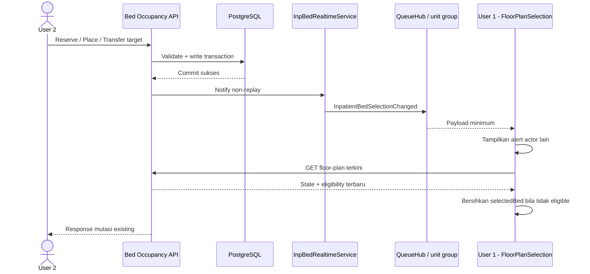
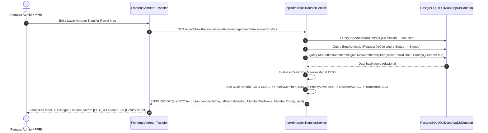

# Integration Contract — Modul Rawat Inap

| Field | Nilai |
| --- | --- |
| Blueprint ID | `RWI-BP-001` |
| `contract_version` | **`0.17.0`** — amandemen Prioritas Kamar Pasien Member di Antrean Transfer & Lencana Tier (bagian 15, `draft`, `RWI-DEC-338` s.d. `341`, 2026-10-19). Riwayat metadata sebelumnya: `0.16.0` Notifikasi Realtime Pemilihan Bed (`approved_design_planned`, `RWI-DEC-337`); amandemen Integrasi Denah approved (bagian 12, last_changed_in `0.13.0`, `RWI-DEC-324`); amandemen Bed Management draft (bagian 11); `0.11.0` Workspace PPRI; `0.10.0`; `0.9.0` |
| Status | **`draft`** untuk amandemen Prioritas Kamar Member & Lencana Tier (`0.17.0`); **`approved`** untuk amandemen Notifikasi Realtime (`0.16.0`), Integrasi Denah (`0.13.0`), dan Workspace PPRI (`0.11.0`) |
| Owner | Produk/domain/API Muhammad Hamzah; keamanan/privasi OPEN; frontend sesuai DEC-292 |
| `input_revision` | Prioritas Member: Decision log rev 60 (`RWI-DEC-338` s.d. `341`, `RWI-AC-481` s.d. `493`). Realtime Bed: Decision log rev 54 (`RWI-DEC-333`–`336`). Integrasi Denah: decision 50, DEC-298–323, AC-436–461 |
| Backend SHA | `24526327` (branch `MHamzah`) |
| Dampak kompatibilitas | Aditif (non-breaking): Field baru pada DTO `InpatientAdmissionTransferItemResponse` (`isCito`, `isPriorityMember`, `memberTierName`, `memberPriorityLevel`), pengurutan multi-kriteria deterministic di server. Tidak ada tabel baru, tidak ada arah tulis ke modul lain |

> **`0.3.0` sengaja tidak menambah satu integrasi pun.** `RWI-DEC-066` menolak menambah kolom
> "boleh campur" pada `MstRoom`, sehingga aturan pencampuran kamar dijalankan dengan **membaca**
> penghuni yang sedang ada — data milik Rawat Inap sendiri. Tidak ada arah tulis baru ke modul lain,
> dan janji "nol perubahan kolom pada tabel modul lain" tetap utuh. Yang naik hanyalah
> `contract_version`, supaya seluruh kontrak tetap sebaris.

**Modul ini tidak memanggil satu pun sistem di luar aplikasi Quilvian pada revisi ini.** Seluruh
integrasi yang dibahas di sini bersifat internal, yaitu antar modul di dalam satu aplikasi dan satu
database. Alasannya ada di bagian 4.

---

## 1. Integrasi internal — arah baca

| ID | Produsen | Konsumen | Tujuan bisnis | Sumber kebenaran | Sifat |
| --- | --- | --- | --- | --- | --- |
| `INT-INP-01` | `RegistrationManagement` | Rawat Inap | Kunjungan sebagai jangkar episode | Registrasi | Sinkron, baca langsung lewat `ApplicationDbContext` |
| `INT-INP-02` | `MasterData` HealthServices | Rawat Inap | Tempat tidur, kamar, unit layanan, kelas pasien | Master Data | Sinkron, baca langsung |
| `INT-INP-04` | `Corporate/HumanResource` | Rawat Inap | Dokter untuk DPJP, pegawai untuk perawat | HR Workforce | Sinkron, baca langsung |
| `INT-INP-05` | `PatientManagement` | Rawat Inap | Identitas pasien untuk census dan resume | Patient Management | Sinkron, baca lewat kunjungan |
| `INT-INP-06` | `EmergencyInstallationManagement` | Rawat Inap | Waktu pasien tiba di bangsal, dari event `Tiba` pada catatan kepergian IGD | **IGD** | Sinkron, baca langsung. Hanya pada jalur serah terima IGD |
| `INT-INP-07` | `RegistrationManagement` | Rawat Inap | Rangkaian kedatangan, lewat `TrxPatientEncounter.OriginEncounterId` | Registrasi | Sinkron, baca langsung. Kolomnya dibuat dan diisi modul IGD |

**Dua integrasi terakhir ditambahkan pada `0.4.0`** lewat `RWI-DEC-072` dan `RWI-DEC-073`.
Keduanya arah **baca**, keduanya hanya menyala pada jalur serah terima IGD, dan jalur itu adalah
`INP-S09` yang di luar scope revisi ini. Tidak satu pun kolom milik modul lain ditulis atau
dibuat oleh Rawat Inap karena keduanya.

Keenamnya **tidak** menyalin data. Yang disimpan modul ini hanya Id-nya, dan nama ditampilkan
lewat `Include` atau projection saat query.

Satu pengecualian yang disengaja: `InpBedPlacement` menyimpan salinan `RoomId`, `ServiceUnitId`,
dan `PatientClassId` **pada saat penempatan dibuat**. Ini bukan duplikasi master, melainkan
**rekaman keadaan pada satu titik waktu**. Kalau kamar dipindahkan ke kelas lain tahun depan,
riwayat tahun ini tetap menunjukkan kelas yang benar-benar berlaku saat itu — dan itulah yang
membuat `RWI-RULE-007` dapat dijalankan.

---

## 2. Integrasi internal — arah tulis

### `INT-INP-03` — Menuliskan salinan status ketersediaan tempat tidur

Ini **satu-satunya** arah tulis modul ini ke luar batasnya sendiri.

| Aspek | Ketetapannya |
| --- | --- |
| Produsen | Rawat Inap |
| Konsumen | `MasterData` HealthServices, kolom `MstBed.BedStatus` |
| Tujuan bisnis | Menjaga agar seluruh pembaca lama — daftar bed, ringkasan, isian pilihan, dan layar master di frontend — tetap bekerja tanpa diubah |
| Sumber kebenaran | Rawat Inap untuk **maknanya**; Master Data untuk **kolomnya** |
| Nilai yang boleh ditulis | Hanya `Available`, `Reserved`, dan `Occupied` |
| Nilai yang **tidak** boleh disentuh Rawat Inap | `Cleaning`, `Maintenance`, `Blocked`, `Inactive` — tetap wewenang admin master data |
| Sifat | Sinkron, **di dalam transaksi yang sama** dengan perubahan catatan penempatan |
| Idempotency | Penulisan bersifat menetapkan nilai, bukan menambah. Mengulang operasi yang sama menghasilkan keadaan yang sama |
| Bila gagal | Seluruh transaksi dibatalkan. Tidak ada keadaan catatan penempatan berubah tetapi kolom status tidak, atau sebaliknya |
| Rekonsiliasi | Laporan selisih `GET /monitoring/bed-drift`, lihat bagian 3 |
| Persetujuan | Pemilik `MasterData` HealthServices, tercatat sebagai `RWI-OQ-033` — **sudah diberikan** 21 Agustus 2026 lewat `RWI-DEC-062`. Diterapkan `BE-RWI-006` pada 1 September 2026 |

**Kapan penulisan terjadi:**

| Tindakan Rawat Inap | `MstBed.BedStatus` menjadi |
| --- | --- |
| Pemesanan dibuat | `Reserved` |
| Pemesanan dibatalkan | `Available` |
| Pemesanan gugur, terbaca saat query | `Available` |
| **Kepergian fisik pasien dicatat** | `Available` |
| Pasien ditempatkan | `Occupied` |
| Pasien pindah — tempat tidur lama | `Available` |
| Pasien pindah — tempat tidur tujuan | `Occupied` |
| Admisi dibatalkan | `Available` |
| Episode ditutup | `Available` |

**Satu hal yang tidak dilakukan modul ini:** menimpa `Cleaning`, `Maintenance`, atau `Blocked`
menjadi `Available`. Bila tempat tidur dilepas sementara statusnya sedang `Maintenance` karena
disetel admin, nilai itu **dibiarkan apa adanya** dan tidak dikembalikan ke `Available`. Tempat
tidur yang sedang diperbaiki memang tidak boleh langsung dipakai pasien berikutnya.

---

## 3. Rekonsiliasi — laporan selisih tempat tidur

Karena salinan dan sumbernya berada di dua modul yang berbeda, selisih tetap mungkin terjadi —
misalnya bila kelak ada jalur lain yang menyetel kolom itu, atau bila data lama sudah terlanjur
salah sebelum modul ini dipasang.

Laporan selisih adalah **bagian dari kontrak integrasi**, bukan fitur tambahan yang boleh ditunda.

| Jenis selisih | Cara mengenalinya | Artinya bagi pengguna |
| --- | --- | --- |
| Tempat tidur terbaca kosong padahal ada penghuni | `BedStatus = Available` tetapi ada `InpBedPlacement` dengan `EndDateTime` kosong | Berbahaya. Tempat tidur bisa diberikan ke pasien kedua |
| Tempat tidur terbaca terisi padahal kosong | `BedStatus = Occupied` tetapi tidak ada penempatan aktif | Merugikan. Kamar terlihat penuh padahal tersedia |
| Tempat tidur terbaca dipesan padahal tidak ada pemesanan | `BedStatus = Reserved` tetapi tidak ada pemesanan berstatus `Active` | Merugikan, sama seperti di atas |

Contoh baris laporan:

> Tempat tidur `BD-RSMMC-00042` tertulis Tersedia, tetapi masih ada penempatan aktif atas nama
> Tn. Budi sejak 21 Agustus 2026 pukul 10:40. Episode `RI-2026-08-000123`.

**Yang harus diperiksa sebelum modul dipakai pertama kali:** bila di database sudah ada baris
`MstBed` yang terlanjur berstatus `Reserved` atau `Occupied` — padahal belum pernah ada modul rawat
inap — baris itu wajib dikembalikan ke `Available` lebih dulu. Kalau tidak, laporan selisih akan
langsung menampilkan seluruh baris itu. Ini sudah tercatat pada rencana migration bagian 7.2.

---

## 4. Integrasi eksternal

**Tidak ada satu pun integrasi eksternal yang dirancang pada revisi ini.**

Ini keadaan yang disengaja, bukan bagian yang belum ditulis. Alasannya:

| Hal | Keterangan |
| --- | --- |
| Yang seharusnya ada | Pengiriman data rawat inap ke SATUSEHAT: identitas encounter, riwayat lokasi, diagnosis, tindakan, dan data terkait pemulangan |
| Buktinya dibutuhkan | PRD Modul Rawat Inap baris 814; baseline `ID-INP-INT-001` sampai `ID-INP-INT-005`, seluruhnya dengan `integration_relevance: HIGH` |
| Kenapa tidak dirancang | Keputusannya belum ada. Tercatat sebagai `DEC-INP-005` dan `RWI-OQ-037` |
| Apa yang belum diputuskan | Siapa pemiliknya, data apa yang wajib dikirim, kapan dipicu, dan **di mana riwayat lokasi disimpan** — pada catatan penempatan milik Rawat Inap, atau pada kunjungan milik Registrasi |
| Kenapa itu mahal bila salah | Bila jawabannya "pada kunjungan", pemilik data riwayat lokasi berpindah dari Rawat Inap ke Registrasi |
| **Sudah diputuskan pada 2026-08-21** | `RWI-DEC-053` menetapkan riwayat lokasi **tetap dimiliki Rawat Inap**. Pengiriman dibangun sebagai kemampuan tersendiri yang membacanya. Yang masih terbuka hanya isi kiriman, pemicunya, dan siapa pemiliknya |

### 4.1 Yang sudah disiapkan supaya keputusan itu tidak mahal

Walaupun kontraknya belum dirancang, seluruh bahan yang dibutuhkan pengiriman **sudah tersimpan
dalam bentuk yang dapat dibaca ulang**:

| Bahan yang dibutuhkan SATUSEHAT | Sudah tersedia di |
| --- | --- |
| Identitas encounter | `InpEpisode.EncounterId` |
| Riwayat lokasi beserta periodenya | `InpBedPlacement`, berbentuk baris berperiode |
| Waktu pasien meninggalkan ruangan | `InpEpisode.PhysicallyLeftAt` |
| Versi resume sebelumnya, bila resume pernah diamandemen | `InpDischargeSummaryRevision` |
| Riwayat penanggung jawab | `InpDoctorAssignment`, berbentuk baris berperiode |
| Perubahan status episode beserta waktunya | `InpStatusHistory` |
| Data terkait pemulangan | `InpDischargeSummary` |
| Kelas layanan yang berlaku per periode | `InpBedPlacement.PatientClassId` |

Karena semuanya berbentuk riwayat dan bukan penanda keadaan terakhir, pengiriman kelak tinggal
membaca — tidak ada yang perlu dibongkar.

---

## 5. Kejadian bisnis

Daftar berikut adalah **fakta bisnis**, bukan rancangan mekanisme pengiriman pesan.

| ID | Kejadian | Kapan terjadi | Konsumen yang mungkin peduli |
| --- | --- | --- | --- |
| `EVT-INP-01` | Episode diaktifkan | Episode menjadi `Admitted` | Billing, interoperabilitas, census |
| `EVT-INP-02` | Tempat tidur dipesan | Pemesanan dibuat | Papan ketersediaan |
| `EVT-INP-03` | Pemesanan gugur | Terbaca saat query | Papan ketersediaan |
| `EVT-INP-04` | Pasien menempati tempat tidur | Penempatan dibuka | Billing untuk charge kamar, interoperabilitas |
| `EVT-INP-05` | Pasien berpindah tempat tidur | Perpindahan berhasil | Billing bila kelas berubah, interoperabilitas |
| `EVT-INP-06` | DPJP dialihkan | Pengalihan berhasil | Interoperabilitas, laporan |
| `EVT-INP-07` | Pasien diputuskan boleh pulang | Episode menjadi `DischargePending` | Farmasi untuk obat pulang, kasir |
| `EVT-INP-12` | Pasien meninggalkan ruangan | Kepergian fisik dicatat | Papan ketersediaan, kasir, kebersihan |
| `EVT-INP-08` | Resume pulang ditandatangani | Penandatanganan | Interoperabilitas, rekam medis |
| `EVT-INP-09` | Episode ditutup | Episode menjadi `Closed` | Billing, interoperabilitas, papan ketersediaan |
| `EVT-INP-10` | Episode dibatalkan | Episode menjadi `Cancelled` | Papan ketersediaan, kunjungan |
| `EVT-INP-11` | Episode ditutup menembus gerbang keuangan | Penutupan oleh supervisor | Laporan pengecualian |

### 5.1 Cara mewujudkannya pada MVP

Capability map **tidak menemukan satu pun** sarana antrean pesan atau kotak keluar di dalam
source pada SHA `5afb54b`. Karena itu:

| Hal | Ketetapannya pada MVP |
| --- | --- |
| Bentuk pengiriman | Pemanggilan langsung di dalam service, bukan pesan asinkron |
| Kenapa memadai | Seluruh konsumen yang ada hari ini berada di dalam satu aplikasi dan satu database |
| Kapan menjadi tidak memadai | Begitu `DEC-INP-005` terjawab dan pengiriman ke luar aplikasi dibutuhkan |
| Dicatat sebagai | `ARCH-GAP-006` pada arsitektur domain |

Yang **tidak** dilakukan: membangun sarana antrean pesan sekarang hanya karena mungkin dibutuhkan
kelak. Itu pekerjaan yang belum ada pemintanya.

---

## 6. Modul yang sengaja belum terhubung

| Modul | Kenapa belum | Decision ID |
| --- | --- | --- |
| `ClinicalManagement` | Dokumentasi klinis rawat inap di luar scope | `DEC-INP-001` |
| `PharmacyManagement` | Resep dan obat pulang di luar scope | `DEC-INP-001` |
| `EmergencyInstallationManagement` | Serah terima IGD ke rawat inap di luar scope. **Sejak `0.4.0` arah bacanya sudah dirancang** lewat `INT-INP-06`, tetapi belum terhubung karena `INP-S09` belum dikerjakan. Pemiliknya bernama sejak `RWI-DEC-069`: Rizki Gunawan | `DEC-INP-002` |
| `BillingManagement` | Belum punya kemampuan transaksi. Digantikan penandaan manual sesuai `RWI-RULE-028` | — |

Untuk `BillingManagement`, perlu ditegaskan: modul Rawat Inap **tidak** membangun faktur, tagihan
berjalan, tarif, atau perhitungan biaya sendiri. Yang disimpan hanyalah **pernyataan kelayakan**
berupa `Pending`, `Cleared`, atau `Blocked`, dan pernyataan itu ditandai manual petugas kasir. Ini
bukan sistem billing mini; ia hanya gerbang.

Ketika `BillingManagement` operasional, sumber nilai berpindah dari penandaan manual menjadi bacaan
dari Billing. **Aturan penutupannya tidak berubah** — hanya sumber datanya. Ini sudah dikunci pada
`RWI-RULE-028` aturan 7.

---

## 7. Traceability

| Bagian | Requirement dan decision asal |
| --- | --- |
| 1 | `RWI-RULE-005`, `RWI-RULE-007` |
| 2 | `RWI-RULE-027`, `RWI-DEC-039`, `RWI-OQ-033` |
| 3 | `RWI-RULE-027` aturan 6 |
| 4 | `DEC-INP-005`, `RWI-OQ-037`, baseline `ID-INP-INT-001` s.d. `005` |
| 5 | Arsitektur domain bagian J.3, `ARCH-GAP-006` |
| 6 | `RWI-RULE-028`, `DEC-INP-001`, `DEC-INP-002` |

---

## 8. Perubahan pada `contract_version` `0.9.0` — amandemen terbatas ★ 15 September 2026

**Status `draft`.** Seluruhnya internal, satu `ApplicationDbContext`.

| ID | Arah | Modul lawan | Pola | Pasangan | Keadaan |
| --- | --- | --- | --- | --- | --- |
| `INT-INP-08` | Tulis, dipicu penutupan | `MedicalRecordManagement` | Sinkron, satu transaksi | `INT-DOK-13` | `Missing` — `RLN3-CAP-38` |
| `INT-INP-09` | Tulis, dipicu penutupan | `ClinicalManagement` pesanan tindakan | Sinkron, satu transaksi | `INT-DOK-13` | `Missing` |
| `INT-INP-10` | Tulis, dipicu penutupan | `PharmacyManagement` dosis obat | Sinkron, satu transaksi | `INT-KEP-15` | `Missing` |
| `INT-INP-11` | Baca | `ClinicalManagement`, `PharmacyManagement`, `LaboratoryManagement`, `RadiologyManagement` | Sinkron, hanya baca | `INT-DOK-20` | `Missing` — usulan isian resume |
| `INT-INP-12` | Baca | `ClinicalManagement` | Sinkron, hanya baca | `INT-DOK-11` | `Missing` — `NeedsReviewCount` census |
| `INT-INP-13` | Dibaca | `ClinicalManagement` penjaga penulis klinis | Sinkron | `INT-DOK-12` | `Extend` — `AssignmentPurpose` |

### 8.1 `INT-INP-08` s.d. `INT-INP-10` — langkah akibat penutupan

| Hal | Isinya |
| --- | --- |
| Urutan | Setelah status `Closed` diterapkan dan sebelum `SaveChanges`: (4) kunci konsep, (5) batalkan pesanan tertunda, (6) batalkan dosis masa depan |
| Kenapa urutan itu | Penguncian tidak bergantung dua lainnya; pembatalan pesanan dan dosis tidak saling bergantung. Urutan dibuat tetap supaya log dan test dapat dibandingkan |
| Kegagalan | Galat pada langkah mana pun → rollback seluruh transaksi, termasuk pengembalian tempat tidur dan penutupan penugasan |
| Idempotensi | Menjalankan ulang pada episode `Closed` ditolak oleh penjaga status yang sudah ada; ketiga langkah juga hanya menyentuh keadaan awal yang benar |
| Selama service tujuan belum dibangun | Langkah yang service-nya belum ada **tidak dipasang**; penutupan berjalan seperti hari ini. Tiap langkah dipasang pada gelombang pemiliknya — 11.8 |
| Pemberitahuan | `INT-INP-08` adalah titik sentuh `MedicalRecordManagement` — **wajib diberitahukan kepada Yoga Aji Pratama**, satu paket dengan `INT-DOK-13` dan `INT-KEP-12` |
| Contoh | Joko ditutup 13.00 → 1 konsep terkunci, 1 pesanan batal, 1 dosis 20.00 batal; response `SideEffects` menampilkan ketiga angka |

### 8.2 `INT-INP-11` — usulan isian resume

| Hal | Isinya |
| --- | --- |
| Yang dibaca | Diagnosis encounter; tindakan `Completed`; butir resep pulang; hasil laboratorium/radiologi final kritis atau abnormal; Assesment Edukasi selesai |
| Batas tunggu | 5 detik per sumber; sumber lambat → `SourceStatus = Unavailable`, sumber lain tetap dikembalikan |
| Privasi | Hanya dikirim kepada pemegang `InpatientDischarge : Read`; tidak dicatat ke custom logger |
| Yang tidak dilakukan | Tidak menyimpan; tidak memperbarui resume otomatis |

### 8.3 `INT-INP-12` — angka "Perlu Review"

| Hal | Isinya |
| --- | --- |
| Yang dibaca | Jumlah entri CPPT menunggu verifikasi yang boleh diverifikasi dokter login (`RWI-DEC-125`, `126`) dan jumlah pesanan menunggu verifikasi instruksinya |
| Kegagalan | `NeedsReviewCount = null` beserta penanda; angka lain tetap tampil |

### 8.4 `INT-INP-13` — tujuan penugasan dibaca penjaga penulis klinis

`InpatientClinicalContextService` membaca `AssignmentPurpose` untuk menegakkan `RWI-DEC-130` butir (5): dokter
berpenugasan `LateDocumentation` tidak dapat memverifikasi CPPT. Keputusan pulang, tanda tangan resume, perpindahan, dan
isolasi sudah tertutup bagi `OnCallDoctor` oleh `GUARD-INP-01` s.d. `04`.

---

## 9. Perubahan pada `contract_version` `0.10.0` — Finishing Rawat Inap ★ 1 Oktober 2026

| Field | Nilai |
|---|---|
| `last_changed_in` | `0.10.0` |
| Status | **`approved`** — Muhammad Hamzah, 2026-10-02 (`RWI-DEC-221`) |
| Pemilik pihak lain | Kamar Operasi — Ikbal Yulianto (**disetujui Ikbal Yulianto, `RWI-DEC-208`**); Billing — `RWI-DEC-192`, `196`; Clinical — Muhammad Hamzah |
| Keputusan yang belum ada | **Tidak ada.** ~~`DEC-INP-018`~~ ditutup `RWI-DEC-207`. `INT-RWF-22` tetap mengirim dengan `EncounterId` kasus OK; Billing menautkan kunjungan itu ke invoice `RANAP` (`INT-RWF-25`) |

Seluruh integrasi di bawah adalah panggilan **dalam proses yang sama** (satu aplikasi, satu database), bukan HTTP antarmodul, mengikuti pola `InpBillingDepositAdapter`.

| ID | Dari → ke | Pemicu | Isi | Sinkron | Idempotensi | Bila gagal | Rekonsiliasi |
|---|---|---|---|---|---|---|---|
| `INT-RWF-19` | Rawat Inap → OK | Pesan ruang bedah dari bangsal | `PatientId`, `EncounterId` episode, satu `PatientProcedureId`, jenis layanan, rencana anestesi, isian pesanan, akun penginput | Ya | `Idempotency-Key` diteruskan ke `CreateOprCaseRequest.IdempotencyKey` | Pesanan tidak tersimpan; pengguna mencoba lagi | Tidak perlu |
| `INT-RWF-20` | OK → Rawat Inap (baca) | Penerimaan serah terima | "Apakah pasien X menempati bed aktif di unit Y" (`InpPatientLocationQuery`) | Ya | Baca | Gagal baca → penerimaan **ditolak** (gagal tertutup) | — |
| `INT-RWF-21` | OK → Clinical | Kasus `Completed` | Selesaikan setiap order tindakan yang dirujuk kasus: pelaksana dokter operator, waktu = kasus selesai; fakta tagih tindakan lahir dari jalur order tindakan yang sudah ada | Sesudah commit kasus | Order sudah `Completed` dilewati | Dicatat; dicoba ulang lewat rekonsiliasi delivery OK | `GET …/integration/reconciliation` menampilkan order yang belum selesai |
| `INT-RWF-22` | OK → Billing | Kasus `Completed` | Komponen `ANESTHESIA` (bila catatan anestesi final), `OR_RENT` (durasi menit kamar operasi), `MATERIAL-{usageId}` (pemakaian `Used`); `SourceContext = OPERATING_ROOM`, `EncounterId` kasus | Sesudah commit (outbox `OprIntegrationDelivery`) | `case:charge:component:revision` | Delivery `Failed`, dicoba ulang | Rekonsiliasi OK yang sudah ada; Billing menolak tarif tak ada → baris "tarif belum ada" |
| `INT-RWF-23` | OK → Rawat Inap | Simpan kamar pulih `Inpatient`/`Icu`, pasien tanpa episode hadir | `PatientId`, `SourceEncounterId`, `OprCaseId`, dokter operator, tingkat perawatan, catatan keputusan | Ya, dalam transaksi OK | Satu `Pending` per kasus (unique parsial) | Transaksi kamar pulih gagal seluruhnya; petugas menyimpan ulang | Tidak perlu — disetujui `RWI-DEC-208` |
| `INT-RWF-24` | OK → Rawat Inap | Keputusan kamar pulih berubah dari `Inpatient`/`Icu`, atau pasien boleh pulang | Batalkan permintaan `Pending` beralasan | Ya, dalam transaksi OK | Permintaan bukan `Pending` dilewati | Sama | — |
| `INT-RWF-25` | Rawat Inap → Billing | Admisi dari permintaan selesai | Ketukan pintu `ADMISSION_CONFIRMED` seperti admisi biasa — **isi pesan tetap daftar putih** (`INV-RWF-05`); Billing membaca `InpAdmissionReferral.SourceEncounterId` dari sumbernya dan menautkan kunjungan asal ke invoice `RANAP` (`integrasi-billing` `INT-RWF-29`, `RWI-DEC-207`) | Outbox (`integrasi-billing` `1.1.0`) | Sama dengan `INT-RWF-01`; tautan unik per invoice dan kunjungan | Sama | Putar ulang `I5` |
| `INT-RWF-26` | Rawat Inap → Clinical | Transfer antarunit tersimpan | `InpEpisodeId`, unit asal, unit tujuan, penempatan asal dan tujuan | Sesudah commit transfer | Satu dokumen per penempatan tujuan | Dicatat; transfer tetap sah | Daftar Pantau menampilkan transfer antarunit tanpa dokumen; dibuat ulang saat dibuka |
| `INT-RWF-27` | Rawat Inap/Clinical/OK → OK (baca) | Bangsal membuka ringkasan operasi | `GET cases/{id}/post-operative-summary` | Ya | Baca | Gagal → "Ringkasan operasi tidak dapat dimuat"; tidak ada salinan | — |
| `INT-RWF-28` | OK → Clinical (baca) | Kirim pra-operasi | Tanda vital terakhir episode; skor nyeri terakhir | Ya | Baca | Tanpa tanda vital → `OPR-WPO-005` | — |

**Yang tidak diintegrasikan.** Biaya operasi tidak lewat ketukan pintu Rawat Inap — OK mengirim langsung ke Billing (`INT-RWF-22`) karena kasus OK juga melayani pasien non-rawat inap. Bahan OK yang tertagih lewat `INT-RWF-22` **tidak** ditagih lagi oleh Farmasi (`RWI-DEC-196`): delivery bahan memakai sumber `OPERATING_ROOM`, dan pengeluaran stok OK (`inventory/dispatch`) tetap tanpa tagihan.

**Penyelarasan decision log revision `31` ★ 2 Oktober 2026.** `INT-RWF-23` dan `INT-RWF-24` disetujui OK (`RWI-DEC-208`). `INT-RWF-25` dikoreksi: versi sebelumnya menulis pesan "ditambah `SourceEncounterId`", yang melanggar `INV-RWF-05`.

---

## 10. Perubahan pada `contract_version` `0.11.0` — Workspace PPRI ★ 7 Oktober 2026

| Field | Nilai |
|---|---|
| `last_changed_in` | `0.11.0` |
| Status | **`approved`** — Muhammad Hamzah, 2026-10-08 (`RWI-DEC-265`) |
| Pemilik pihak lain | `ClinicalManagement` — Muhammad Hamzah (disetujui lewat `RWI-DEC-264`); `PatientManagement` — **disetujui `RWI-DEC-266`**; HR Master Data — **disetujui `RWI-DEC-266`**; `RegistrationManagement` — **menunggu `RWI-OQ-128`**; Billing — Yasmina, service deposit yang ada dipakai apa adanya, method tarif kamar **menunggu `RWI-OQ-129`**; Kamar Operasi — service yang ada dipakai apa adanya |
| Prinsip | Seluruh integrasi adalah **bacaan** dalam proses yang sama (satu aplikasi, satu database), bukan HTTP antarmodul. Workspace PPRI **tidak menulis** ke modul lain mana pun dan **tidak** menerbitkan kejadian ke Billing, karena dokumen admisi tidak menimbulkan biaya (`RWI-DEC-257`, `264`) |

Satu-satunya pemanggil sisi Rawat Inap adalah `InpAdmissionSourceReader` (`INV-RWA-14`). "Bila gagal" ditulis dari sudut pandang petugas.

| ID | Dari → ke | Pemicu | Isi yang dibaca | Sinkron | Idempotensi | Bila gagal atau belum tersedia | Rekonsiliasi |
|---|---|---|---|---|---|---|---|
| `INT-RWA-01` | Rawat Inap → `PatientManagement` | Membuka ruang kerja; kunci dokumen; cetak gelang, label, IPD | Identitas pasien dan isi QR No. RM (`PatientProfileQueryService.GetIdentityAsync`, `PatientQrPayloadBuilder`) | Ya | Baca | "DATA PASIEN TIDAK DAPAT DIMUAT"; tidak ada form; kunci dan cetak ditolak (`FR-RWA-008`, `VAL-RWA-27`) | — |
| `INT-RWA-02` | Rawat Inap → `PatientManagement` | Isian bawaan GC V1, Data Wali, penanggung jawab IPD | Relasi terstruktur dan kontak darurat: nama, hubungan, alamat, telepon, penanda penanggung jawab (`GetPartyCandidatesAsync`) | Ya | Baca | Daftar pilihan kosong dengan pesan; petugas mengisi manual | — |
| `INT-RWA-03` | Rawat Inap → Clinical | Header | Nama alergi aktif (`PatientAllergyQueryService`) | Ya | Baca | "Alergi tidak dapat dimuat"; form lain tetap jalan | — |
| `INT-RWA-04` | Rawat Inap → Clinical | Header, label, IPD, kelengkapan Selisih Biaya, salinan beku | Jenis penjamin, nama, kelas, polis, **nomor kartu, nomor peserta** (`EncounterInsuranceService.GetContextAsync` yang diperluas) | Ya | Baca | Kelengkapan Selisih Biaya "tidak dapat dihitung"; kunci Selisih Biaya ditolak; label tanpa baris No. Kartu | — |
| `INT-RWA-05` | Rawat Inap → Clinical | IPD; saran butir 1 Serah Terima | Surat Pengantar Rawat Inap `Issued` terbaru pada kunjungan episode: nomor, dokter, tanggal, diagnosis, alasan (`DoctorCertificateService.GetLatestIssuedInpatientReferralAsync`) | Ya | Baca | Garis kosong; tanpa saran | — |
| `INT-RWA-06` | Rawat Inap → Registration | IPD pasien tanpa surat pengantar | Nama dokter perujuk luar dan institusinya (`EncounterReferralQueryService`) | Ya | Baca | Garis kosong (`RWI-AC-386`) | — |
| `INT-RWA-07` | Rawat Inap → Billing | Header (`ViewAmount`), simpan dan kunci Pelunasan Deposit, kelengkapan, peringatan jatuh tempo | `IsPolicyRequired`, minimum, diterima, kekurangan, interval tindak lanjut (`BillingDepositService.GetEpisodeDepositSummaryAsync`) | Ya | Baca | Angka tidak tampil; simpan dan kunci Pelunasan Deposit ditolak `VAL-RWA-12`; kelengkapan deposit "?" | Tidak perlu — angka beku menyimpan `AmountsReadAt` |
| `INT-RWA-08` | Rawat Inap → Billing, lalu Clinical | IPD "Rencana @ Kamar (Rp)"; baris kamar Estimasi | Tarif kamar per hari menurut unit dan kelas (`BillingCalculationService.GetDailyRoomRateAsync`), lalu harga menurut penjamin (`InsuranceCoverageService.ResolveTariffAsync`) | Ya | Baca | "lihat kasir" (`RWI-AC-387`) | — |
| `INT-RWA-09` | Rawat Inap → Clinical | Simpan dan kunci Estimasi Biaya (di luar gelombang) | Harga tindakan menurut penjamin dan kelas (`InsuranceCoverageService.ResolveProcedureAsync`) — tidak bergantung hak memesan (`RWI-DEC-258` butir 1) | Ya | Baca | Baris "Tarif belum tersedia" | — |
| `INT-RWA-10` | Rawat Inap → Billing | Kunci Estimasi Biaya (di luar gelombang) | Kebijakan biaya administrasi aktif rawat inap (`AdministrationFeePolicyService`) | Ya | Baca | Catatan biaya admin tidak dicetak | — |
| `INT-RWA-11` | Rawat Inap → Kamar Operasi | Kelengkapan (aturan wajib Estimasi); isian kepala Estimasi | Kasus pada kunjungan episode berstatus selain `Cancelled`/`Rejected` (`OperatingRoomCaseService.GetPagedAsync` dengan `EncounterId`) | Ya | Baca | Kewajiban Estimasi "?" | — |
| `INT-RWA-12` | Rawat Inap → HR Master Data | Seluruh cetakan; kode label; zona waktu | Profil situs `IsMainSite` aktif (`HospitalSiteProfileQueryService.GetMainSiteProfileAsync`) | Ya | Baca | Kop berbaris kosong, **tidak pernah** nilai bawaan yang ditanam; kunci dokumen ditolak `VAL-RWA-27` | — |
| `INT-RWA-13` | Rawat Inap (dalam modul) | Membuka Detail Episode | Kelengkapan tanpa rupiah dan jatuh tempo terlewati (`InpAdmissionCompletenessEvaluator` dari `InpEpisodeService`) | Ya | Baca | Detail episode tetap tampil; peringatan "Kelengkapan dokumen admisi tidak dapat dihitung" | — |
| `INT-RWA-14` | Modul lain → Rawat Inap | Kelak: Workspace Keperawatan, Workspace Dokter (amandemen terpisah, PRD bagian 8) | Ringkasan Nilai Kepercayaan dan Privasi `Completed` (`GET …/admission-workspace/patient-rights`) | Ya | Baca | Konsumen menampilkan "Ringkasan hak pasien tidak dapat dimuat" | — |

**Yang sengaja tidak diintegrasikan.**

| Tidak dibuat | Alasan |
|---|---|
| Tulis ke `TrxPatientConsent` | *Fail-closed* (`RWI-DEC-230`) |
| Tulis ke `MrcClinicalDocumentIntegrity` | `RWI-DEC-229` |
| Kejadian outbox ke Billing | Dokumen admisi tidak menimbulkan biaya; batas `integrasi-billing` tidak bergerak |
| Pemberitahuan jatuh tempo ke modul Billing | Ditunda (PRD bagian 8, G-46); peringatan hanya di Workspace PPRI dan Detail Episode |
| Penurunan kelas otomatis saat jatuh tempo terlewati | PRD bagian 15 butir 9; tetap transfer manual |
| Hub SignalR | Penyegaran berkala 30 detik di layar (G-34) |
| Integrasi eksternal | Tidak ada; tanda tangan elektronik tersertifikasi di luar MVP |

## 11. Amandemen Bed Management — 10 Oktober 2026

**Status: draft — Amandemen Bed Management, 10 Oktober 2026.** Set kontrak mengikuti `blueprint-manifest.md`; `last_changed_in: 0.12.0`. Owner produk/domain/API: Muhammad Hamzah (RWI-DEC-061); frontend: pengembang dalam batas RWI-DEC-292; keamanan/privasi: OPEN. `approved_by: null`, `approved_at: null` untuk amandemen ini.

Masukan: decision log revision **46**, RWI-DEC-274–294 dan RWI-AC-396–426; gate revision **1.12**, **BM-RCG-20261010-01**, enam BM-CG siap untuk desain produk terbatas. `DOMAIN_ARCHITECTURE_NOT_RUN` untuk slice ini: ownership existing sudah diketahui dan gate mengizinkan desain langsung. Arsitektur domain lama bagi scope lain tetap berlaku. As-is bersumber audit **BM-AUD-20261010-01** revision 1 (section 7 untuk Swagger), bukan bukti runtime.

Snapshot BE `d4e1eca06fb28c05934c68c1e51a4dca01935a10`, FE `969acfcc04cdf31074a1911e9827c31d25ddadd0`. Semua nama class/field/API baru di bawah adalah **target Rencana (belum tersedia)**. Bila bagian lama bertentangan mengenai bed kembali Available, amandemen ini mengikuti RWI-DEC-281/282. Persetujuan produk bukan persetujuan desain atau SOP. Hash masukan terpusat pada manifest.

### 11.1 Dependency dan batas integrasi

| ID | Arah | Kontrak | Failure/ownership | Trace |
| --- | --- | --- | --- | --- |
| INT-BM-01 | MasterData → Bed operations | Baca master bed/room/unit/class live + verified class profile | MasterData tetap single source; tidak menghitung dari harga; invalid digest→Unknown | BM-G01, AC-405/423 |
| INT-BM-02 | Bed operations → MasterData bed copy | Update raw status di transaksi yang sama, melalui guard coordinator | Cleaning raw4 untuk internal waiting/inprogress; closed5..7 tidak ditimpa cleaning | AC-407/412/424 |
| INT-BM-03 | Departure/transfer → Readiness | Release placement aktual lalu root WaitingCleaning cycle baru | Closure episode lama tidak release bed baru; admission unused cancel tidak dirty | AC-407/408/426 |
| INT-BM-04 | Transfer → Clinical handover existing | Pertahankan alur sesudah commit; gagal callback dicatat/retry existing | Tidak gate penerimaan tujuan; tidak reverse transfer committed | DEC-284/290, AC-414/422 |
| INT-BM-05 | Placement/correction → Billing | Pertahankan BED_OCCUPIED untuk penempatan/transfer biasa dan OCCUPANCY_CORRECTED untuk koreksi; receiver requery timeline | Gunakan integrasi-billing contract approved 1.1.0 + outbox/ack existing; tidak mengubah event name/payload dari kontrak canonical | DEC-157/161/166, AC-415/418 |
| INT-BM-06 | Authorization platform → BedAccess | Permission existing + trusted scope assignment; deny bila proof hilang | Tidak role grants atau scope inferred; masking server | AC-416/417/425 |
| INT-BM-07 | Frontend → API committed outcome | Key stabil, expected versions, query own outcome; invalidate affected reads | Tidak optimistic success/offline overwrite; await refresh baru confirmation | AC-420–422 |
| INT-BM-08 | Master hierarchy writers → Bed guards | Perubahan availability unit/room/class serialized terhadap affected beds | Inventory source/path & implement adapter sebelum mixed-writer cutover | AC-419/424, BM-G04 |

### 11.2 Billing dan failure

Bed Management tidak membuat tarif, ledger, invoice, folio atau algoritma charge baru. ManualTransferCategory adalah catatan klasifikasi perpindahan, bukan price override. Kelas/waktu placement sah menjadi input yang dibaca Billing; correction tidak menghapus versi lama. Filter efektif mengikuti SupersededByCorrectionId, bukan IsSuperseded (yang juga true untuk transfer biasa).

Kontrak canonical Billing berada pada `../../integrasi-billing/contracts/integration-contract.md`; event schema/ack/idempotency receiver tetap di sana. Jangan menyalin schema event kedua atau menganggap event delivered sebelum receiver ack. Tambahan receipt API di bed berbeda dari dedup outbox receiver. Outbox ditulis bersama mutation bila event existing mensyaratkan; callback hanya sesudah commit; retry delivery tidak mengulang transfer.

Jika Billing guard atau scope dependency tidak dapat dipastikan saat commit, fail closed tanpa setengah data. Kepergian fisik existing tetap berbeda dari penutupan episode; tidak menambah gate kasir pada release bed. Gangguan network sesudah commit: own outcome lookup, refresh, retry same key jika perlu, tidak automatic reverse atau offline queue.

### 11.3 Batas scope

Tidak ada integrasi eksternal baru, worker expiry, reminder, offline workflow atau SLA baru. SOP rekonsiliasi dipenuhi dari BM-G02, bukan dibuat oleh AI. BM-DEP-01..05 pada gate tetap berlaku; dependencies non-blocking untuk desain bounded dapat menjadi blocker aktivasi operasi terkait.

### 11.4 Konsumen internal reserve — finalisasi 11 Oktober 2026

`InpAdmissionTransferService` juga memanggil reserve, sehingga ikut M3 dan guard INT-BM-02/07. Komposisi pembukaan episode, reserve, disposisi existing, dan receipt memakai satu transaksi caller sebagaimana backend14.14; layanan yang ikut tidak membuka transaksi bersarang. Tidak menambah integrasi eksternal, event Billing, atau aturan klinis IGD. Audit current dan fingerprint baru ada pada evidence/bed-management-impact-scan-20261011.md; arsip audit62 lama tidak tersedia untuk verifikasi ulang.

## Amandemen EPS-006 - 12 Oktober 2026

Orchestrator transfer existing memanggil OpenAdmission, owner Registrasi untuk source pembayaran dan relasi asal, ReserveBedCore, serta Billing TopUp dalam satu outer transaction. Billing tidak membuka nested transaction. Receipt bed actor/key/hash serta source row lock dan unique source index menjaga replay/duplikasi. Clinical letter poli tetap Issued; status pemakaian diturunkan dari relasi Registrasi.

[Acuan implementasi EPS-006 versi 1.0](admission-transfer-repair-006.md) berlaku untuk slice transfer dan menggantikan uraian historis yang bertentangan. Batas runtime dan migration dicatat dalam [laporan verifikasi](../task/report/frontend/FIX-EPS-006-08.md).

## Amandemen PLAN-REPAIR-DOK-006 — 2026-10-13

Clinical dan Billing memakai InpServiceClassResolver, bukan kelas encounter rawat inap sebagai sumber kelas aktual. Interval penempatan [StartDateTime, EndDateTime); riwayat transfer berakhir tetap sah meskipun IsSuperseded, baris digantikan koreksi/dianggap dihapus dikecualikan. Sebelum placement kelas aktual null. Tidak menimpa sejarah kelas encounter/episode karena perpindahan kamar.

Rujukan normatif delta yang disetujui: [RWI-KELAS-006-1.0](../../dokter-rawat-inap/contracts/kelas-perawatan-repair-006.md), SHA256 `439623315c8cb4922e4794b7efb2218228d9e88fbd5f25e1473decd5087cd112`. Bagian lama yang bertentangan pada lingkup delta ini digantikan oleh amandemen; bagian lain tetap berlaku.

## Amandemen admisi bayi -> RWI-BAYI-016-1.0, 14 Oktober 2026

Master bayi/ibu, kunjungan/penjamin bayi, episode bayi dan invoice sumber tetap terpisah. familyBillingPreference=Combined adalah preferensi handoff, bukan bukti kelompok invoice/settlement. plannedDepositAmount adalah rencana, bukan uang diterima. Kontrak pembayaran lintas invoice/refund/clearance masih perlu slice Billing terpisah.

Detail dan batas mengikuti [kontrak admisi bayi](newborn-admission-repair-016.md). Implementasi/source serta bukti dicatat pada laporan BE-RWI-231 dan FE-RWI-245; packaging/DB runtime belum dinyatakan siap.

## 12. Amandemen Integrasi Denah ↔ Bed Management — 15 Oktober 2026

**Status: `approved` — Muhammad Hamzah, 2026-10-16 (`RWI-DEC-324`). Amandemen Integrasi Denah ↔ Bed Management, ditulis 15 Oktober 2026.** Set kontrak mengikuti `blueprint-manifest.md`; `last_changed_in: 0.13.0`. Owner produk/domain/API: Muhammad Hamzah (RWI-DEC-061); titik sentuh Billing: Yasmina (RWI-OQ-143); MasterData: seluruh tim. `approved_by: Muhammad Hamzah`, `approved_at: 2026-10-16` (`RWI-DEC-324`).

Masukan: decision log revision **50**, RWI-DEC-298–323 dan RWI-AC-436–461; gate revision **1.13**, **DNH-RCG-20261015-01**; `DOMAIN_ARCHITECTURE_NOT_RUN`. Snapshot BE `ca09cae909597442385ce4513be9c803549be10e`, FE `4d9bf608dbbaddc96a2b4acfc8723753b5dd5028`. Tidak ada integrasi eksternal baru, event outbox baru, maupun worker baru.

### 12.1 Dependency dan batas integrasi

| ID | Arah | Kontrak | Kegagalan / kepemilikan | Trace |
| --- | --- | --- | --- | --- |
| INT-DNH-01 | MasterData kelas → Bed Management, Billing, dan 10 modul pemakai kelas | Kelas setara diganti nama dan urutannya dengan Id tetap; kelas baru baris baru; kelas tak terpakai nonaktif | Id tetap sehingga tarif, deposit, dan aturan cakupan tetap tersambung tanpa pemetaan ulang | DEC-322; AC-460; RWI-FACT-073 (7) |
| INT-DNH-02 | MasterData kelas → konfigurasi urutan kelas | Perubahan daftar atau `ClassLevel` kelas aktif dan pembaruan `ClassOrder` dalam satu jendela perubahan | Tanpa itu perbandingan kelas biasa `Unknown` → transfer antarkelas biasa ditolak `CLASS_ORDER_UNVERIFIED`; kelas khusus tidak terdampak | DEC-319; AC-458; `BM-G01` |
| INT-DNH-03 | Bed Management → Billing (tarif kamar) | Tidak berubah: tarif dicocokkan per unit layanan dan kelas; snapshot `comparisonResult` `Special` tidak dibaca sebagai harga | Kelas atau unit yang benar-benar baru tanpa tarif: perkiraan biaya menampilkan "Tarif belum tersedia" | RWI-OQ-143; `DNH-G02` |
| INT-DNH-04 | MasterData unit ↔ hak akses | Kamar memakai unit yang diakui RS; penugasan `UnitAssignments` existing tetap berlaku | Unit baru butuh penugasan akses sebelum dipakai | DEC-323; `BM-G03` |
| INT-DNH-05 | Frontend denah ↔ backend | Geometri dan kunci di frontend; data kamar/bed dari API; kunci yang tidak cocok tidak digambar sebagai kamar berdata | Kamar database tanpa kunci muncul di daftar "Kamar tanpa posisi" | DEC-299/306 |
| INT-DNH-06 | Pemakai lain `MstRoom` (Kamar Operasi, hemodialisis, gudang obat) | Kamar di luar denah tidak disentuh; halaman Master Room tetap ada | Penghapusan kolom jenis kelamin tidak memengaruhi mereka (tidak ada pembaca lain di source `ca09cae9`) | Rencana 2; `DNH-CAP-28` |
| INT-DNH-07 | PatientManagement | Data jenis kelamin pasien tidak disentuh dan tidak dibaca Bed Management | — | DEC-315 |
| INT-DNH-08 | Daftar pasien rawat inap → `bed-board` | Endpoint dan bentuk respons dipertahankan | Menghapus endpoint merusak daftar pasien | `DNH-MIS-09` |

### 12.2 Billing

Bed Management tetap tidak membuat tarif, ledger, folio, atau invoice. HD/LD tidak dikirim ke Billing dan tidak memengaruhi biaya. Perubahan nama kelas tampil otomatis di layar Billing yang membaca nama dari master, karena Id tetap. Pertanyaan Billing yang tersisa hanya RWI-OQ-143: tarif untuk kelas yang benar-benar baru (mis. Perinatologi, VIP Deluxe bila belum ada) dan untuk unit yang dibuat baru.

### 12.3 Batas scope

Tidak ada sinkronisasi denah dengan sistem luar, tidak ada impor dari berkas yang diunggah, dan tidak ada pembuatan unit atau tarif otomatis. Pembersihan data DB Hamzah (RWI-DEC-305) adalah langkah operasional terpisah dengan konfirmasi pemilik, bukan bagian kontrak integrasi.

## 13. Amandemen Integrasi Admisi Bayi — `RWI-BAYI-022-2.0.0`

| Integrasi | Kepemilikan dan handoff |
| --- | --- |
| Operating Room → Admisi | `OprCase` obstetri menjadi sumber ibu dan `DeliveryCaseId`; lokasi ibu bukan syarat |
| Patient Management → Registration | Pasien bayi memiliki RM dan urutan sendiri; encounter menerima referensi payment source ibu |
| Registration → Inpatient | Encounter bayi membawa snapshot penjamin independen beserta provenance |
| Inpatient → Billing | Layanan tetap berasal dari encounter/episode bayi; Admisi tidak membuat invoice gabungan dan tidak memutasi saldo deposit |
| Billing/Kasir/AR | Membentuk invoice bayi dan, untuk tunai, mengalokasikan deposit ibu melalui workflow terpisah `DEP-BIL-01` |

Kegagalan pada identitas, penjamin, episode, atau bed harus fail-fast sebelum aktivasi. Penerapan
saldo deposit ibu bukan bagian dari source Admisi ini.

## 14. Amandemen integrasi realtime pemilihan bed — `contract_version 0.16.0` (`approved_design_planned`, `RWI-DEC-337`)

### 14.1 Karakter integrasi

Integrasi ini adalah SignalR internal dari Inpatient Bed Occupancy ke layar pemilihan bed. Ia bukan
webhook eksternal, tidak memanggil sistem pihak ketiga, dan tidak menjadi sumber state bisnis.

| Producer | Transport | Consumer | Tujuan |
|---|---|---|---|
| `InpBedOccupancyService` melalui `InpBedRealtimeService` | Event `InpatientBedSelectionChanged` pada `/hubs/queues` | `FloorPlanSelection` aktif di unit yang sama | Alert pengguna lain dan invalidasi/refetch denah |

### 14.2 Sequence sukses

Urutan pengiriman event terhadap response HTTP tidak dijamin untuk konsumen jaringan, tetapi
publisher hanya boleh dipanggil sesudah database commit.

### 14.3 Failure, retry, replay, dan rekonsiliasi

| Kondisi | Perilaku wajib |
|---|---|
| Publish gagal | Log ID teknis; mutasi tetap sukses; tidak rollback |
| Client offline | Tidak ada antrean/replay; saat reconnect lakukan rejoin dan refetch |
| Event duplikat selama sesi | Deduplikasi `eventId` in-memory |
| Event terlambat/out-of-order | Refetch menyelesaikan state; jangan menerapkan payload sebagai state |
| Dua mutasi bersaing | Constraint/version guard + `409` menentukan satu pemenang |
| Hub join tidak berwenang | Tolak; dilarang fallback `Clients.All` |

Tidak ada outbox, dead-letter queue, retry persisted, delivery receipt, atau reconciliation batch.
Rekonsiliasi tunggal adalah pembacaan ulang floor plan authoritative.

### 14.4 Dependency dan compatibility

- Dependensi backend existing: ASP.NET Core SignalR, `QueueHub`, access service, dan mutation
  coordinator.
- Dependensi frontend existing: `@microsoft/signalr`, queue realtime factory, dan floor-plan hook.
- Event bersifat aditif dan tidak mengubah kontrak HTTP konsumen lama.
- Tidak ada dependency Billing, SATUSEHAT, BPJS, LIS/RIS, atau layanan eksternal.
- Aktivasi produksi membawa nama lengkap dan menunggu gate privacy/security `RWI-OQ-151`.

---

## 15. Amandemen Integrasi Prioritas Kamar Pasien Member di Antrean Transfer — `contract_version 0.17.0` (`draft`, `RWI-DEC-338` s.d. `341`)

Amandemen ini mendokumentasikan batas integrasi internal modul Rawat Inap dengan modul CRM (Membership) dan modul IGD (Emergency Installation Management) untuk mendukung prioritas antrean transfer ruangan serta visualisasi lencana tier, disetujui melalui `IGD-REQ-004` dan `RWI-DEC-338` s.d. `341`.

### 15.1 Karakter Integrasi

Integrasi ini bersifat **read-only internal** di dalam satu database PostgreSQL Quilvian melalui Entity Framework Core (`ApplicationDbContext`). Modul Rawat Inap **sama sekali tidak melakukan penulisan (write)** ke tabel CRM maupun tabel IGD, dan tidak memanggil sistem pihak ketiga eksternal.

| ID | Produsen | Konsumen | Sumber Kebenaran Data | Tujuan Bisnis | Sifat Integrasi |
|---|---|---|---|---|---|
| `INT-TRF-01` | Modul CRM / Pasien (`MstPatientMembership`, `MstMembershipTier`) | Rawat Inap (`InpAdmissionTransferService`) | Tabel `MstPatientMembership` & `MstMembershipTier` | Membaca status keanggotaan aktif (`MembershipStatus == Active`), masa berlaku (`PeriodStartDate <= Today <= ExpiredDate`), hak prioritas (`PriorityQueue == true`), serta nama tier dan level prioritas untuk pengurutan antrean transfer kamar rawat inap. | Sinkron, query read-only via EF Core `ApplicationDbContext`. Tanpa penulisan ke tabel membership. |
| `INT-TRF-02` | Modul IGD (`EmgAdmissionRequest`) | Rawat Inap (`InpAdmissionTransferService`) | Tabel `EmgAdmissionRequest` (berstatus `Signed`) | Membaca penanda kegawatdaruratan transfer (`IsCito`) yang diputuskan oleh dokter IGD penanggung jawab. | Sinkron, query read-only via EF Core `ApplicationDbContext`. Tanpa penulisan ke formulir IGD. |

### 15.2 Sequence Diagram Pembacaan Integrasi Antrean Transfer

### 15.3 Kebijakan Fallback dan Toleransi Kegagalan (Resilience Policy)

Sesuai `RWI-AC-493`, kegagalan atau ketiadaan data pada modul hulu harus ditangani secara fail-safe tanpa memicu HTTP 500:

1. **Fallback Modul CRM**:
   - Jika pasien tidak memiliki baris pada `MstPatientMembership`, sistem memetakan `IsPriorityMember = false`, `MemberTierName = null`, `MemberPriorityLevel = null`.
   - Jika pasien memiliki membership tetapi statusnya `Inactive`, `Suspended`, atau tanggal hari ini berada di luar rentang `PeriodStartDate` s.d. `ExpiredDate`, keanggotaan dianggap tidak aktif: `IsPriorityMember = false`, `MemberTierName = null`, `MemberPriorityLevel = null`.
   - Jika keanggotaan aktif namun tier-nya memiliki flag `PriorityQueue == false`, pasien tetap tercatat tier-nya namun `IsPriorityMember = false` (antrean diperlakukan sebagai antrean reguler).
2. **Fallback Modul IGD**:
   - Jika permintaan transfer berasal dari luar IGD (misal Poliklinik/Rawat Jalan jika ada di masa depan), atau formulir `EmgAdmissionRequest` belum berstatus `Signed`, sistem memetakan `IsCito = false`.
   - Pasien non-CITO diperlakukan sesuai status membership-nya (bila member prioritas masuk kelompok member prioritas, bila non-member masuk kelompok reguler).

### 15.4 Invariant Perlindungan Klinis & Kestabilan Kamar

1. **Non-Diskriminasi Asuhan Klinis (`RWI-DEC-340`, `RWI-AC-491`)**:
   - Integrasi membership ini **hanya** digunakan untuk mengurutkan antrean penawaran kamar dan menampilkan lencana pada layar admisi transfer.
   - Modul klinis (visite dokter, asuhan keperawatan, administrasi obat, tindakan medis) dilarang mengonsumsi tier membership untuk membeda-bedakan mutu layanan klinis.
2. **Kestabilan Penempatan Kamar (`RWI-DEC-339`, `RWI-AC-490`)**:
   - Validasi membership dievaluasi pada saat antrean dan saat penetapan kamar pertama kali (admisi).
   - Apabila keanggotaan pasien kedaluwarsa setelah pasien menempati kamar di bangsal rawat inap, kamar pasien **tidak boleh dicabut, dibatalkan, atau dipindahkan paksa ke kelas lebih rendah**. Pasien tetap berhak menempati kamar hingga episode rawat inap selesai.
3. **Privasi Denah Bangsal Umum (`RWI-DEC-341`, `RWI-AC-488`)**:
   - Informasi tier membership tidak diekspos ke denah Bed Management bangsal umum untuk menjaga kerahasiaan status komersial antar pasien di lingkungan rawat inap.

